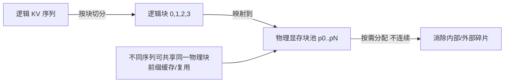

# KV Cache 与 PagedAttention

> 自回归生成时，每一步都要重算前面所有 token 的 Key/Value，成本高且浪费。KV Cache 通过缓存避免重复计算；PagedAttention 进一步把 KV 的显存管理从"连续大块"变成"按需分页"，是 vLLM / MindIE 等高吞吐推理框架的基石。

关联：[Transformer 模型详解](Transformer模型详解.md) · [flash_attention](flash_attention.md) · [推理性能指标 TTFT TPOT Throughput](../../04模型推理/推理性能指标%20TTFT%20TPOT%20Throughput.md)

---

## 图示速览

**PagedAttention 核心思想**：逻辑 KV 序列按块切分，再映射到不连续的物理显存块池，按需分配、不同序列可共享同一物理块（前缀缓存），从而消除碎片。

## 1. 为什么需要 KV Cache

自回归解码：第 `t` 步的 token 注意力要计算 `query_t` 与**所有历史 key/value** 的点积。

- 没有缓存：每生成一个 token，都要对前面 `1..t-1` 全部重新做线性投影得到 K/V，计算量 `O(t²)`，不可接受。
- 有缓存：在 prefill 阶段一次性算好所有位置的 K/V 并**存下来**，之后每步只算当前 `query_t`，与缓存拼接做注意力。计算量从 `O(t²)` 降到 `O(t)`（每步只算 1 个 query）。

> 代价：KV 必须常驻显存，且随 batch、序列长度线性增长——这正是长上下文推理的显存瓶颈。

---

## 2. KV Cache 显存占用公式

对任意一层，KV 缓存大小（字节）：

$$\text{Mem} = 2 \times B \times S \times n_{\text{layers}} \times n_{\text{heads}} \times d_{\text{head}} \times \text{precision\_bytes}$$

其中系数 `2` 来自 Key 和 Value 各一份；`B` 是 batch，`S` 是当前序列长度。

例：7B 模型（32 层、32 头、128 维、FP16=2B），序列 4k、batch 32：

$$2 \times 32 \times 4096 \times 32 \times 32 \times 128 \times 2 \approx 1.1\ \text{GB}$$

> 注意：GQA（分组查询注意力，见 LLaMA/Mistral）通过减少 K/V 头数，能把 KV 显存砍到 1/8~1/4，是长上下文与高并发的关键（[LLaMA 系列架构演进](../01模型结构/01LLM模型/llama/LLaMA系列架构演进.md)）。

---

## 3. 朴素 KV Cache 的问题

传统实现为每个序列预留**连续且预留最大长度**的显存块：

- **内部碎片**：实际序列远短于 `max_len`，大量预留空间浪费。
- **外部碎片**：序列长度动态变化，连续大块难复用。
- **不能共享**：同一 system prompt 下多个并发请求的 prefix KV 被重复存储。

实际显存利用率往往只有 20%~40%，限制了并发（batch）上限。

---

## 4. PagedAttention（vLLM 提出）

核心类比：**像操作系统虚拟内存一样，把 KV 分成固定大小的"页（block）"，非连续存放**。

- KV 被切分为 block（如每块 16 个 token 的 KV）。
- 用一张"块表（block table）"记录逻辑位置 → 物理块的映射。
- 生成时按需要分配新块，序列增长不再要求连续大块。

带来的收益：

1. **近乎零碎片**：块可分散在显存任意位置，利用率 >95%。
2. **显存共享（copy-on-write）**：多个请求共享同一 prompt 前缀时，指向相同的物理块，只在分歧处复制，大幅节省 KV（对 few-shot / 多轮对话极有效）。
3. **更高的并发**：同样显存能塞下更多序列 → 吞吐上升。

> 昇腾 MindIE 的 KV 管理同样采用分页/块化思路（Paged KV Cache），在 `ATB`/`MindIE-LLM` 中通过 `block_size` 等参数配置，与 vLLM 设计同源。

---

## 5. 与其他优化的关系

| 技术 | 解决什么 | 与 KV Cache 的关系 |
| --- | --- | --- |
| GQA / MQA | 减少 K/V 头数 | 直接缩小 KV 体积 |
| PagedAttention | 显存碎片与共享 | KV 的存储组织方式 |
| 前缀缓存（Prefix Cache） | 重复 prompt 前缀 | 复用已计算的 KV 块 |
| KV 量化（INT8/FP8） | 减小单元素字节 | KV 内容的精度压缩 |
| 投机解码 | 加速 decode | 不改 KV，但依赖稳定的 KV 复用 |

---

## 6. TODO / 延伸

- [ ] 动手：用伪代码实现 block table 的"按 token 索引定位物理块"。
- [ ] 深入：PagedAttention 与 Continuous Batching 如何协同（[服务化部署 Continuous Batching](../../04模型推理/服务化部署%20Continuous%20Batching.md)）。
- [ ] 量化：KV Cache INT8/FP8 对长上下文吞吐的实测影响。
- [ ] 昇腾：MindIE 中 `block_size` 对不同 batch/序列分布的敏感度实验。
