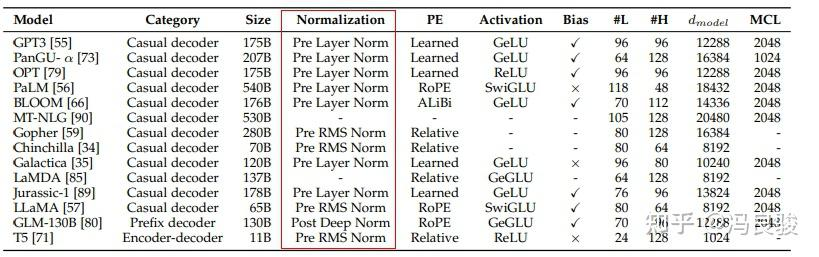
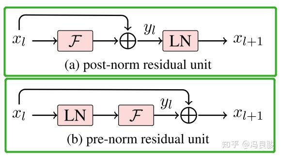
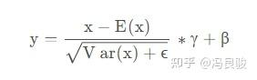
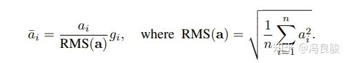
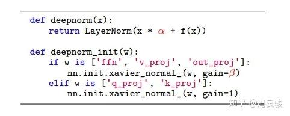
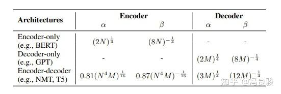

# Norm

当前主流大模型使用的Normalization主要有三类，分别是Layer Norm，[RMS Norm](https://zhida.zhihu.com/search?content_id=225975397&content_type=Article&match_order=1&q=RMS+Norm&zhida_source=entity)，以及Deep Norm，这里依次介绍他们的异同



这里的 Pre 和 Post 是指 Normalization在结构中的位置



一般认为，Post-Norm在残差之后做归一化，对参数正则化的效果更强，进而模型的收敛性也会更好；而Pre-Norm有一部分参数直接加在了后面，没有对这部分参数进行正则化，可以在反向时防止[梯度爆炸](https://zhida.zhihu.com/search?content_id=225975397&content_type=Article&match_order=1&q=梯度爆炸&zhida_source=entity)或者[梯度消失](https://zhida.zhihu.com/search?content_id=225975397&content_type=Article&match_order=1&q=梯度消失&zhida_source=entity)，大模型的训练难度大，因而使用Pre-Norm较多。

### **1. Layer Norm** ([Layer Normalization](https://link.zhihu.com/?target=https%3A//arxiv.org/abs/1607.06450))

LayerNorm是大模型也是[transformer结构](https://zhida.zhihu.com/search?content_id=225975397&content_type=Article&match_order=1&q=transformer结构&zhida_source=entity)中最常用的归一化操作，简而言之，它的作用是 *对特征张量按照某一维度或某几个维度进行0均值，1方差的归一化* 操作，计算公式为：



这里的 可以理解为 *张量中具体某一维度的所有元素*，比如对于 shape 为 (2,2,4) 的张量 input，若指定归一化的操作为第三个维度，则会对第三个维度中的四个张量（2,2,1），各进行上述的一次计算

这里结合PyTorch的nn.LayerNorm算子来看比较明白：

```text
nn.LayerNorm(normalized_shape, eps=1e-05, elementwise_affine=True, device=None, dtype=None)
```

- normalized_shape：归一化的维度，int（最后一维）list（list里面的维度），还是以（2,2,4）为例，如果输入是int，则必须是4，如果是list，则可以是[4], [2,4], [2,2,4]，即最后一维，倒数两维，和所有维度
- eps：加在分母方差上的偏置项，防止分母为0
- elementwise_affine：是否使用可学习的参数 和 ，前者开始为1，后者为0，设置该变量为True，则二者均可学习随着训练过程而变化

### **2. RMS Norm**（[Root Mean Square Layer Normalization](https://link.zhihu.com/?target=https%3A//arxiv.org/abs/1910.07467)）

与layerNorm相比，RMS Norm的主要区别在于去掉了减去均值的部分，计算公式为：



这里的 与Layer Norm中的 等价，作者认为这种模式在简化了Layer Norm的同时，可以在各个模型上减少约 7%∼64% 的计算时间

代码实现：[https://github.com/bzhangGo/rmsnorm](https://link.zhihu.com/?target=https%3A//github.com/bzhangGo/rmsnorm)

### **3. Deep Norm** （[Deep Normalization](https://link.zhihu.com/?target=https%3A//arxiv.org/pdf/2203.00555.pdf)）

Deep Norm是对Post-LN的的改进，具体的：



- DeepNorm在进行Layer Norm之前会以 参数扩大[残差连接](https://zhida.zhihu.com/search?content_id=225975397&content_type=Article&match_order=1&q=残差连接&zhida_source=entity)
- 在Xavier参数初始化过程中以 减小部分参数的初始化范围

一些模型的具体参数使用方法如下：



这里N和M分别指编码和解码器的层数

论文中，作者认为 Post-LN 的不稳定性部分来自于*梯度消失*以及*太大的模型更新*，同时，有以下几个理论分析

- 定义了“预期模型更新”的概念表示 模型更新的规模量级
- 证明了 和 不会改变注意力输出大小数量级的界限，因而 并没有缩小这部分参数
- 模型倾向于*累积每个子层的更新*，从而*导致模型更新量呈爆炸式增长*，从而使*早期优化*变得不稳定
- 使用Deep Norm 的 "预期模型更新"，在参数 取值适当的时候，以*常数为界*

同时，作者通过实验证实了Deep Norm在训练深层transformer模型的时候具备近乎恒定的更新规模，成功训练了1000层transformer的模型，认为Deep Norm在具备 *Post-LN 的良好性能* 的同时又有 *Pre-LN 的稳定训练*

代码实现：[https://github.com/microsoft/to](https://link.zhihu.com/?target=https%3A//github.com/microsoft/torchscale)

### 参考

1. [昇腾大模型|结构组件-1——Layer Norm、RMS Norm、Deep Norm](https://zhuanlan.zhihu.com/p/620297938)

