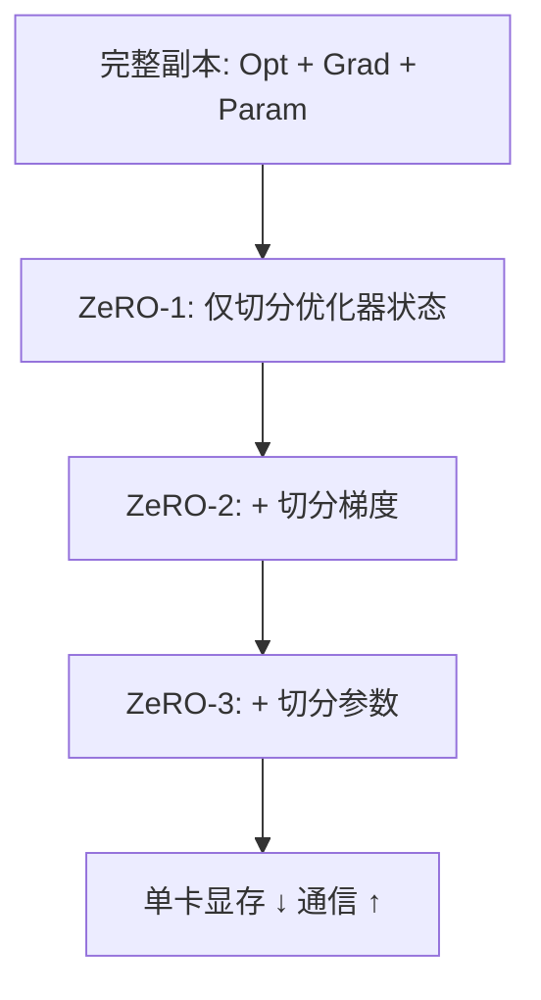

# ZeRO 与优化器状态切分

> 数据并行（DP）下每张卡都完整存一份模型、梯度、优化器状态，显存浪费严重。ZeRO（Zero Redundancy Optimizer）通过"分片（sharding）"把这三部分沿 DP 维度切开，在几乎不损计算效率的前提下把单卡显存压到 `1/N`。

关联：[模型并行知识](../02模型训练/训练并行/模型并行知识.md) · [内存计算](../02模型训练/内存计算.md) · [混合精度训练 FP16 BF16 FP8](混合精度训练%20FP16%20BF16%20FP8.md)

---

## 图示速览

**ZeRO 分片递进**：ZeRO-1 只切优化器状态，ZeRO-2 再加梯度，ZeRO-3 进一步切参数。切得越细单卡显存越低，但跨卡通信越多。

## 1. 数据并行的显存冗余

标准 DP（每张卡复制完整模型）的单卡显存 = `参数Ψ + 梯度Ψ + 优化器状态(Adam: 4Ψ for FP32 master+动量+方差 + 参数副本)`。以 Adam + FP32 主权重计，优化器状态就占 `12Ψ` 字节，是显存大头。

ZeRO 的核心："既然 DP 各卡在每一步算的是同一批参数的不同 micro-batch，那优化器状态/梯度/参数**没必要每卡都存全份**，切成 N 份、各管一份即可"。

---

## 2. ZeRO 的三个阶段

| 阶段 | 切分对象 | 单卡显存（近似） | 额外通信 |
| --- | --- | --- | --- |
| ZeRO-0（纯 DP） | 无 | `16Ψ`（含 12Ψ 优化器） | 仅梯度 AllReduce |
| **ZeRO-1** | 优化器状态 | `~4Ψ + 12Ψ/N` | 优化器状态 All-Gather（极少） |
| **ZeRO-2** | 优化器状态 + 梯度 | `~2Ψ + 2Ψ/N + 12Ψ/N` | 梯度 Reduce-Scatter 替代 AllReduce |
| **ZeRO-3** | 优化器状态 + 梯度 + 参数 | `~(16Ψ)/N` | 前向/反向前各做一次参数 All-Gather |

- **ZeRO-1**：只切优化器状态，最省事、通信几乎不变，性价比最高。
- **ZeRO-2**：再切梯度，反向时 Reduce-Scatter 直接得到分片梯度，省一次全量 AllReduce。
- **ZeRO-3**（aka 全分片 / Fully Sharded）：参数也切分，用时 All-Gather 拼回，单卡显存随 DP 数线性下降，但**通信量上升**（每层前向/反向各一次参数收集）。

> 直觉：ZeRO 把"冗余副本"换成"按需收集 + 分片存储"，用通信换显存。

---

## 3. ZeRO-3 的注意事项

- **参数 All-Gather 通信**：每层前向开始时收集参数、用完即弃，反向同理。通信与计算可重叠（overlap），但实现不好会拖慢。
- **大参数层激活**：ZeRO 不分片激活，长序列/大 batch 下激活仍是瓶颈 → 需配合[序列并行](序列并行与长上下文训练.md)或激活重算（activation recomputation / checkpointing）。
- **offload（ZeRO-Offload / ZeRO-Inference）**：把优化器状态/参数卸载到 CPU/NVMe，用计算换显存，适合显存极小但要跑大模型的场景，代价是 CPU↔GPU 带宽。

---

## 4. ZeRO 与 FSDP

- **FSDP（PyTorch Fully Sharded Data Parallel）** ≈ ZeRO-3：参数、梯度、优化器状态全分片，包裹每个 module。
- 工程上：DeepSpeed 实现 ZeRO-1/2/3；PyTorch 原生用 FSDP（近 ZeRO-3）；二者思想一致，选型看框架栈。
- **昇腾 MindSpeed / MindSpore**：MindSpeed 的 Megatron 式并行已整合 ZeRO 风格优化器状态切分；MindSpore 的 `model_parallel` + `optimizer_shard` 也实现等价能力。

---

## 5. 与张量/流水并行的组合

ZeRO 是**数据并行维度**的优化，可与 TP/PP/CP 正交叠加：

- 典型配置：`TP × PP × (DP+ZeRO)`。ZeRO 作用在 DP 这一维，不影响 TP/PP 的通信模式。
- 超大模型（如 DeepSeek-V3 671B）往往 **TP/PP/EP（专家并行）为主干 + ZeRO-1 管优化器状态**，而非 ZeRO-3，因为 TP/PP 已把参数切开，再上 ZeRO-3 通信代价过高。

---

## 6. TODO / 延伸

- [ ] 推导：ZeRO-3 下单卡显存何时优于"TP=8 + ZeRO-1"，给定卡数与层大小。
- [ ] 深入：ZeRO-3 的 All-Gather 与计算重叠（overlap）实现要点。
- [ ] 实验：同一 7B 在 ZeRO-1 vs ZeRO-3 下的吞吐/显存对比（昇腾 MindSpeed）。
- [ ] 对比：ZeRO-Offload 的 CPU 带宽瓶颈在 910B 上的实测。
