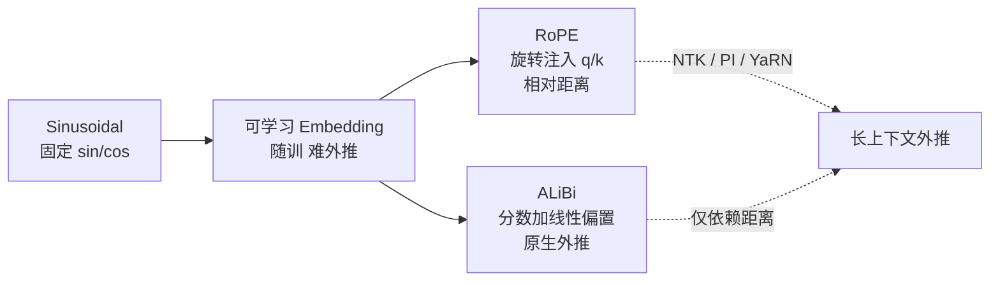

# 位置编码：RoPE 与 ALiBi

> 自注意力本身对词序不敏感（置换等变），必须用位置编码把"位置"注入序列。本文梳理绝对/相对位置编码的演进，重点讲清当前主流的两类：**RoPE（旋转位置编码）** 与 **ALiBi（线性偏置）**。

关联：[Transformer 模型详解](Transformer模型详解.md) · [注意力头](注意力头.md) · [LLM 中的上下文长度](LLM中的上下文长度.md)

---

## 图示速览

**位置编码演进全景**：从绝对（Sinusoidal / 可学习）走向相对（RoPE 旋转注入、ALiBi 分数偏置），RoPE/ALiBi 因天然相对性与强外推成为主流。

## 1. 为什么需要位置编码

- 自注意力对输入顺序无感知：`Attention(x, y) == Attention(permute(x), permute(y))`。
- 没有位置信息，模型把 "猫 吃 鱼" 和 "鱼 吃 猫" 看成同一件事。
- 目标：让表示携带位置（或相对距离）信息，同时尽量**外推（extrapolation）**到更长的训练时未见过的序列。

---

## 2. 绝对位置编码：从 Sinusoidal 到可学习

| 方案 | 做法 | 问题 |
| --- | --- | --- |
| Sinusoidal（原始 Transformer） | 用不同频率的 sin/cos 生成固定位置向量，加到 token 嵌入 | 相对位置关系不显式，长度外推差 |
| 可学习 Embedding | 随机初始化一个 `(max_len, d)` 的位置表，随训 | 超出 `max_len` 无法泛化；相对距离需模型自己学 |

绝对位置编码把"第 i 个位置"当独立符号，对"距离"的建模是隐式的，难以外推。

---

## 3. RoPE（Rotary Position Embedding，旋转位置编码）

核心思想：**不直接加位置向量，而是用旋转矩阵把"位置"编码进 q/k 向量的几何结构里**，使得两个位置的注意力得分只与它们的**相对距离**有关。

### 3.1 直观

- 把每个头的维度 `d` 两两配对 `(x_{2k}, x_{2k+1})`，看成二维平面上的向量。
- 对位置 `m` 的向量施加一个角度为 `m·θ_k` 的旋转：`R(Θ_m)`。
- 旋转操作在复数/二维平面上就是乘一个旋转矩阵，**点积在旋转下保持相对角度关系**。

### 3.2 公式

对位置 `m` 的查询/键向量 `x`，旋转后：

$$q_m = R(\Theta_m)\,x_m,\qquad k_n = R(\Theta_n)\,x_n$$

其中旋转角频率按维度递减：

$$\Theta_m = \mathrm{diag}(m\theta_1,\,m\theta_2,\,\dots,\,m\theta_{d/2}),\quad \theta_k = 10000^{-2k/d}$$

于是注意力内积满足**相对性**：

$$q_m^\top k_n = (R_m x_m)^\top (R_n x_n) = x_m^\top R_{n-m}\,x_n$$

即只依赖 `m - n`，天然是**相对位置编码**。

### 3.3 工程要点

- **逐头独立旋转**，实现上可用 `float32` 预计算 `cos/sin` 表，再用 `q,k` 与 `cos/sin` 做乘加融合（见 [flash_attention](flash_attention.md) 的 IO-Aware 思路）。
- **长上下文外推**：原生 RoPE 在超过训练长度后性能骤降。常用手段：
  - **NTK-aware scaling**：把 `base`（默认 10000）调大，让高频维度承担更多位置信息。
  - **Position Interpolation（PI）**：推理时把位置索引从 `[0, L_train]` 线性压缩到 `[0, L_new]`，训练长度内几乎无损。
  - **YaRN / LongRoPE**：结合 NTK 与插值，兼顾高频细节与低频趋势。
- **现状**：LLaMA 系列、Qwen、DeepSeek（V3/R1）、ChatGLM 均使用 RoPE，是事实标准。

> 昇腾侧：MindSpeed / MindIE 已内置 RoPE 算子与位置插值（PI/YaRN）配置，长上下文训练/推理时通过 `rotary_base`、`rope_scaling` 等参数控制，无需手写。

---

## 4. ALiBi（Attention with Linear Biases）

思路完全不同：**完全不往输入加位置向量**，而是在注意力分数上直接加一个与距离成线性反比的偏置。

$$\mathrm{score}(q_m, k_n) = \frac{q_m^\top k_n}{\sqrt{d}} - s\cdot|m-n|$$

- `s` 是每 head 一个的斜率（按 head 序号几何递减），决定"惩罚长距离"的强度。
- `|m-n|` 越大，偏置越负，模型越倾向关注近处 token。

### 4.1 优点

- **零额外参数、不占序列维度**，训练和推理都简单。
- **长度外推极强**：因为偏置只依赖相对距离，没见过的长序列上表现几乎不衰减（训练 2k 可直接用到 10k+）。
- 对长文档、检索类任务友好。

### 4.2 缺点

- 相对位置是"软偏置"而非"硬编码"，对需要精细位置感的生成任务略弱。
- 与 RoPE 相比生态小（BLOOM、MPT、T5 变体用过；LLaMA/Qwen/DeepSeek 选 RoPE）。

---

## 5. 选型速查

| 维度 | RoPE | ALiBi |
| --- | --- | --- |
| 位置注入点 | q/k 向量旋转 | 注意力分数偏置 |
| 相对位置 | ✅ 内积天然依赖距离 | ✅ 偏置依赖距离 |
| 长度外推 | 需 NTK/PI/YaRN 辅助 | 原生强外推 |
| 额外算力 | 低（融合算子） | 几乎为零 |
| 主流采用 | LLaMA/Qwen/DeepSeek/Mistral | BLOOM/MPT |

> 实践建议：做通用生成大模型优先 RoPE + 位置插值；做超长上下文/检索且不想调插值超参时，ALiBi 更省心。

---

## 6. TODO / 延伸

- [ ] 代码级：用 numpy 实现一个最小 RoPE 并验证 `(q_m·k_n)` 只依赖 `m-n`。
- [ ] 深入：YaRN 的注意力温度缩放（attention temperature）为何能缓解分布偏移。
- [ ] 对比：T5 的桶式相对位置（relative bias bucket）与 RoPE/ALiBi 的差异。
- [ ] 昇腾：在 MindSpeed 中配置 `rope_scaling= yarn` 长训实验记录。
