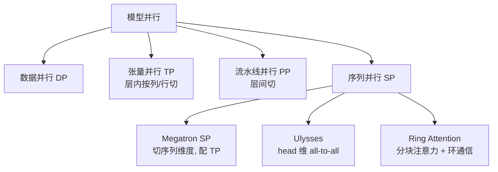

# 序列并行与长上下文训练

> 张量并行（TP）/流水并行（PP）切的是"层内/层间"维度，但**序列长度维**在长上下文下仍是巨大负担：激活显存随序列长度线性膨胀，注意力计算随长度平方增长。序列并行（SP）专门切"序列维"，并催生了 Ulysses、Ring Attention 等长上下文训练范式。

关联：[ZeRO 与优化器状态切分](ZeRO与优化器状态切分.md) · [模型并行知识](../02模型训练/训练并行/模型并行知识.md) · [KV Cache 与 PagedAttention](KV%20Cache与PagedAttention.md) · [LLM 中的上下文长度](LLM中的上下文长度.md)

---

## 图示速览

**并行策略谱系**：序列并行（Megatron SP / Ulysses / Ring Attention）与 TP、PP、DP 并列，专门解决超长序列下激活显存与注意力计算的分片问题。

## 1. 为什么需要序列并行

设 TP 已把每层线性切到 `t` 张卡，但有一部分算子**对序列维度操作、与 TP 不兼容**：

- LayerNorm / RMSNorm、Dropout、逐 token 的激活函数（SwiGLU 等）是**序列并行（sequence-parallel）**的——它们沿序列维独立，可以安全地再沿序列切分。
- 这些算子在 TP 下需要**全序列（all-gather）**，否则 TP 通信会打断；于是 Megatron 把"序列并行"与"张量并行"配对：TP 的线性层前后用 all-gather/reduce-scatter 在序列维收放。

效果：激活显存从 `S`（序列长度）降到 `S/t`，长序列训练显存显著下降。

---

## 2. Megatron-LM 式序列并行（SP）

- 与 TP 绑定：`linear(TP) → dropout/norm(SP) → linear(TP)`。
- 在 TP 的列/行并行之间，用 **reduce-scatter（前向输入切小）** 与 **all-gather（反向恢复）** 管理序列分片。
- 通信量可控，且与 TP 通信重叠。是当前 MoE/稠密大模型训练的事实标准组合（`TP × CP/SP × PP × DP`）。

---

## 3. Ulysses 序列并行（上下文并行 CP 的一种）

思路不同：**沿注意力头切分序列**。

1. 输入序列沿长度切成 `p` 份，用 **all-to-all** 转置为"每卡持有全部序列、但只有 `1/p` 的头"。
2. 各卡对自己负责的头做**完整序列注意力**（因为序列完整，注意力是全局正确的）。
3. 再用 **all-to-all** 转回"每卡持有 `1/p` 序列、全部头"。
4. 前向/反向用 ring-style 的 all-to-all 重叠通信与计算。

优点：注意力计算完全正确（无近似），适合**超长上下文 + 注意力密集**；与 Ulysses 配合的还有把 FFN 走 TP 的混合并行。

---

## 4. Ring Attention（环形注意力）

目标：**让上下文长度突破单卡显存上限**，近似"无限长"。

- 把长序列切成块，分布到 `p` 张卡；每张卡只持有 1 个 query 块和 1 个 KV 块。
- 注意力用 **在线 softmax（online softmax）**：分块计算 `max/sum/exp`，KV 块沿**环（ring）** 在卡间传递，每张卡的 query 依次与所有 KV 块交互。
- 通信（KV 块传递）与计算（当前块注意力）**完全重叠**，环转一圈即完成全局注意力。
- 显存只与单块大小有关 → 可训练**百万级 token** 上下文（需与 Ulysses 或 sequence parallel 组合管理非注意力层）。

---

## 5. 长上下文训练的其他拼图

| 技术 | 解决 | 说明 |
| --- | --- | --- |
| 序列并行 / Ulysses | 激活与注意力随长度爆炸 | 切序列维 |
| Ring Attention | 单卡显存限制最大长度 | 环形分块注意力 |
| RoPE 位置插值（NTK/PI/YaRN） | 超出训练长度后退化 | 见[位置编码 RoPE 与 ALiBi](位置编码%20RoPE与ALiBi.md) |
| 数据侧"打包/课程" | 长样本稀少、效率低 | 长短样本混合、逐步加长 |
| 线性/稀疏注意力 | 平方复杂度 | 局部窗口 + 全局 token（如 Mistral sliding window） |

> 昇腾 MindSpeed 已支持上下文并行（CP/Ulysses 类）与序列并行，配合 Ring Attention 思路可在 910B 集群上训长上下文；调参重点是 all-to-all 带宽与计算重叠比。

---

## 6. TODO / 延伸

- [ ] 推导：Ring Attention 在 `p` 卡、序列 `S` 时，单卡峰值激活显存与 `S/p` 的关系。
- [ ] 深入：Ulysses all-to-all 与 Megatron SP 的通信量对比（同卡数、同序列）。
- [ ] 实验：在 MindSpeed 开启 CP=4 训练 32k 上下文，记录激活显存与 step 时间。
- [ ] 对比：YaRN 位置插值在长上下文训练初期 vs 推理期加载的差异。
