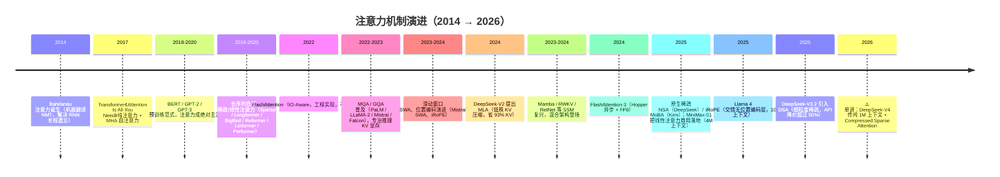
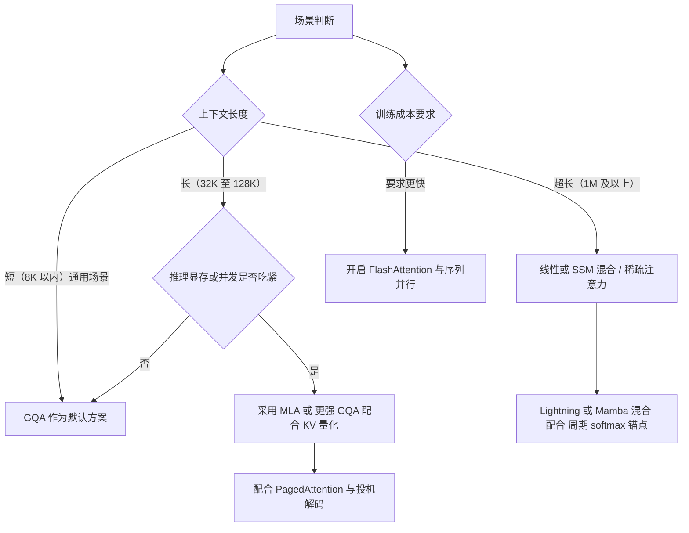

# 注意力机制：历史演进、优劣对比与代表模型（精简版）

> 视角：我是一名 AI 算力工程师。本文是[详细版](注意力机制：历史演进、优劣对比与代表模型（详细版）.md)的浓缩版，面向团队内**开发**与**销售**同事，用最短篇幅讲清：市面上五花八门的"注意力"名词（MHA / MQA / GQA / MLA / 稀疏 / 线性 / FlashAttention / Mamba……）哪些是**数学架构**、哪些是**工程实现**、哪些是**营销话术**，以及它们在**算力、显存、成本**上意味着什么。
>
> 关联阅读：[Transformer 模型详解](../Transformer模型详解.md) · [flash_attention](../flash_attention.md) · [KV Cache 与 PagedAttention](../KV%20Cache与PagedAttention.md) · [位置编码 RoPE 与 ALiBi](../位置编码%20RoPE与ALiBi.md)

---

## 0. 核心结论

1. **注意力是 LLM 的算力命门。** 标准自注意力的计算量和显存都随序列长度 **二次方（O(N²)）** 增长——这是长上下文、高并发、低成本推理的**核心瓶颈**。
2. **近几年的所有注意力创新，本质上都在"降本"**：要么压缩 KV（MQA/GQA/MLA），要么跳过不重要 token（稀疏/NSA/DSA），要么把二次方改成线性（线性注意力/Mamba）。没有"免费变强"。
3. **FlashAttention 不是一种新注意力，而是一种更快的**实现**。它计算的仍是标准 softmax 注意力，只是更省显存、更贴合 GPU 内存层次。** 被问及"是否使用 FlashAttention"时，可答：它是训练与 prefill 的标配加速，不改变模型效果。

> 判别框架：**训练看算力（FLOPs）→ 推理解码看显存带宽 → 长上下文看显存容量。** 不同注意力变体，打的是这三维里不同的痛点。

---

## 1. 注意力是什么

标准缩放点积注意力：

$$
\text{Attention}(Q,K,V) = \text{softmax}\!\left(\frac{QK^{\top}}{\sqrt{d}}\right)V
$$

每个 token 产出 Query（要找什么）、Key（是什么）、Value（能提供什么），Query 与所有 Key 算相似度归一化后加权求和所有 Value。直觉：生成第 t 个词时，决定"回头看前面哪些词、各看多少"。多头注意力（MHA）把这套并行跑 h 份、各学不同的关注子空间，最后拼接。

- $QK^{\top}$ 这个 $N\times N$ 矩阵就是二次方复杂度的物理载体，所有优化都围绕它展开。

---

## 2. 演进时间线

**演进主线**：全算（MHA）→ 算得巧（稀疏/窗口）→ 存得少（MQA/GQA/MLA）→ 算得省（线性/SSM）→ 三者混合 + 软硬协同（NSA/DSA/iRoPE）。

---

## 3. 变体家族与总对比

**分类坐标系**（避免混淆）：

| 维度 | 说明 |
| --- | --- |
| 改了数学定义？ | 是否改变了 softmax(QKᵀ)V 本身（如线性注意力用核技巧、MLA 用低秩压缩） |
| 改了 KV 组织？ | 是否只改变 K/V 头数量或存储方式（MQA/GQA/MLA），数学不变 |
| 改了复杂度？ | 是否把 O(N²) 降到 O(N) 或 O(N·k)（稀疏/线性/SSM） |
| 是工程实现？ | 是否数学完全不变、只改计算/存储方式（FlashAttention、PagedAttention） |

> **关键区分**：MQA/GQA/MLA 改的是"KV 长什么样、存多少"，**不是**"注意力算什么"；FlashAttention 连 KV 都没改，只改"怎么算更快"。只有"稀疏/线性/SSM"动了复杂度本身。

**总对比表**：

| 方案 | 类别 | 复杂度 | KV 显存 vs MHA | 训练友好 | 推理友好 | 代表模型 | 一句话点评 |
| --- | --- | --- | --- | --- | --- | --- | --- |
| **MHA** | 架构(基准) | O(N²) | 1×（最大） | ★★★★★ | ★ | BERT/GPT-3/LLaMA-1 | 强但贵 |
| **MQA** | KV组织 | O(N²)算 | ~1/h | ★★★ | ★★★★★ | PaLM/Falcon | 省显存但易致质量下降 |
| **GQA** | KV组织 | O(N²)算 | ~1/g | ★★★★ | ★★★★ | LLaMA-2/Mistral/Qwen | 质量成本平衡点，当前主流 |
| **MLA** | 架构(低秩) | O(N²)算 | ~**1/15**(自报-93%) | ★★★★★ | ★★★★★ | DeepSeek-V2/V3/R1 | 省显存且不损失精度，当前最优之一 |
| **SWA** | 稀疏 | O(N·w) | 同GQA存储 | ★★★★ | ★★★★ | Mistral | 简单好用，靠层叠获长程 |
| **NSA/DSA** | 稀疏(原生可训练) | O(N·k) | MLA级+稀疏 | ★★★ | ★★★★★ | DeepSeek-V3.2 | 长上下文降本+软硬协同 |
| **线性(Lightning等)** | 线性 | **O(N)** | 恒定(无N²) | ★★★ | ★★★★★ | MiniMax-01/RWKV | 灭二次方，但纯线性检索弱 |
| **Mamba/混合** | SSM/混合 | O(N) | 恒定(无KV增长) | ★★★ | ★★★★★ | Jamba/混合模型 | 长序列神器，需混合保检索 |
| **FlashAttention** | **工程实现** | O(N²)算(同MHA) | 不增不减 | ★★★★★ | ★★★★(prefill) | 全行业标配 | 算得更快更省显存，不改效果 |

> ⚠️ 部分"KV 节省倍数""提速倍数"为厂商/论文自报数据，落地到具体硬件（尤其非 NVIDIA 架构，如昇腾）需实测打折；单来源结论已标注。

**最该记住的四种**：
- **GQA**：质量/成本最优平衡，开源模型主流默认。
- **MLA**：低秩压缩 KV，推理省显存且训练不损失精度，DeepSeek 系"便宜"的底层原因。
- **稀疏/线性**：把二次方复杂度压下来，解锁百万字长上下文，纯线性在精确检索上仍偏弱、需混合架构。
- **FlashAttention**：底层加速实现，不是新架构，训练/prefill 标配。

---

## 4. 算力三维剖析

| 阶段 | 瓶颈维度 | 注意力这一环在卡什么 |
| --- | --- | --- |
| **训练 / Prefill** | 算力（FLOPs）+ 显存 IO | N×N 矩阵计算 + 中间矩阵读写 HBM；FA 在这里发力 |
| **推理 Decode（逐 token 生成）** | **显存带宽** | 每生成一个 token 都要把**全部历史 KV** 从 HBM 读进算力单元；KV 越大、带宽越窄，越慢 |
| **长上下文推理** | **显存容量** | KV Cache 随 N 线性膨胀，装不下就 OOM，直接限制并发与上下文长度 |

**KV Cache 显存量化对比**（假设 32 层、d_head=128、FP16、上下文 4096）：

| 方案 | n_kv_heads | 每 token KV | 4k 序列(单请求) | 相对 MHA |
| --- | --- | --- | --- | --- |
| MHA | 32 | 0.5 MB | **2.0 GB** | 1× |
| GQA（8 组） | 8 | 0.125 MB | 0.5 GB | 4× ↓ |
| MQA | 1 | 16 KB | 0.064 GB | 32× ↓ |
| MLA | 压缩潜在(≈512维) | ≈0.03 MB | ≈0.13 GB | ≈15× ↓（自报-93%） |

**结论**：压缩 KV（GQA/MLA）缓解"带宽+容量"瓶颈（解码慢、装不下）；FlashAttention 缓解"算力+IO"瓶颈（训练/prefill 慢）；稀疏/线性缓解"复杂度"瓶颈（长 N 的整体成本）。

> 销售转化：同等算力与 128K 上下文下，"KV 缩减 8~15 倍"约等于相同显存可**容纳 8~15 倍的并发或上下文**，或降低单请求成本——这是 DeepSeek 系列成本优势的底层原因之一。

---

## 5. 选型指南

### 5.1 面向开发的注意力选型指南

- **通用落地**：GQA + FlashAttention + PagedAttention，大多数场景的稳妥选择。
- **极致长上下文 / 低成本推理**：MLA（DeepSeek 路线）或 NSA/DSA 稀疏；或线性混合（MiniMax 路线）。
- **训练超大模型**：FlashAttention-3 + 序列并行 + 梯度检查点；注意力结构本身不宜轻易改动，优先保证精度。

### 5.2 面向销售的客户沟通要点

1. **"KV 压缩（GQA/MLA）意味着以相同成本服务数倍客户。"** 显存缩减 8~15 倍 → 并发与上下文容量提升 → 单请求成本下降。
2. **"FlashAttention 属于底层加速，不改变效果，但使训练与长文本 prefill 更快、更省。"** 可视为"隐形基础设施升级"。
3. **"稀疏 / 线性注意力使百万字文档、超长对话在成本可控下成为可能。"** 需如实说明：纯线性在极长精确检索上仍有短板，当前主流为混合架构。

> 销售注意事项：若客户问及"是否采用 Mamba / 线性注意力替代 Transformer"，而实际仍基于 Transformer+GQA，应如实说明"我们基于成熟的 Transformer 架构，配合 GQA/MLA 压缩与 FlashAttention 加速"，**不应为凸显技术前沿性而夸大架构差异**，否则在 PoC 验证阶段极易暴露。

---

## 6. 常见误区 / 答疑

- **Q：FlashAttention 是一种新的注意力机制吗？** 不是。它算的仍是标准 softmax 注意力，结果完全一致，只是用分块+重算避免了 N×N 矩阵落 HBM，更快更省显存。是"实现优化"，不是"架构创新"。
- **Q：MQA/GQA 会导致质量下降吗？** MQA 早期有质量下降风险，需更充分训练；GQA 几乎不损失精度，已成开源默认；MLA 推理等效 MQA、训练保持 MHA 表达力，基本不损失精度。
- **Q：线性注意力能替代 softmax 吗？** 目前不能全面替代。纯线性在精确检索/复制类任务（大海捞针）上表现会明显下降，业界答案是**混合**（线性/SSM 主力 + 周期性 softmax 锚点）。
- **Q：MLA 为何能既省显存又不损失精度？** 核心是"低秩联合压缩 KV + 矩阵吸收"：只缓存很小的潜在向量，解压矩阵被吸收进 Q/O 投影，推理甚至不显式算 K/V；训练时仍等效 MHA 全表达力。
- **Q：稀疏注意力训练推理不一致吗？** 传统稀疏多在推理阶段做、训练仍是全注意力，会损伤效果；NSA/DSA/MoBA 的关键贡献正是**把稀疏做到可训练**，端到端一致。
- **Q：注意力头数越多越好吗？** 不是。头数增加 KV 显存和计算，边际收益递减；现代模型更倾向"够用的头数 + GQA/MLA 压缩"。

---

## 7. 趋势总结

1. **复杂度主线**：O(N²) → O(N·k) / O(N)。亚二次/线性是确定方向。
2. **训练侧**：FlashAttention 已成事实标准；FA3 吃满 Hopper/FP8，未来看各家 NPU（含昇腾）的 IO-Aware 内核跟进。
3. **推理侧**：GQA 是基线，MLA 是更优，NSA/DSA 类稀疏是长上下文降本的下一站。
4. **架构主线**：纯 Transformer 仍主导，但**混合架构（注意力 + SSM/线性 + MoE）** 是 2024–2026 最清晰的共识。
5. **软硬协同**：NSA/DSA 的"块粒度 + 专用算子"、FA3 的"异步 + 低精度"说明，**注意力优化的天花板在于算法-硬件对齐**，仅改公式不够，还需优化 kernel。

---

## 附录：关键参考文献

| 主题 | 论文 / 模型 | arXiv |
| --- | --- | --- |
| 注意力起源（NMT） | Bahdanau et al. 2014 | 1409.0473 |
| Transformer / MHA | Vaswani et al. 2017 | 1706.03762 |
| MQA | Shazeer 2019 | 1911.02150 |
| GQA | Ainslie et al. 2023 | 2305.13245 |
| FlashAttention | Dao 2022 | 2205.14135 |
| FlashAttention-3 | Shah et al. 2024 | 2407.08608 |
| DeepSeek-V2 / MLA | DeepSeek-AI 2024 | 2405.04434 |
| Mamba-2 / SSD | Dao & Gu 2024 | 2405.21060 |
| NSA（原生稀疏） | Yuan et al. 2025 | 2502.11089 |
| MiniMax-01 / Lightning | MiniMax 2025 | 2501.08313 |
| DeepSeek-V3.2 / DSA | DeepSeek-AI 2025 | 2512.02556 |

> 完整索引与逐变体技术细节见[详细版](注意力机制：历史演进、优劣对比与代表模型（详细版）.md)。注：DeepSeek-V4（2026，1M 上下文 + Compressed Sparse Attention）仅见单来源，**未获官方技术报告，不可作为确定性结论对外引用**；厂商自报倍数一律视为上限，落地需实测。
