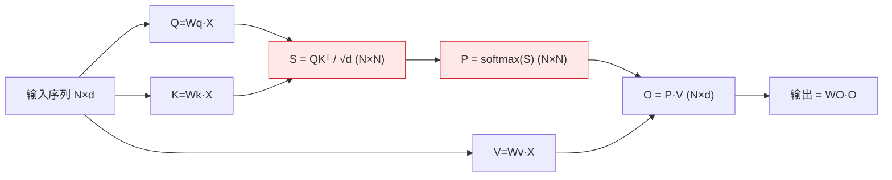
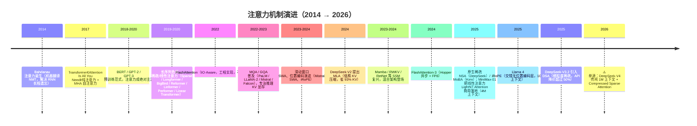
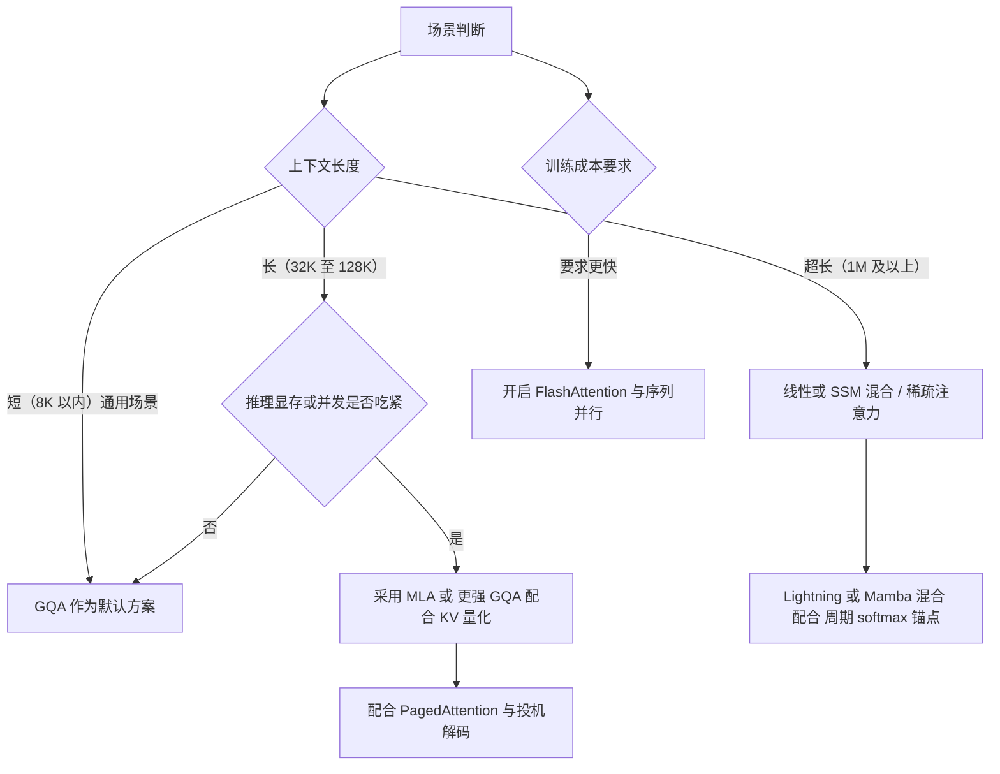

# 注意力机制：历史演进、优劣对比与代表模型

> 视角：我是一名 AI 算力工程师。本文面向团队内从事**开发**与**销售**工作的同事，旨在将市面上五花八门的"注意力"名词（MHA / MQA / GQA / MLA / 稀疏 / 线性 / FlashAttention / Mamba……）系统梳理清楚：哪些是**数学架构**、哪些是**工程实现**、哪些是**营销话术**，以及它们到底在**算力、显存、成本**上意味着什么。
>
> 关联阅读：[Transformer 模型详解](../Transformer模型详解.md) · [flash_attention](../flash_attention.md) · [KV Cache 与 PagedAttention](../KV%20Cache与PagedAttention.md) · [位置编码 RoPE 与 ALiBi](../位置编码%20RoPE与ALiBi.md) · **[精简版](注意力机制：历史演进、优劣对比与代表模型（精简版）.md)**（面向快速浏览与销售答疑）

---

## 0. 核心结论

1. **注意力是 LLM 的算力命门。** 标准自注意力的计算量和显存都随序列长度 **二次方（O(N²)）** 增长——这是长上下文、高并发、低成本推理的**核心瓶颈**。
2. **近几年的所有注意力创新，本质上都在"降本"**：要么压缩 KV（MQA/GQA/MLA），要么跳过不重要 token（稀疏/NSA/DSA），要么把二次方改成线性（线性注意力/Mamba）。没有哪一个是"免费变强"。
3. **FlashAttention 不是一种新注意力，而是一种更快的**实现**。它计算的仍是标准 softmax 注意力，只是更省显存、更贴合 GPU 内存层次。** 当被问及"是否使用了 FlashAttention"时，可回答：它是训练与 prefill 阶段的标配加速手段，不改变模型效果。

> 算力工程师的判别框架：**训练看算力（FLOPs）→ 推理解码看显存带宽 → 长上下文看显存容量。** 不同注意力变体，打的是这三维里不同的"痛点"。

---

## 1. 注意力机制的工作原理

把注意力想成一次**带权检索 / 软查表**：

- 每个 token 生成三个向量：**Query（我要找什么）**、**Key（我是什么）**、**Value（我能提供什么信息）**。
- Query 去和所有 Key 算相似度（点积），用 softmax 归一化成一组权重，再用这组权重对所有 Value 做**加权求和**，得到这一个 token 的新表示。
- 直觉：模型在生成第 t 个词时，决定"应该回头看前面哪些词、各看多少"。

标准缩放点积注意力公式：

$$
\text{Attention}(Q,K,V) = \text{softmax}\!\left(\frac{QK^{\top}}{\sqrt{d}}\right)V
$$

- $Q,K,V \in \mathbb{R}^{N\times d}$，$N$ 是序列长度，$d$ 是头维度。
- $QK^{\top}$ 是一个 $N\times N$ 的"注意力矩阵"——**它的大小就是二次方的来源**。
- 复杂度：单头 $\mathcal{O}(N^2 d)$，多头再乘头数；训练/prefill 的总 FLOPs 约正比于 $N^2 d$。

**多头注意力（MHA）** 就是把上面这套并行跑 $h$ 份、各自学不同的"关注子空间"，最后拼接。Multi-Head 是默认配置。

> 红色框（$N\times N$ 矩阵）就是二次方复杂度的物理载体，后续所有优化都围绕它展开。

---

## 2. 演进时间线

**演进主线**：从"全算（MHA）" → "算得巧（稀疏/窗口）" → "存得少（MQA/GQA/MLA）" → "算得省（线性/SSM）" → "三者混合 + 软硬协同（NSA/DSA/iRoPE）"。

---

## 3. 注意力变体家族与优劣对比

先给一个**分类坐标系**，避免混淆：

| 维度 | 说明 |
| --- | --- |
| 改了数学定义？ | 是否改变了 softmax(QKᵀ)V 本身（如线性注意力用核技巧替代 softmax、MLA 用低秩压缩） |
| 改了 KV 组织？ | 是否只改变 K/V 头的数量或存储方式（MQA/GQA/MLA），数学不变 |
| 改了复杂度？ | 是否把 O(N²) 降到 O(N) 或 O(N·k)（稀疏/线性/SSM） |
| 是工程实现？ | 是否数学完全不变、只改计算/存储方式（FlashAttention、PagedAttention） |

> **关键区分**：MQA/GQA/MLA 改的是"KV 长什么样、存多少"，**不是**"注意力算什么"；FlashAttention 连 KV 都没改，只改"怎么算更快"。只有"稀疏/线性/SSM"这一类动了复杂度本身。

### 3.1 MHA（标准多头注意力）

- **核心**：每个头独立一套 Q/K/V，n_q = n_kv = h。
- **优点**：表达力最强、训练最稳，是 Transformer 的默认配置。
- **缺点**：KV Cache 最大——每个 token 每层要存 $2\times h\times d$ 个元素，长上下文推理的显存/带宽杀手。
- **代表**：初代 Transformer、BERT、GPT-2/3、LLaMA-1、原始 ViT。

### 3.2 MQA（多查询注意力，Shazeer 2019；PaLM 2022 大规模验证）

- **核心**：**所有查询头共享同一份 K/V**（n_kv = 1）。
- **优点**：KV Cache 直接砍到 MHA 的 $1/h$，推理显存与带宽大幅释放，解码吞吐显著上升。
- **缺点**：早期被诟病存在质量下降（表达力减弱、精度损失），需更充分训练弥补；极端共享有时会影响长程检索。
- **代表**：PaLM、Falcon、StarCoder、GPT-4（业界普遍认为使用 MQA 或 GQA）。

### 3.3 GQA（分组查询注意力，2023）

- **核心**：折中——把 h 个查询头分成 g 组，**每组共享 1 份 K/V**（n_kv = g，典型 g=8）。
- **优点**：KV 比 MHA 小 g 倍，几乎不损失精度；是"质量/成本"的最优平衡点。
- **缺点**：仍比 MQA 多存 g 倍 KV；g 是超参要调。
- **代表**：LLaMA-2（70B 用 8 组）、Mistral、Gemma、Qwen 系列。**目前开源主力模型的默认选择。**

### 3.4 MLA（多头潜在注意力，DeepSeek-V2 2024）

- **核心**：**低秩联合压缩 KV**——把 K/V 压成一个很小的"潜在向量" $c^{KV}$（DeepSeek-V2 中维度仅 512），推理时只缓存这个潜在向量；再利用矩阵乘法结合律，把解压矩阵"吸收"进 Q、O 的投影里，连显式 K/V 都不用算。
- **优点**：KV 比 MHA 小约 **93.3%**（DeepSeek 自报），接近 MQA 的省显存水平，但**训练侧仍保持 MHA 级别的表达力**（不牺牲质量）。同时配 RoPE 用"解耦共享 Key"以免破坏吸收特性。
- **缺点**：实现复杂（要吸收矩阵、解耦 RoPE）；是 DeepSeek 家族的"独门"设计，生态工具链适配需专门做。
- **代表**：DeepSeek-V2 / V3 / V3.2、DeepSeek-R1。**这是当前"省显存且不损失精度"的最优方案之一。**

### 3.5 稀疏 / 窗口注意力（SWA、Longformer、BigBird、NSA、DSA、MoBA）

- **核心**：不是所有 token 都互相看——只看局部窗口、或只看"重要"的块（top-k）。复杂度从 O(N²) 降到 O(N·w) 或 O(N·k)。
- **代表与差异**：
  - **SWA（滑动窗口，Mistral）**：只看附近 w 个 token，O(N·w)，靠堆叠层获得"等效长程"；简单、推理友好。
  - **Longformer / BigBird**：组合局部窗口 + 随机/全局 token，理论上可到 O(N)。
  - **NSA（Native Sparse Attention，DeepSeek 2025）**：**训练阶段就稀疏**（此前稀疏多在推理阶段做，训练与推理不一致会导致质量下降），以"块"为粒度 + 压缩/选择/滑动三分支，软硬协同，长文本提速约 11×，性能可比全注意力。
  - **DSA（DeepSeek-V3.2，2025）**：在 MLA 之上叠加"闪电索引器 + 细粒度 top-k token 选择"，把复杂度降到 O(N·k)；**API 降价 >50%**，是 MLA 与稀疏的融合。
  - **MoBA（Kimi，2025）**：同期把块稀疏注意力做到可训练。
- **优点**：长上下文成本断崖式下降。
- **缺点**：稀疏模式可能漏掉"远距离但关键"的信息；GPU 原生不擅长稀疏计算，要专门算子（软硬协同是难点）。

### 3.6 线性 / 亚二次注意力（Performer、Linear Transformer、Linformer、Lightning Attention、RWKV）

- **核心**：用"核技巧"或递归状态把 softmax 的 N×N 矩阵**近似掉**，使复杂度降到 **O(N)**（随序列长度线性）。
  - **Performer / Linear Transformer**：用随机特征 / 核函数近似 softmax。
  - **Linformer**：直接假设注意力矩阵低秩，把 K/V 长度压到固定 k。
  - **Lightning Attention（MiniMax-01，2025）**：IO-Aware 的分块线性注意力，把"块内"用线性递归、"块间"用线性注意力，训练/推理吞吐随长度**几乎恒定**，首次在 456B 商用规模落地（每 8 层 7 层线性 + 1 层 softmax 做"检索锚点"）。
  - **RWKV**：把注意力写成线性递归（RNN 形式），训练可并行、推理 O(1) 状态。
- **优点**：**彻底消除二次方复杂度**，百万/千万级上下文在显存上可行；推理极省。
- **缺点**：**纯线性注意力在"精确检索 / 大海捞针"类任务上表现会明显下降**——这是它至今未能全面替代 softmax 的根本原因。 因此主流做法是**混合**（线性主力 + 周期性 softmax 锚点）。

### 3.7 SSM / 混合架构（Mamba、Mamba-2、Jamba、Griffin、xLSTM）

- **核心**：状态空间模型（SSM）用"固定大小的状态"递推处理序列，推理 O(1)/token、无 KV Cache 增长；Mamba 通过**输入依赖的选择性扫描**获得类注意力的"按需记忆"。
- **代表**：
  - **Mamba（2023）/ Mamba-2（2024）**：Mamba-2 用"状态空间对偶（SSD）"证明 SSM 与注意力是同一数学对象的两种视图，训练比 Mamba-1 快 2–8×。
  - **Jamba（AI21，2024）**：Transformer + Mamba 交替（1:7 比例）+ MoE，单卡 80G 装下 256K 上下文。
  - **混合成为共识**：注意力负责"全局精确检索"，SSM 负责"高效长序列处理"，同模型内组合。
- **优点**：长序列显存恒定、推理快；理论上可"无限"上下文。
- **缺点**：纯 SSM 在前沿大模型规模上仍未取代 Transformer（精确复制/查表类任务偏弱）；生态与工具链成熟度不及 Transformer。

### 3.8 FlashAttention（再次强调：这是实现，不是架构）

- **核心**：用 **tiling（分块）+ recomputation（重算）** 把注意力搬进 GPU 的 SRAM 算，避免把 N×N 中间矩阵写回 HBM；**数学结果与原版完全一致（exact）**。
- **演进**：FA1（2022，IO-Aware）→ FA2（2023，更好并行）→ **FA3（2024，Hopper 专用：异步 Tensor Core + TMA 重叠、FP8 低精度，H100 上 FP16 达 740 TFLOPs、FP8 近 1.2 PFLOPs）**。
- **它解决什么**：prefill 与训练时的**计算/IO 瓶颈**（不是 KV 大小）。
- **代表**：GPT-3/4、LLaMA、Falcon 等几乎全部现代 LLM 的训练与推理内核标配。详见 [flash_attention](../flash_attention.md)。

### 3.9 注意力方案总对比表

| 方案 | 类别 | 提出 | 复杂度 | KV 显存 vs MHA | 训练友好 | 推理友好 | 代表模型 | 一句话点评 |
| --- | --- | --- | --- | --- | --- | --- | --- | --- |
| **MHA** | 架构(基准) | 2017 | O(N²) | 1×（最大） | ★★★★★ | ★ | BERT/GPT-3/LLaMA-1 | 强但贵 |
| **MQA** | KV组织 | 2019/22 | O(N²)算 | ~1/h | ★★★ | ★★★★★ | PaLM/Falcon | 省显存但易致质量下降 |
| **GQA** | KV组织 | 2023 | O(N²)算 | ~1/g | ★★★★ | ★★★★ | LLaMA-2/Mistral/Qwen | 质量成本平衡点，当前主流 |
| **MLA** | 架构(低秩) | 2024 | O(N²)算 | ~**1/15**(自报-93%) | ★★★★★ | ★★★★★ | DeepSeek-V2/V3/R1 | 省显存且不损失精度，当前最优之一 |
| **SWA** | 稀疏 | 2023 | O(N·w) | 同GQA存储 | ★★★★ | ★★★★ | Mistral | 简单好用，靠层叠获长程 |
| **NSA/DSA** | 稀疏(原生可训练) | 2025 | O(N·k) | MLA级+稀疏 | ★★★ | ★★★★★ | DeepSeek-V3.2 | 长上下文降本+软硬协同 |
| **线性(Lightning等)** | 线性 | 2020/25 | **O(N)** | 恒定(无N²) | ★★★ | ★★★★★ | MiniMax-01/RWKV | 灭二次方，但纯线性检索弱 |
| **Mamba/混合** | SSM/混合 | 2023/24 | O(N) | 恒定(无KV增长) | ★★★ | ★★★★★ | Jamba/混合模型 | 长序列神器，需混合保检索 |
| **FlashAttention** | **工程实现** | 2022-24 | O(N²)算(同MHA) | 不增不减 | ★★★★★ | ★★★★(prefill) | 全行业标配 | 算得更快更省显存，不改效果 |

> ⚠️ 部分"KV 节省倍数""提速倍数"为厂商/论文自报数据，落地到具体硬件（尤其非 NVIDIA 架构，如昇腾）需实测打折；单来源结论已标注。

---

## 4. 算力视角深度剖析

### 4.1 为什么注意力是瓶颈：三维度

| 阶段 | 瓶颈维度 | 注意力这一环在卡什么 |
| --- | --- | --- |
| **训练 / Prefill** | 算力（FLOPs）+ 显存 IO | N×N 矩阵计算 + 中间矩阵读写 HBM；FA 在这里发力 |
| **推理 Decode（逐 token 生成）** | **显存带宽** | 每生成一个 token 都要把**全部历史 KV** 从 HBM 读进算力单元；KV 越大、带宽越窄，越慢 |
| **长上下文推理** | **显存容量** | KV Cache 随 N 线性膨胀，装不下就 OOM，直接限制并发与上下文长度 |

**结论**：压缩 KV（GQA/MLA）主要缓解"带宽+容量"瓶颈（解码慢、装不下）；FlashAttention 主要缓解"算力+IO"瓶颈（训练/prefill 慢）；稀疏/线性主要缓解"复杂度"瓶颈（长 N 的整体成本）。

### 4.2 KV Cache 显存占用量化分析

假设：32 层、d_head=128、FP16（2 字节）、上下文 4096。

**单 token 全层 KV 占用** = $2 \times n_{\text{layers}} \times n_{\text{kv\_heads}} \times d_{\text{head}} \times 2$ 字节。

| 方案 | n_kv_heads | 每 token KV | 4k 序列(单请求) | 相对 MHA |
| --- | --- | --- | --- | --- |
| MHA | 32 | 0.5 MB | **2.0 GB** | 1× |
| GQA（8 组） | 8 | 0.125 MB | 0.5 GB | 4× ↓ |
| MQA | 1 | 16 KB | 0.064 GB | 32× ↓ |
| MLA | 压缩潜在(≈512维) | ≈0.03 MB | ≈0.13 GB | ≈15× ↓（自报-93%） |

> 现实例子：LLaMA-2-70B 用 **8 组 GQA**，KV 比同规模 MHA 小 8 倍；DeepSeek-V2 用 MLA，自报 KV 减少 **93.3%**、最大生成吞吐提升至 **5.76×**、训练成本省 **42.5%**。这些数字来自论文自报，工程上需结合自身硬件验证。

**对销售的转化**：在同等算力与 128K 上下文条件下，"KV 缩减 8~15 倍"约等于相同显存可**容纳 8~15 倍的并发或上下文**，或降低单请求成本——这正是 DeepSeek 系列模型具备成本优势的底层原因之一。

### 4.3 FlashAttention 为什么快（IO-Aware）

- GPU 内存层次：**SRAM（快但小，约 20MB）** ≪ **HBM（慢但大，几十 GB）**。标准注意力把 N×N 矩阵反复读写 HBM，IO 才是真瓶颈，不是算力。
- FA 把 Q/K/V **分块（tiling）** 搬进 SRAM，在 SRAM 内算完一块就更新输出，绝不物化完整 N×N；反向用 **recomputation** 避免存中间矩阵。
- FA3 进一步吃满 Hopper：warp 专业化让"计算"与"数据搬运"异步重叠、块间 matmul 与 softmax 交错、FP8 低精度块量化——H100 上 FP16 利用率从 FA2 的 35% 提到 ~75%。
- **昇腾视角**：MindIE / ATB 在 Ascend 上同样走"分块 + 融合算子 + 利用 UB/L1 高速缓存"的 IO-Aware 路线，对标 FA 思路；具体 kernel 性能需看 CANN/ATB 版本与型号（如 910B vs 910C），落地前建议用真实模型 profile 一下 MFU 与 decode 时延。

### 4.4 训练与推理的不同瓶颈

- **训练**：受限于 FLOPs 与 HBM↔SRAM IO → 用 FlashAttention + 序列并行（Ring/Varlen）/ 梯度检查点。
- **Decode**：受限于"每步搬全部 KV 的带宽" → 用 GQA/MLA 压缩 KV、用 PagedAttention 消除碎片、用投机解码掩盖延迟。
- **长上下文**：受限于 KV 容量 → 用 GQA/MLA/NSA/DSA、KV 量化（INT8/FP8）、上下文窗口分块。

### 4.5 长上下文的二次方噩梦与解法全景

| 痛点 | 解法 | 代表 |
| --- | --- | --- |
| N² 算不动（prefill） | FlashAttention（更快算全注意力） | FA1/2/3 |
| N² KV 装不下（容量） | GQA / MLA 压缩 KV | LLaMA-2 / DeepSeek |
| N² 太贵（长文推理成本） | 稀疏（只看重要块）/ 线性（O(N)） | NSA / DSA / Lightning |
| 长文本外推（短训长用） | RoPE 基频设计 / NoPE 交错层 / 温度缩放 | iRoPE（Llama 4, 10M） |

---

## 5. 代表模型巡礼

| 年份 | 模型 | 注意力方案 | 算力/成本看点 |
| --- | --- | --- | --- |
| 2017 | Transformer | MHA | 奠定一切 |
| 2018 | BERT | MHA(Encoder) | 预训练范式 |
| 2019/20 | GPT-2 / GPT-3 | MHA(Decoder) | 规模化 |
| 2020 | Longformer / BigBird | 稀疏 | 首批长文档 |
| 2022 | PaLM | **MQA** | 首次大规模验证 MQA |
| 2023 | LLaMA-2 | **GQA**(8组) | 开源 GQA 普及起点 |
| 2023 | Mistral 7B | **GQA + SWA** | 滑窗 + 分组，小模型长上下文 |
| 2023 | Falcon | **MQA** | 推理优化 |
| 2024 | DeepSeek-V2 | **MLA** | KV -93%，吞吐 5.76× |
| 2023-24 | Mamba / Mamba-2 | SSM(可混合) | O(N)，无 KV 增长 |
| 2024 | FlashAttention-3 | 实现(Hopper/FP8) | H100 利用率~75% |
| 2025 | MiniMax-01 | **7:1 Lightning:Softmax** | 456B 商用线性注意力，4M 上下文 |
| 2025 | Llama 4 | **iRoPE**(交错NoPE+RoPE) | 10M 上下文，MoE |
| 2025 | DeepSeek-V3.2 | **MLA + DSA** | 稀疏融合，API 降价>50% |
| 2026 | ⚠️ DeepSeek-V4(单源) | Compressed Sparse Attention | 传闻 1M 上下文 |

---

## 6. 选型决策：给开发 / 给销售

### 6.1 面向开发的注意力选型指南

- **通用落地**：GQA（质量/成本平衡）+ FlashAttention（加速）+ PagedAttention（省显存）。这是大多数场景的稳妥选择。
- **极致长上下文 / 低成本推理**：MLA（如 DeepSeek 路线）或 NSA/DSA 稀疏；或线性混合（MiniMax 路线）。
- **训练超大模型**：FlashAttention-3 + 序列并行 + 梯度检查点；注意力结构本身不宜轻易改动，优先保证精度。

### 6.2 面向销售的客户沟通要点

将技术要点转化为面向客户的商业表述：

1. **"KV 压缩（GQA/MLA）意味着以相同成本服务数倍客户。"** 显存缩减 8~15 倍 → 并发与上下文容量提升 → 单请求成本下降。这是 DeepSeek 系列模型成本优势的根本来源。
2. **"FlashAttention 属于底层加速，不改变模型效果，但使训练与长文本 prefill 更快、更省。"** 可视为"隐形基础设施升级"，无需作为核心卖点单独强调，但应能回应客户对"速度"的关切。
3. **"稀疏 / 线性注意力使百万字文档、超长对话在成本可控的前提下成为可能。"** 对应客户的"长上下文""长文档分析""智能体记忆"需求；需如实说明：**纯线性注意力在极长精确检索上仍有短板，当前主流为混合架构**，不应将"线性注意力可全面超越 Transformer"作为对外宣传口径。

> 销售注意事项：若客户问及"是否采用 Mamba / 线性注意力替代 Transformer"，而实际仍基于 Transformer+GQA，应如实说明"我们基于成熟的 Transformer 架构，配合 GQA/MLA 压缩与 FlashAttention 加速"，**不应为凸显技术前沿性而夸大架构差异**，否则在 PoC 验证阶段极易暴露。

---

## 7. 常见误区 / 答疑（FAQ）

**Q1：FlashAttention 是一种新的注意力机制吗？**
不是。它算的仍是标准 softmax 注意力，**结果完全一致**，只是用分块+重算避免了 N×N 矩阵落 HBM，从而更快更省显存。它是"实现优化"，不是"架构创新"。

**Q2：MQA/GQA 会导致质量下降吗？**
MQA 早期确实存在质量下降风险，需更充分训练；GQA 作为折中方案几乎不损失精度，已成为开源模型的主流默认配置。MLA 通过低秩压缩在**推理时**等效 MQA、**训练时**保持 MHA 表达力，基本不损失精度。

**Q3：线性注意力能替代 softmax 注意力吗？**
目前不能"全面替代"。纯线性注意力在精确检索/复制类任务（大海捞针）上表现会明显下降。业界的答案是**混合**：线性/SSM 当主力降本，周期性插入 softmax 层做"检索锚点"（如 MiniMax 7:1、Jamba 1:7）。

**Q4：MLA 为何能既省显存又不损失精度？**
核心是"低秩联合压缩 KV + 矩阵吸收"：只缓存一个很小的潜在向量，解压矩阵被提前吸收进 Q/O 投影，推理时甚至不显式算 K/V；训练时仍等效 MHA 的全表达力。这正是 DeepSeek 在显存效率与模型质量之间兼顾的设计目标。

**Q5：稀疏注意力是不是训练推理不一致？**
传统稀疏多在**推理**阶段做，训练仍是全注意力，会引入不一致、损伤效果。NSA/DSA/MoBA 的关键贡献正是**把稀疏做到可训练**，端到端一致。

**Q6：注意力头数越多越好吗？**
不是。头数增加 KV 显存和计算，边际收益递减；现代模型更倾向"够用的头数 + GQA/MLA 压缩"而非堆头。

---

## 8. 趋势总结

1. **复杂度主线**：O(N²) → O(N·k) / O(N)。二次方是历史包袱，亚二次/线性是确定方向。
2. **训练侧**：FlashAttention 已成事实标准；FA3 把 Hopper/FP8 吃满，未来看各家 NPU（含昇腾）的 IO-Aware 内核跟进。
3. **推理侧**：GQA 是基线方案，MLA 是更优方案，NSA/DSA 类稀疏是"长上下文降本的下一站"。
4. **架构主线**：纯 Transformer 仍主导，但**混合架构（注意力 + SSM/线性 + MoE）** 是 2024–2026 最清晰的共识——各取所长。
5. **软硬协同**：NSA/DSA 的"块粒度 + 专用算子"、FA3 的"异步 + 低精度"都说明：**注意力优化的天花板在于算法-硬件对齐**，仅修改公式不够，还需优化 kernel。

> 作为算力工程师的终局判断：注意力不会消失，但其"二次方复杂度"瓶颈正被 KV 压缩、稀疏、线性三种路径同时消解；谁能将这三者在**具体硬件上**（NVIDIA 或昇腾）落地得又快又稳，谁就掌握了大模型成本的话语权。

---

## 附录：参考文献与 arXiv 索引

| 主题 | 论文 / 模型 | arXiv |
| --- | --- | --- |
| 注意力起源（NMT） | Bahdanau et al. 2014 | 1409.0473 |
| Transformer / MHA | Vaswani et al. 2017 | 1706.03762 |
| BERT | Devlin et al. 2018 | 1810.04805 |
| GPT-3 | Brown et al. 2020 | 2005.14165 |
| 稀疏 Transformer | Child et al. 2019 | 1904.10509 |
| Longformer | Beltagy et al. 2020 | 2004.05150 |
| BigBird | Zaheer et al. 2020 | 2007.14062 |
| Reformer | Kitaev et al. 2020 | 2001.04451 |
| Linformer | Wang et al. 2020 | 2006.04768 |
| Performer | Choromanski et al. 2020 | 2009.14794 |
| Linear Transformer | Katharopoulos et al. 2020 | 2006.16236 |
| MQA | Shazeer 2019 | 1911.02150 |
| PaLM（大规模 MQA） | Chowdhery et al. 2022 | 2204.02311 |
| GQA | Ainslie et al. 2023 | 2305.13245 |
| Mistral / SWA | Jiang et al. 2023 | 2310.06825 |
| FlashAttention | Dao 2022 | 2205.14135 |
| FlashAttention-2 | Dao 2023 | 2307.08691 |
| FlashAttention-3 | Shah et al. 2024 | 2407.08608 |
| DeepSeek-V2 / MLA | DeepSeek-AI 2024 | 2405.04434 |
| DeepSeek-V3 | Liu et al. 2024 | 2412.19437 |
| Mamba | Gu & Dao 2023 | 2312.00752 |
| Mamba-2 / SSD | Dao & Gu 2024 | 2405.21060 |
| RWKV-4 | Peng et al. 2023 | 2305.13048 |
| RetNet | Sun et al. 2023 | 2307.08621 |
| NSA（原生稀疏） | Yuan et al. 2025 | 2502.11089 |
| MiniMax-01 / Lightning | MiniMax 2025 | 2501.08313 |
| DeepSeek-V3.2 / DSA | DeepSeek-AI 2025 | 2512.02556 |
| Llama 4 / iRoPE | Meta 2025（官方博客，非 arXiv） | — |

> 注：DeepSeek-V4（2026，1M 上下文 + Compressed Sparse Attention）仅见于单来源（第三方模型数据库），**尚未见官方技术报告，本文以 ⚠️ 标注，不可作为确定性结论对外引用**。厂商自报的"提速/降本倍数"一律视为上限，落地需实测。
