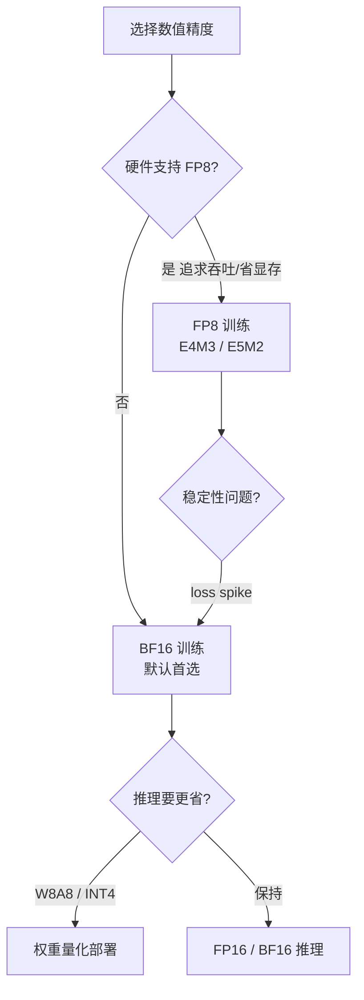

# 混合精度训练：FP16 / BF16 / FP8

> 大模型训练里"用什么数值格式"直接决定显存、带宽与稳定性。本文讲清 FP32/FP16/BF16/FP8 的格式差异、为何 LLM 偏好 BF16、FP16 为何需要 loss scaling，以及 FP8 训练的现状与陷阱。

关联：[优化器](优化器.md) · [大模型 MFU 计算公式](大模型%20MFU%20计算公式.md) · [Norm](Norm.md)

---

## 图示速览

**数值精度选型决策**：硬件支持 FP8 且追求吞吐可上 FP8；否则 BF16 是训练默认首选，推理阶段再按需做权重量化进一步省显存。

## 1. 浮点格式速查

浮点数 `value = (-1)^sign × mantissa × 2^exponent`。关键看**指数位（决定可表示的范围/ Dynamic Range）** 与**尾数位（决定精度）**。

| 格式 | 总位数 | 符号 | 指数 | 尾数 | 最大可表示数（约） | 典型用途 |
| --- | --- | --- | --- | --- | --- | --- |
| FP32 | 32 | 1 | 8 | 23 | 3.4e38 | 主权重 / 优化器状态（master） |
| FP16 | 16 | 1 | 5 | 10 | 6.5e4 | 早期混合精度前向/反向 |
| BF16 | 16 | 1 | 8 | 7 | 3.4e38 | **LLM 训练首选** |
| FP8(E4M3) | 8 | 1 | 4 | 3 | 448 | 前向权重/激活（精度优先） |
| FP8(E5M2) | 8 | 1 | 5 | 2 | 5.7e4 | 反向梯度（范围优先） |

> 关键结论：**BF16 与 FP32 范围相同（指数都是 8 位），只是尾数更短**；FP16 范围小（最大 ~65504），容易上溢/下溢。

---

## 2. 为什么 BF16 是 LLM 训练首选

- 训练中出现超大/超小梯度很常见，FP16 的窄范围（指数 5 位）极易**上溢成 inf / 下溢成 0**，导致训练崩溃。
- BF16 范围与 FP32 一致，几乎不需要 loss scaling 就能稳定训练，代价只是尾数精度略低——对 LLM 这种"大数吃小梯度"的场景完全可接受。
- 硬件支持：NVIDIA Ampere+（A100/H100）、**昇腾 910B** 均原生支持 BF16 张量核心。

> 经验法则：新模型默认 BF16；除非显存/带宽极度紧张且已验证 FP16 稳定，否则不要选 FP16。

---

## 3. FP16 与 Loss Scaling（历史方案）

早期 A100 之前常用 FP16 以提速省显存，但 FP16 范围窄，梯度易下溢为 0：

- **动态 Loss Scaling**：每步把 loss 乘一个放大系数 `S` → 梯度同步放大 → 反向前再除回，避免小梯度被舍入成 0。
- 现代框架（AMP）能自动管理，但**BF16 基本免去了这套麻烦**，所以 FP16+scaling 已较少作为首选。

---

## 4. 混合精度训练的标准做法

- **主权重（master weight）保持 FP32**：优化器（Adam 的 momentum/variance）用 FP32，更新后转回低精度参与计算，避免累加误差。
- **前向 / 反向用低精度**（BF16 或 FP8）：减少显存占用与 HBM 带宽压力，提升 MFU。
- **某些敏感算子保持 FP32**：如 `softmax`、`layer norm` 的累加、损失函数，保精度。

$$\text{显存节省} \propto \frac{\text{高精度字节} - \text{低精度字节}}{\text{高精度字节}}$$

从 FP32 → BF16，参数与梯度显存直接减半，是 ZeRO / 张量并行之外另一大省显存杠杆（见 [ZeRO 与优化器状态切分](ZeRO与优化器状态切分.md)）。

---

## 5. FP8 训练：现状与陷阱

FP8（H100 的 `transformer-engine`、昇腾 910B 的 FP8 算子）用 8 位进一步把计算和显存压半：

- **E4M3**（4 指数 3 尾数）：范围小但精度高，用于**前向的权重/激活**。
- **E5M2**（5 指数 2 尾数）：范围大，用于**反向的梯度**，防止溢出。
- 训练时通常 `FP8 计算 + FP32 主权重 + 逐层/逐张量缩放因子（scaling factor）`。

陷阱：

1. **缩放因子敏感**：scaling 太大→饱和截断，太小→下溢；常用延迟缩放（delayed scaling）或基于历史统计。
2. **并非所有层都适合**：embedding、layer norm、softmax、输出 logits 常回退到 BF16/FP32。
3. **收敛性需验证**：小模型 FP8 易对齐，超大 MoE 需仔细调 scaling 策略（DeepSeek-V3 即用 FP8 混合精度，见 [DeepSeek V3](../01模型结构/01LLM模型/deepseek/deepseek_v3.md)）。

> 昇腾侧：CANN / MindSpeed 已支持 FP8（含 per-tensor / per-channel scaling）训练与推理，910B 上可验证 MFU 与收敛；迁移时重点关注 scaling 配置与回退算子清单。

---

## 6. 推理侧的精度

- 推理也可用量化进一步压低：权重 INT8/FP8、KV Cache INT8（见 [量化推理 GPTQ AWQ FP8](../../04模型推理/量化推理%20GPTQ%20AWQ%20SmoothQuant%20FP8.md)）。
- 训练用 BF16，推理服务可按 SLA 选 BF16（保精度）或 INT8/FP8（保吞吐）。

---

## 7. TODO / 延伸

- [ ] 实验：同一 7B 模型分别用 FP16+scaling 与 BF16 训练，对比 loss 曲线稳定性。
- [ ] 深入：FP8 delayed scaling 与 per-tensor scaling 的数学差异。
- [ ] 昇腾：在 MindSpeed 开启 FP8 训练，记录 MFU 提升与收敛偏差。
- [ ] 对比：FP8 训练中哪些算子必须回退 BF16（看 CANN 算子支持列表）。
