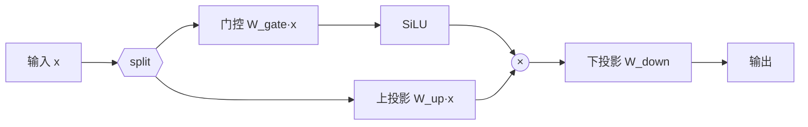

# 激活函数：GELU 与 SwiGLU

> Transformer 的 FFN（前馈网络）用什么激活函数，直接影响表达力与训练稳定性。本文梳理从 ReLU 到 GELU，再到现代 LLM 标配 **SwiGLU** 的演进，并解释"为什么大模型几乎都丢掉 bias"。

关联：[Norm](Norm.md) · [Transformer 模型详解](Transformer模型详解.md) · [混合精度训练 FP16 BF16 FP8](混合精度训练%20FP16%20BF16%20FP8.md)

---

## 图示速览

**SwiGLU 门控结构**：输入 split 后一支过门控（SiLU 激活）与另一支逐元素乘，再做下投影。相比普通 FFN 多一个门控矩阵，是现代 LLM 的标准 MLP。

## 1. 几种常见激活

| 激活 | 公式 | 特点 |
| --- | --- | --- |
| ReLU | `max(0, x)` | 简单、稀疏，但"死神经元"、不可导点 |
| GELU | `x·Φ(x)`（高斯 CDF 近似） | 平滑、似"随机正则"，BERT/GPT-2/3 用 |
| Swish | `x·σ(x)` | 平滑、自门控，MobileNet/PaLM 用 |
| **SwiGLU** | `Swish(W1·x) ⊙ (W2·x)` | 门控线性单元，LLaMA/Qwen/DeepSeek 标配 |

GELU 的常用近似：

$$\text{GELU}(x) \approx 0.5x\left(1+\tanh\left(\sqrt{2/\pi}\,(x+0.044715x^3)\right)\right)$$

---

## 2. 从 GELU 到 SwiGLU：FFN 的重构

标准 FFN（以 ReLU/GELU 作激活）：

$$\text{FFN}(x) = W_2\,\sigma(W_1 x)$$

SwiGLU（把"激活"换成"门控"）：

$$\text{SwiGLU}(x) = \left(W_1 x\right) \odot \sigma(W_3 x)\,W_2$$

- 用一个额外的门控矩阵 `W3` 与 `σ`（Swish）对 `W1 x` 做**逐元素门控**（⊙ 为逐元素乘）。
- 本质：用"门控线性单元（GLU）"替代单一激活，让网络**学会对哪些信息放行**，表达力更强。
- 代价：FFN 中间维度通常从 `4d` 提到 `8d/3`（约 1.33×）以补偿参数量，使总参数接近。

> 经验：SwiGLU 在同等参数量下稳定优于 GELU/ReLU，是 PaLM、LLaMA、Qwen、DeepSeek、Mistral 等的一致选择。

---

## 3. 为什么现代 LLM 丢掉 bias

采用 **RMSNorm + SwiGLU（无 bias）** 已成为惯例：

- RMSNorm 已做缩放，**LayerNorm 的 bias 与激活 bias 冗余**；去掉 bias 减少参数与通信量（TP/PP 下 bias 也要 all-reduce）。
- SwiGLU 的门控机制本身提供足够非线性，bias 收益极小。
- 结果：LLaMA 系 FFN/Attention 的线性层**不带 bias**，代码更简洁、并行通信更少。

---

## 4. 选型速查

| 场景 | 推荐 |
| --- | --- |
| 现代 decoder-only LLM | SwiGLU + RMSNorm + 无 bias |
| 需要极致省参/旧模型复现 | GELU + LayerNorm |
| 移动/边缘小模型 | Swish/ReLU（门控开销不划算） |

> 昇腾侧：AscendC / MindSpeed 的 FFN 算子已针对 SwiGLU（含门控融合）做算子优化，迁移时确认 `act_fn=glu/swiglu` 配置与无 bias 设置一致，避免 shape 不匹配。

---

## 5. TODO / 延伸

- [ ] 推导：SwiGLU 相比 GELU-FFN 在同等隐藏维下参数量的变化（设 `d_ff=8d/3`）。
- [ ] 实验：7B 模型分别用 GELU 与 SwiGLU 训练，对比困惑度与收敛速度。
- [ ] 深入：GLU 家族（ReGLU、GEGLU）与 SwiGLU 的细微差异。
- [ ] 算子：AscendC 中 SwiGLU 门控融合的 tiling 策略。
