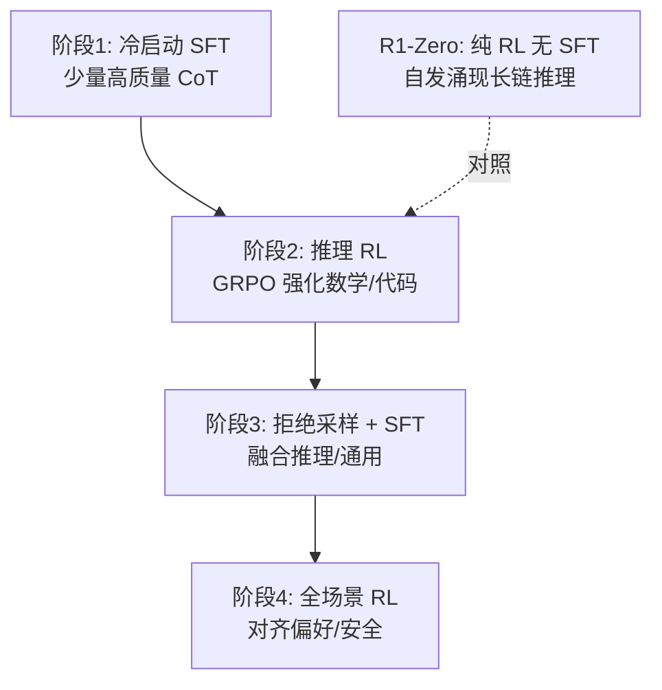

# DeepSeek V3.1 与 R1 推理模型

> 本文承接 [DeepSeek V3](../deepseek_v3.md)（MLA + MoE + MTP 的稠密/MoE 基座），补充两条后续主线：**R1 推理模型**（用纯强化学习唤醒推理能力）与 **V3.1 的混合推理**。这是 2025 年"推理模型"浪潮的起点，也是本仓库 [GRPO 原理](../../00基础知识/grpo.md) 与 MindSpeed-RL 工程最对得上的部分。

关联：[DeepSeek V3](../deepseek_v3.md) · [GRPO 原理](../../00基础知识/grpo.md) · [MindSpeed-RL 实践](../../02模型训练/mindspeed/mindspeed-rl/mindspeed-rl_practice.md)

---

## 图示速览

**DeepSeek-R1 四阶段训练管线**：冷启动 SFT → 推理 RL（GRPO）→ 拒绝采样+SFT → 全场景 RL。R1-Zero 作为对照，证明纯 RL（无 SFT）也能涌现长链推理。

## 1. 基座能力回顾（V3）

DeepSeek-V3（2024-12，671B 总参 / 37B 激活）：

- **MLA（多头潜在注意力）**：低秩压缩 KV，极小 KV Cache（见 [KV Cache](../../00基础知识/KV%20Cache与PagedAttention.md)）。
- **细粒度 MoE**：256 路由专家 + 1 共享专家，无辅助损失负载均衡。
- **MTP（多 token 预测）**：训练时预测 2 个未来 token，提升数据效率；推理时可做投机解码加速。
- **FP8 混合精度训练**：大幅降低训练成本。

---

## 2. DeepSeek-R1：纯强化学习唤醒推理

R1（2025-01，arXiv:2501.12948）证明：**不需要大量人工标注推理链，仅靠大规模 RL（GRPO）就能让模型涌现长链推理**。

### 2.1 R1-Zero（纯 RL，无 SFT 冷启动）

- 直接在 V3-Base 上用 **GRPO** 训练，奖励只有"答案对不对（规则校验）+ 格式是否规范"，**没有神经网络奖励模型**。
- 现象：训练过程中模型**自发学会延长思维链、自我反思、尝试不同解法**——平均回答长度随训练显著变长。
- AIME 2024 pass@1 从 **15.6% → 77.9%**，达到 o1-preview 级别。
- 代价：输出可读性差、语言混杂（中英混排）。

### 2.2 R1 四阶段管线（解决 R1-Zero 的缺陷）

| 阶段 | 做法 | 解决 |
| --- | --- | --- |
| 1. 冷启动 SFT | 几千条高质量长 CoT 微调 | 输出可读、格式统一 |
| 2. 推理 RL（GRPO） | 准确率奖励 + 语言一致性奖励 | 推理强、缓解语言混杂 |
| 3. 拒绝采样 + SFT | ~60 万推理 + ~20 万通用 = 80 万条，对基座微调 | 文理兼备 |
| 4. 全场景 RL | 推理用规则奖励，通用用人类偏好 RM | 有用 + 无害 |

- 最终 R1 在多数推理基准上匹配或超越 o1。
- **蒸馏**：把 R1 的推理能力蒸馏到 Qwen/Llama 小模型（1.5B~70B），小模型也能获得强推理。

> 与仓库呼应：GRPO 的"去价值网络 + 组内归一化"正是 [GRPO 原理](../../00基础知识/grpo.md) 与 MindSpeed-RL 的实现核心；R1 的多阶段管线也是 MindSpeed-RL 中 `solutions/r1_zero_*` 的工程蓝本。

---

## 3. DeepSeek-V3.1：混合推理

- 在 V3 基座上引入 **"思考模式（thinking）/ 非思考模式"可切换**：简单问题直接答，复杂问题走长链推理。
- 上下文扩到 **128K**，并强化工具调用/agent 能力，向"通用推理+工具使用"统一。

---

## 4. 为什么这件事重要

- **RLVR（带可验证奖励的 RL）** 成为训练推理模型的主流：数学答案、代码测试都能规则校验，不依赖奖励模型，规避 reward hacking。
- GRPO 因"省掉 critic、显存小"成为开源推理模型默认算法；后续 Qwen3、Kimi K2 等均沿用其思想（见 [Kimi K2](../kimi/Kimi%20K2%20MoE.md)）。
- 工程上：R1 成功让"RL 后训练"从小众变成大模型标配，也是昇腾 MindSpeed-RL 重点支持的方向。

---

## 5. TODO / 延伸

- [ ] 复现：用 MindSpeed-RL 跑通 R1-Zero 风格的 7B 数学 GRPO（参考 `solutions/r1_zero_qwen25_7b`）。
- [ ] 深入：R1 阶段 3 为何对"基座"而非"RL checkpoint"做 SFT（能力重融合）。
- [ ] 对比：R1 规则奖励 vs PPO 的奖励模型，在长链推理上的稳定性差异。
- [ ] 跟踪：V3.2 / R2 是否把推理、agent、对齐合并到单一 GRPO 阶段（公开信息有限，待更新）。
