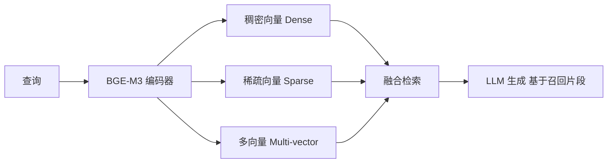

# Embedding 模型：BGE 与 BGE-M3

> 检索增强生成（RAG）的"检索"环节依赖高质量的文本向量（embedding）。本文梳理 BGE 系列（尤其是 **BGE-M3** 的多功能/多语言/多粒度）的架构与训练目标，以及它在 RAG 链路中的角色。

关联：[RAG](../../../04应用开发/01AI_Agent/01RAG/RAEDME.md) · [模型评测](../../03模型评测/RAEDME.md) · [Qwen3](qwen/qwen3/qwen3.md)

---

## 图示速览

**BGE-M3 三模态检索**：同一编码器同时产出稠密 / 稀疏 / 多向量三种表示并融合，召回结果送 LLM 做生成（典型 RAG 链路）。

## 1. 什么是 Embedding 模型

- 把一段文本编码为一个固定/可变维度的稠密向量，使"语义相近的文本向量距离更近"。
- 核心用途：**向量检索（召回）**——把 query 与海量文档做最近邻搜索，喂给生成模型做 RAG。
- 与生成式 LLM 的区别：它不生成文本，只产出向量；模型小、推理快、可批量化建库。

---

## 2. BGE 系列

### 2.1 BGE（Base / Large）

- 基于 BERT 类编码器（如 BERT-large、RoBERTa），用**对比学习**训练：正样本（相关 query-doc 对）向量靠近，负样本远离。
- 关键技巧：
  - **In-batch Negatives**：一个 batch 内其他样本的 doc 自动当负例，扩大负例量而不增加标注成本。
  - **难负例（hard negatives）**：人工/检索构造"看似相关实则不对"的负例，提升判别力。
  - **指令前缀（instruction tuning）**：检索/分类等不同任务加不同指令前缀，提升领域适配。
- 在 MTEB 等榜单长期领先开源 embedding。

### 2.2 BGE-M3（多功能旗舰）

M3 = **Multi-Function / Multi-Lingual / Multi-Granularity**：

| 维度 | 含义 |
| --- | --- |
| Multi-Function | 同时支持三种检索：**稠密（dense）、稀疏（sparse）、多向量（colbert/multi-vector）** |
| Multi-Lingual | 100+ 语言，跨语言检索 |
| Multi-Granularity | 词 / 句 / 段 / 篇 不同粒度统一建模 |

- **稠密**：标准单向量嵌入，主打通用语义检索。
- **稀疏**：输出类似 BM25 的"词权重"，可与传统倒排索引结合，擅长精确关键词匹配。
- **多向量（ColBERT 式）**：输出每个 token 的向量，检索时做"query token × doc token"最大相似度累加（late interaction），精度高但存储大。
- 训练目标融合三种表示的对比损失，推理时可按场景选一种或融合。

---

## 3. 训练目标（对比学习）

$$\mathcal{L} = -\log \frac{e^{\mathrm{sim}(q,d^+)/\tau}}{\sum_{d\in\{d^+,d^-\}} e^{\mathrm{sim}(q,d)/\tau}}$$

- `sim` 常用余弦相似度，τ 为温度。
- 负例 = in-batch 负例 + 难负例；多语言下还要构造跨语言正负对。
- BGE-M3 在此基础上扩展出稀疏/多向量的辅助损失。

---

## 4. 在 RAG 中的角色与选型

| 需求 | 推荐表示 |
| --- | --- |
| 通用语义召回 | dense（BGE-M3 dense） |
| 精确关键词/专有名词 | sparse（结合倒排） |
| 高精度长文档 | multi-vector（ColBERT） |
| 跨语言检索 | BGE-M3 multilingual |

> 落地提示：建库时用 embedding 模型把文档转向量存入向量库（如 Milvus / Faiss）；推理时把 query 转向量做 ANN 检索，再把 Top-K 拼回 prompt（见 [RAG](../../../04应用开发/01AI_Agent/01RAG/RAEDME.md)）。昇腾侧可用 MindIE 或 CPU 部署 embedding 模型，与生成模型解耦。

---

## 5. TODO / 延伸

- [ ] 实验：同一 RAG 任务下 dense / sparse / multi-vector 的召回率（Recall@K）对比。
- [ ] 深入：ColBERT late interaction 的存储与检索开销权衡。
- [ ] 对比：BGE-M3 vs E5 / GTE / Voyage 等商业/开源 embedding 在中文场景的表现。
- [ ] 跟踪：生成式检索（用 LLM 直接产出 doc id）与传统 embedding 检索的边界。
