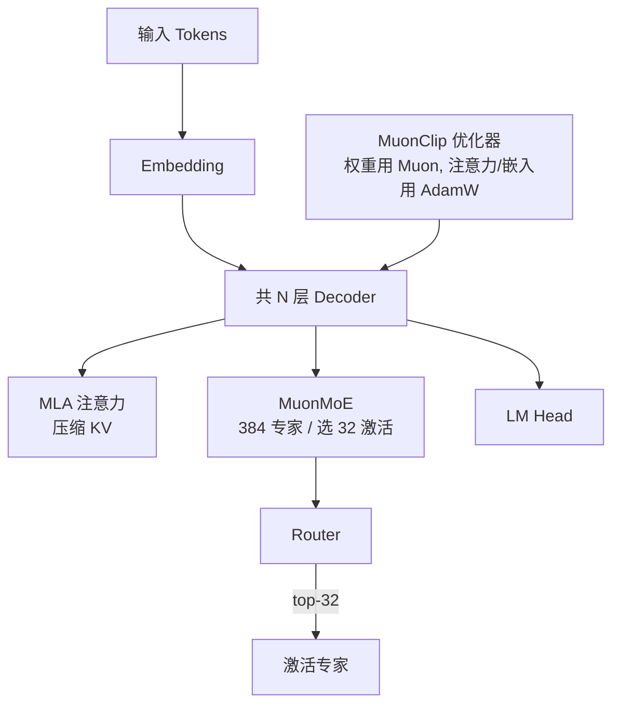

# Kimi K2：万亿参数 Agentic MoE

> Kimi K2（Moonshot AI，2025-07 开源，Apache-2.0）是 2025 年最值得关注的**开源 MoE** 之一：总参 1T、每 token 激活仅 32B，专为**工具调用 / 长程 Agent 任务**设计。架构上延续了 DeepSeek 的 MLA，并在训练稳定性上做出了 MuonClip 这一关键创新。

关联：[DeepSeek V3](../deepseek/deepseek_v3.md) · [Mistral 与 Mixtral MoE](../mistral/Mistral与Mixtral%20MoE.md) · [DeepSeek V3.1 与 R1](../deepseek/DeepSeek%20V3.1与R1%20推理模型.md)

---

## 图示速览

**Kimi K2 架构要点**：MuonMoE（384 专家、激活 32）配合 MLA 压缩 KV，优化器用 MuonClip（权重 Muon + 注意力/嵌入 AdamW）稳定大规模训练。

## 1. 关键规格（公开信息）

| 项目 | 数值 |
| --- | --- |
| 总参数 | **1T（1 万亿）** |
| 每 token 激活 | **32B** |
| 专家数 | 384（每 token 选 **top-8** + 1 共享专家） |
| 层数 | 61 |
| 注意力头 | 64 |
| 注意力隐藏维 | 7168 |
| 专家隐藏维 | 2048 |
| 词表 | 160,000 |
| 上下文 | 128K |
| 训练 token | 15.5T |
| 激活函数 | SwiGLU |
| 注意力 | **MLA**（多头潜在注意力，同 DeepSeek） |
| 优化器 | **MuonClip** |
| 许可证 | Apache-2.0（Base + Instruct 均开源） |

---

## 2. 架构要点

### 2.1 MLA + 细粒度 MoE

- 沿用 DeepSeek 的 **MLA** 压缩 KV（见 [KV Cache](../../00基础知识/KV%20Cache与PagedAttention.md)），使 128K 长上下文的 KV 显存可控。
- MoE 用 **384 专家 + top-8 + 1 共享**，比 Mixtral 的 8 专家更细粒度，表达力与负载分布更均衡；激活 32B 意味着**推理算力约等于一个 32B 稠密模型**，但知识容量是 1T。

### 2.2 MuonClip：训练稳定性突破

- 大模型 MoE 训练常见"注意力 logits 爆炸"导致不稳定。Kimi K2 用 **MuonClip** 优化器（Muon 的改进版），核心是 **qk-clip**：在更新后直接对 Q/K 投影矩阵做重缩放，抑制注意力 logits 爆炸。
- 效果：在 15.5T token 上**未出现任何训练不稳定**，是能训出 1T MoE 的关键工程点。

### 2.3 Agentic 训练范式

- 预训练语料中大规模合成 **agentic 数据**：模拟上千领域、上千工具的真实/合成交互，用 rubric（评分量规）+ LLM 裁判做拒绝采样过滤。
- 后训练用**通用 RL**：可验证任务（代码/数学）走 on-policy rollout + 规则奖励；不可验证任务用自评判机制。
- 目标不是"更长 CoT 推理"，而是**稳定的多步规划、工具调用、自我反思**——这是它与 DeepSeek-R1（偏推理）的差异化定位。

---

## 3. 能力定位

- 编程：SWE-bench Verified **65.8%**（单轮、启用工具），LiveCodeBench v6 Pass@1 53.7%。
- 数学：MATH-500 **97.4%**。
- 工具使用 / 多步 Agent 任务显著领先同期开源模型。
- 与 DeepSeek-R1（推理）、LLaMA 4（多模态 MoE）形成互补：K2 强在**开箱即用的 Agent 工作流**。

---

## 4. 对知识库的意义

- 验证了 **MLA 的跨团队复用**：DeepSeek、Kimi 均选 MLA，说明低秩 KV 压缩已成旗舰 MoE 标配。
- **MuonClip / qk-clip** 是大规模 MoE 训练稳定性的重要新工具，值得在 [模型训练-内存计算](../02模型训练/内存计算.md) 与优化器章节补充。
- Agentic 后训练（rubric + 工具环境）是 RLHF 之后又一个工程重心，与 MindSpeed-RL 的 worker/环境设计可对照。

---

## 5. TODO / 延伸

- [ ] 深入：MuonClip 的 qk-clip 与标准 Muon 的数学差异（为何能抑制 logits 爆炸）。
- [ ] 对比：Kimi K2 的 384-top8 路由 vs DeepSeek-V3 的 256-top? 路由粒度与负载均衡。
- [ ] 实验：在昇腾 MindSpeed 上用 MuonClip 训小规模 MoE，验证稳定性收益。
- [ ] 跟踪：Kimi K2.5 / 多模态版本的架构变化（公开信息有限，待更新）。
