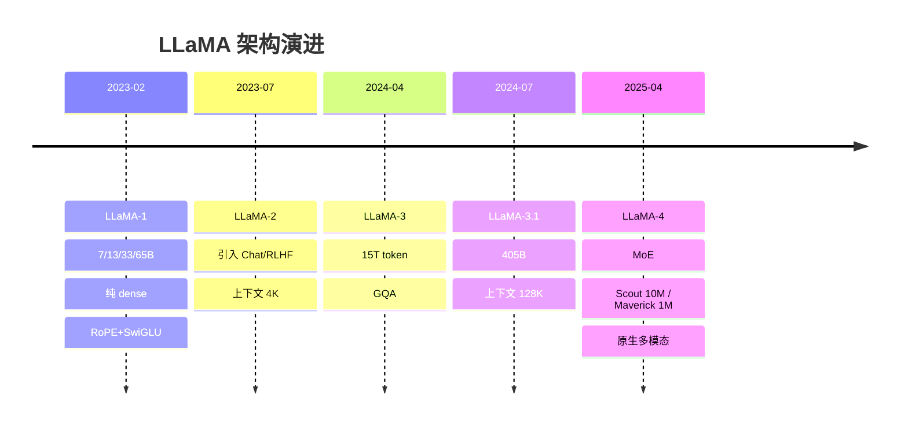

# LLaMA 系列架构演进

> Meta 的 LLaMA 是开源 LLM 的事实基线。本文按版本梳理架构关键改动：从 LLaMA 1 的"极简 Transformer"，到 3 代普及 GQA/长上下文，再到 4 代全面转向 MoE + 原生多模态。

关联：[DeepSeek V3](../deepseek/deepseek_v3.md) · [Mistral 与 Mixtral MoE](../mistral/Mistral与Mixtral%20MoE.md) · [位置编码 RoPE 与 ALiBi](../../00基础知识/位置编码%20RoPE与ALiBi.md) · [KV Cache 与 PagedAttention](../../00基础知识/KV%20Cache与PagedAttention.md)

---

## 图示速览

**LLaMA 架构演进时间线**：从 dense 走向 MoE，上下文长度从 4K 一路扩展到 10M，并引入原生多模态（LLaMA-4）。




## 1. 共同基座（LLaMA 1 确立的设计）

LLaMA 1（2023-02，7B/13B/33B/65B）奠定了"高效 decoder-only"范式：

- **Pre-Norm + RMSNorm**（不用 LayerNorm 的 bias/mean，更省算力）
- **RoPE** 旋转位置编码
- **SwiGLU** 激活（FFN 无 bias）
- 上下文 2048，标准 MHA

> 这套组合被后续几乎所有开源 LLM（Qwen、DeepSeek、Mistral）沿用。

---

## 2. LLaMA 2 → 3：数据、上下文与 GQA

| 版本 | 时间 | 关键改动 |
| --- | --- | --- |
| LLaMA 2 | 2023-07 | 上下文 4096，训练数据量提升；7B/13B/70B |
| LLaMA 3 | 2024-04 | **全系列引入 GQA**、上下文 8k、词表扩到 128k（tiktoken BPE）、质量大幅跃升 |
| LLaMA 3.1 | 2024-07 | 上下文扩到 **128k**、新增 405B、RoPE `theta=500k`（更好的长外推） |
| LLaMA 3.3 | 2024-12 | 70B 接近 405B 质量（性价比之选） |

**GQA（Grouped-Query Attention）** 是 3 代最重要的架构改动之一：把 K/V 头数减少为 Q 头数的若干组，大幅压缩 [KV Cache](../../00基础知识/KV%20Cache与PagedAttention.md)，让长上下文与高并发推理可行。LLaMA 3 全系列标配 GQA。

---

## 3. LLaMA 4（2025-04）：MoE + 原生多模态

LLaMA 4 是一次范式转变——**从稠密转向稀疏 MoE，并原生支持多模态（早期融合 early fusion）**。

| 模型 | 激活参数 | 专家数 | 总参数 | 上下文 | 备注 |
| --- | --- | | --- | --- | --- |
| **Scout** | 17B | 16 | 109B | **10M** | 单张 H100(INT4) 可跑 |
| **Maverick** | 17B | 128 | 400B | 1M | 单台 H100 主机可跑 |
| **Behemoth**（教师，未开放） | 288B | 16 | ~2T | — | 用于蒸馏 Scout/Maverick |

要点：

- **MoE 路由**：每个 token 只激活部分专家，推理算力随"激活参数"而非"总参数"走，性价比极高。
- **原生多模态（early fusion）**：图像 token 与文本 token 在预训练阶段就一起喂入，而非事后挂冻结视觉塔——这是与 LLaVA 式"视觉编码器+投影"路线的根本区别。
- **多语言/长上下文**：12 种语言、Scout 支持 10M 超长上下文（靠 MoE + 长序列并行实现）。

> 对比：DeepSeek-V3 是稠密/MoE 混合（MLA+MoE），LLaMA 4 是纯 MoE；两者都验证了"总参巨大、激活很小"是 2025 后大模型的主流形态。

---

## 4. 演进主线小结

```
LLaMA 1: 极简高效 Transformer (RMSNorm+RoPE+SwiGLU)
   │
LLaMA 2: 更多数据、4k 上下文
   │
LLaMA 3: GQA + 8k/128k 上下文 + 128k 词表
   │
LLaMA 3.1/3.3: 405B 旗舰 + 长上下文成熟
   │
LLaMA 4: ★MoE + 原生多模态 + 10M 上下文
```

---

## 5. TODO / 延伸

- [ ] 对比：LLaMA 3 的 GQA 头分组数（如 8B 用几组 KV 头）与 KV 显存节省比例。
- [ ] 深入：early fusion 多模态 vs LLaVA 式 late fusion 的训练/推理差异。
- [ ] 实验：在昇腾 MindSpeed 上复现 LLaMA 3 的 GQA 配置，观测 KV 显存下降。
- [ ] 对比：LLaMA 4 MoE 与 DeepSeek-V3 MoE 的路由/负载均衡策略差异。
