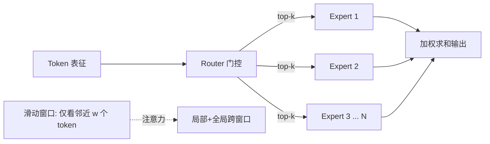

# Mistral 与 Mixtral MoE

> Mistral AI 用"更小但更聪明"的架构证明了高效设计的价值：Mistral 7B 以滑动窗口+GQA 击败更大的 LLaMA 2；Mixtral 8x7B 则把稀疏 MoE 带进开源主流，用"总参大、激活小"实现高性价比推理。

关联：[LLaMA 系列架构演进](../llama/LLaMA系列架构演进.md) · [DeepSeek V3](../deepseek/deepseek_v3.md) · [KV Cache 与 PagedAttention](../../00基础知识/KV%20Cache与PagedAttention.md)

---

## 图示速览

**MoE 路由与滑动窗口**：Router 对每 token 选 top-k 专家，专家输出加权求和；注意力采用滑动窗口只在局部窗口内计算，跨窗口靠缓存传递全局信息。

## 1. Mistral 7B（2023-10）

在 LLaMA 2 架构基础上做两处关键改动：

- **滑动窗口注意力（Sliding Window Attention, SWA）**：每个 token 只关注前后 `w` 个 token 的窗口，注意力复杂度从 `O(S²)` 降到 `O(S·w)`。多层堆叠后，感受野随层数线性扩大，仍能捕获长程依赖。
- **GQA（分组查询注意力）**：压缩 KV 头数，减小 [KV Cache](../../00基础知识/KV%20Cache与PagedAttention.md)。
- 结果：Mistral 7B 在多数基准上超过 LLaMA 2 13B，且推理更快。

> SWA 是"用局部窗口换长上下文成本"的代表，后续被 LLaMA 4、Gemini 等以不同形式采用。

---

## 2. Mixtral 8x7B（2023-12）：稀疏 MoE

核心：把 FFN 层替换为 **多个专家（expert）MLP + 一个路由（router）**，每个 token 只激活其中 top-k 个。

| 项目 | 数值 |
| --- | --- |
| 专家数 | 8 |
| 每 token 激活 | top-2（即 2/8） |
| 总参数 | ~46.7B |
| 激活参数 | ~12.9B |

- 每个专家就是一个 Mistral 7B 风格的 MLP；路由是**逐 token、每层独立**的 softmax 选择。
- 推理算力 ≈ 12.9B 稠密模型，但知识容量 ≈ 46.7B → 同等算力下质量更高。
- Mixtral 8x7B 在多数任务上匹敌或超越 LLaMA 2 70B，而推理成本仅约 12.9B。

后续还有 **Mixtral 8x22B**（更大专家）等变体。

---

## 3. MoE 的关键工程问题：负载均衡

稀疏路由如果不加约束，会出现"少数专家被反复选中、其余饿死"的坍塌：

- **辅助损失（auxiliary load-balancing loss）**：鼓励 token 在专家间均匀分布。DeepSeek 后来提出**无辅助损失**的偏置更新（见 [DeepSeek V3](../deepseek/deepseek_v3.md)），避免辅助损失对主任务的干扰。
- **专家并行（Expert Parallelism, EP）**：不同专家部署在不同设备，路由后做 all-to-all 通信。这是 MoE 训练/推理的通信核心，也是 [模型并行知识](../../02模型训练/训练并行/模型并行知识.md) 中 DP/TP/PP 之外的第四维。

---

## 4. 与 DeepSeek MoE 的对比

| 维度 | Mixtral | DeepSeek-V3 |
| --- | --- | --- |
| 专家规模 | 8（top-2） | 256 路由 + 1 共享 |
| 注意力 | 标准 MHA/GQA | **MLA**（低秩压缩 KV） |
| 负载均衡 | 辅助损失 | 无辅助损失（偏置更新） |
| 总/激活 | 46.7B / 12.9B | 671B / 37B |

> 共同点：都验证了"稀疏激活"路线。差异在于 DeepSeek 用 MLA 进一步压缩 KV、用共享专家+细粒度路由提升表达力。

---

## 5. TODO / 延伸

- [ ] 推导：Mixtral 8x7B 的"激活 12.9B"如何由共享/专家参数量相加得到。
- [ ] 深入：专家并行（EP）的 all-to-all 通信模式与 TP/PP 的叠加。
- [ ] 实验：在昇腾 MindSpeed 上配置 MoE（EP/TP），观测 all-to-all 瓶颈。
- [ ] 对比：辅助损失 vs 无辅助损失对最终精度的影响（引用 DeepSeek-V3 结论）。
