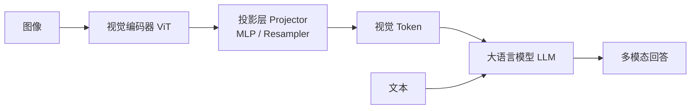

# 多模态模型结构：LLaVA / Qwen-VL / InternVL

> 让 LLM"看懂"图像（甚至视频/音频），是 2024–2025 年的主线之一。本文对比三类代表性范式：LLaVA 的"视觉编码器 + 投影层"、Qwen-VL 的原生分辨率与动态分辨率、InternVL 的大视觉编码器，并点出与 LLaMA 4 早期融合路线的区别。

关联：[Transformer 模型详解](../../00基础知识/Transformer模型详解.md) · [Qwen3](qwen/qwen3/qwen3.md) · [LLaMA 系列架构演进](../llama/LLaMA系列架构演进.md)

---

## 图示速览

**多模态融合骨架**：图像经视觉编码器（ViT）提取特征，经投影层变成视觉 Token，与文本 Token 一起送入 LLM 完成跨模态理解与生成。

## 1. 多模态的两个融合层级

| 路线 | 做法 | 代表 |
| --- | --- | --- |
| **Late Fusion（后期融合）** | 预训练好的视觉编码器（ViT）抽出图像特征 → 投影层映射到 LLM 词嵌入空间 → 拼接进文本序列 | LLaVA、Qwen-VL、InternVL |
| **Early Fusion（早期融合）** | 图像/文本 token 在预训练阶段就一起喂入同一 Transformer | LLaMA 4、Gemini |

本文聚焦更主流、更易在昇腾上落地的 **Late Fusion** 三大家。

---

## 2. LLaVA：极简两阶段

- **结构**：`ViT（如 CLIP ViT-L）→ 投影层（MLP 或 cross-attention）→ LLM（Vicuna/Llama）`。
- **训练**：
  1. 冻结 ViT 与 LLM，只训投影层（把图像特征对齐到文本空间）。
  2. 解冻 LLM，做视觉指令微调。
- **特点**：结构简单、复现成本低，是"多模态入门"的事实标准；缺点是对高分辨率/细粒度 OCR 较弱。

---

## 3. Qwen-VL / Qwen2.5-VL：原生与动态分辨率

- **视觉编码器**：ViT + 一个轻量 adaptor（如带 2D 位置信息的 MLP / 卷积），把视觉特征接入 Qwen LLM。
- **关键改进**：
  - **动态分辨率（Naive Dynamic Resolution）**：把图像切成不定数量的视觉 token（而非固定网格），高分辨率图保留更多细节，视觉 token 数随图变化。
  - **位置编码 3D-RoPE**：把"时间/高度/宽度"都编码进位置，支持**视频**与时序理解。
  - **统一的视觉-语言表征**：文本、图像、视频 token 在同一序列里用同一套位置编码，便于多模态对齐。
- Qwen2.5-VL 在 OCR、文档、长视频理解上显著强于初代 Qwen-VL，是开源多模态的强基线。

> 仓库已有 [Qwen2.5-vl-7B MindIE 推理](../../../04模型推理/Qwen2.5-vl-7B-MindIE.md)，可对照本文的模型结构阅读。

---

## 4. InternVL：大视觉编码器

- 思路：把视觉侧也做大——**大规模 ViT（InternViT，可达数亿~数十亿参数）** + 一个 MLM（多模态大语言模型，常用 InternLM/Qwen）。
- 强调**高分辨率 OCR、图表、细粒度视觉理解**，并通过"渐进式对齐"训练（先对齐视觉编码器，再端到端微调）。
- 在需要"看清小字/表格"的场景（文档、科学图）表现突出。

---

## 5. 对比小结

| 模型 | 视觉侧 | 分辨率策略 | 强项 |
| --- | --- | --- | --- |
| LLaVA | CLIP ViT + MLP | 固定网格 | 简单、易复现 |
| Qwen-VL | ViT + adaptor | 动态分辨率 + 3D-RoPE | OCR/视频/通用 |
| InternVL | 大 ViT | 高分辨率切片 | 细粒度/文档 |
| LLaMA 4 | 早期融合 | 原生多模态 | 与文本统一建模 |

---

## 6. 工程与昇腾落地

- 多模态推理的瓶颈常在前处理（图像切块、token 数）与视觉编码器，而非 LLM 本体；可用 [MindIE 推理接口](../../../04模型推理/01推理框架/MindIE/MindIE推理接口.md) 串联视觉+语言两阶段。
- 训练侧：MindSpeed-MM（见 [多模态训练](../../02模型训练/mindspeed/mindspeed-mm/mindspeed-mm.md)）提供多模态预训练管线。

---

## 7. TODO / 延伸

- [ ] 深入：Qwen2.5-VL 的 3D-RoPE 如何在视频帧间编码时间维度。
- [ ] 对比：动态分辨率 vs 固定 grid 在长图/大图上的 token 数差异。
- [ ] 实验：在 MindIE 上跑 Qwen2.5-VL，记录视觉 token 数对 TTFT 的影响。
- [ ] 跟踪：原生多模态（early fusion）相比 late fusion 的训练成本与质量权衡。
