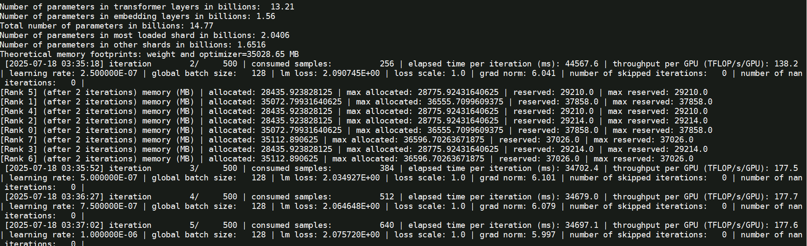

# Qwen3-14B适配

## 一、依赖安装&制作镜像

### 1.1 HDK与CANN安装

HDK安装：参考版本配套表，根据系统和硬件产品型号，选择对应版本的`driver`和`firmware`下载[驱动固件](https://www.hiascend.com/hardware/firmware-drivers/community)，并参考完成[NPU驱动固件安装](https://www.hiascend.com/document/detail/zh/CANNCommunityEdition/81RC1alpha002/softwareinst/instg/instg_0005.html?Mode=PmIns&OS=Ubuntu&Software=cannToolKit)，安装后重启os系统生效。容器环境一般安装在宿主机上。

CANN安装：参考版本配套表，根据系统选择`aarch64`或`x86_64`对应版本的`cann-toolkit`、`cann-kernel`和`cann-nnal`，下载[CANN软件包](https://www.hiascend.com/developer/download/community/result?module=cann)，参考[CANN安装教程](https://www.hiascend.com/document/detail/zh/CANNCommunityEdition/81RC1alpha002/softwareinst/instg/instg_0008.html?Mode=PmIns&OS=Ubuntu&Software=cannToolKit)完成cann包安装。容器环境一般安装在容器内。

### 1.2 创建python环境

```shell
conda create --name py310 python=3.10
conda activate py310
```

### 1.3 PTA安装


准备[torch_npu](https://www.hiascend.com/developer/download/community/result?module=pt)和[apex](https://gitee.com/ascend/apex)，参考[Ascend Extension for PyTorch 配置与安装](https://www.hiascend.com/document/detail/zh/Pytorch/60RC2/configandinstg/instg/insg_0001.html)或执行以下命令安装：

```shell
# 安装torch和torch_npu 
#torch参考 https://download.pytorch.org/whl/cpu/
#torch_npu构建参考 https://gitee.com/ascend/pytorch/releases
pip install https://download.pytorch.org/whl/cpu/torch-2.6.0%2Bcpu-cp310-cp310-manylinux_2_28_aarch64.whl
pip install https://gitee.com/ascend/pytorch/releases/download/v7.0.RC1.alpha002-pytorch2.6.0/torch_npu-2.6.0rc1-cp310-cp310-manylinux_2_28_aarch64.whl

# apex for Ascend 需要自行参考 https://gitee.com/ascend/apex 完成whl包的构建，再通过如下指令完成安装
pip install apex-0.1.dev20241015+ascend-cp310-cp310-linux_aarch64.whl
```

执行如下命令，若返回True则说明安装成功。

```
python3 -c "import torch;import torch_npu;print(torch_npu.npu.is_available())"
```

**apex构建参考命令**

> 注意：后续过程经常需要CANN环境变量，为了方便可以提前讲相关生效环境变量的脚本写入 .bashrc 中
```
# 设置环境变量
source /usr/local/Ascend/ascend-toolkit/set_env.sh
source /usr/local/Ascend/nnal/atb/set_env.sh
```
```
git clone -b master https://gitee.com/ascend/apex.git
cd apex/
#编译apex的二进制包
bash scripts/build.sh --python=3.10
#安装
cd apex/dist/
pip3 uninstall apex
pip3 install --upgrade torch_npu-2.6.0rc1-cp310-cp310-manylinux_2_28_aarch64.whl # version中包含python版本和cpu架构
```
### 1.4 MindSpeed-LLM及相关依赖安装

```shell
# 使能环境变量
source /usr/local/Ascend/ascend-toolkit/set_env.sh
source /usr/local/Ascend/nnal/atb/set_env.sh

# 安装MindSpeed加速库
git clone https://gitee.com/ascend/MindSpeed.git
cd MindSpeed
git checkout -b core_r0.8.0
git checkout 2c085cc9  # checkout commit from MindSpeed core_r0.8.0 in 2025.04.01
pip install -r requirements.txt 
pip3 install -e .
cd ..

# 准备MindSpeed-LLM及Megatron-LM源码
git clone https://gitee.com/ascend/MindSpeed-LLM.git 
git clone https://github.com/NVIDIA/Megatron-LM.git  # megatron从github下载，请确保网络能访问
cd Megatron-LM
git checkout core_r0.8.0
cp -r megatron ../MindSpeed-LLM/
cd ../MindSpeed-LLM
git checkout 2.1.0

pip install -r requirements.txt  # 安装其余依赖库
```

由于qwen3依赖 transformers==4.51.0，单独安装
```shell
pip install transformers==4.51.0
```

所有依赖都安装后，可以将环境保存为镜像以便下次使用

```
docker commit -a "lipengfei" -m "build for mindspeed-llm 2.1.0"  llm_qwen3 a3_mindspeed-llm:2.1.0
```

以上安装后，相关组件配套表如下：

| 软件          | 版本               | 部署方式 |
| ------------- | ------------------ | -------- |
| Driver        | AscendHDK 25.0.RC1 | 宿主机   |
| Firmware      | AscendHDK 25.0.RC1 | 宿主机   |
| Python        | 3.8.10             | 容器内   |
| CANN          | CANN 8.1.RC1       | 容器内   |
| Torch         | 2.1.0              | 容器内   |
| Torch_npu     | release v7.0.0     | 容器内   |
| MindSpeed     | 2.0.0_core_r0.8.0  | 容器内   |
| MindSpeed-LLM | 2.0.0              | 容器内   |
| Megatron-LM   | core_r0.8.0        | 容器内   |
| Docker镜像OS  | Ubuntu 20.04.6     | /        |

## 二、创建容器

```bash
docker run -dit -u root --ipc=host --network host --privileged \
    --name 'qwen3_14b' \
    --device=/dev/davinci0 \
    --device=/dev/davinci1 \
    --device=/dev/davinci2 \
    --device=/dev/davinci3 \
    --device=/dev/davinci4 \
    --device=/dev/davinci5 \
    --device=/dev/davinci6 \
    --device=/dev/davinci7 \
    --device=/dev/davinci8 \
    --device=/dev/davinci9 \
    --device=/dev/davinci10 \
    --device=/dev/davinci11 \
    --device=/dev/davinci12 \
    --device=/dev/davinci13 \
    --device=/dev/davinci14 \
    --device=/dev/davinci15 \
    --device=/dev/davinci_manager \
    --device=/dev/devmm_svm \
    --device=/dev/hisi_hdc \
    -p 50000:3000 \
    -v /usr/local/Ascend/driver:/usr/local/Ascend/driver \
    -v /usr/local/Ascend/firmware:/usr/local/Ascend/firmware \
    -v /usr/local/Ascend/add-ons/:/usr/local/Ascend/add-ons/ \
    -v /usr/local/sbin/:/usr/local/sbin/ \
    -v /usr/bin/hccn_tool:/usr/bin/hccn_tool \
    -v /var/log/npu/conf/slog/slog.conf:/var/log/npu/conf/slog/slog.conf \
    -v /apps:/apps \
    -v /home:/home \
    a3_llm:v2.1.0 bash
```

## 三、预训练
### 3.1 权重转换

昇腾MindSpeed-LLM要求模型权重采用Megatron-LM格式，在这里我们将原始HuggingFace权重格式转换为Megatron-Mcore格式。
详见[hf2mg权重转换](./pytorch/solutions/checkpoint_convert.md#21-huggingface权重转换到megatron-lm格式)

使用官方提供的转换脚本，获取对应切分的mg权重。

```bash
bash examples/mcore/qwen3/ckpt_convert_qwen3_hf2mcore.sh
# 请先根据如下指导完成脚本修改配置
```

如下 ckpt_convert_qwen3_hf2mcore.sh 为调整后的hf2mcore权重转换示例脚本

```bash
export CUDA_DEVICE_MAX_CONNECTIONS=1
# 生效 ascend-toolkit 环境变量
source /usr/local/Ascend/ascend-toolkit/set_env.sh

# 设置需要的权重转换参数
python convert_ckpt.py \
    --use-mcore-models \
    --model-type GPT \
    --load-model-type hf \
    --save-model-type mg \
    --target-tensor-parallel-size 2 \
    --target-pipeline-parallel-size 4 \
    --spec mindspeed_llm.tasks.models.spec.qwen3_spec layer_spec \
    --load-dir /apps/hw/weights/Qwen3-14B/ \
    --save-dir /apps/hw/outputs/qwen3/model_weights/qwen3_14b_mcore_tp2pp4/ \
    --tokenizer-model /apps/hw/weights/Qwen3-14B/tokenizer.json \
    --params-dtype bf16 \
    --model-type-hf qwen3
```

参数解析

| 参数                                  | 说明                                                         | 必填 |
|-------------------------------------|------------------------------------------------------------|---|
| `--model-type GPT`                  | 指定模型类型为GPT系列                                               | ✅ |
| `--use-mcore-models`                | 转换为Megatron-Mcore格式                        | ✅ |
| `--target-tensor-parallel-size`   | 张量并行度设置                                             | ✅ |
| `--target-pipeline-parallel-size` | 流水线并行度设置                                            | ✅ |
| `--tokenizer-model`                 | 指定分词器路径                                                    | ✅ |
| `--load-model-type`                 | 加载权重的类别（可以是hf、mg）                                          | ✅ |
| `--save-model-type`                 | 存储权重的类别（可以是hf、mg）                                          | ✅ |
| `--load-dir`                 | 权重文件加载路径                                          | ✅ |
| `--save-dir`                 | 权重文件保存路径                                          | ✅ |
| `--model-type-hf`                 | huggingface模型类别，默认为llama2                                  |   |
| `--params-dtype`                 | 指定权重转换后的权重精度模式，默认为fp16，如果源文件格式为bf16，则需要设置为bf16 | ✅  |

### 3.2 预训练数据集处理

通过对各种格式的数据做提前预处理，避免原始数据的反复处理加载，将所有的数据都统一存储到为.bin和.idx两个文件中，详见[预训练数据处理](https://gitee.com/ascend/MindSpeed-LLM/docs/pytorch/solutions/pretrain/pretrain_dataset.md)

常用的预训练数据集包括alpaca、enwiki、c4等，链接中提供了数据集下载地址。

**预训练数据集下载**

如下以alpaca数据集为例，进行预训练数据集示例。

```shell
# 根据链接提供地址，通过wget获取数据集数据
mkdir dataset
cd dataset/
wget https://huggingface.co/datasets/tatsu-lab/alpaca/blob/main/data/train-00000-of-00001-a09b74b3ef9c3b56.parquet
cd ..

# 使用仓库提供的数据处理脚本，转换预训练数据集为mg格式
bash examples/mcore/qwen3/data_convert_qwen3_pretrain.sh
# 请根据如下指导完成脚本修改配置
```
data_convert_qwen3_pretrain.sh 中的配置需做如下修改：
```shell
# 请按照您的真实环境修改 set_env.sh 路径
source /usr/local/Ascend/ascend-toolkit/set_env.sh
# 解决libgomp在arm平台上的一个bug:cannot allocate memory in static TLS block
export LD_PRELOAD=$LD_PRELOAD:/root/miniconda3/envs/py310/lib/python3.10/site-packages/sklearn/utils/../../scikit_learn.libs/libgomp-d22c30c5.so.1.0.0

mkdir ./dataset

python ./preprocess_data.py \
    --input /apps/hw/datasets/train-00000-of-00042-d964455e17e96d5a.parquet \
    --tokenizer-name-or-path /apps/hw/weights/Qwen3-14B/ \
    --tokenizer-type PretrainedFromHF \
    --handler-name GeneralPretrainHandler \
    --output-prefix /apps/hw/outputs/qwen3/datasets/enwiki \
    --json-keys text \
    --workers 4 \
    --log-interval 1000
```

参数解析

| 参数                       | 说明                                                               | 必填 |
|---------------------------|------------------------------------------------------------------|--|
| `--input`                 | 支持输入数据集目录或文件，目录则处理全部文件, 支持.parquet、.csv、.json、.jsonl、.txt、.arrow格式，同一目录要求数据格式保持一致 | ✅ |
| `--tokenizer-type` | 说明使用tokenizer类别，参数值为PretrainedFromHF时，词表路径填写模型目录即可               | ✅ |
| `--tokenizer-name-or-path`| 配合tokenizer-type，目标模型的tokenizer原数据文件夹，用于数据集的转换                   |  |
| `--tokenizer-model`       | 配合指定分词器模型的路径，路径具体到tokenizer.model文件                              |  |
| `--output-prefix`  | 转换后输出的数据集文件的文件名前缀                                                | ✅ |
| `--workers`               | 多进程数据集处理                                                         | ✅ |

### 3.3 预训练任务启动

完成了数据集处理和权重转换之后，可以开始拉起预训练任务。

#### 3.3.1 启动单机预训练

打开示例脚本

```
vim examples/mcore/qwen3/pretrain_qwen3_14b_4K_ptd.sh
```

示例脚本内容如下：

 ```shell
export CUDA_DEVICE_MAX_CONNECTIONS=1 #定义了任务流能够利用或映射到的硬件队列的数量。
export PYTORCH_NPU_ALLOC_CONF=expandable_segments:True #内存碎片优化开关，默认False
export HCCL_IF_BASE_PORT=30000 #设置HCCL端口
# 解决libgomp在arm平台上的一个bug:cannot allocate memory in static TLS block
export LD_PRELOAD=$LD_PRELOAD:/root/miniconda3/envs/py310/lib/python3.10/site-packages/sklearn/utils/../../scikit_learn.libs/libgomp-d22c30c5.so.1.0.0

# 基础配置
NPUS_PER_NODE=8  #使用单节点的8卡NPU
MASTER_ADDR=localhost #以本节点ip地址为master_ip
MASTER_PORT=6015 #本节点端口号为6015
NNODES=1  #单机，即一台节点，多机即多节点
NODE_RANK=0  #单机RANK为0，多机为(0,NNODES-1)，不同节点不可重复
WORLD_SIZE=$(($NPUS_PER_NODE*$NNODES)) #最终使用的NPU数

# 根据实际情况配置权重保存、权重加载、词表、数据集路径
CKPT_LOAD_DIR="/apps/hw/outputs/qwen3/model_weights/qwen3_14b_mcore_tp2pp4/"  #权重加载路径，填入权重转换时保存的权重路径
CKPT_SAVE_DIR="/apps/hw/outputs/qwen3/save_weights/qwen3_14b_mcore_tp2pp4/"  #训练完成后的权重保存路径
DATA_PATH="/apps/hw/outputs/qwen3/datasets/enwiki_text_document"  #数据集路径，填入数据预处理时保存的数据路径，注意需要添加后缀
TOKENIZER_PATH="/apps/hw/weights/Qwen3-14B/" #词表路径，填入下载的开源权重词表路径

TP=2  #权重转换设置--target-tensor-parallel-size 2，修改为2
PP=4  #权重转换设置--target-pipeline-parallel-size 4，修改为4
CP=1  #序列并行
MBS=1 #设置micro-batch-size为1
GBS=128 #设置global-batch-size为64
SEQ_LENGTH=4096  #设置seq_length为4096 
TRAIN_ITERS=500 #多少步存一次ckpt
CP_TYPE='ulysses_cp_algo' #序列并行算法
# 完成如上修改后保存关闭脚本
 ```

```shell
# 初始化环境变量
source /usr/local/Ascend/ascend-toolkit/set_env.sh
source /usr/local/Ascend/nnal/atb/set_env.sh

# 启动预训练脚本
bash examples/mcore/qwen3/pretrain_qwen3_14b_4K_ptd.sh
```



脚本中特性包含训练参数也包含优化特性，如下部分参数解释

| 参数名                                     | 说明                              |
|-----------------------------------------|---------------------------------|
| `--use-mcore-models`                    | 使用mcore分支运行模型     |
| `--disable-bias-linear`                 | 去掉linear的偏移值，与qwen原模型一致         |
| `--add-qkv-bias`                        | 增加Q、K、V的偏移值，是权重的组成部分            |
| `--group-query-attention`               | 开启GQA注意力处理机制                    |
| `--num-query-groups 4`                  | 配合GQA使用，设置groups为4              |
| `--position-embedding-type rope`        | 位置编码采用rope方案                    |
| `--untie-embeddings-and-output-weights` | 根据原模型要求将output层和embedding层的权重解耦 |
| `--bf16`                                | 昇腾芯片对BF16精度支持良好，可显著提升训练速度       |
| `--tensorboard-dir`               | 如需要tensorboard显示loss曲线，增加此参数，用于事件存储目录，如`/apps/hw/outputs/qwen3/14b/tb `。查看训练loss曲线使用方法为 `tensorboard --logdir=./tb --port=3000` |

训练任务启动后，日志存储在 logs 下。

如果需要后台启动任务

```
nohup bash examples/mcore/qwen3/pretrain_qwen3_14b_4K_ptd.sh >pretrain_qwen3_14b_4K_ptd.log 2>&1 &
```

终止训练进程

```
pkill -9 python
```

#### 3.3.2 启动多机预训练任务(待验证)

启动多机预训练任务，对在单机预训练脚本的基础上

```
vim examples/mcore/qwen3/pretrain_qwen3_14b_4K_ptd.sh
```

做如下修改

 ```shell
# 多机配置如下
NPUS_PER_NODE=8           # 同单机
MASTER_ADDR=${master_ip}  # 参与多机训练的节点都配置为master_ip
MASTER_PORT=6015          # 本节点端口号为6000
NNODES=1                  # 根据参与节点数量配置
NODE_RANK=0               # 多机为(0,NNODES-1)，不同节点不可重复，master_node rank为0，其ip为master_ip
WORLD_SIZE=$(($GPUS_PER_NODE * $NNODES))

# 参与节点都要有如下数据
CKPT_LOAD_DIR="/apps/hw/outputs/qwen3/model_weights/qwen3_14b_mcore_tp2pp4/"  # 权重加载路径，填入权重转换时保存的权重路径
CKPT_SAVE_DIR="/apps/hw/outputs/qwen3/save_weights/qwen3_14b_mcore_tp2pp4/"   # 训练完成后的权重保存路径
DATA_PATH="/apps/hw/outputs/qwen3/datasets/enwiki_text_document" # 数据集路径，填入数据预处理时保存的数据路径，注意需要添加后缀
TOKENIZER_PATH="/apps/hw/weights/Qwen3-14B/" # 词表路径，填入下载的开源权重词表路径
 ```

**注意**：

- 多机训练需在多个终端同时启动预训练脚本(每个终端的预训练脚本只有NODE_RANK参数不同，其他参数均相同)
- 如果使用多机训练，且没有设置数据共享，需要在训练启动脚本中增加`--no-shared-storage`参数，设置此参数之后将会根据布式参数判断非主节点是否需要load数据，并检查相应缓存和生成数据

## 四、SFT微调

### 4.1 指令微调场景介绍
#### 4.1.1 单样本微调

每条数据为一个独立的任务样本，包括指令和目标回复。适合用于问答、翻译、单轮任务等。

- 数据格式示例：

    ```json
    {
        "instruction": "请将下面的句子翻译成英文：我爱自然语言处理。",
        "response": "I love natural language processing."
    }
    ```

#### 4.1.2 多样本pack微调

为了提高训练效率，将多个样本拼接打包成一个长序列，减少填充，提高显存利用率。

- 原始样本：

    ```json
    [
        {
            "instruction": "请将以下句子翻译成英文：我们正在开发一款新的人工智能助手。",
            "response": "We are developing a new AI assistant."
        },
        {
            "instruction": "请列出三个可再生能源的例子。",
            "response": "太阳能、风能和水能是三种常见的可再生能源。"
        }
    ]
    ```

- 拼接后输入示例：

    ```json
    <bos> Instruction: 请将以下句子翻译成英文：我们正在开发一款新的人工智能助手。
    Response: We are developing a new AI assistant. <eos>
    Instruction: 请列出三个可再生能源的例子。
    Response: 太阳能、风能和水能是三种常见的可再生能源。 <eos>
    ```

#### 4.1.3 多轮对话微调

用于训练模型进行连续对话，保留上下文信息。每条样本包含一轮以上的用户和模型对话。

- 数据示例：

    ```json
    {
        "conversations": [
            {"role": "user", "content": "你好"},
            {"role": "assistant", "content": "你好，有什么我可以帮你的吗？"},
            {"role": "user", "content": "什么是强化学习？"},
            {"role": "assistant", "content": "强化学习是一种让智能体通过试错方式学习策略的方法。"}
        ]
    }
    ```

- 构造的输入示例：

    ```json
    <user>: 你好
    <assistant>: 你好，有什么我可以帮你的吗？
    <user>: 什么是强化学习？
    <assistant>: 强化学习是一种让智能体通过试错方式学习策略的方法。
    ```

### 4.2 使用alpaca SFT微调


## 五、Lora微调

## 六、附加说明

### 6.1.1 模型脚本环境变量说明

以上模型列表中脚本的环境变量说明具体如下：

| 环境变量名称                      | 环境变量描述                                                                    |
|-----------------------------|---------------------------------------------------------------------------|
| ASCEND_LAUNCH_BLOCKING      | 将Host日志输出到串口,0-关闭/1-开启。                                                   |
| ASCEND_SLOG_PRINT_TO_STDOUT | 设置默认日志级别,0-debug/1-info/2-warning/3-error。                                |
| HCCL_WHITELIST_DISABLE      | HCCL白名单开关,1-关闭/0-开启。                                                      |
| HCCL_CONNECT_TIMEOUT        | 设置HCCL超时时间，默认值为120。                                                       |
| CUDA_DEVICE_MAX_CONNECTIONS | 定义了任务流能够利用或映射到的硬件队列的数量。                                                   |
| TASK_QUEUE_ENABLE           | 用于控制开启task_queue算子下发队列优化的等级，0：关闭，1：开启Level 1优化，2：开启Level 2优化。             |
| COMBINED_ENABLE             | 设置combined标志。设置为0表示关闭此功能；设置为1表示开启，用于优化非连续两个算子组合类场景。                       |
| PYTORCH_NPU_ALLOC_CONF      | 内存碎片优化开关，默认是expandable_segments:False，使能时expandable_segments:True。        |
| ASCEND_RT_VISIBLE_DEVICES   | 指定哪些Device对当前进程可见，支持一次指定一个或多个Device ID。通过该环境变量，可实现不修改应用程序即可调整所用Device的功能。 |
| NPUS_PER_NODE               | 配置一个计算节点上使用的NPU数量。                                                        |
| HCCL_SOCKET_IFNAME          | 指定hccl socket通讯走的网卡配置。                                                    |
| GLOO_SOCKET_IFNAME          | 指定gloo socket通讯走的网卡配置。                                                    |
| HCCL_LOGIC_SUPERPOD_ID      | 指定当前设备的逻辑超节点ID，如果走ROCE，不同多机超节点ID不同，0-N。                                   |

### 6.1.2 训练参数说明

训练参数解析

| 参数                              | 说明                                                         | 必填 |
| --------------------------------- | ------------------------------------------------------------ | ---- |
| `--model-type GPT`                | 指定模型类型为GPT系列                                        | ✅    |
| `--use-mcore-models`              | 转换为Megatron-Mcore格式                                     | ✅    |
| `--target-tensor-parallel-size`   | 张量并行度设置                                               | ✅    |
| `--target-pipeline-parallel-size` | 流水线并行度设置                                             | ✅    |
| `--tokenizer-model`               | 指定分词器路径                                               | ✅    |
| `--load-model-type`               | 加载权重的类别（可以是hf、mg）                               | ✅    |
| `--save-model-type`               | 存储权重的类别（可以是hf、mg）                               | ✅    |
| `--load-dir`                      | 权重文件加载路径                                             | ✅    |
| `--save-dir`                      | 权重文件保存路径                                             | ✅    |
| `--model-type-hf`                 | huggingface模型类别，默认为llama2                            |      |
| `--params-dtype`                  | 指定权重转换后的权重精度模式，默认为fp16，如果源文件格式为bf16，则需要设置为bf16 | ✅    |
| `--tensorboard-dir`               | 指定tensorboard的事件存储目录，如` ./tb `。查看训练loss曲线使用方法为 `tensorboard --logdir=./tb --port=6007` |      |

