# Qwen3-14B业务数据集K8S集群验证

## 一、版本配套

相关组件配套表如下：

| 软件          | 版本                    | 部署方式 |
| ------------- | ----------------------- | -------- |
| Driver        | AscendHDK 25.2.0        | 宿主机   |
| Firmware      | AscendHDK 25.2.0        | 宿主机   |
| Python        | 3.10.18                 | 容器内   |
| CANN          | CANN 8.2.RC1            | 容器内   |
| Torch         | 2.6.0                   | 容器内   |
| Torch_npu     | 2.6.0（release v7.1.0） | 容器内   |
| MindSpeed     | 2.1.0_core_r0.8.0       | 容器内   |
| MindSpeed-LLM | 2.1.0                   | 容器内   |
| Megatron-LM   | core_r0.8.0             | 容器内   |
| Docker镜像OS  | Ubuntu 20.04.6          | /        |

## 二、创建容器


## 三、HF权重转为MG格式


## 四、全参微调

### 4.1 数据集转换

本次微调基于intent_10k数据集，由于涉及到think标签数据的处理，版本需使用 [MindSpeed-LLM的master分支](https://gitee.com/ascend/MindSpeed-LLM/blob/master/examples/mcore/qwen3/data_convert_qwen3_instruction.sh)。已经制作好镜像为 

```
registry-cn-guian.midea.com/aios/a3_llm_release:master.1
```

> 容器内代码目录为 /src/train25.1.0/MindSpeed-LLM

对intent_10k数据集处理脚本的配置进行修改：

```
cd /src/train25.1.0/MindSpeed-LLM
cp examples/mcore/qwen3/data_convert_qwen3_instruction.sh midea_qwen3/data_convert_qwen3_instruction_intent10k_qwen3_think.sh
mkdir -p /apps/hw/outputs/midea/qwen3/finetune_dataset_intent10k
vim midea_qwen3/data_convert_qwen3_instruction_intent10k_qwen3_think.sh
```

```shell
source ~/.bashrc
python ./preprocess_data.py \
    --input  /apps/hw/datasets/midea_dataset/intent/intent_train_10k.jsonl \
    --tokenizer-name-or-path /apps/hw/weights/Qwen3-14B/ \
    --output-prefix /apps/hw/outputs/midea/qwen3/finetune_dataset_intent10k_qwen3_think/intent \
    --handler-name SharegptStyleInstructionHandler \
    --tokenizer-type PretrainedFromHF \
    --enable-thinking true \
    --workers 4 \
    --log-interval 1000 \
    --prompt-type qwen3 \
    --map-keys '{"messages":"messages", "tags":{"role_tag": "role","content_tag": "content","user_tag": "user","assistant_tag": "assistant","system_tag": "system"}}'
```

修改后，执行脚本

```bash
bash midea_qwen3/data_convert_qwen3_instruction_intent10k_qwen3_think.sh
```

转换日志如下：

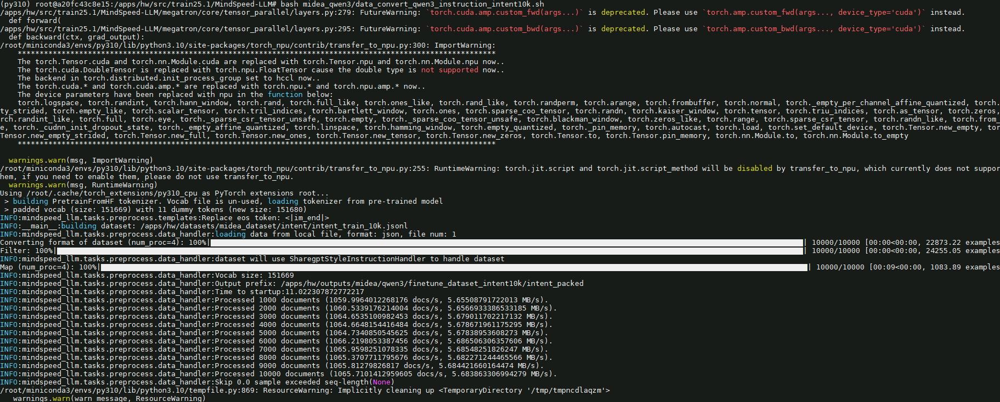


指令微调数据集处理结果如下：

```shell
intent_packed_attention_mask_document.bin
intent_packed_attention_mask_document.idx
intent_packed_input_ids_document.bin
intent_packed_input_ids_document.idx
intent_packed_labels_document.bin
intent_packed_labels_document.idx
```

### 4.2 全参微调训练

修改单机全参微调脚本

```
cp examples/mcore/qwen3/tune_qwen3_14b_4K_full_ptd.sh midea_qwen3/tune_qwen3_14b_4K_full_intent10k_ptd.sh
vim midea_qwen3/tune_qwen3_14b_4K_full_intent10k_ptd.sh 
```

脚本内容修改如下：


```shell
export CUDA_DEVICE_MAX_CONNECTIONS=1 #定义了任务流能够利用或映射到的硬件队列的数量。
export PYTORCH_NPU_ALLOC_CONF=expandable_segments:True #内存碎片优化开关，默认False

# 基础配置
NPUS_PER_NODE=16  #使用单节点的NPU数
MASTER_ADDR=localhost #以本节点ip地址为master_ip
MASTER_PORT=6015 #本节点端口号为6015
NNODES=1  #单机，即一台节点，多机即多节点
NODE_RANK=0  #单机RANK为0，多机为(0,NNODES-1)，不同节点不可重复
WORLD_SIZE=$(($NPUS_PER_NODE*$NNODES)) #最终使用的NPU数

# 根据实际情况配置权重保存、权重加载、词表、数据集路径
CKPT_LOAD_DIR="/apps/hw/outputs/midea/qwen3/14b/mg_weights/qwen3_14b_mcore_tp4pp2/"  #权重加载路径，填入权重转换时保存的权重路径
CKPT_SAVE_DIR="/apps/hw/outputs/midea/qwen3/14b/save_weights_full/qwen3_14b_mcore_tp4pp2_intent10k/"  #训练完成后的权重保存路径
DATA_PATH="/apps/hw/outputs/midea/qwen3/finetune_dataset_intent10k/intent"  #数据集路径，填入数据预处理时保存的数据路径，注意需要添加后缀
TOKENIZER_PATH="/apps/hw/weights/Qwen3-14B/" #词表路径，填入下载的开源权重词表路径

TP=4
PP=2
MBS=16
GBS=128
SEQ_LENGTH=800
TRAIN_ITERS=390 #训练步数

...

DATA_ARGS="
    --data-path $DATA_PATH \
    --split 100,0,0
"

OUTPUT_ARGS="
    --log-interval 1 \
    --save-interval ${TRAIN_ITERS} \
    --eval-interval ${TRAIN_ITERS} \
    --eval-iters 0 \
    --log-throughput
"

TUNE_ARGS="
    --finetune \
    --stage sft \
    --is-instruction-dataset \
    --prompt-type qwen \
    --variable-seq-lengths
"

...

torchrun $DISTRIBUTED_ARGS posttrain_gpt.py \
 	...
    --tensorboard-dir /apps/hw/outputs/qwen3/14b/tb/full/midea/intent10k_0806 \
	...
    | tee /apps/hw/exps/qwen3/midea/full0806/tune_qwen3_14b_full_intent10k.log

```

微调脚本部分参数说明：

- `DATA_PATH`：数据集路径。请注意实际数据预处理生成文件末尾会增加`_input_ids_document`等后缀，该参数填写到数据集的前缀即可。例如实际的数据集相对路径是`./finetune_dataset/alpaca/alpaca_packed_input_ids_document.bin`等，那么只需要填`./finetune_dataset/alpaca/alpaca`即可。
- `is-instruction-dataset`：用于指定微调过程中采用指令微调数据集，以确保模型依据特定指令数据进行微调。
- `variable-seq-lengths`：在不同的mini-batch间支持以动态的序列长度进行微调，默认padding到`8`的整数倍，可以通过`pad-to-multiple-of`参数来修改padding的倍数。详细可参考[variable length flash attention](https://gitee.com/ascend/MindSpeed-LLM/blob/2.1.0/docs/pytorch/features/variable_length_flash_attention.md)。假设微调时指定`--seq-length`序列长度为1024，开启`--variable-seq-lengths`后，序列长度会padding到真实数据长度的8整数倍。如下图所示：  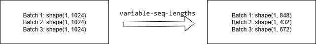

* `--save-interval` 多少步存一次ckpt

如果是单机运行场景，只需要在一台机器上启动微调脚本：

```bash
bash midea_qwen3/tune_qwen3_14b_4K_full_intent10k_ptd.sh 
```

训练过程部分日志如下：

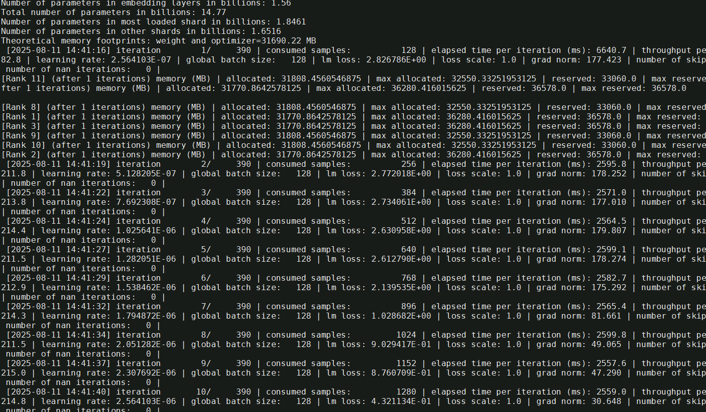


Loss曲线如下：

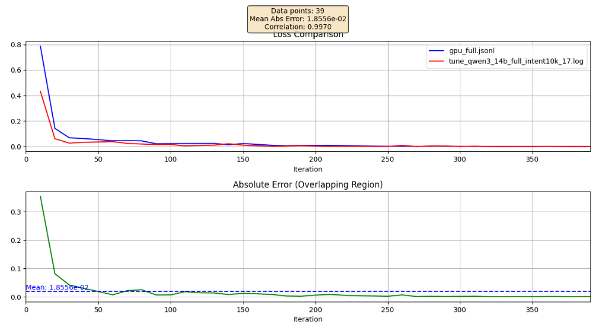

### 4.4 数据集在NPU评测

使用评测脚本

```bash
vim midea_qwen3/qwen3_14b_full_ptd_eval_intent10k.sh
```

修改以下参数：

```bash
CHECKPOINT="/apps/hw/outputs/midea/qwen3/14b/save_weights_full/qwen3_14b_mcore_tp4pp2_intent10k/" # 指向微调后权重的保存路径
TOKENIZER_PATH="/apps/hw/weights/Qwen3-14B/" # 指向模型tokenizer的路径

# Change for multinode config
MASTER_ADDR=localhost
MASTER_PORT=6000
NNODES=1 # 集群里的节点数，以实际情况填写,
NODE_RANK=0  # 当前节点的RANK，多个节点不能重复，主节点为0, 其他节点可以是1,2..
NPUS_PER_NODE=8
WORLD_SIZE=$(($NPUS_PER_NODE*$NNODES))

TP=4
PP=2
SEQ_LENGTH=2048

#重点设置eval-data-path和tee的输出日志路径
torchrun $DISTRIBUTED_ARGS inference_4_midea_test.py \
...
         --eval-data-path "/apps/hw/datasets/midea_dataset/intent/intent_test_1k.jsonl" \
         --eval-data-size 1000 \
                | tee logs/generate_mcore_qwen3_14b_eval_intent10k_dataset.log

```

运行评测脚本：

```bash
bash examples/mcore/qwen3/qwen3_14b_full_ptd_eval_midea_dataset.sh
```

> 评测脚本代码参考附加说明7.3

部分评测日志如下：

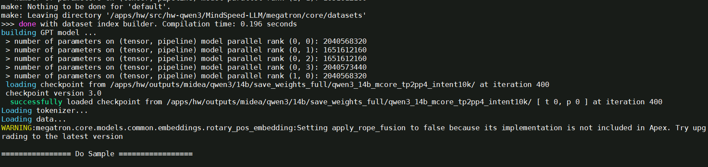

评测结果如下，准确率

```
Average accuracy: 0.942
```

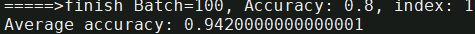

### 4.5  权重MG转为HF

训练完成后，如果需要将Megatron-Mcore（MG）权重转为HuggingFace（HF）权重，修改转换脚本

```bash
cp examples/mcore/qwen3/ckpt_convert_qwen3_mcore2hf.sh midea_qwen3/ckpt_convert_qwen3_14b_intent10k_mcore2hf.sh
vim midea_qwen3/ckpt_convert_qwen3_14b_intent10k_mcore2hf.sh
```

将 Lora权重 合并转换为HF权重的配置参数：

```shell
export CUDA_DEVICE_MAX_CONNECTIONS=1 #定义了任务流能够利用或映射到的硬件队列的数量。
python convert_ckpt.py \
    --use-mcore-models \
    --model-type GPT \
    --load-model-type mg \
    --save-model-type hf \
    --target-tensor-parallel-size 1 \
    --target-pipeline-parallel-size 1 \
    --spec mindspeed_llm.tasks.models.spec.qwen3_spec layer_spec \
    --load-dir /apps/hw/outputs/midea/qwen3/14b/save_weights_sft/qwen3_14b_mcore_tp4pp2/ \
    --save-dir /apps/hw/weights/Qwen3-14B/ \
    --params-dtype bf16 \
    --model-type-hf qwen3
```

>  关键参数： 
>
>  * --save-model-type参数设置为 hf 
>
>  * save-dir 参数设置为原始hf权重的路径，脚本执行后，会在该目录下生成mg2hf的目录存放转换后的权重。
>  * --target-tensor-parallel-size 1， --target-pipeline-parallel-size 1 ：因为转为HF后，无切分策略，因此tp和pp都需要设置为1

运行脚本

```shell
bash midea_qwen3/ckpt_convert_qwen3_14b_intent10k_mcore2hf.sh
```

转换过程部分日志如下

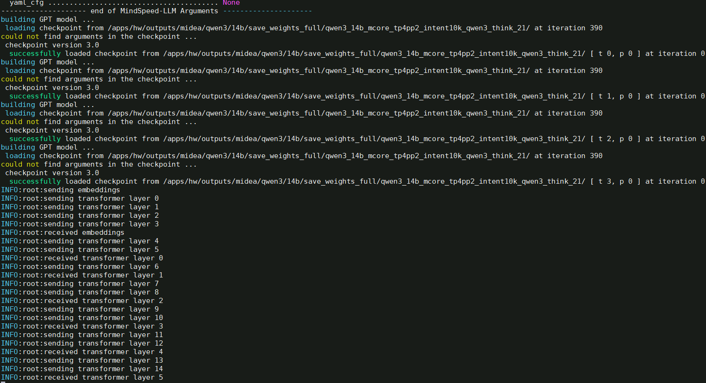

转换完成后，会在`/apps/hw/weights/Qwen3-14B/`目录生成  `mg2hf/` 的目录

```
config.json
generation_config.json
model-00001-of-00006.safetensors
model-00002-of-00006.safetensors
model-00003-of-00006.safetensors
model-00004-of-00006.safetensors
model-00005-of-00006.safetensors
model-00006-of-00006.safetensors
model.safetensors.index.json
```

## 五、Lora微调

### 5.1 数据集转换

Lora 微调的数据集复用全参微调数据集即可。

### 5.2 Lora微调训练

修改单机lora微调脚本

```bash
cp examples/mcore/qwen3/tune_qwen3_14b_4K_lora_ptd.sh midea_qwen3/tune_qwen3_14b_4K_lora_intent10k_ptd.sh
vim midea_qwen3/tune_qwen3_14b_4K_lora_intent10k_ptd.sh
```

脚本内容如下：

```shell
export CUDA_DEVICE_MAX_CONNECTIONS=1  #定义了任务流能够利用或映射到的硬件队列的数量。

# 基础配置
NPUS_PER_NODE=8  #使用单节点的8卡NPU
MASTER_ADDR=localhost #以本节点ip地址为master_ip
MASTER_PORT=6015 #本节点端口号为6015
NNODES=1  #单机，即一台节点，多机即多节点
NODE_RANK=0  #单机RANK为0，多机为(0,NNODES-1)，不同节点不可重复
WORLD_SIZE=$(($NPUS_PER_NODE*$NNODES)) #最终使用的NPU数

# 根据实际情况配置权重保存、权重加载、词表、数据集路径
CKPT_LOAD_DIR="/apps/hw/outputs/midea/qwen3/14b/mg_weights/qwen3_14b_mcore_tp4pp2/"  #权重加载路径，填入权重转换时保存的权重路径
CKPT_SAVE_DIR="/apps/hw/outputs/midea/qwen3/14b/save_weights_lora/qwen3_14b_mcore_tp4pp2_intent10k/"  #训练完成后的权重保存路径
DATA_PATH="/apps/hw/outputs/midea/qwen3/finetune_dataset_intent10k/intent"  #数据集路径，填入数据预处理时保存的数据路径，注意需要添加后缀
TOKENIZER_PATH="/apps/hw/weights/Qwen3-14B/" #词表路径，填入下载的开源权重词表路径

TP=4
PP=2
SEQ_LENGTH=2048
TRAIN_ITERS=790

...

# 重点设置lr=1.0e-5，lr-warmup-fraction=0.1
TRAIN_ARGS="
    --micro-batch-size 4 \
    --global-batch-size 64 \
    --lr 1.0e-5 \
    --lr-decay-style cosine \
    --lr-warmup-fraction 0.1 \
    --attention-dropout 0.0 \
    --init-method-std 0.01 \
    --hidden-dropout 0.0 \
    --clip-grad 1.0 \
    --adam-beta1 0.9 \
    --adam-beta2 0.999 \
    --initial-loss-scale 4096 \
    --seed 42 \
    --bf16 \
    --train-iters ${TRAIN_ITERS} \
    --seq-length ${SEQ_LENGTH} \
    --no-shared-storage
"


torchrun $DISTRIBUTED_ARGS posttrain_gpt.py \
	...
    --tensorboard-dir /apps/hw/outputs/qwen3/14b/tb/lora/midea/intent10k_0804 \
    ...
    | tee logs/tune_qwen3_14b_lora_intent10k_ptd.log
```

运行脚本

```
bash midea_qwen3/tune_qwen3_14b_4K_lora_intent10k_ptd.sh
```

训练部分日志如下：

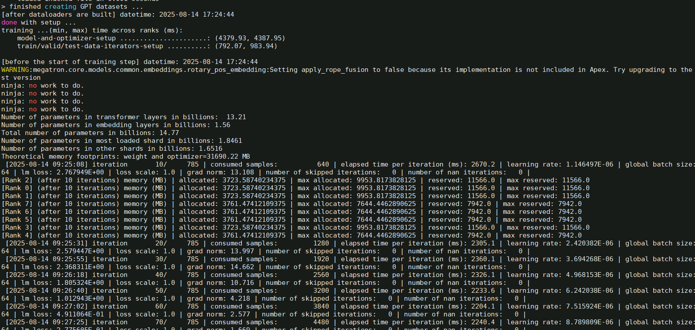

Loss曲线如下：

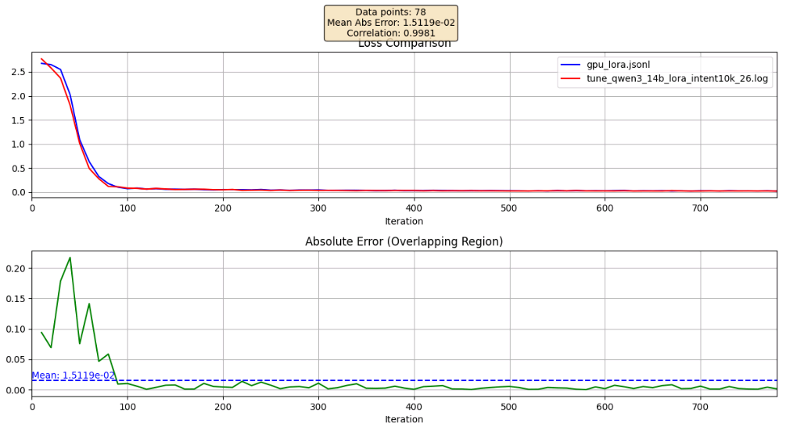

### 5.3 Lora权重与Base权重的合并

基于lora微调训练完后，得到Lora权重与Base权重存在区别，无法直接用于续训，需要转换后才可使用，添加以下参数即可将训练好的 Lora 权重与 Base 权重融合,合并后转换为 Mcore 权重。

修改合并脚本

```
cp examples/mcore/qwen3/ckpt_convert_qwen3_mcore2hf.sh midea_qwen3/ckpt_convert_qwen3_mcore2mcore_lora_intent10k.sh
vim midea_qwen3/ckpt_convert_qwen3_mcore2mcore_lora_intent10k.sh
```

将 Lora权重 合并转换为 Mcore 权重的示例参数：

```shell
python convert_ckpt.py \
    --use-mcore-models \
    --model-type GPT \
    --load-model-type mg \
    --save-model-type mg \
    --target-tensor-parallel-size 4 \
    --target-pipeline-parallel-size 2 \
    --spec mindspeed_llm.tasks.models.spec.qwen3_spec layer_spec \
    --lora-r 16 \
    --lora-alpha 32 \
    --lora-target-modules linear_qkv linear_proj linear_fc1 linear_fc2 \
    --load-dir /apps/hw/outputs/midea/qwen3/14b/mg_weights/qwen3_14b_mcore_tp4pp2/ \
    --lora-load /apps/hw/outputs/midea/qwen3/14b/save_weights_lora/qwen3_14b_mcore_tp4pp2_intent10k/ \
    --save-dir /apps/hw/outputs/midea/qwen3/14b/save_weights_lora/qwen3_14b_mcore_tp4pp2_intent10k_merge/ \
    --model-type-hf qwen3
```

> 关键参数： --save-model-type mg

启动转换脚本：

```shell
bash midea_qwen3/ckpt_convert_qwen3_mcore2mcore_lora_intent10k.sh
```

转换过程部分日志如下：

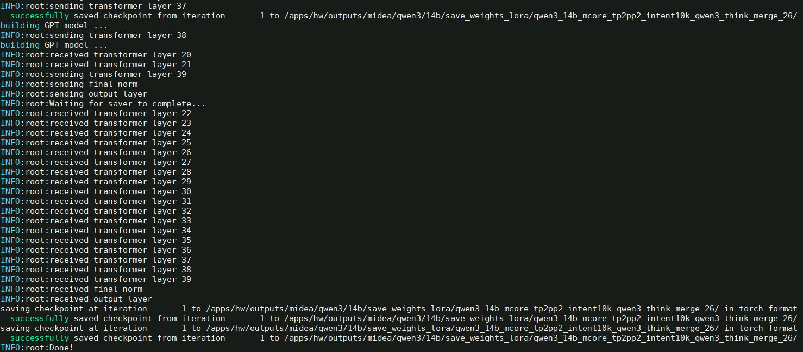

权重合并后的目录下：

```
drwxr-xr-x.  6 root root  4096 Aug 11 23:09 iter_0000001/
-rw-r--r--.  1 root root     1 Aug 19 14:41 latest_checkpointed_iteration.txt
```

### 5.5 数据集在NPU评测

使用评测脚本

```bash
vim midea_qwen3/qwen3_14b_lora_ptd_eval_intent10k.sh
```

修改以下参数：

```bash
CHECKPOINT="/apps/hw/outputs/midea/qwen3/14b/save_weights_lora/qwen3_14b_mcore_tp4pp2_intent10k_merge/" # 指向微调后权重的保存路径
TOKENIZER_PATH="/apps/hw/weights/Qwen3-14B/" # 指向模型tokenizer的路径

# Change for multinode config
MASTER_ADDR=localhost
MASTER_PORT=6000
NNODES=1 # 集群里的节点数，以实际情况填写,
NODE_RANK=0  # 当前节点的RANK，多个节点不能重复，主节点为0, 其他节点可以是1,2..
NPUS_PER_NODE=8
WORLD_SIZE=$(($NPUS_PER_NODE*$NNODES))

TP=2
PP=4
SEQ_LENGTH=2048

#重点设置eval-data-path和tee的输出日志路径
torchrun $DISTRIBUTED_ARGS inference_4_midea_test.py \
...
         --eval-data-path "/apps/hw/datasets/midea_dataset/intent/intent_test_1k.jsonl" \
         --eval-data-size 1000 \
               | tee logs/generate_mcore_qwen3_14b_lora_eval_intent10k.log

```

然后运行评测脚本：

```bash
bash examples/mcore/qwen3/qwen3_14b_lora_ptd_eval_intent10k.sh 
```

部分评测日志如下：

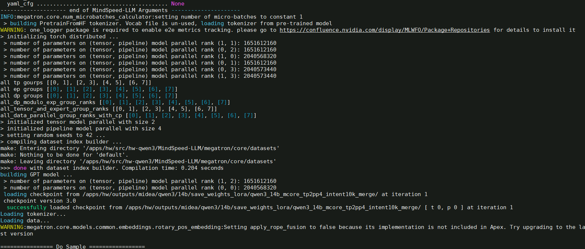

评测结果如下，准确率0.894

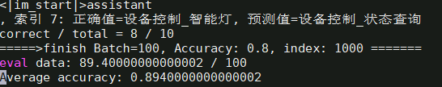

### 5.6 权重MG转为HF

若希望将lora权重合并转换为Hugging Face格式，修改合并脚本

```bash
cp examples/mcore/qwen3/ckpt_convert_qwen3_mcore2hf_lora.sh midea_qwen3/ckpt_convert_qwen3_mcore2hf_lora_intent10k.sh
vim midea_qwen3/ckpt_convert_qwen3_mcore2hf_lora_intent10k.sh
```

将 Lora权重 合并转换为HF权重的示例参数：

```shell
python convert_ckpt.py \
    --use-mcore-models \
    --model-type GPT \
    --load-model-type mg \
    --save-model-type hf \
    --target-tensor-parallel-size 1 \
    --target-pipeline-parallel-size 1 \
    --spec mindspeed_llm.tasks.models.spec.qwen3_spec layer_spec \
    --lora-r 16 \
    --lora-alpha 32 \
    --lora-target-modules linear_qkv linear_proj linear_fc1 linear_fc2 \
    --load-dir /apps/hw/outputs/midea/qwen3/14b/mg_weights/qwen3_14b_mcore_tp4pp2/ \
    --lora-load /apps/hw/outputs/midea/qwen3/14b/save_weights_lora/qwen3_14b_mcore_tp4pp2_intent10k/ \
    --save-dir /apps/hw/weights/Qwen3-14B/ \
    --model-type-hf qwen3
```

>  * --save-model-type参数设置为 hf
>
>  * save-dir 参数设置为原始hf权重的路径，脚本执行后，会在该目录下生成mg2hf的目录存放转换后的权重。
>  * tp和pp都设置为1：  --target-tensor-parallel-size 1 ， --target-pipeline-parallel-size 1 

**注意：** `lora` 参数的值应与微调时的参数设置保持一致，以确保转换后的模型具有相同的性能表现和兼容性。

启动转换脚本：

```shell
bash midea_qwen3/ckpt_convert_qwen3_mcore2hf_lora_intent10k.sh | tee logs/ckpt_convert_qwen3_mcore2hf_lora_intent10k.log
```

转换过程部分日志如下：

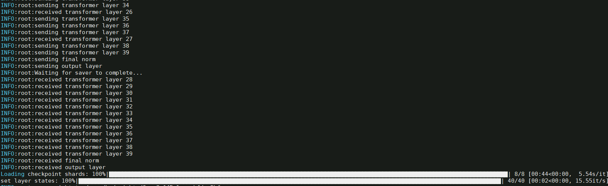

转换完成后，会在`/apps/hw/weights/Qwen3-14B/`目录生成  `mg2hf/` 的目录

```
config.json
generation_config.json
model-00001-of-00006.safetensors
model-00002-of-00006.safetensors
model-00003-of-00006.safetensors
model-00004-of-00006.safetensors
model-00005-of-00006.safetensors
model-00006-of-00006.safetensors
model.safetensors.index.json
```

## 六、预训练

### 6.1 预训练数据集处理

通过对各种格式的数据做提前预处理，避免原始数据的反复处理加载，将所有的数据都统一存储到为.bin和.idx两个文件中，详见[预训练数据处理](https://gitee.com/ascend/MindSpeed-LLM/docs/pytorch/solutions/pretrain/pretrain_dataset.md)。常用的预训练数据集包括alpaca、enwiki、c4等。

以alpaca数据集为例，进行预训练数据集示例。

```shell
wget https://huggingface.co/datasets/tatsu-lab/alpaca/blob/main/data/train-00000-of-00001-a09b74b3ef9c3b56.parquet
```

修改脚本

```bash
cp examples/mcore/qwen3/data_convert_qwen3_pretrain.sh midea_qwen3/data_convert_qwen3_pretrain_enwiki.sh
vim midea_qwen3/data_convert_qwen3_pretrain_enwiki.sh
mkdir -p /apps/hw/outputs/midea/qwen3/pretrain_datasets_enwiki/
```

配置做如下修改：

```shell
python ./preprocess_data.py \
    --input /apps/hw/datasets/enwiki/train-00000-of-00042-d964455e17e96d5a.parquet \
    --tokenizer-name-or-path /apps/hw/weights/Qwen3-14B/ \
    --tokenizer-type PretrainedFromHF \
    --handler-name GeneralPretrainHandler \
    --output-prefix /apps/hw/outputs/midea/qwen3/pretrain_datasets_enwiki/enwiki \
    --json-keys text \
    --workers 4 \
    --log-interval 1000
```

启动转换

```bash
bash midea_qwen3/data_convert_qwen3_pretrain_enwiki.sh
```

转换过程如下：

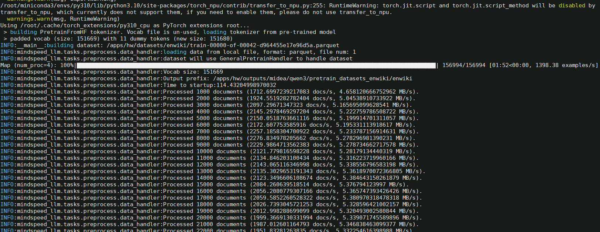

参数解析如下：

| 参数                       | 说明                                                         | 必填 |
| -------------------------- | ------------------------------------------------------------ | ---- |
| `--input`                  | 支持输入数据集目录或文件，目录则处理全部文件, 支持.parquet、.csv、.json、.jsonl、.txt、.arrow格式，同一目录要求数据格式保持一致 | ✅    |
| `--tokenizer-type`         | 说明使用tokenizer类别，参数值为PretrainedFromHF时，词表路径填写模型目录即可 | ✅    |
| `--tokenizer-name-or-path` | 配合tokenizer-type，目标模型的tokenizer原数据文件夹，用于数据集的转换 |      |
| `--tokenizer-model`        | 配合指定分词器模型的路径，路径具体到tokenizer.model文件      |      |
| `--output-prefix`          | 转换后输出的数据集文件的文件名前缀                           | ✅    |
| `--workers`                | 多进程数据集处理                                             | ✅    |

### 6.2 预训练任务启动

打开脚本

```
cp examples/mcore/qwen3/pretrain_qwen3_14b_4K_ptd.sh midea_qwen3/pretrain_qwen3_14b_enwiki_4K_ptd.sh
vim midea_qwen3/pretrain_qwen3_14b_enwiki_4K_ptd.sh
```

脚本内容修改如下：

 ```shell
export CUDA_DEVICE_MAX_CONNECTIONS=1 #定义了任务流能够利用或映射到的硬件队列的数量。
export PYTORCH_NPU_ALLOC_CONF=expandable_segments:True #内存碎片优化开关，默认False
export HCCL_IF_BASE_PORT=30000 #设置HCCL端口

# 基础配置
NPUS_PER_NODE=8  #使用单节点的8卡NPU
MASTER_ADDR=localhost #以本节点ip地址为master_ip
MASTER_PORT=6015 #本节点端口号为6015
NNODES=1  #单机，即一台节点，多机即多节点
NODE_RANK=0  #单机RANK为0，多机为(0,NNODES-1)，不同节点不可重复
WORLD_SIZE=$(($NPUS_PER_NODE*$NNODES)) #最终使用的NPU数

# 根据实际情况配置权重保存、权重加载、词表、数据集路径
CKPT_LOAD_DIR="/apps/hw/outputs/midea/qwen3/14b/mg_weights/qwen3_14b_mcore_tp4pp2/"  #权重加载路径，填入权重转换时保存的权重路径
CKPT_SAVE_DIR="/apps/hw/outputs/midea/qwen3/14b/save_weights_pretrain/qwen3_14b_mcore_tp4pp2/"  #训练完成后的权重保存路径
DATA_PATH="/apps/hw/outputs/midea/qwen3/pretrain_datasets_enwiki/enwiki_text_document"  #数据集路径，填入数据预处理时保存的数据路径，注意需要添加后缀
TOKENIZER_PATH="/apps/hw/weights/Qwen3-14B/" #词表路径，填入下载的开源权重词表路径

TP=4  #tensor-parallel
PP=2  #pipeline-parallel
CP=1  #序列并行
MBS=1 #设置micro-batch-size为1
GBS=128 #设置global-batch-size为64
SEQ_LENGTH=4096  #设置seq_length为4096 
TRAIN_ITERS=2000 #训练多少步
CP_TYPE='ulysses_cp_algo' #序列并行算法
 ```

启动脚本
```shell
bash midea_qwen3/pretrain_qwen3_14b_enwiki_4K_ptd.sh
```

训练日志如下：

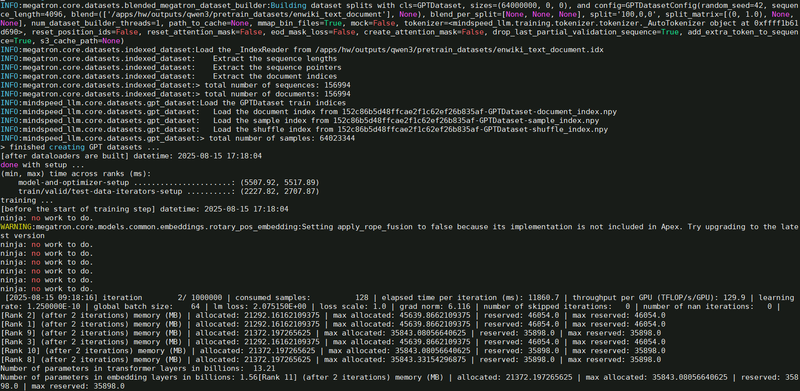

tensorboard监控微调loss下降结果如下：

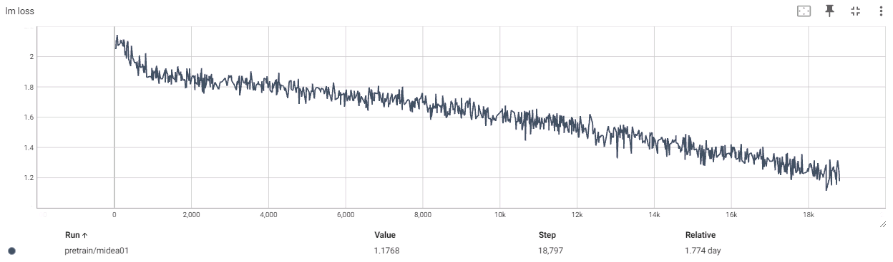

脚本中特性包含部分参数解释

| 参数名                                  | 说明                                                         |
| --------------------------------------- | ------------------------------------------------------------ |
| `--use-mcore-models`                    | 使用mcore分支运行模型                                        |
| `--disable-bias-linear`                 | 去掉linear的偏移值，与qwen原模型一致                         |
| `--add-qkv-bias`                        | 增加Q、K、V的偏移值，是权重的组成部分                        |
| `--group-query-attention`               | 开启GQA注意力处理机制                                        |
| `--num-query-groups 4`                  | 配合GQA使用，设置groups为4                                   |
| `--position-embedding-type rope`        | 位置编码采用rope方案                                         |
| `--untie-embeddings-and-output-weights` | 根据原模型要求将output层和embedding层的权重解耦              |
| `--bf16`                                | 昇腾芯片对BF16精度支持良好，可显著提升训练速度               |
| `--tensorboard-dir`                     | 如需要tensorboard显示loss曲线，增加此参数，用于事件存储目录，如`/apps/hw/outputs/midea/qwen3/14b/tb/pretrain `。查看训练loss曲线使用方法为 `tensorboard --logdir=/apps/hw/outputs/midea/qwen3/14b/tb --port=3000 --bind_all` |

如果需要后台启动任务

```bash
nohup bash midea_qwen3/pretrain_qwen3_14b_4K_ptd.sh >pretrain_qwen3_14b_4K_ptd.log 2>&1 &
```

终止训练进程

```bash
pkill -9 python
```

如果是多机运行，则需要在单机的脚本上修改以下参数：

```shell
# 多机配置 
# 根据分布式集群实际情况配置分布式参数
GPUS_PER_NODE=8  # 每个节点的卡数
MASTER_ADDR="your master node IP"  # 都需要修改为主节点的IP地址（不能为localhost）
MASTER_PORT=6000
NNODES=2  # 集群里的节点数，以实际情况填写,
NODE_RANK="current node id"  # 当前节点的RANK，多个节点不能重复，主节点为0, 其他节点可以是1,2..
WORLD_SIZE=$(($GPUS_PER_NODE * $NNODES))
```

最后确保每台机器上的模型路径和数据集路径等无误后，在多个终端上同时启动预训练脚本即可开始训练。

**注意**：

- 多机训练需在多个终端同时启动预训练脚本(每个终端的预训练脚本只有NODE_RANK参数不同，其他参数均相同)
- 如果使用多机训练，且没有设置数据共享，需要在训练启动脚本中增加`--no-shared-storage`参数，设置此参数之后将会根据布式参数判断非主节点是否需要load数据，并检查相应缓存和生成数据

## 八、附加说明

### 7.1 模型训练常见环境变量说明

模型训练常见环境变量说明：

| 环境变量名称                | 环境变量描述                                                 |
| --------------------------- | ------------------------------------------------------------ |
| ASCEND_LAUNCH_BLOCKING      | 将Host日志输出到串口,0-关闭/1-开启。                         |
| ASCEND_SLOG_PRINT_TO_STDOUT | 设置默认日志级别,0-debug/1-info/2-warning/3-error。          |
| HCCL_WHITELIST_DISABLE      | HCCL白名单开关,1-关闭/0-开启。                               |
| HCCL_CONNECT_TIMEOUT        | 设置HCCL超时时间，默认值为120。                              |
| HCCL_NPU_SOCKET_PORT_RANGE  | 配置HCCL在NPU侧使用的通信端口，支持配置为具体的端口、端口范围或者字符串“auto”。[详细参考](https://www.hiascend.com/document/detail/zh/canncommercial/81RC1/apiref/envvar/envref_07_0144.html) |
| CUDA_DEVICE_MAX_CONNECTIONS | 定义了任务流能够利用或映射到的硬件队列的数量。               |
| TASK_QUEUE_ENABLE           | 用于控制开启task_queue算子下发队列优化的等级，0：关闭，1：开启Level 1优化，2：开启Level 2优化。 |
| COMBINED_ENABLE             | 设置combined标志。设置为0表示关闭此功能；设置为1表示开启，用于优化非连续两个算子组合类场景。 |
| PYTORCH_NPU_ALLOC_CONF      | 内存碎片优化开关，默认是expandable_segments:False，使能时expandable_segments:True。 |
| ASCEND_RT_VISIBLE_DEVICES   | 指定哪些Device对当前进程可见，支持一次指定一个或多个Device ID。通过该环境变量，可实现不修改应用程序即可调整所用Device的功能。 |
| NPUS_PER_NODE               | 配置一个计算节点上使用的NPU数量。                            |
| HCCL_SOCKET_IFNAME          | 指定hccl socket通讯走的网卡配置。                            |
| GLOO_SOCKET_IFNAME          | 指定gloo socket通讯走的网卡配置。                            |
| HCCL_LOGIC_SUPERPOD_ID      | 指定当前设备的逻辑超节点ID，如果走ROCE，不同多机超节点ID不同，0-N。 |

### 7.2 训练参数说明

训练脚本常见参数解释

| 参数                              | 说明                                                         | 必填 |
| --------------------------------- | ------------------------------------------------------------ | ---- |
| `--model-type GPT`                | 指定模型类型为GPT系列                                        | ✅    |
| `--use-mcore-models`              | 转换为Megatron-Mcore格式                                     | ✅    |
| `--target-tensor-parallel-size`   | 张量并行度设置                                               | ✅    |
| `--target-pipeline-parallel-size` | 流水线并行度设置                                             | ✅    |
| `--tokenizer-model`               | 指定分词器路径                                               | ✅    |
| `--load-model-type`               | 加载权重的类别（可以是hf、mg）                               | ✅    |
| `--save-model-type`               | 存储权重的类别（可以是hf、mg）                               | ✅    |
| `--load-dir`                      | 权重文件加载路径                                             | ✅    |
| `--save-dir`                      | 权重文件保存路径                                             | ✅    |
| `--model-type-hf`                 | huggingface模型类别，默认为llama2                            |      |
| `--params-dtype`                  | 指定权重转换后的权重精度模式，默认为fp16，如果源文件格式为bf16，则需要设置为bf16 | ✅    |
| `--tensorboard-dir`               | 开启tensorboard数据收集并指定tensorboard的事件存储目录，如` ./tb `。查看训练loss曲线使用方法为 `tensorboard --logdir=./tb --port=3000` |      |

### 7.3 评测脚本适配

`inference_4_midea_test.py` 的代码如下：

```
import argparse
from typing import Union
from mindspeed_llm import megatron_adaptor

from evaluate_intent_mg import evaluate
from megatron.core.models.gpt.gpt_layer_specs import get_gpt_layer_with_transformer_engine_spec, \
    get_gpt_layer_local_spec
from megatron.core.transformer.spec_utils import import_module
from megatron.legacy.model import GPTModel
from megatron.training import get_args, print_rank_0
from megatron.training.arguments import core_transformer_config_from_args
from megatron.training.initialize import initialize_megatron
from megatron.training.yaml_arguments import core_transformer_config_from_yaml
from mindspeed_llm.tasks.inference.module import GPTModelInfer, MegatronModuleForCausalLM


def model_provider(pre_process=True, post_process=True) -> Union[GPTModelInfer, GPTModel]:
    """Builds the model.

    If you set the use_mcore_models to True, it will return the mcore GPT model and if not the legacy GPT model.

    Args:
        pre_process (bool, optional): Set to true if you need to compute embedings. Defaults to True.
        post_process (bool, optional): Set to true if you need to want to compute output logits/loss. Defaults to True.


    Returns:
        Union[GPTModelInfer, GPTModel]: The returned model
    """
    args = get_args()
    use_te = args.transformer_impl == "transformer_engine"

    if args.sequence_parallel and args.use_kv_cache:
        raise AssertionError('Use_kv_cache can not be true in sequence_parallel mode.')

    print_rank_0('building GPT model ...')
    # Experimental loading arguments from yaml
    if args.yaml_cfg is not None:
        config = core_transformer_config_from_yaml(args, "language_model")
    else:
        config = core_transformer_config_from_args(args)

    if args.use_mcore_models:
        if args.spec is not None:
            transformer_layer_spec = import_module(args.spec)
        else:
            if use_te:
                transformer_layer_spec = get_gpt_layer_with_transformer_engine_spec(args.num_experts,
                                                                                    args.moe_grouped_gemm)
            else:
                transformer_layer_spec = get_gpt_layer_local_spec(args.num_experts, args.moe_grouped_gemm)

        model = GPTModelInfer(
            config=config,
            transformer_layer_spec=transformer_layer_spec,
            vocab_size=args.padded_vocab_size,
            max_sequence_length=args.max_position_embeddings,
            pre_process=pre_process,
            post_process=post_process,
            fp16_lm_cross_entropy=args.fp16_lm_cross_entropy,
            parallel_output=True if args.sequence_parallel else False,
            share_embeddings_and_output_weights=not args.untie_embeddings_and_output_weights,
            position_embedding_type=args.position_embedding_type,
            rotary_percent=args.rotary_percent,
            seq_len_interpolation_factor=args.rotary_seq_len_interpolation_factor
        )
    else:
        if not args.context_parallel_size == 1:
            raise ValueError("Context parallelism is only supported with Megatron Core!")

        model = GPTModel(
            config,
            parallel_output=True if args.sequence_parallel else False,
            pre_process=pre_process,
            post_process=post_process
        )

    return model


def extra_args_provider(parser):
    parser.add_argument("--eval-data-path", type=str, default=None, help="Path to the evaluation data")
    parser.add_argument("--eval-data-size", type=int, default=100, help="Number of examples to evaluate")
    parser.add_argument("--eval-batch-size", type=int, default=10, help="Batch size for evaluation")
    return parser

def main():
    initialize_megatron(extra_args_provider=extra_args_provider, args_defaults={'no_load_rng': True,
                                                                                'no_load_optim': True})

    args = get_args()

    model = MegatronModuleForCausalLM.from_pretrained(
        model_provider=model_provider,
        pretrained_model_name_or_path=args.load
    )

    evaluate(model, args)


if __name__ == "__main__":
    main()
```

`evaluate_intent_mg.py`

```
import json
import random
import time
import re
from math import ceil

from datasets import load_dataset
from torch import distributed as dist
from transformers import AutoTokenizer

from megatron.training import print_rank_0


# --------------- 加载数据 ----------------
def load_data(path, test_size):
    if path.endswith(".json"):
        with open(path, "r", encoding="utf-8") as f:
            data = json.load(f)
    elif path.endswith(".jsonl"):
        with open(path, "r", encoding="utf-8") as f:
            data = [json.loads(line) for line in f]
    elif path.endswith(".parquet"):
        dataset = load_dataset("parquet", data_files={"test": path})
        data = dataset["test"].to_list()
    else:
        raise ValueError("Unsupported file format.")
    if test_size is not None:
        random.seed(42)
        random.shuffle(data)
        return data[:test_size]
    return data


# --------------- 构造对话模版 ----------------
def convert_to_hf_chat_format(conversations):
    return [
        {"role": turn["role"], "content": turn["content"].strip()}
        for turn in conversations
        if turn["role"] in {"system", "user"}
    ]


def format_prompt(hf_conversation, tokenizer):
    return tokenizer.apply_chat_template(
        hf_conversation,
        tokenize=False,
        add_generation_prompt=True
    )


# --------------- 评估 accuracy ----------------
def evaluate_prediction(ground_truth_list, prediction_list, prompt_list):
    total = len(ground_truth_list)
    correct_list = [gt == prediction for gt, prediction in zip(ground_truth_list, prediction_list)]
    correct = sum(correct_list)

    for i, (gt, pred, is_correct, prompt) in enumerate(zip(ground_truth_list, prediction_list, correct_list, prompt_list)):
        if not is_correct:
            print_rank_0(f"预测错误：")
            print_rank_0(f"Prompt: {prompt}, 索引 {i}: 正确值={gt}, 预测值={pred}")

    print_rank_0(f"correct / total = {correct} / {total}")
    return correct / total


# --------------- 评测数入口 ----------------
def evaluate(model, args):
    print_rank_0("Loading tokenizer...")
    tokenizer = AutoTokenizer.from_pretrained(args.tokenizer_name_or_path, trust_remote_code=True)

    print_rank_0("Loading data...")
    data = load_data(args.eval_data_path, test_size=args.eval_data_size)
    accuracy_list = []
    for i in range(0, len(data), args.eval_batch_size):
        bs_no = i // args.eval_batch_size + 1
        print_rank_0(f"==============  Batch {bs_no} / {ceil(args.eval_data_size / args.eval_batch_size)} : Start ({i} + {args.eval_batch_size}) / {args.eval_data_size} =============")
        batch_data = data[i:i + args.eval_batch_size]
        accuracy = evaluate_one_bacth(args, batch_data, model, tokenizer)
        accuracy_list.append(accuracy)
        print_rank_0(f"=====>finish Batch={bs_no}, Accuracy: {accuracy}, index: {i + len(batch_data)} =======")

    print_rank_0(f"eval data: {sum(accuracy_list)} / {len(accuracy_list)}")
    print_rank_0("Average accuracy: {}".format(sum(accuracy_list) / len(accuracy_list)))


def evaluate_one_bacth(args, data, model, tokenizer):
    ground_truth_list = []
    prompt_list = []
    for example in data:
        messages = example["messages"]

        # 找到 ground truth
        assistant_turns = [m for m in messages if m["role"] == "assistant"]
        if not assistant_turns:
            continue
        ref_response = assistant_turns[0]["content"]
        ground_truth_list.append(ref_response)

        # 构造 prompt（system/user）
        hf_conversation = convert_to_hf_chat_format(messages)
        prompt = format_prompt(hf_conversation, tokenizer)
        prompt_list.append(prompt)
    # batch generating
    outputs_list = task_do_sample(args, model, prompt_list)
    prediction_list = [re.sub(r'<think>.*?</think>', '', outputs, flags=re.DOTALL) for outputs in outputs_list]
    prediction_list = [outputs.strip() for outputs in prediction_list]
    print_rank_0(f"===>ground_truth_list = {ground_truth_list}\n")
    print_rank_0(f"===>outputs_list = {outputs_list}\n")
    print_rank_0(f"===>prediction_list = {prediction_list}\n")
    #accuracy = evaluate_prediction(ground_truth_list, outputs_list, prompt_list)
    accuracy = evaluate_prediction(ground_truth_list, prediction_list, prompt_list)
    return accuracy


def task_do_sample(args, model, instructions: list):
    t = time.time()
    output = model.generate(
        instructions,
        do_sample=True,
        top_k=args.top_k,
        top_p=args.top_p,
        temperature=args.temperature,
        max_new_tokens=args.max_new_tokens,
        stream=False
    )

    if dist.get_rank() == 0:
        print_rank_0("\n================ Do Sample =================")
        print_rank_0(f"\nYou:\n{instructions}\n\nMindSpeed-LLM:\n{output}")
        print_rank_0("============================================")
        print_rank_0(f"\nElapsed: {round(time.time() - t, 2)}s")

    dist.barrier()
    return output
```

