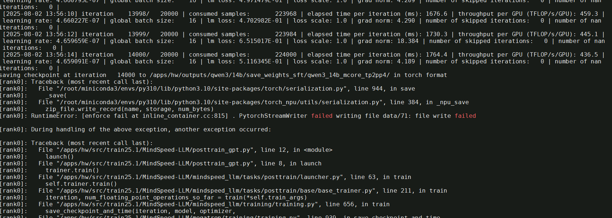

## 运行一段时间后因异常自动停止训练

打印构造后的prompt
395         print("encode_tokens:",encoded_messages)
396         print("message:", tokenizer.decode(encoded_messages, skip_special_tokens=false))

cd /data/private/llm_workspace && bash data_convert_qwen3_instruction_intent10k_qwen3.sh

https://huggingface.co/blog/qwen-3-chat-template-deep-dive