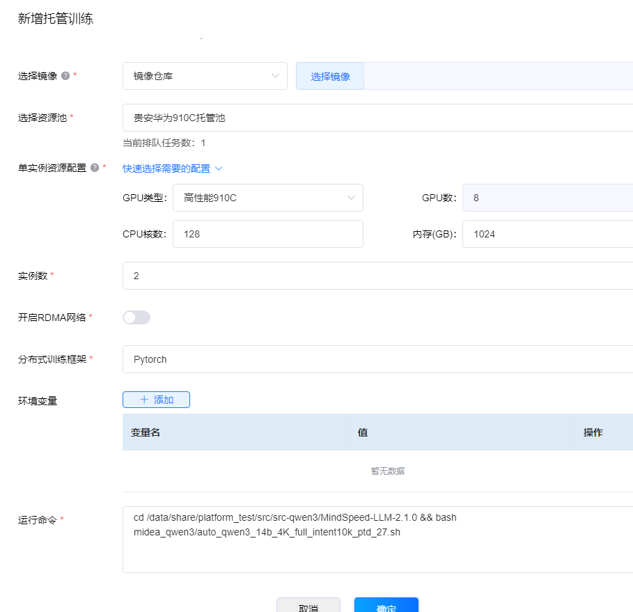
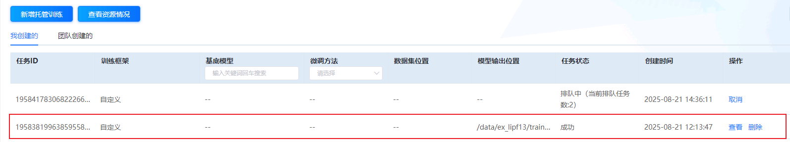
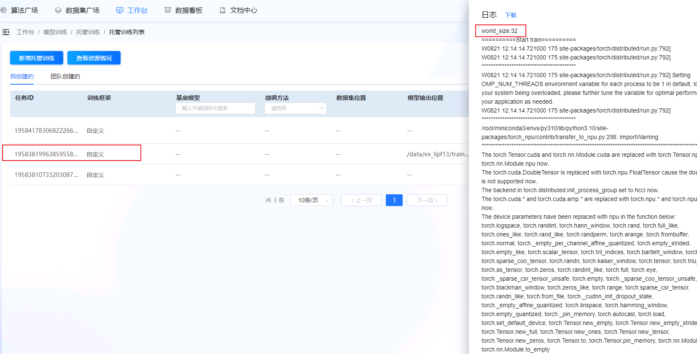
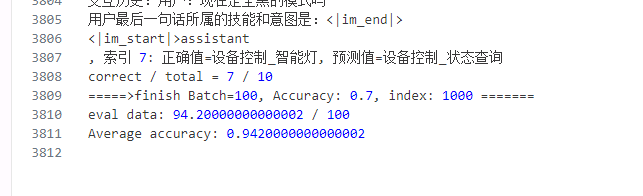
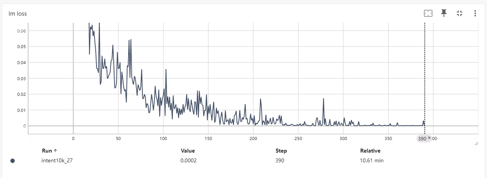

# 算法平台qwen3-14b双机16卡验证

## 1.算法平台启动多机多卡托管训练

登录算法管理平台，依次点击：工作台—>模型训练—>实验环境—>新增实验环境，如下图所示

按照需求依次填入信息：

| 配置项         | 配置值                                                       |
| -------------- | ------------------------------------------------------------ |
| 选择训练模板   | 自定义                                                       |
| 镜像仓库       | registry-cn-guian.midea.com/aios/a3_llm_release:v2.1.3-aimp  |
| 选择资源池     | 贵安华为910C托管池                                           |
| 实例资源配置   | 按需，当前样例选择：配置4：GPU卡数8卡；CPU核数128核；内存1024GB |
| 实例数         | 按需，当前样例选择：2                                        |
| 开启RDMA网络   | 否                                                           |
| 分布式训练框架 | Pytorch                                                      |
| 环境变量       | 无                                                           |
| 运行命令       | cd /data/share/platform_test/src/src-qwen3/MindSpeed-LLM-2.1.0 && bash midea_qwen3/auto_qwen3_14b_4K_full_intent10k_ptd_27.sh |

点击下方“确定”按钮。

任务执行完成任务状态变为“成功”

## 2.查看任务日志

在算法平台查看日志

训练日志路径：

* 容器内：`/data/share/platform_test/src/src-qwen3/MindSpeed-LLM-2.1.0/logs/tune_qwen3_14b_full_intent10k_27.log`
* 共享存储：`/apps/shared_storage/app/team/1950833868382666752/platform_test/src/src-qwen3/MindSpeed-LLM-2.1.0/logs/tune_qwen3_14b_full_intent10k_27.log`

评测结果0.942，评测日志路径：

* 容器内：`/data/share/platform_test/src/src-qwen3/MindSpeed-LLM-2.1.0/logs/generate_mcore_qwen3_14b_eval_intent10k_27.log`

* 共享存储：`/apps/shared_storage/app/team/1950833868382666752/platform_test/src/src-qwen3/MindSpeed-LLM-2.1.0/logs/generate_mcore_qwen3_14b_eval_intent10k_27.log`

  

tensorboard 日志：

* 容器内：`/data/share/lpf/outputs/qwen3/14b/tb/full/midea/intent10k_27/`
* 共享存储：`/apps/shared_storage/app/team/1950833868382666752/lpf/outputs/qwen3/14b/tb/full/midea/intent10k_27/`

## 3. 评测结果总结

| 使用设备 | 全参微调@NPU A3(16卡) | 全参微调@NPU A3(8卡) |
| -------- | --------------------- | -------------------- |
| 评测得分 | 0.942                 | 0.942                |
| 训练耗时 | 637秒                 | 1036秒               |

## 4. Loss曲线

在tenorboard中查看曲线

