# 第一部分：Qwen2.5_7B业务数据集训练指导

## 一、 训练导读

MindSpeedLLM是基于昇腾生态的大语言模型分布式训练框架，旨在为华为 [昇腾芯片](https://gitee.com/link?target=https%3A%2F%2Fwww.hiascend.com%2F) 生态合作伙伴提供端到端的大语言模型训练方案，包含分布式预训练、分布式指令微调以及对应的开发工具链（数据预处理、权重转换、在线推理、基线评估等）。

本文档将详细介绍如何在昇腾A3超节点环境下，使用MindSpeedLLM框架完成Qwen2.5-7B-Instruct模型在业务数据集上的全参微调和LoRA微调，以及相关的评估流程。无论是初次接触大模型训练的新手，还是有经验的算法工程师，都能从本文档中获取到实用的指导和参考。

本文章节简介：

- **测试环境**：详细说明完成训练所需的硬件环境（A3超节点）、软件环境（Driver、Firmware、Python、CANN等）和镜像准备信息，确保读者了解基础环境配置要求。

- **平台快速验证**：介绍了如何在算法管理平台上的实验环境验以及托管环境上快速体验训练过程，并提供了可执行的权重转换，数据处理，训练脚本等脚本。

- **后续章节**：以Qwen2.5-7B为例，详细介绍基于业务数据集GPU到NPU迁移训练的验证测试流程以及测试结果。

## 二、 测试环境

本次测试基于MindCluster集群进行资源调度，创建训练任务，完成Qwen2.5-7B-Instruct在业务数据集上的全参微调以及Lora微调训练与评测。使用到的软件以及硬件环境如下：

### 2.1. 硬件环境

| 硬件名称 | 配置信息  | 备注 |
| -------- | --------- | ---- |
| 机器型号 | A3 超节点 |      |
| 测试集群 | 8卡Pod    | 单机 |

### 2.2. 软件环境

| 软件          | 版本              | 部署方式 |
| ------------- | ----------------- | -------- |
| Driver        | AscendHDK 25.2.0  | 宿主机   |
| Firmware      | AscendHDK 25.2.0  | 宿主机   |
| Python        | 3.10.18           | 容器     |
| CANN          | 8.2.RC1           | 容器     |
| Torch         | 2.6.0             | 容器     |
| Torch_npu     | 2.6.0             | 容器     |
| MindSpeed     | 2.1.0_core_r0.8.0 | 容器     |
| MindSpeed-LLM | 2.1.0             | 容器     |
| Megatron-LM   | core_r0.8.0       | 容器     |
| Docker镜像OS  | Ubuntu 20.04.6    | /        |

### 2.3. 镜像准备

当前使用镜像为：registry-cn-guian.midea.com/aios/a3_llm_release:v2.1.3-aimp

## 三、 平台快速验证

### 3.1. 实验环境验证

#### 3.1.1. 新建环境

登录算法管理平台，依次点击：工作台—>模型训练—>实验环境—>新增实验环境，如下图所示

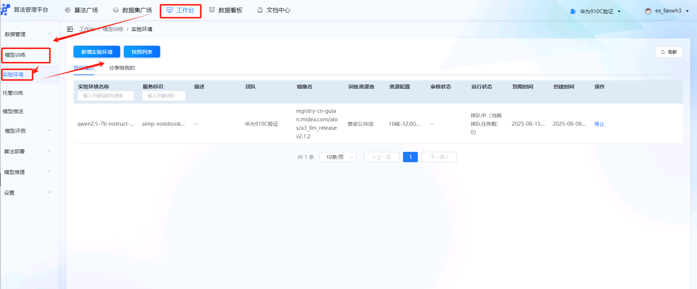

按照需求依次填入信息，“选择镜像”一栏中选择自定义镜像地址，这里镜像地址为：registry-cn-guian.midea.com/aios/a3_llm_release:v2.1.3-aimp

“训练资源池”选择昇腾资源池，按照需求申请相应配置即可

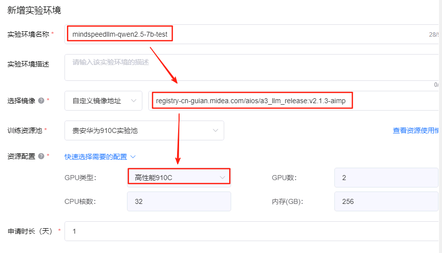

申请完成后点击下图的”VSCode“


可在VSCode中选择“TERMINAL”即可远程到客户环境

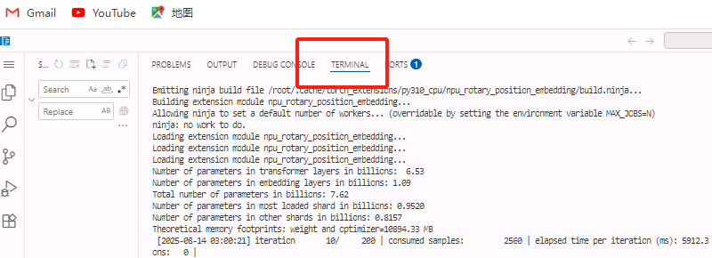

#### 3.1.2. 启动脚本

##### 3.1.2.1. 脚本准备

为便于快速体验训练过程，本文已准备了Qwen2.5-7B模型的训练验证脚本，包括数据预处理、模型格式转换、全量微调和LoRA微调等功能，放在到`/data/share/platform_test`路径下。

##### 3.1.2.2. 目录结构

```sh
scripts/
    ├── ckpt_convert_qwen25_hf2mcore_tp2_pp1.sh  # 将HF格式模型转换为Mcore格式(TP=2, PP=1)
    ├── ckpt_convert_qwen25_hf2mcore_tp4_pp2.sh  # 将HF格式模型转换为Mcore格式(TP=4, PP=2)
    ├── data_convert_qwen25_instruction.sh       # 指令数据转换脚本
    └── qwen25_7b_instruct/                      # Qwen2.5-7B指令微调相关脚本
        ├── ckpt_convert_qwen25_mcore2hf_4_full_eval.sh  # 将Mcore格式全量模型转换为HF格式用于评估
        ├── ckpt_convert_qwen25_mcore2hf_4_lora_eval.sh   # 将Mcore格式LoRA模型转换为HF格式用于评估
        ├── generate_qwen25_7b_lora_ptd.sh                # 生成Qwen2.5-7B LoRA模型PTD文件
        ├── generate_qwen25_7b_ptd.sh                     # 生成Qwen2.5-7B全量模型PTD文件
        ├── tune_qwen25_7b_4k_full_ptd.sh                 # Qwen2.5-7B全量微调脚本
        └── tune_qwen25_7b_4k_lora_ptd.sh                 # Qwen2.5-7B LoRA微调脚本
```

#### 3.1.3. 训练权重准备

##### 3.1.3.1. 模型下载

从HuggingFace下载模型权重[Qen2.5-7B-Instruct](https://huggingface.co/Qwen/Qwen2.5-7B-Instruct)，已放置在`/data/share/platform_test`目录下。

##### 3.1.3.2. 目录结构

```sh
models/
   └── Qwen2.5-7B-Instruct
       ├── config.json
       ├── configuration.json
       ├── generation_config.json
       ├── latest_checkpointed_iteration.txt
       ├── LICENSE
       ├── merges.txt
       ├── model-00001-of-00004.safetensors
       ├── model-00002-of-00004.safetensors
       ├── model-00003-of-00004.safetensors
       ├── model-00004-of-00004.safetensors
       ├── model.safetensors.index.json
       ├── README.md
       ├── tokenizer_config.json
       ├── tokenizer.json
       └── vocab.json
```

#### 3.1.4. 训练测试集准备

##### 3.1.4.1. 数据准备

准备训练与测试数据集，已放在`/data/share/platform_test`目录下

##### 3.1.4.2. 目录结构

```sh
datasets/
   ├── intent_test_1k.jsonl # 测试集
   └── intent_train_10k.jsonl # 训练集
```

### 3.2. 托管环境验证

#### 3.2.1. 全参微调

```sh
# 选择镜像
registry-cn-guian.midea.com/aios/a3_llm_release:v2.1.3-aimp

# 启动命令
cd /data/share/platform_test/scripts && bash data_convert_qwen25_instruction.sh && bash ckpt_convert_qwen25_hf2mcore_tp4_pp2.sh && bash qwen25_7b_instruct/tune_qwen25_7b_4k_full_ptd.sh
```

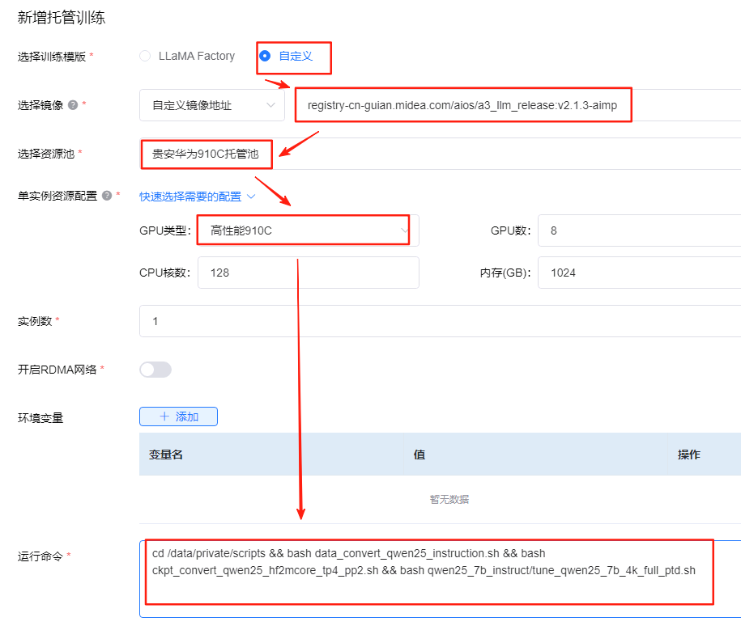

#### 3.2.2. Lora微调

```sh
# 选择镜像
registry-cn-guian.midea.com/aios/a3_llm_release:v2.1.3-aimp

# 启动命令
cd /data/share/platform_test/scripts && bash data_convert_qwen25_instruction.sh && bash ckpt_convert_qwen25_hf2mcore_tp2_pp1.sh && bash qwen25_7b_instruct/tune_qwen25_7b_4k_lora_ptd.sh
```

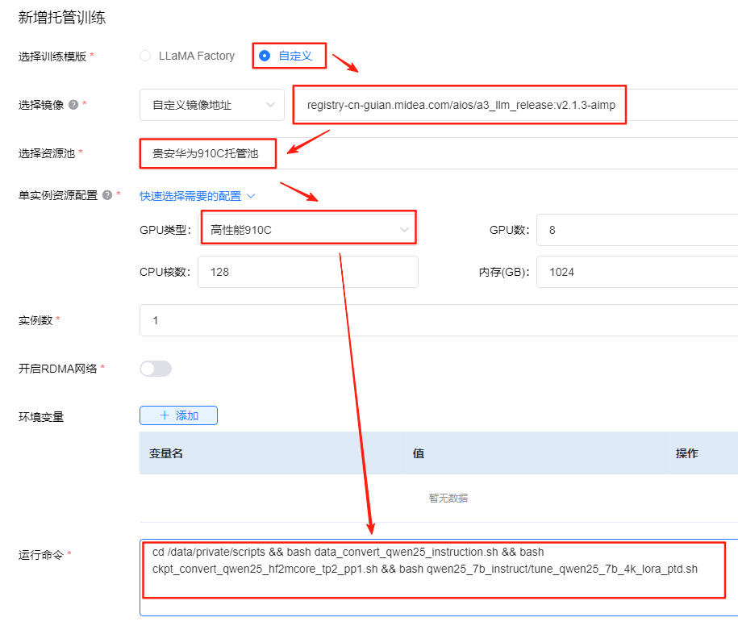

#### 3.2.3. 运行结果

运行完成后，会在`/data/private`目录下生成如下文件。

##### 3.2.3.1. 输出日志

```sh
outputs/
└── qwen2.5-7b
    ├── logs
        ├── tensorboard_dir/ # tensorboard 目录
        ├── tune_mcore_qwen25_7b_full_tp4_pp2_train.log # 全参微调训练日志
        └── tune_mcore_qwen25_7b_lora_tp2_pp1_train.log # Lora微调训练日志
```

##### 3.2.3.2. 数据解析结果

```sh
datasets/
    ├── intent_train_10k/ # 数据集预处理结果
        ├── intent_train_10k_packed_attention_mask_document.bin
        ├── intent_train_10k_packed_attention_mask_document.idx
        ├── intent_train_10k_packed_input_ids_document.bin
        ├── intent_train_10k_packed_input_ids_document.idx
        ├── intent_train_10k_packed_labels_document.bin
        ├── intent_train_10k_packed_labels_document.idx
        ├── intent_train_10k_train_indexmap_50240ns_1234s_padded_samples_shuffle_decoder_packed_idx.npy
        └── intent_train_10k_train_indexmap_51200ns_1234s_padded_samples_shuffle_decoder_packed_idx.npy
```

##### 3.2.3.3. 权重结果

```sh
models_mg/
    ├── ckpt
    │   ├── Qwen2.5-7B-Instruct_tp2_pp1_lora # Lora微调后的权重
    │   └── Qwen2.5-7B-Instruct_tp4_pp2 # 全参微调后的权重
    ├── Qwen2.5-7B-Instruct_tp2_pp1 # 权重转换结果TP2PP1
    └── Qwen2.5-7B-Instruct_tp4_pp2 # 权重转换结果TP4PP2
```

## 四、 LLaMAFactory训练信息

本章节主要是汇总客户在LLaMAFactory训练信息，用于后续MindspeedLLM训练参数对齐，数据解析参考。

### 4.1. LLaMAFactory脚本

LLaMAFactory启动脚本及其配置如下：

#### 4.1.1. 启动命令

```sh
# 全量微调用了 8 卡200steps
cd /data/likuan/llm_experiment/LLaMA-Factory
llamafactory-cli train ../sft/scripts/train_qwen2.5_7B_full_sft.yaml
# 关键参数
GBS=256
MAX_ITER=200
dataset_size=10000
epoch=5
256*200=51200

# lora微调 是 2 卡785steps
cd /data/likuan/llm_experiment/LLaMA-Factory
/apps/likuan/llm_experiment/sft/scripts/train_qwen2.5_7B_lora_sft.yaml
# 关键参数
GBS=64
MAX_ITER=785
dataset_size=10000
epoch=5
64*785=50240
```

#### 4.1.2. 全参微调

```sh
# 业务启动参数 train_qwen2.5_7B_full_sft.yaml

### model
model_name_or_path: /data/team/llm/Qwen2.5-7B-Instruct
trust_remote_code: true

### method
stage: sft
do_train: true
finetuning_type: full
deepspeed: examples/deepspeed/ds_z3_config.json  # choices: [ds_z0_config.json, ds_z2_config.json, ds_z3_config.json]

### dataset
dataset: intent
template: qwen
cutoff_len: 2048
max_samples: 40000
overwrite_cache: true
preprocessing_num_workers: 16
dataloader_num_workers: 4

output_dir: ../sft/models/qwen2.5_7B_intent_10k_5e
logging_steps: 10
save_steps: 100
plot_loss: true
overwrite_output_dir: true
save_only_model: false
report_to: tensorboard  # choices: [none, wandb, tensorboard, swanlab, mlflow]

### train
per_device_train_batch_size: 32
gradient_accumulation_steps: 1
learning_rate: 1.0e-5
num_train_epochs: 5
lr_scheduler_type: cosine
warmup_ratio: 0.1
bf16: true
ddp_timeout: 180000000
resume_from_checkpoint: null

### eval
# eval_dataset: alpaca_en_demo
# val_size: 0.1
# per_device_eval_batch_size: 1
# eval_strategy: steps
# eval_steps: 500
```

```json
// ds_z3_config.json
{
  "train_batch_size": "auto",
  "train_micro_batch_size_per_gpu": "auto",
  "gradient_accumulation_steps": "auto",
  "gradient_clipping": "auto",
  "zero_allow_untested_optimizer": true,
  "fp16": {
    "enabled": "auto",
    "loss_scale": 0,
    "loss_scale_window": 1000,
    "initial_scale_power": 16,
    "hysteresis": 2,
    "min_loss_scale": 1
  },
  "bf16": {
    "enabled": "auto"
  },
  "zero_optimization": {
    "stage": 3,
    "overlap_comm": false,
    "contiguous_gradients": true,
    "sub_group_size": 1e9,
    "reduce_bucket_size": "auto",
    "stage3_prefetch_bucket_size": "auto",
    "stage3_param_persistence_threshold": "auto",
    "stage3_max_live_parameters": 1e9,
    "stage3_max_reuse_distance": 1e9,
    "stage3_gather_16bit_weights_on_model_save": true
  }
}

```

#### 4.1.3. Lora微调

```sh
# 业务启动参数

### model
model_name_or_path: /data/team/llm/Qwen2.5-7B-Instruct
trust_remote_code: true

### method
stage: sft
do_train: true
finetuning_type: lora
lora_rank: 16
lora_target: all

### dataset
dataset: intent
template: qwen
cutoff_len: 2048
max_samples: 40000
overwrite_cache: true
preprocessing_num_workers: 16
dataloader_num_workers: 4

### output
output_dir: ../sft/models/qwen2.5_7B_lora_intent_10k_5e
logging_steps: 10
save_steps: 100
plot_loss: true
overwrite_output_dir: true
save_only_model: false
report_to: tensorboard  # choices: [none, wandb, tensorboard, swanlab, mlflow]

### train
per_device_train_batch_size: 32
gradient_accumulation_steps: 1
learning_rate: 1.0e-5
num_train_epochs: 5.0
lr_scheduler_type: cosine
warmup_ratio: 0.1
bf16: true
ddp_timeout: 180000000
resume_from_checkpoint: null

### eval
# eval_dataset: alpaca_en_demo
# val_size: 0.1
# per_device_eval_batch_size: 1
# eval_strategy: steps
# eval_steps: 500
```

### 4.2. 评测

#### 4.2.1. 原始评测脚本

```sh
import argparse
import json
import random
from datasets import load_dataset
from vllm import LLM, SamplingParams
from vllm.lora.request import LoRARequest
from transformers import AutoTokenizer


# --------------- 加载数据 ----------------
def load_data(path, test_size):
    if path.endswith(".json"):
        with open(path, "r", encoding="utf-8") as f:
            data = json.load(f)
    elif path.endswith(".jsonl"):
        with open(path, "r", encoding="utf-8") as f:
            data = [json.loads(line) for line in f]
    elif path.endswith(".parquet"):
        dataset = load_dataset("parquet", data_files={"test": path})
        data = dataset["test"].to_list()
    else:
        raise ValueError("Unsupported file format.")
    if test_size is not None:
        random.seed(42)
        random.shuffle(data)
        return data[:test_size]
    return data


# --------------- 构造对话模版 ----------------
def convert_to_hf_chat_format(conversations):
    return [
        {"role": turn["role"], "content": turn["content"].strip()}
        for turn in conversations
        if turn["role"] in {"system", "user"}
    ]


def format_prompt(hf_conversation, tokenizer):
    return tokenizer.apply_chat_template(
        hf_conversation,
        tokenize=False,
        add_generation_prompt=True
    )

# --------------- 评估 accuracy ----------------
def evaluate_prediction(ground_truth_list, prediction_list):
    total = len(ground_truth_list)
    correct = len([gt == prediction for gt, prediction in zip(ground_truth_list, prediction_list)])
    return correct / total


# --------------- 主函数入口 ----------------
def main(base_model, lora_model, data_path, test_size):
    print("Loading tokenizer...")
    tokenizer = AutoTokenizer.from_pretrained(base_model, trust_remote_code=True)

    print("Loading model...")
    llm = LLM(model=base_model, enable_lora=True if lora_model else False)
    sampling_params = SamplingParams(temperature=0.0, max_tokens=128)

    print("Loading data...")
    data = load_data(data_path, test_size=test_size)

    ground_truth_list = []
    prompt_list = []
    for example in data:
        messages = example["messages"]

        # 找到 ground truth
        assistant_turns = [m for m in messages if m["role"] == "assistant"]
        if not assistant_turns:
            continue
        ref_response = assistant_turns[0]["content"]
        ground_truth_list.append(ref_response)

        # 构造 prompt（system/user）
        hf_conversation = convert_to_hf_chat_format(messages)
        prompt = format_prompt(hf_conversation, tokenizer)
        prompt_list.append(prompt)

    # vllm batch generating
    if lora_model is None:
        outputs_list = llm.generate(prompt_list, sampling_params)
    else:
        outputs_list = llm.generate(prompt_list, sampling_params, lora_request=LoRARequest("sql_adapter", 1, lora_model))

    accuracy = evaluate_prediction(ground_truth_list, outputs_list)
    print("Accuracy: {}".format(accuracy))
    
    # --------------- CLI ----------------
if __name__ == "__main__":
    parser = argparse.ArgumentParser()
    parser.add_argument("--base_model", type=str, required=True, help="Path to base model")
    parser.add_argument("--lora_model", type=str, default=None, help="Optional LoRA adapter path")
    parser.add_argument("--data_path", type=str, required=True, help="Input evaluation dataset path")
    parser.add_argument("--test_size", type=int, default=None, help="How many examples to use for testing")
    args = parser.parse_args()

    main(args.base_model, args.lora_model, args.data_path, args.test_size)

```

#### 4.2.2. 训练集样例

```json
# intent_train_10k.jsonl
{
  "messages": [
    {
      "role": "system",
      "content": "You are a helpful assistant."
    },
    {
      "role": "user",
      "content": "你需要基于用户交互历史和技能意图列表，判断用户最后一句话所属的技能意图。要求：1.答案按照所属技能_所属意图的形式输出；2.若无合适技能，则预测为闲聊百科_无意义\n技能意图列表：\n1.其他控制: 网络蓝牙, 家庭传声, 场景控制, 播放控制, 屏幕操作, 语音功能设置, 步骤操作\n2.设备控制: 烟机,电蒸锅,电磁炉,烤箱,干衣机,空气炸锅,冰箱,电水壶,热水器,智慧屏,微蒸烤一体机,电压力锅,加湿器,窗帘,取暖器,智能灯,空调,状态查询,浴室镜,新风机,空气净化器,电饭煲,风扇,微波炉,面条机,模糊设备,其他设备,洗衣机,养生壶,软水机,扫地机,地暖,壁挂炉,蒸箱,破壁机,灶具,烹饪机,消毒柜,饮水机,洗碗机,浴霸,晾衣架\n3.信息查询: 耗材使用, 室内空气, 能耗统计, 场景信息, 家庭信息, 设备信息, 用水信息\n4.天气查询: 天气查询\n5.闲聊百科: 时效性检索, 无意义, 知识查询, 人设问答\n6.时间: 闹钟提醒, 时间日期\n7.工具: 油价, 黄历运势, 计算器, 汇率, 股票\n8.家电问答: 家电报修, 家电问答, 家电报装, 家电保养, 家电清洁\n9. 多媒体播放: 多媒体播放\n10. 任务规划: 全屋场景创建, 全屋场景澄清\n交互历史：用户：广州塔为什么也叫小蛮腰\n用户最后一句话所属的技能和意图是s："
    },
    {
      "role": "assistant",
      "content": "闲聊百科_知识查询"
    }
  ]
}


{
  "messages": [
    {
      "role": "system",
      "content": "You are a helpful assistant."
    },
    {
      "role": "user",
      "content": "你需要基于用户交互历史和技能意图列表，判断用户最后一句话所属的技能意图。要求：1.答案按照所属技能_所属意图的形式输出；2.若无合适技能，则预测为闲聊百科_无意义\n技能意图列表：\n1.其他控制: 网络蓝牙, 家庭传声, 场景控制, 播放控制, 屏幕操作, 语音功能设置, 步骤操作\n2.设备控制: 烟机,电蒸锅,电磁炉,烤箱,干衣机,空气炸锅,冰箱,电水壶,热水器,智慧屏,微蒸烤一体机,电压力锅,加湿器,窗帘,取暖器,智能灯,空调,状态查询,浴室镜,新风机,空气净化器,电饭煲,风扇,微波炉,面条机,模糊设备,其他设备,洗衣机,养生壶,软水机,扫地机,地暖,壁挂炉,蒸箱,破壁机,灶具,烹饪机,消毒柜,饮水机,洗碗机,浴霸,晾衣架\n3.信息查询: 耗材使用, 室内空气, 能耗统计, 场景信息, 家庭信息, 设备信息, 用水信息\n4.天气查询: 天气查询\n5.闲聊百科: 时效性检索, 无意义, 知识查询, 人设问答\n6.时间: 闹钟提醒, 时间日期\n7.工具: 油价, 黄历运势, 计算器, 汇率, 股票\n8.家电问答: 家电报修, 家电问答, 家电报装, 家电保养, 家电清洁\n9. 多媒体播放: 多媒体播放\n10. 任务规划: 全屋场景创建, 全屋场景澄清\n交互历史：用户：唉我好烦啊我把那个视频删了呀我烦\n用户最后一句话所属的技能和意图是："
    },
    {
      "role": "assistant",
      "content": "闲聊百科_无意义"
    }
  ]
}
```

**数据量**

 训练数据集10000条

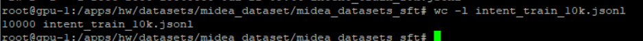

#### 4.2.3. 测试集

```json
{
  "messages": [
    {
      "role": "system",
      "content": "You are a helpful assistant."
    },
    {
      "role": "user",
      "content": "你需要基于用户交互历史和技能意图列表，判断用户最后一句话所属的技能意图。要求：1.答案按照所属技能_所属意图的形式输出；2.若无合适技能，则预测为闲聊百科_无意义\n技能意图列表：\n1.其他控制: 网络蓝牙, 家庭传声, 场景控制, 播放控制, 屏幕操作, 语音功能设置, 步骤操作\n2.设备控制: 烟机,电蒸锅,电磁炉,烤箱,干衣机,空气炸锅,冰箱,电水壶,热水器,智慧屏,微蒸烤一体机,电压力锅,加湿器,窗帘,取暖器,智能灯,空调,状态查询,浴室镜,新风机,空气净化器,电饭煲,风扇,微波炉,面条机,模糊设备,其他设备,洗衣机,养生壶,软水机,扫地机,地暖,壁挂炉,蒸箱,破壁机,灶具,烹饪机,消毒柜,饮水机,洗碗机,浴霸,晾衣架\n3.信息查询: 耗材使用, 室内空气, 能耗统计, 场景信息, 家庭信息, 设备信息, 用水信息\n4.天气查询: 天气查询\n5.闲聊百科: 时效性检索, 无意义, 知识查询, 人设问答\n6.时间: 闹钟提醒, 时间日期\n7.工具: 油价, 黄历运势, 计算器, 汇率, 股票\n8.家电问答: 家电报修, 家电问答, 家电报装, 家电保养, 家电清洁\n9. 多媒体播放: 多媒体播放\n10. 任务规划: 全屋场景创建, 全屋场景澄清\n交互历史：用户：地暖设置为三度\n用户最后一句话所属的技能和意图是："
    },
    {
      "role": "assistant",
      "content": "设备控制_地暖"
    }
  ]
}

{
  "messages": [
    {
      "role": "system",
      "content": "You are a helpful assistant."
    },
    {
      "role": "user",
      "content": "你需要基于用户交互历史和技能意图列表，判断用户最后一句话所属的技能意图。要求：1.答案按照所属技能_所属意图的形式输出；2.若无合适技能，则预测为闲聊百科_无意义\n技能意图列表：\n1.其他控制: 网络蓝牙, 家庭传声, 场景控制, 播放控制, 屏幕操作, 语音功能设置, 步骤操作\n2.设备控制: 烟机,电蒸锅,电磁炉,烤箱,干衣机,空气炸锅,冰箱,电水壶,热水器,智慧屏,微蒸烤一体机,电压力锅,加湿器,窗帘,取暖器,智能灯,空调,状态查询,浴室镜,新风机,空气净化器,电饭煲,风扇,微波炉,面条机,模糊设备,其他设备,洗衣机,养生壶,软水机,扫地机,地暖,壁挂炉,蒸箱,破壁机,灶具,烹饪机,消毒柜,饮水机,洗碗机,浴霸,晾衣架\n3.信息查询: 耗材使用, 室内空气, 能耗统计, 场景信息, 家庭信息, 设备信息, 用水信息\n4.天气查询: 天气查询\n5.闲聊百科: 时效性检索, 无意义, 知识查询, 人设问答\n6.时间: 闹钟提醒, 时间日期\n7.工具: 油价, 黄历运势, 计算器, 汇率, 股票\n8.家电问答: 家电报修, 家电问答, 家电报装, 家电保养, 家电清洁\n9. 多媒体播放: 多媒体播放\n10. 任务规划: 全屋场景创建, 全屋场景澄清\n交互历史：用户：泡一次澡用的电费够买瓶矿泉水吗\n用户最后一句话所属的技能和意图是："
    },
    {
      "role": "assistant",
      "content": "信息查询_能耗统计"
    }
  ]
}
```

**数据量**

 测试数据集1000条

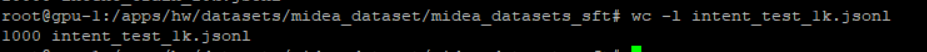

## 五、 MindSpeedLLM数据预处理

### 5.1. 脚本

由上述业务数据集样例可知，业务数据集时ShareGPT风格数据，因此采用[ShareGPT风格数据集处理方法](https://gitee.com/ascend/MindSpeed-LLM/blob/2.1.0/docs/pytorch/solutions/finetune/datasets/sharegpt_dataset.md#sharegpt%E9%A3%8E%E6%A0%BC%E6%95%B0%E6%8D%AE%E9%9B%86%E5%A4%84%E7%90%86%E6%96%B9%E6%B3%95)进行预处理。

 业务当前提供数据集intent预处理脚本如下：

```sh
# 业务数据集预处理
source /usr/local/Ascend/ascend-toolkit/set_env.sh
cd /usr/local/Ascend/llm-train/MindSpeed-LLM
datapath=/apps/shared_storage/hw_test/hw/datasets/midea_dataset/midea_datasets_sft
mkdir ${datapath}/intent_train_10k

python ./preprocess_data.py \
    --input ${datapath}/intent_train_10k.jsonl \
    --tokenizer-name-or-path /apps/hw/weights/Qwen2.5-7B \
    --output-prefix ${datapath}/intent_train_10k/intent_train_10k \
    --workers 4 \
    --log-interval 1000 \
    --tokenizer-type PretrainedFromHF \
    --handler-name SharegptStyleInstructionHandler \
    --prompt-type qwen \
    --map-keys '{"messages":"messages", "tags":{"role_tag": "role","content_tag": "content","user_tag": "user","assistant_tag": "assistant","system_tag": "system"}}'
```

> 关键参数说明：
>
>  1. `--input`(必须):
>
>     描述: 输入数据文件的路径，通常是一个jsonl（每行一个JSON对象）文件。
>
>     示例: `--input /path/to/data.jsonl`
>
>  2. `--tokenizer-name-or-path`(必须):
>
>     描述: 用于分词器的预训练模型的名称或路径。可以是Hugging Face模型仓库的ID，也可以是本地包含tokenizer文件的目录。
>
>     示例: `--tokenizer-name-or-path Qwen/Qwen1.5-7B`或者 `--tokenizer-name-or-path /path/to/tokenizer`
>
>  3. `--output-prefix`(必须):
>
>     描述: 输出文件的前缀。预处理后的数据会被保存为多个文件（例如，后缀为.bin和.idx），这个参数指定这些文件的前缀路径。
>
>     示例: `--output-prefix /path/to/output/preprocessed_data`
>
>  4. `--workers`(可选，默认值可能为1):
>
>     描述: 指定数据预处理时使用的进程数（多进程）。更多的进程数可以加快处理速度。
>
>     示例: `--workers 4`
>
>  5. `--log-interval`(可选，默认值可能为100):
>
>     描述: 控制日志打印的频率，例如每处理1000条数据打印一次进度日志。
>
>     示例: `--log-interval 1000`
>
>  6. `--tokenizer-type`(必须):
>
>     描述: 指定tokenizer的类型。这里使用`PretrainedFromHF`，表示使用Hugging Face的预训练tokenizer。
>
>     示例: `--tokenizer-type PretrainedFromHF`
>
>  7. `--handler-name`(必须):
>
>     描述: 指定数据处理器（handler）的类名。这里使用`SharegptStyleInstructionHandler`，这是专门为类似ShareGPT格式（对话格式）的指令数据设计的处理器。该处理器会按照指令模板格式化数据。
>
>     示例: `--handler-name SharegptStyleInstructionHandler`
>
>  8. `--prompt-type`(必须):
>
>     描述: 指定提示模板类型。不同的提示模板对应不同的格式化方式。这里指定为`qwen`，表示使用Qwen模型所要求的提示格式。
>
>     示例: `--prompt-type qwen`
>
>  9. `--map-keys`(必须):
>
>     描述: 一个JSON字符串，用于将输入数据中的字段映射到处理器所需的字段。这个参数允许我们自定义输入JSON中的键名，使得处理器能够正确获取角色、内容等信息。
>
>     格式: 一个JSON字典，其中至少包括：
>
>     - "messages": 输入数据中对话列表的键名（通常是一个列表，包含多个对话回合）
>
>     - "tags": 一个嵌套字典，用于指定在对话回合中每个字段的键名，例如角色（role）、内容（content）等，以及用户、助手和系统角色的标签。
>
>       示例:
>
>       `--map-keys '{"messages":"messages", "tags":{"role_tag":"role", "content_tag":"content", "user_tag":"user", "assistant_tag":"assistant", "system_tag":"system"}}'`
>
>       说明：在这个例子中，输入数据中对话列表的键名为"messages"。在每一个对话回合中，角色字段的键名为"role"，内容字段的键名为"content"，而用户、助手和系统消息则分别用"user"、"assistant"和"system"来标识（这些标签用于区分消息发送者）。
>
>  注意：由于`--map-keys`参数是一个JSON字符串，所以需要用单引号括起来（在shell中），并且确保内部双引号被正确转义或保留（这里使用的是JSON字符串，所以内部用双引号）。

### 5.2. 处理结果

数据预处理脚本会将数据按照相应的数据风格进行解析，并且根据prompt-type所对应的模板构建成为prompt，再转化为token后保存到.bin .idx 文件中。下图是解析后的文件示例。

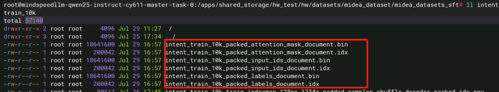

## 六、 MindSpeedLLM权重准备

### 6.1. 模型权重下载

从HuggingFace下载模型权重[Qen2.5-7B-Instruct](https://huggingface.co/Qwen/Qwen2.5-7B-Instruct)，下载方式参考[HF镜像站](https://hf-cdn.sufy.com/)，其他模型下载可参考[Dense模型](https://gitee.com/ascend/MindSpeed-LLM/blob/2.1.0/docs/pytorch/models/dense_model.md)、[MOE模型](https://gitee.com/ascend/MindSpeed-LLM/blob/2.1.0/docs/pytorch/models/moe_model.md)和[SSM模型](https://gitee.com/ascend/MindSpeed-LLM/blob/2.1.0/docs/pytorch/models/ssm_model.md)文档中对应模型的下载链接。下载完成效果如下：

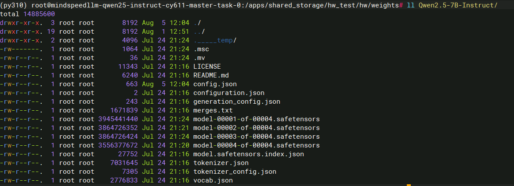

### 6.2. 权重转换

> 随着大规模预训练模型的广泛应用，不同的训练框架和硬件平台之间的适配性问题逐渐显现。专有训练框架如MindSpeed-LLM通常采用定制的并行化策略（例如Tensor Parallelism、Pipeline Parallelism）以应对大规模模型训练中的内存和计算瓶颈。随着训练需求和硬件的变化，模型参数的切分策略也需进行相应的调整。然而，跨框架的权重转换往往面临格式不兼容和切分策略不同等挑战。权重转换旨在促进大规模预训练模型在不同训练框架之间的无缝迁移与评估，解决框架间权重格式不兼容及切分策略差异等问题，从而增强模型迁移的灵活性和可扩展性，支持更广泛的应用场景和业务需求。

#### 6.2.1. Huggingface权重转换到Megatron-LM格式

权重转换实现了 HuggingFace 权重到 Megatron-LM 格式的转换，支持多种并行策略（如张量并行、流水并行等），确保转换后可以在 MindSpeed-LLM 框架下继续训练和推理。Llama2-7b模型的hf-mg权重转换脚本仅供参考：

```sh
cd **/MindspeedLLM代码路径
source /usr/local/Ascend/ascend-toolkit/set_env.sh

python convert_ckpt.py \
 --model-type GPT \
 --load-model-type hf \
 --save-model-type mg \
 --target-tensor-parallel-size 2 \
 --target-pipeline-parallel-size 4 \
 --num-layer-list 8,8,8,8 \
 --model-type-hf llama2 \
 --use-mcore-models \
 --load-dir ./model_from_hf/llama-2-7b-hf/ \
 --save-dir ./model_weights/llama-2-7b-mcore/ \
 --tokenizer-model ./model_from_hf/llama-2-7b-hf/tokenizer.model
```

| 参数                                    | 说明                                                         | 可选/必选 |
| --------------------------------------- | ------------------------------------------------------------ | --------- |
| --target-tensor-parallel-size           | TP 切分数量，默认为 1                                        | 必选      |
| --target-pipeline-parallel-size         | PP 切分数量，默认为 1                                        | 必选      |
| --num-layer-list                        | 动态PP划分，通过列表指定每个PP Stage的层数，默认为None       | 可选      |
| --num-layers-per-virtual-pipeline-stage | VPP划分，指定VPP的每个Stage层数，默认为None                  | 可选      |
| --target-expert-model-parallel-size     | 专家并行，指定专家并行卡数，默认为1                          | 可选      |
| --noop-layers                           | 自定义空层操作，指定在模型某层增加空层，转换后层数为原huggingface模型层数+空层数，默认为None | 可选      |
| --use-mcore-models                      | 转换为Megatron-Mcore权重，若不指定，则默认转换为Megatron-Legacy权重 | 可选      |
| --model-type-hf                         | huggingface模型类别，默认为llama2，参考注意 2                | 可选      |
| --tokenizer-model                       | 需要指明到具体的分词器模型文件，如 tokenizer.model、tokenizer.json、qwen.tiktoken、None等，具体取决于huggingface中词表文件的格式形式 | 必选      |
| --params-dtype                          | 指定权重转换后的权重精度模式，默认为fp16，如果源格式文件为bf16，则需要对应设置为bf16，影响推理或评估结果 | 必选      |

> **注意**：
>
> 1. VPP和动态PP划分只能二选一
>
> 2. 目前支持的模型见 [model_cfg.json](https://gitee.com/ascend/MindSpeed-LLM/blob/master/configs/checkpoint/model_cfg.json)中“model_mappings”下包含的模型。
>

#### 6.2.2. 并行切分

##### 6.2.2.1. 全参微调

根据LLaMAFactory脚本参数可知并行配置相关参数如下：

```sh
# 单机8卡 deepspeed zero3
deepspeed: examples/deepspeed/ds_z3_config.json
per_device_train_batch_size: 32
gradient_accumulation_steps: 1
```

转换到MindspeedLLM相应的并行配置为：

```sh
TP=1 # TP（Tensor Parallelism）
PP=1 # PP（Pipeline Parallelism）
DP=8 # DP（Data Parallelism）
MBS=32 # 微批大小
GBS=256 # 全局批大小
```

Deepspeed zero3利用显存优化技术，将模型参数，梯度优化器状态切分到多张卡上，以通信换空间，极大的降低训练时显存压力，同时感知切分。

与Deepspeed 不同，MindspeedLLM需要显式进行模型切分，因此需要在训练之前确定切分策略。由于7B模型无法直接在不切分场景运行，因此我们考虑将模型权重进行切分，降低显存压力。

> 根据官网[并行策略通用建议](https://www.hiascend.com/document/detail/zh/Pytorch/710/ptmoddevg/trainingmigrguide/performance_tuning_0024.html) : 在面临显存不足、模型过大无法完全加载以及需要进行切分的情况下，优先考虑使用TP（Tensor Parallelism）进行切分，并确保切分的数量小于等于机器内的计算卡数。如果在TP切分达到最大显存容量仍然不足的情况下，可以考虑在机器之间使用PP（Pipeline Parallelism）进行切分。

当前采用TP=4，PP=2进行权重切分。权重切分具体代码如下：

```sh
# cd MinspeedLLM path
source /usr/local/Ascend/ascend-toolkit/set_env.sh

# 设置需要的权重转换参数
python convert_ckpt.py \
       --use-mcore-models \
       --model-type GPT \
       --load-model-type hf \
       --save-model-type mg \
       --target-tensor-parallel-size 4 \
       --target-pipeline-parallel-size 2 \
       --num-layer-list 14,14 \
       --add-qkv-bias \
       --load-dir /apps/hw/weights/Qwen2.5-7B-Instruct/ \
       --save-dir /apps/hw/weights/weight_mg/new_qwen2.5_mcore_tp4_pp2/ \
       --tokenizer-model /apps/hw/weights/Qwen2.5-7B-Instruct/tokenizer.json \
       --model-type-hf llama2 \
       --params-dtype bf16
```

> 关键参数说明：
>
> qwen2.5模型这里的--model-type-hf需要设置为：llama2。参考目前支持的模型 [model_cfg.json](https://gitee.com/ascend/MindSpeed-LLM/blob/master/configs/checkpoint/model_cfg.json)中“model_mappings”下包含的模型参数映射关系。

**执行结果如下**：

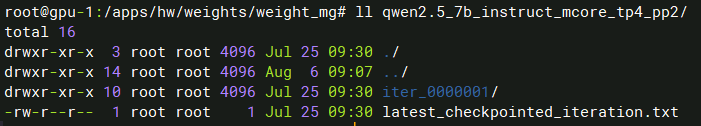

##### 6.2.2.2. Lora微调

根据业务LLaMAFactory脚本参数可知并行配置相关参数如下：

```sh
# 单机2卡
per_device_train_batch_size: 32
gradient_accumulation_steps: 1
```

转换到MindspeedLLM相应的并行配置为：

```sh
TP=1 # TP（Tensor Parallelism）
PP=1 # PP（Pipeline Parallelism）
DP=2 # DP（Data Parallelism）
MBS=32 # 微批大小
GBS=64 # 全局批大小
```

与全参微调相同，MindpseedLLM需要进行权重切分，当前采用TP=2，PP=1进行权重切分：

```sh
# cd MinspeedLLM path
source /usr/local/Ascend/ascend-toolkit/set_env.sh

# 设置需要的权重转换参数
python convert_ckpt.py \
       --use-mcore-models \
       --model-type GPT \
       --load-model-type hf \
       --save-model-type mg \
       --target-tensor-parallel-size 2 \
       --target-pipeline-parallel-size 1 \
       --add-qkv-bias \
       --load-dir /apps/hw/weights/Qwen2.5-7B-Instruct/ \
       --save-dir /apps/hw/weights/weight_mg/qwen2.5_7b_instruct_mcore_tp2_pp1/ \
       --tokenizer-model /apps/hw/weights/Qwen2.5-7B-Instruct/tokenizer.json \
       --model-type-hf llama2 \
       --params-dtype bf16
```

> 关键参数说明：
>
> qwen2.5模型这里的--model-type-hf需要设置为：llama2。参考目前支持的模型 [model_cfg.json](https://gitee.com/ascend/MindSpeed-LLM/blob/master/configs/checkpoint/model_cfg.json)中“model_mappings”下包含的模型参数映射关系。

**执行结果如下**：

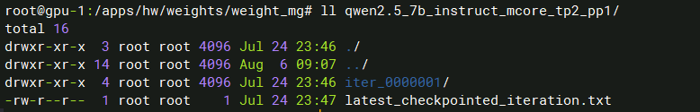

## 七、 MindspeedLLM业务数据评测

### 7.1. 训练脚本修改

#### 7.1.1. 官网脚本样例

##### 7.1.1.1. 全参微调

下载[MindspeedLLM代码仓](https://gitee.com/ascend/MindSpeed-LLM)，在`examples/mcore/qwen25`下会有qwen2.5 各种模型大小的预训练，微调，权重转换以及在线推理脚本样例。当前使用到的脚本如下：

```sh
#!/bin/bash
# 核心环境配置
export CUDA_DEVICE_MAX_CONNECTIONS=1  # 限制NPU间连接数，防止NCCL通信拥塞

# 分布式训练基础配置
NPUS_PER_NODE=8                      # 单节点NPU数量（8卡）
MASTER_ADDR=localhost                # 主节点地址（单机训练设为localhost）
MASTER_PORT=6000                     # 主节点通信端口
NNODES=1                             # 节点总数（单节点）
NODE_RANK=0                          # 当前节点排名（首个节点）
WORLD_SIZE=$(($NPUS_PER_NODE*$NNODES)) # 全局NPU总数=单节点NPU数×节点数

# 路径配置（需用户填写）
CKPT_LOAD_DIR="your model ckpt path"   # 预训练模型加载路径
CKPT_SAVE_DIR="your model save ckpt path" # 微调模型保存路径
DATA_PATH="your data path"             # 训练数据集路径
TOKENIZER_PATH="your tokenizer path"   # 分词器路径

# 模型并行配置
TP=1     # 张量并行维度（Tensor Parallelism=1，不切分张量）
PP=2     # 流水线并行维度（Pipeline Parallelism=2，模型分层切到2卡）
SEQ_LEN=4096  # 最大序列长度（模型支持4096上下文）
MBS=1    # 微批次大小（每NPU单次前向计算样本数）
GBS=8    # 全局批次大小（总批次=微批次×梯度累计步数）
TRAIN_ITERS=5000  # 总训练迭代步数

# 分布式启动参数
DISTRIBUTED_ARGS="
    --nproc_per_node $NPUS_PER_NODE \   # 每节点启动进程数
    --nnodes $NNODES \                  # 总计算节点数
    --node_rank $NODE_RANK \             # 当前节点ID
    --master_addr $MASTER_ADDR \         # 主节点IP地址
    --master_port $MASTER_PORT           # 主节点通信端口
"

# 微调专项参数
TUNE_ARGS="
    --finetune \                    # 启用微调模式（非预训练）
    --stage sft \                   # 监督微调（Supervised Fine-Tuning）
    --is-instruction-dataset \      # 使用指令格式数据集
    --tokenizer-not-use-fast \       # 禁用HuggingFace快速分词器（兼容性）
    --prompt-type qwen \            # 使用Qwen专用提示模板
    --padded-samples \              # 仅填充必要样本（优化内存）
    --variable-seq-lengths          # 动态序列长度（按批次最长样本填充）
"

# 模型架构参数
GPT_ARGS="
    --use-distributed-optimizer \    # 分布式优化器（ZeRO 1）
    --overlap-grad-reduce \          # 梯度聚合与计算重叠（通信优化）
    --overlap-param-gather \         # 参数收集与计算重叠（通信优化）
    --use-mcore-models \             # 启用Megatron核心定制架构
    --tensor-model-parallel-size ${TP} \  # 张量并行维度配置
    --pipeline-model-parallel-size ${PP} \ # 流水线并行维度配置
    --num-layers 28  \              # Transformer总层数（Qwen2.5 7B标准）
    --hidden-size 3584  \           # 隐层维度大小
    --ffn-hidden-size 18944 \       # FFN中间层维度
    --num-attention-heads 28  \     # 注意力头数
    --max-position-embeddings ${SEQ_LEN} \ # 最大位置编码长度
    --seq-length ${SEQ_LEN} \       # 训练序列长度
    --disable-bias-linear \         # 全连接层禁用bias
    --add-qkv-bias \                # QKV投影层添加bias（Qwen特性）
    --group-query-attention \       # 启用分组查询注意力（GQA）
    --num-query-groups 4 \          # GQA分组数（KV头=4，压缩为1/7）
    --use-flash-attn \              # 启用FlashAttention加速
    --swiglu \                      # 使用SwiGLU激活函数
    --use-fused-swiglu \            # 融合SwiGLU计算内核
    --normalization RMSNorm \       # RMS归一化层（替代LayerNorm）
    --norm-epsilon 1e-6 \           # 归一化层epsilon
    --use-fused-rmsnorm \           # 融合RMSNorm计算
    --position-embedding-type rope \ # 旋转位置编码（RoPE）
    --rotary-base 1000000 \         # RoPE扩展基数（支持长上下文）
    --use-fused-rotary-pos-emb \    # 融合RoPE计算
    --untie-embeddings-and-output-weights \ # 解绑输入/输出embedding
    --micro-batch-size ${MBS} \     # 微批次大小
    --global-batch-size ${GBS} \    # 全局批次大小
    --make-vocab-size-divisible-by 1 \ # 词表大小对齐（禁用填充）
    --padded-vocab-size 152064 \    # 词表大小（Qwen2标准）
    --tokenizer-type PretrainedFromHF \ # 从HF加载分词器
    --tokenizer-name-or-path ${TOKENIZER_PATH} \ # 分词器路径
    --attention-dropout 0.0 \       # 注意力层dropout率（微调常设0）
    --hidden-dropout 0.0 \          # 隐藏层dropout率（微调常设0）
    --train-iters ${TRAIN_ITERS} \  # 总训练步数
    --lr 1.25e-6 \                  # 初始学习率（典型微调值）
    --lr-decay-style cosine \       # 余弦退火学习率
    --min-lr 1.25e-7 \              # 最小学习率（cosine退火下限）
    --lr-warmup-fraction 0.01 \     # 预热步数占比（1%=50步）
    --init-method-std 0.01 \        # 参数初始化标准差
    --weight-decay 0.0 \            # 权重衰减（禁用）
    --clip-grad 1.0 \               # 梯度裁剪阈值（稳定训练）
    --adam-beta1 0.9 \              # AdamW优化器β1
    --adam-beta2 0.95 \             # AdamW优化器β2
    --initial-loss-scale 4096 \     # 初始损失缩放（混合精度训练）
    --no-gradient-accumulation-fusion \ # 禁用梯度累积融合（稳定性）
    --no-masked-softmax-fusion \    # 禁用掩码softmax融合（兼容性）
    --attention-softmax-in-fp32 \   # 注意力softmax保持FP32精度（数值稳定）
    --bf16                          # 启用BF16混合精度训练（加速计算）
"

# 数据加载参数
DATA_ARGS="
    --data-path $DATA_PATH \        # 训练数据集路径
    --split 100,0,0                # 数据分配（100%训练，0%验证/测试）
"

# 检查点配置
CKPT_ARGS="
    --no-load-optim \               # 不加载优化器状态（从预训练开始）
    --no-load-rng \                 # 不加载随机状态
    --no-save-optim \               # 不保存优化器状态（节省空间）
    --no-save-rng \                 # 不保存随机状态
    --seed 1234                     # 全局随机种子（确保可复现）
"

# 日志与输出配置
OUTPUT_ARGS="
    --log-interval 1 \              # 每步记录日志
    --save-interval 5000 \          # 每5000步保存检查点
    --eval-interval 5000 \          # 每5000步运行验证（实际跳过，因无验证集）
    --eval-iters 0 \                # 验证迭代次数=0（禁用验证）
    --log-throughput                # 记录训练吞吐量指标
"

# 启动训练命令
torchrun $DISTRIBUTED_ARGS posttrain_gpt.py \
    $GPT_ARGS \
    $DATA_ARGS \
    $CKPT_ARGS \
    $OUTPUT_ARGS \
    $TUNE_ARGS \
    --load ${CKPT_LOAD_DIR} \      # 加载预训练模型
    --save ${CKPT_SAVE_DIR} \      # 保存微调模型
    --distributed-backend nccl \   # 使用NCCL分布式后端
    | tee logs/tune_mcore_qwen25_7b_full.log  # 同时输出到终端和日志文件
```

##### 7.1.1.2. Lora微调

```sh
# examples/mcore/qwen25/tune_qwen25_7b_4k_lora_ptd.sh
#!/bin/bash
# 硬件与分布式配置
export CUDA_DEVICE_MAX_CONNECTIONS=1  # 限制NPU间最大连接数，防止NCCL通信拥塞
NPUS_PER_NODE=8                       # 单节点NPU数量（8卡配置）
MASTER_ADDR=localhost                 # 主节点地址（单机训练设为localhost）
MASTER_PORT=6000                      # 主节点通信端口
NNODES=1                              # 节点总数（单节点）
NODE_RANK=0                           # 当前节点排名（首个节点为0）
WORLD_SIZE=$(($NPUS_PER_NODE*$NNODES)) # 全局NPU总数计算（单节点8卡）

# 路径配置（需用户填写）
CKPT_LOAD_DIR="your model ckpt path"   # 预训练模型加载路径（需替换为实际路径）
CKPT_SAVE_DIR="your model save ckpt path" # 微调模型保存路径（需替换为实际路径）
DATA_PATH="your data path"             # 训练数据集路径（需替换为实际路径）
TOKENIZER_PATH="your tokenizer path"   # 分词器路径（需替换为实际路径）

# 训练核心参数
TP=1             # 张量并行维度（Tensor Parallelism=1，不切分张量）
PP=1             # 流水线并行维度（Pipeline Parallelism=1，不切分层）
SEQ_LEN=4096     # 最大序列长度（支持4096上下文）
MBS=1            # 微批次大小（每GPU单次前向计算样本数）
GBS=16           # 全局批次大小（总批次=微批次×梯度累积步数）
TRAIN_ITERS=5000 # 总训练迭代步数

# 分布式启动参数
DISTRIBUTED_ARGS="
    --nproc_per_node $NPUS_PER_NODE \   # 每节点启动进程数（等于NPU数）
    --nnodes $NNODES \                  # 总计算节点数
    --node_rank $NODE_RANK \             # 当前节点ID
    --master_addr $MASTER_ADDR \         # 主节点IP地址
    --master_port $MASTER_PORT           # 主节点通信端口
"

# LoRA微调专项参数
TUNE_ARGS="
    --finetune \                    # 启用微调模式
    --stage sft \                   # 监督微调（Supervised Fine-Tuning）
    --is-instruction-dataset \      # 使用指令格式数据集
    --tokenizer-not-use-fast \       # 禁用HuggingFace快速分词器（兼容性）
    --prompt-type qwen \            # 使用Qwen专用提示模板
    --variable-seq-lengths \        # 动态序列长度（按批次最长样本填充）
    --padded-samples \              # 仅填充必要样本（优化内存）
    --lora-r 8 \                    # LoRA秩（矩阵低秩分解维度）
    --lora-alpha 16 \               # LoRA缩放因子（影响学习强度）
    --lora-fusion \                 # 融合LoRA权重到原模型（提升推理速度）
    --lora-target-modules linear_qkv linear_proj linear_fc1 linear_fc2  # 应用LoRA的模块
"

# 模型架构参数
GPT_ARGS="
    --use-mcore-models \             # 启用Megatron核心定制架构
    --use-distributed-optimizer \    # 分布式优化器（ZeRO 1）
    --overlap-grad-reduce \          # 梯度聚合与计算重叠（通信优化）
    --tensor-model-parallel-size ${TP} \  # 张量并行维度配置
    --pipeline-model-parallel-size ${PP} \ # 流水线并行维度配置
    --num-layers 28 \               # Transformer总层数（Qwen2.5 7B标准）
    --hidden-size 3584 \            # 隐层维度大小
    --ffn-hidden-size 18944 \       # FFN中间层维度（约5.3倍隐藏层）
    --num-attention-heads 28 \      # 注意力头数
    --tokenizer-type PretrainedFromHF \ # 加载HF格式分词器
    --tokenizer-name-or-path ${TOKENIZER_PATH} \ # 分词器路径
    --seq-length ${SEQ_LEN} \       # 训练序列长度
    --max-position-embeddings ${SEQ_LEN} \ # 最大位置编码长度
    --make-vocab-size-divisible-by 1 \ # 不填充词表
    --padded-vocab-size 152064 \    # Qwen2标准词表大小
    --rotary-base 1000000 \         # RoPE旋转基值（支持长上下文）
    --lr 1.25e-6 \                  # 初始学习率（LoRA典型值）
    --min-lr 1.25e-7 \              # 最小学习率（cosine退火下限）
    --train-iters ${TRAIN_ITERS} \  # 总训练步数
    --lr-decay-style cosine \       # 余弦退火学习率策略
    --untie-embeddings-and-output-weights \ # 解绑输入/输出embedding
    --disable-bias-linear \         # 线性层禁用bias
    --add-qkv-bias \                # QKV投影层添加bias（Qwen特性）
    --attention-dropout 0.0 \       # 注意力层dropout率
    --hidden-dropout 0.0 \          # 隐藏层dropout率
    --position-embedding-type rope \ # 旋转位置编码（RoPE）
    --normalization RMSNorm \       # RMS归一化层（替代LayerNorm）
    --swiglu \                      # SwiGLU激活函数
    --use-flash-attn \              # 启用FlashAttention加速
    --weight-decay 0.0 \            # 禁用权重衰减
    --use-rotary-position-embeddings \ # 启用RoPE旋转位置编码
    --no-masked-softmax-fusion \    # 禁用掩码softmax融合
    --attention-softmax-in-fp32 \   # 注意力softmax保持FP32精度
    --clip-grad 1.0 \               # 梯度裁剪阈值（防梯度爆炸）
    --adam-beta1 0.9 \              # AdamW优化器β1
    --adam-beta2 0.95 \             # AdamW优化器β2
    --initial-loss-scale 4096 \     # 初始损失缩放（混合精度训练）
    --no-gradient-accumulation-fusion \ # 禁用梯度累积融合（稳定性）
    --bf16 \                        # 启用BF16混合精度训练
    --group-query-attention \       # 启用分组查询注意力（GQA）
    --num-query-groups 4 \          # GQA分组数（KV头=4，压缩为1/7）
    --norm-epsilon 1e-06 \          # 归一化层epsilon
    --use-fused-rmsnorm \           # 融合RMSNorm计算
    --use-fused-swiglu \            # 融合SwiGLU计算
    --use-fused-rotary-pos-emb \    # 融合RoPE计算
"

# 数据加载参数
DATA_ARGS="
    --data-path $DATA_PATH \        # 训练数据集路径
    --split 100,0,0                # 数据分配（100%训练，0%验证/测试）
"

# 检查点配置
CKPT_ARGS="
    --no-load-optim \               # 不加载优化器状态（从预训练开始）
    --no-load-rng \                 # 不加载随机状态
    --no-save-optim \               # 不保存优化器状态（节省空间）
    --no-save-rng \                 # 不保存随机状态
    --seed 1234                     # 全局随机种子（确保可复现）
"

# 日志与输出配置
OUTPUT_ARGS="
    --log-interval 1 \              # 每步记录日志
    --save-interval 5000 \          # 每5000步保存检查点
    --eval-interval 5000 \          # 每5000步运行验证（实际跳过，因无验证集）
    --eval-iters 0 \                # 验证迭代次数=0（禁用验证）
    --log-throughput                # 记录训练吞吐量指标
"

# 启动命令
torchrun $DISTRIBUTED_ARGS posttrain_gpt.py \
    $GPT_ARGS \
    $DATA_ARGS \
    $CKPT_ARGS \
    $OUTPUT_ARGS \
    $TUNE_ARGS \
    --distributed-backend nccl \   # 使用NCCL分布式后端
    --load ${CKPT_LOAD_DIR} \      # 加载预训练模型
    --save ${CKPT_SAVE_DIR} \      # 保存微调模型
    | tee logs/tune_mcore_qwen25_7b_lora.log  # 同时输出到终端和日志文件
```

#### 7.1.2. 训练脚本适配

##### 7.1.2.1. 全参微调

全参官方参考链接：[ 大模型指令微调](https://gitee.com/ascend/MindSpeed-LLM/blob/2.1.0/docs/pytorch/solutions/finetune/instruction_finetune.md)

基于官网微调脚本样例，需要进行以下步骤适配：

###### 7.1.2.1.1. 路径参数配置

```sh
# 切分后Megatron-LM模型权重
CKPT_LOAD_DIR="/apps/shared_storage/hw_test/hw/weights/weight_mg/qwen2.5_7b_instruct_mcore_tp4_pp2" 
# 训练保存路径
CKPT_SAVE_DIR="/apps/shared_storage/hw_test/hw/weights/ckpt_record/auto_train_test/qwen2.5_mcore_full_tp4_pp2_midea_eval"
# 训练数据路径
DATA_PATH="/apps/shared_storage/hw_test/hw/datasets/midea_dataset/midea_datasets_sft/intent_train_10k/intent_train_10k"
# Tokenizer路径
TOKENIZER_PATH="/apps/shared_storage/hw_test/hw/weights/Qwen2.5-7B-Instruct"
```

###### 7.1.2.1.2. 训练参数对齐

下面对关键训练参数进行对齐：

| MindspeedLLM           | LLaMAFactory                   | 备注                                                  |
| ---------------------- | ------------------------------ | ----------------------------------------------------- |
| SEQ_LEN=2048           | cutoff_len=2048                | Token长度限制                                         |
| log-interval=10        | logging_steps=10               | 打印日志频率，对齐方便绘图                            |
| MBS=32                 | per_device_train_batch_size=32 | 需要根据显存进行配置                                  |
| -                      | gradient_accumulation_steps=1  | MindspeedLLM梯度累计会根据MBS,GBS,DP自动计算。当前为8 |
| GBS=256                | -                              | MindspeedLLM 与 LLaMAFactory全局batch_size            |
| TRAIN_ITERS=200        | num_train_epochs=5             | MindspeedLLM 与 LLaMAFactory训练样本数对齐            |
| lr=1.0e-5              | learning_rate=1.0e-5           | 学习率                                                |
| lr-decay-style=cosine  | lr_scheduler_type=cosine       | 余弦退火学习率衰减                                    |
| lr-warmup-fraction=0.1 | warmup_ratio=0.1               | 学习率预热                                            |
| bf16                   | bf16=true                      | bf 训练                                               |

###### 7.1.2.1.3. 完整训练脚本

```sh
export CUDA_DEVICE_MAX_CONNECTIONS=1
export ASCEND_RT_VISIBLE_DEVICES=0,1,2,3,4,5,6,7,8,9,10,11,12,13,14,15

source /usr/local/Ascend/ascend-toolkit/set_env.sh

NPUS_PER_NODE=8
MASTER_ADDR=localhost
MASTER_PORT=1901
NNODES=1
NODE_RANK=0
WORLD_SIZE=$(($NPUS_PER_NODE*$NNODES))

# please fill these path configurations
CKPT_LOAD_DIR="/apps/shared_storage/hw_test/hw/weights/weight_mg/qwen2.5_7b_instruct_mcore_tp4_pp2"
CKPT_SAVE_DIR="/apps/shared_storage/hw_test/hw/weights/ckpt_record/auto_train_test/qwen2.5_mcore_full_tp4_pp2_midea_eval"
DATA_PATH="/apps/shared_storage/hw_test/hw/datasets/midea_dataset/midea_datasets_sft/intent_train_10k/intent_train_10k"
TOKENIZER_PATH="/apps/shared_storage/hw_test/hw/weights/Qwen2.5-7B-Instruct"
tensorboard_dir="/apps/shared_storage/hw_test/hw/outputs/qwen2.5-7b//tensorboard_dir/full"
train_log_path="/apps/shared_storage/hw_test/hw/outputs/qwen2.5-7b/logs/auto/tune_mcore_qwen25_7b_full_tp4_pp2_train.log"

TP=4
PP=2
SEQ_LEN=2048
MBS=32
GBS=256
TRAIN_ITERS=200

DISTRIBUTED_ARGS="
    --nproc_per_node $NPUS_PER_NODE \
    --nnodes $NNODES \
    --node_rank $NODE_RANK \
    --master_addr $MASTER_ADDR \
    --master_port $MASTER_PORT
"

TUNE_ARGS="
    --finetune \
    --stage sft \
    --is-instruction-dataset \
    --tokenizer-not-use-fast \
    --prompt-type qwen \
    --padded-samples \
    --variable-seq-lengths \
"

GPT_ARGS="
    --use-distributed-optimizer \
    --overlap-grad-reduce \
    --overlap-param-gather \
    --use-mcore-models \
    --tensor-model-parallel-size ${TP} \
    --pipeline-model-parallel-size ${PP} \
    --num-layer-list 14,14 \
    --num-layers 28  \
    --hidden-size 3584  \
    --ffn-hidden-size 18944 \
    --num-attention-heads 28  \
    --max-position-embeddings ${SEQ_LEN} \
    --seq-length ${SEQ_LEN} \
    --disable-bias-linear \
    --add-qkv-bias \
    --group-query-attention \
    --num-query-groups 4 \
    --use-flash-attn \
    --swiglu \
    --use-fused-swiglu \
    --normalization RMSNorm \
    --norm-epsilon 1e-6 \
    --use-fused-rmsnorm \
    --position-embedding-type rope \
    --rotary-base 1000000 \
    --use-fused-rotary-pos-emb \
    --untie-embeddings-and-output-weights \
    --micro-batch-size ${MBS} \
    --global-batch-size ${GBS} \
    --make-vocab-size-divisible-by 1 \
    --padded-vocab-size 152064 \
    --tokenizer-type PretrainedFromHF \
    --tokenizer-name-or-path ${TOKENIZER_PATH} \
    --attention-dropout 0.0 \
    --hidden-dropout 0.0 \
    --train-iters ${TRAIN_ITERS} \
    --lr 1.0e-5 \
    --lr-decay-style cosine \
    --lr-warmup-fraction 0.1 \
    --init-method-std 0.01 \
    --weight-decay 0.0 \
    --clip-grad 1.0 \
    --adam-beta1 0.9 \
    --adam-beta2 0.999 \
    --initial-loss-scale 4096 \
    --no-gradient-accumulation-fusion \
    --no-masked-softmax-fusion \
    --attention-softmax-in-fp32 \
    --bf16 \
    --tensorboard-dir $tensorboard_dir \
"

DATA_ARGS="
    --data-path $DATA_PATH \
    --split 100,0,0
"

CKPT_ARGS="
    --no-load-optim \
    --no-load-rng \
    --no-save-optim \
    --no-save-rng \
    --seed 1234 \
"

OUTPUT_ARGS="
    --log-interval 10 \
    --save-interval 1000 \
    --eval-interval 1000 \
    --eval-iters 0 \
    --log-throughput
"
echo "==========Start train=========="
torchrun $DISTRIBUTED_ARGS posttrain_gpt.py \
    $GPT_ARGS \
    $DATA_ARGS \
    $CKPT_ARGS \
    $OUTPUT_ARGS \
    $TUNE_ARGS \
    --load ${CKPT_LOAD_DIR} \
    --save ${CKPT_SAVE_DIR} \
    --distributed-backend nccl \
    | tee $train_log_path
```

##### 7.1.2.2. Lora微调

全参官方参考链接： [ LoRA 微调简介](https://gitee.com/ascend/MindSpeed-LLM/blob/2.1.0/docs/pytorch/solutions/finetune/lora_finetune.md)

基于官网微调脚本样例，需要进行以下步骤适配：

###### 7.1.2.2.1. 路径参数配置

```sh
# 切分后Megatron-LM模型权重
CKPT_LOAD_DIR="/apps/shared_storage/hw_test/hw/weights/weight_mg/qwen2.5_7b_instruct_mcore_tp2_pp1"
# 保存权重路径
CKPT_SAVE_DIR="/apps/shared_storage/hw_test/hw/weights/ckpt_record/auto_train_test/qwen2.5_mcore_lora_tp2_pp1_midea_eval"
# 训练数据集
DATA_PATH="/apps/shared_storage/hw_test/hw/datasets/midea_dataset/midea_datasets_sft/intent_train_10k/intent_train_10k"
# Tokenizer 路径
TOKENIZER_PATH="/apps/shared_storage/hw_test/hw/weights/Qwen2.5-7B-Instruct"
```

###### 7.1.2.2.2. 训练参数对齐

下面对一些关键参数进行对齐：

| MindspeedLLM                                                 | LLaMAFactory                   | 备注                                                         |
| ------------------------------------------------------------ | ------------------------------ | ------------------------------------------------------------ |
| lora-r=16                                                    | lora_rank: 16                  | Lora 秩                                                      |
| lora-target-modules linear_qkv linear_proj linear_fc1 linear_fc2 | lora_target: all               | lora模块                                                     |
| SEQ_LEN=2048                                                 | cutoff_len=2048                | Token长度限制                                                |
| log-interval=10                                              | logging_steps=10               | 打印日志频率，对齐方便绘图                                   |
| MBS=16                                                       | per_device_train_batch_size=32 | 需要根据显存进行配置。经过测试，目前TP4PP2最大配置16         |
| -                                                            | gradient_accumulation_steps=1  | MindspeedLLM梯度累计会根据MBS, GBS, DP自动计算。当前梯度累计=4 |
| GBS=64                                                       | -                              | MindspeedLLM 与 LLaMAFactory训练样本数对齐                   |
| TRAIN_ITERS=785                                              | num_train_epochs=5             | 需要根据GBS训练epochs数计算。                                |
| lr                                                           | learning_rate=1.0e-5           | 学习率                                                       |
| lr-decay-style=cosine                                        | lr_scheduler_type=cosine       | 余弦退火学习率衰减                                           |
| lr-warmup-fraction=0.1                                       | warmup_ratio=0.1               | 学习率预热                                                   |
| bf16                                                         | bf16=true                      | bf 训练                                                      |

###### 7.1.2.2.3. 完整训练脚本

```sh
export CUDA_DEVICE_MAX_CONNECTIONS=1
export ASCEND_RT_VISIBLE_DEVICES=8,9,10,11,12,13,14,15
source /usr/local/Ascend/ascend-toolkit/set_env.sh
# source /usr/local/Ascend/nnal/atb/set_env.sh

NPUS_PER_NODE=2
MASTER_ADDR=localhost
MASTER_PORT=1902
NNODES=1
NODE_RANK=0
WORLD_SIZE=$(($NPUS_PER_NODE*$NNODES))

# please fill these path configurations
CKPT_LOAD_DIR="/apps/shared_storage/hw_test/hw/weights/weight_mg/qwen2.5_7b_instruct_mcore_tp2_pp1"
CKPT_SAVE_DIR="/apps/shared_storage/hw_test/hw/weights/ckpt_record/auto_train_test/qwen2.5_mcore_lora_tp2_pp1_midea_eval"
DATA_PATH="/apps/shared_storage/hw_test/hw/datasets/midea_dataset/midea_datasets_sft/intent_train_10k/intent_train_10k"
TOKENIZER_PATH="/apps/shared_storage/hw_test/hw/weights/Qwen2.5-7B-Instruct"
tensorboard_dir="/apps/shared_storage/hw_test/hw/outputs/qwen2.5-7b/tensorboard_dir/full"
train_log_path="/apps/shared_storage/hw_test/hw/outputs/qwen2.5-7b/logs/auto/tune_mcore_qwen25_7b_lora_tp2_pp1_train.log"

TP=2
PP=1
SEQ_LEN=2048
MBS=16
GBS=64
TRAIN_ITERS=785

DISTRIBUTED_ARGS="
    --nproc_per_node $NPUS_PER_NODE \
    --nnodes $NNODES \
    --node_rank $NODE_RANK \
    --master_addr $MASTER_ADDR \
    --master_port $MASTER_PORT
"

TUNE_ARGS="
    --finetune \
    --stage sft \
    --is-instruction-dataset \
    --tokenizer-not-use-fast \
    --prompt-type qwen \
    --variable-seq-lengths \
    --padded-samples \
    --lora-r 16 \
    --lora-alpha 32 \
    --lora-fusion \
    --lora-target-modules linear_qkv linear_proj linear_fc1 linear_fc2
"

GPT_ARGS="
    --use-mcore-models \
    --use-distributed-optimizer \
    --overlap-grad-reduce \
    --tensor-model-parallel-size ${TP} \
    --pipeline-model-parallel-size ${PP} \
    --num-layers 28 \
    --hidden-size 3584 \
    --ffn-hidden-size 18944 \
    --num-attention-heads 28 \
    --tokenizer-type PretrainedFromHF \
    --tokenizer-name-or-path ${TOKENIZER_PATH} \
    --seq-length ${SEQ_LEN} \
    --max-position-embeddings ${SEQ_LEN} \
    --micro-batch-size ${MBS} \
    --global-batch-size ${GBS} \
    --make-vocab-size-divisible-by 1 \
    --padded-vocab-size 152064 \
    --rotary-base 1000000 \
    --lr 1.0e-5 \
    --lr-warmup-fraction 0.1 \
    --train-iters ${TRAIN_ITERS} \
    --lr-decay-style cosine \
    --untie-embeddings-and-output-weights \
    --disable-bias-linear \
    --attention-dropout 0.0 \
    --init-method-std 0.02 \
    --hidden-dropout 0.0 \
    --position-embedding-type rope \
    --normalization RMSNorm \
    --swiglu \
    --use-flash-attn \
    --weight-decay 0.0 \
    --use-rotary-position-embeddings \
    --no-masked-softmax-fusion \
    --attention-softmax-in-fp32 \
    --clip-grad 1.0 \
    --adam-beta1 0.9 \
    --adam-beta2 0.999 \
    --add-qkv-bias \
    --initial-loss-scale 4096 \
    --no-gradient-accumulation-fusion \
    --bf16 \
    --group-query-attention \
    --num-query-groups 4 \
    --norm-epsilon 1e-06 \
    --use-fused-rmsnorm \
    --use-fused-swiglu \
    --use-fused-rotary-pos-emb \
    --tensorboard-dir $tensorboard_dir \
"

DATA_ARGS="
    --data-path $DATA_PATH \
    --split 100,0,0
"

CKPT_ARGS="
    --no-load-optim \
    --no-load-rng \
    --no-save-optim \
    --no-save-rng \
    --seed 1234 \
"

OUTPUT_ARGS="
    --log-interval 10 \
    --save-interval 1000 \
    --eval-interval 1000 \
    --eval-iters 0 \
    --log-throughput
"

torchrun $DISTRIBUTED_ARGS posttrain_gpt.py \
    $GPT_ARGS \
    $DATA_ARGS \
    $CKPT_ARGS \
    $OUTPUT_ARGS \
    $TUNE_ARGS \
    --distributed-backend nccl \
    --load ${CKPT_LOAD_DIR} \
    --save ${CKPT_SAVE_DIR} \
    | tee $train_log_path
```

### 7.2. 评测脚本适配

LLaMAFactory评分脚本采用的vllm推理引擎进行离线推理进行评测，无法在MindspeedLLM框架下直接运行，并且MindspeedLLM暂时不支持自定义数据集对话测试，需要基于业务提供的测试脚本进行代码适配：

  1. 进入`/apps/shared_storage/hw_test/hw/src/MindSpeed-LLM-2.1.0-cy611`（即MindspeedLLM代码仓）目录下，复制改造当前目录下的在线推理`inference.py`脚本得到`inference_4_sft.py`用于训练后启动评分。
 2. 在此目录下将业务脚本进行改造适配得到`evaluate_4_sft.py`，用于最后的模型评分计算。

#### 7.2.1. 改造inference.py

**改造方式**：

- 沿用inference.py创建模型的代码，在`initialize_megatron`中添加扩展参数，用于传入测试数据集文件，批次大小以及评测数据条数等参数。

  ```python
  def extra_args_provider(parser):
      parser.add_argument("--eval-data-path", type=str, default=None, help="Path to the evaluation data")
      parser.add_argument("--eval-data-size", type=int, default=100, help="Number of examples to evaluate")
      parser.add_argument("--eval-batch-size", type=int, default=10, help="Batch size for evaluation")
      return parser
  ```

- 使用评测函数替换task_factory(args, model)实现微调数据集评测逻辑。

  ```python
  # task_factory(args, model)
  evaluate(model, args)
  ```

**完整脚本如下**：

```python
import argparse
from typing import Union

from mindspeed_llm import megatron_adaptor
from megatron.core.models.gpt.gpt_layer_specs import get_gpt_layer_with_transformer_engine_spec, \
    get_gpt_layer_local_spec
from megatron.core.transformer.spec_utils import import_module
from megatron.training import get_args, print_rank_0
from megatron.legacy.model import GPTModel
from megatron.training.initialize import initialize_megatron
from megatron.training.arguments import core_transformer_config_from_args
from megatron.training.yaml_arguments import core_transformer_config_from_yaml

from mindspeed_llm.tasks.inference.module import GPTModelInfer, MegatronModuleForCausalLM

from evaluate_4_sft import evaluate


def model_provider(pre_process=True, post_process=True) -> Union[GPTModelInfer, GPTModel]:
    args = get_args()
    use_te = args.transformer_impl == "transformer_engine"

    if args.sequence_parallel and args.use_kv_cache:
        raise AssertionError('Use_kv_cache can not be true in sequence_parallel mode.')

    print_rank_0('building GPT model ...')
    # Experimental loading arguments from yaml
    if args.yaml_cfg is not None:
        config = core_transformer_config_from_yaml(args, "language_model")
    else:
        config = core_transformer_config_from_args(args)

    if args.use_mcore_models:
        if args.spec is not None:
            transformer_layer_spec = import_module(args.spec)
        else:
            if use_te:
                transformer_layer_spec = get_gpt_layer_with_transformer_engine_spec(args.num_experts,
                                                                                    args.moe_grouped_gemm)
            else:
                transformer_layer_spec = get_gpt_layer_local_spec(args.num_experts, args.moe_grouped_gemm)

        model = GPTModelInfer(
            config=config,
            transformer_layer_spec=transformer_layer_spec,
            vocab_size=args.padded_vocab_size,
            max_sequence_length=args.max_position_embeddings,
            pre_process=pre_process,
            post_process=post_process,
            fp16_lm_cross_entropy=args.fp16_lm_cross_entropy,
            parallel_output=True if args.sequence_parallel else False,
            share_embeddings_and_output_weights=not args.untie_embeddings_and_output_weights,
            position_embedding_type=args.position_embedding_type,
            rotary_percent=args.rotary_percent,
            seq_len_interpolation_factor=args.rotary_seq_len_interpolation_factor
        )
    else:
        if not args.context_parallel_size == 1:
            raise ValueError("Context parallelism is only supported with Megatron Core!")

        model = GPTModel(
            config,
            parallel_output=True if args.sequence_parallel else False,
            pre_process=pre_process,
            post_process=post_process
        )

    return model


def extra_args_provider(parser):
    parser.add_argument("--eval-data-path", type=str, default=None,
                        help="Path to the evaluation data file (supports JSON, JSONL, and Parquet formats)")
    parser.add_argument("--eval-data-size", type=int, default=None,
                        help="Number of examples to evaluate (None means use all data)")
    parser.add_argument("--eval-batch-size", type=int, default=10, help="Batch size for evaluation (default: 10)")
    parser.add_argument("--rm-think", action="store_true", default=False,
                        help="Enable think mode to remove intermediate thinking process from model outputs")
    parser.add_argument("--do-sample", action=argparse.BooleanOptionalAction, default=True,
                        help="Whether to use sampling during generation (default: True). If False, greedy decoding will be used instead.")
    return parser


def main():
    initialize_megatron(extra_args_provider=extra_args_provider, args_defaults={'no_load_rng': True,
                                                                                'no_load_optim': True})

    args = get_args()

    model = MegatronModuleForCausalLM.from_pretrained(
        model_provider=model_provider,
        pretrained_model_name_or_path=args.load
    )

    evaluate(model, args)


if __name__ == "__main__":
    main()

```

#### 7.2.2. 适配LLaMAFactory脚本

分析LLaMAFactory评测脚本可知，业务采用的是vllm离线推理方式进行评测。在业务脚本基础上，修改一下几点代码逻辑：

- 将vllm模型对象由inference.py脚本传入MindspeedLLM 的MegatronModuleForCausalLM对象替换，用于离线推理。
- 加载数据集后，需要分批进行推理，避免显存溢出。

**修改后完整代码如下：**

```python
import json
import random
import time
import re

from datasets import load_dataset
from torch import distributed as dist
from transformers import AutoTokenizer

from megatron.training import print_rank_0


# --------------- 加载数据 ----------------
def load_data(path, test_size):
    if path.endswith(".json"):
        with open(path, "r", encoding="utf-8") as f:
            data = json.load(f)
    elif path.endswith(".jsonl"):
        with open(path, "r", encoding="utf-8") as f:
            data = [json.loads(line) for line in f]
    elif path.endswith(".parquet"):
        dataset = load_dataset("parquet", data_files={"test": path})
        data = dataset["test"].to_list()
    else:
        raise ValueError("Unsupported file format.")
    if test_size is not None:
        random.seed(42)
        random.shuffle(data)
        return data[:test_size]
    return data


# --------------- 构造对话模版 ----------------
def convert_to_hf_chat_format(conversations):
    return [
        {"role": turn["role"], "content": turn["content"].strip()}
        for turn in conversations
        if turn["role"] in {"system", "user"}
    ]


def format_prompt(hf_conversation, tokenizer):
    return tokenizer.apply_chat_template(
        hf_conversation,
        tokenize=False,
        add_generation_prompt=True
    )


# --------------- 评估 accuracy ----------------
def evaluate_prediction(ground_truth_list, prediction_list, prompt_list):
    total = len(ground_truth_list)
    correct_list = [gt == prediction for gt, prediction in zip(ground_truth_list, prediction_list)]
    correct = sum(correct_list)

    for i, (gt, pred, is_correct, prompt) in enumerate(
            zip(ground_truth_list, prediction_list, correct_list, prompt_list)):
        if not is_correct:
            print_rank_0(f"预测错误：")
            print_rank_0(f"Prompt: {prompt}, 索引 {i}: 正确值={gt}, 预测值={pred}")

    print_rank_0(f"correct = {correct}")
    print_rank_0(f"total = {total}")
    return correct / total


# --------------- 评测数入口 ----------------
def evaluate(model, args):
    print_rank_0("Loading tokenizer...")
    tokenizer = AutoTokenizer.from_pretrained(args.tokenizer_name_or_path, trust_remote_code=True)

    print_rank_0("Loading data...")
    data = load_data(args.eval_data_path, test_size=args.eval_data_size)
    print_rank_0(f"Evaluation configuration: data_path={args.eval_data_path}, data_size={len(data)}, batch_size={args.eval_batch_size}")
    accuracy_list = []
    total_batches = (len(data) + args.eval_batch_size - 1) // args.eval_batch_size
    for i in range(0, len(data), args.eval_batch_size):
        batch_data = data[i:i + args.eval_batch_size]
        batch_idx = i // args.eval_batch_size + 1
        print_rank_0(f"Processing batch {batch_idx}/{total_batches}, data range: {i}-{min(i + args.eval_batch_size, len(data))-1}/{len(data)}")
        accuracy = evaluate_one_bacth(args, batch_data, model, tokenizer)
        accuracy_list.append(accuracy)
        print_rank_0(f"Accuracy: {accuracy}, index: {i + len(batch_data)}")
        print_rank_0("Average accuracy: {}".format(sum(accuracy_list) / len(accuracy_list)))


def evaluate_one_bacth(args, data, model, tokenizer):
    ground_truth_list = []
    prompt_list = []
    for example in data:
        messages = example["messages"]

        # 找到 ground truth
        assistant_turns = [m for m in messages if m["role"] == "assistant"]
        if not assistant_turns:
            continue
        ref_response = assistant_turns[0]["content"]
        ground_truth_list.append(ref_response)

        # 构造 prompt（system/user）
        hf_conversation = convert_to_hf_chat_format(messages)
        prompt = format_prompt(hf_conversation, tokenizer)
        prompt_list.append(prompt)
    # batch generating
    outputs_list = generate_res(args, model, prompt_list)
    if args.rm_think:
        outputs_list = [re.sub(r'<think>.*?</think>', '', outputs, flags=re.DOTALL) for outputs in outputs_list]
    predictions = [output.strip() for output in outputs_list]
    print_rank_0(f"ground_truth_list = {ground_truth_list}")
    print_rank_0(f"outputs_list = {predictions}")
    accuracy = evaluate_prediction(ground_truth_list, predictions, prompt_list)
    return accuracy


def generate_res(args, model, instructions: list):
    t = time.time()
    # 打印模型推理入参
    print_rank_0(
        f"top_k={args.top_k}, top_p={args.top_p}, temperature={args.temperature}, max_new_tokens={args.max_new_tokens}")
    # 打印do-sample
    print_rank_0(f"do_sample={args.do_sample}")
    output = model.generate(
        instructions,
        do_sample=args.do_sample,
        top_k=args.top_k,
        top_p=args.top_p,
        temperature=args.temperature,
        max_new_tokens=args.max_new_tokens,
        stream=False
    )

    if dist.get_rank() == 0:
        print_rank_0("\n================ Generate_res =================")
        print_rank_0(f"\nYou:\n{instructions}\n\nMindSpeed-LLM:\n{output}")
        print_rank_0("============================================")
        print_rank_0(f"\nElapsed: {round(time.time() - t, 2)}s")

    dist.barrier()
    return output

```

#### 7.2.3. 评测启动方式

完成推理脚本适配后，沿用MindspeedLLM评测脚本启动方式启动评测脚本（[参考官方文档](https://gitee.com/ascend/MindSpeed-LLM/blob/2.1.0/docs/pytorch/solutions/inference/inference.md)）。具体流程如下：

##### 7.2.3.1. 复制官网推理脚本

```sh
cd /apps/shared_storage/hw_test/hw/src/MindSpeed-LLM-2.1.0-cy611 # MindspeedLLM路径
cp examples/mcore/qwen25/generate_qwen25_7b_ptd.sh examples/mcore/qwen25/generate_qwen25_7b_ptd_4_midea_dataset.sh
```

```sh
# 全参微调 在线推理脚本展示
#!/bin/bash
export CUDA_DEVICE_MAX_CONNECTIONS=1

# please fill these path configurations
CHECKPOINT="your model directory path"
TOKENIZER_PATH="your tokenizer directory path"

# Change for multinode config
MASTER_ADDR=localhost
MASTER_PORT=6000
NNODES=1
NODE_RANK=0
NPUS_PER_NODE=8
WORLD_SIZE=$(($NPUS_PER_NODE*$NNODES))

TP=4
PP=2
SEQ_LENGTH=32768

DISTRIBUTED_ARGS="
    --nproc_per_node $NPUS_PER_NODE \
    --nnodes $NNODES \
    --node_rank $NODE_RANK \
    --master_addr $MASTER_ADDR \
    --master_port $MASTER_PORT
"

torchrun $DISTRIBUTED_ARGS inference.py \
       --use-mcore-models \
       --tensor-model-parallel-size ${TP} \
       --pipeline-model-parallel-size ${PP} \
       --num-layers 28 \
       --hidden-size 3584  \
       --num-attention-heads 28  \
       --ffn-hidden-size 18944 \
       --max-position-embeddings ${SEQ_LENGTH} \
       --seq-length ${SEQ_LENGTH} \
       --disable-bias-linear \
       --add-qkv-bias \
       --group-query-attention \
       --num-query-groups 4 \
       --swiglu \
       --use-fused-swiglu \
       --normalization RMSNorm \
       --norm-epsilon 1e-6 \
       --use-fused-rmsnorm \
       --position-embedding-type rope \
       --rotary-base 1000000 \
       --use-fused-rotary-pos-emb \
       --make-vocab-size-divisible-by 1 \
       --padded-vocab-size 152064 \
       --micro-batch-size 1 \
       --max-new-tokens 256 \
       --tokenizer-type PretrainedFromHF  \
       --tokenizer-name-or-path ${TOKENIZER_PATH} \
       --tokenizer-not-use-fast \
       --hidden-dropout 0 \
       --attention-dropout 0 \
       --untie-embeddings-and-output-weights \
       --no-gradient-accumulation-fusion \
       --attention-softmax-in-fp32 \
       --seed 42 \
       --load ${CHECKPOINT} \
       --exit-on-missing-checkpoint \
       | tee logs/generate_mcore_qwen25_7b.log

```

```sh
#!/bin/bash
# Lora微调 在线推理脚本展示
export CUDA_DEVICE_MAX_CONNECTIONS=1

# please fill these path configurations
TOKENIZER_PATH="your tokenizer directory path"
CHECKPOINT="your model directory path"
CHECKPOINT_LORA="your lora model directory path"

# Change for multinode config
MASTER_ADDR=localhost
MASTER_PORT=6000
NNODES=1
NODE_RANK=0
NPUS_PER_NODE=8
WORLD_SIZE=$(($NPUS_PER_NODE*$NNODES))

TP=1
PP=8
SEQ_LENGTH=32768

DISTRIBUTED_ARGS="
    --nproc_per_node $NPUS_PER_NODE \
    --nnodes $NNODES \
    --node_rank $NODE_RANK \
    --master_addr $MASTER_ADDR \
    --master_port $MASTER_PORT
"

LORA_ARGS="
    --lora-load ${CHECKPOINT_LORA} \
    --lora-r 8 \
    --lora-alpha 16 \
    --lora-fusion \
    --lora-target-modules linear_qkv linear_proj linear_fc1 linear_fc2
"

torchrun $DISTRIBUTED_ARGS inference.py \
       --use-mcore-models \
       --tensor-model-parallel-size ${TP} \
       --pipeline-model-parallel-size ${PP} \
       --load ${CHECKPOINT} \
       --num-layer-list 4,4,4,4,3,3,3,3 \
       --num-layers 28 \
       --hidden-size 3584  \
       --num-attention-heads 28  \
       --ffn-hidden-size 18944 \
       --max-position-embeddings ${SEQ_LENGTH} \
       --seq-length ${SEQ_LENGTH} \
       --make-vocab-size-divisible-by 1 \
       --padded-vocab-size 152064 \
       --rotary-base 1000000 \
       --untie-embeddings-and-output-weights \
       --micro-batch-size 1 \
       --swiglu \
       --disable-bias-linear \
       --tokenizer-type PretrainedFromHF  \
       --tokenizer-name-or-path ${TOKENIZER_PATH} \
       --normalization RMSNorm \
       --position-embedding-type rope \
       --norm-epsilon 1e-6 \
       --hidden-dropout 0 \
       --attention-dropout 0 \
       --tokenizer-not-use-fast \
       --add-qkv-bias \
       --max-new-tokens 256 \
       --no-gradient-accumulation-fusion \
       --exit-on-missing-checkpoint \
       --attention-softmax-in-fp32 \
       --seed 42 \
       --group-query-attention \
       --num-query-groups 4 \
       ${LORA_ARGS} \
       | tee logs/generate_mcore_qwen25_7b_lora.log
```

##### 7.2.3.2. 启动测评

**修改脚本:**

- 启动调用的py脚本：inference_4_sft.py
- CHECKPOINT：微调权重路径
- TOKENIZER_PATH：tokenizer路径
- MASTER_ADDR：主节点ip
- 并行参数：与微调权重切分策略对应

- 添加评测扩展参数：评测数据集，评测批次大小（默认10），评测条数（默认100）
- Lora的秩：--lora-r 16  --lora-alpha 32

**完整评测代码如下：**

```sh
# 全参微调评测脚本
#!/bin/bash
export CUDA_DEVICE_MAX_CONNECTIONS=1
export ASCEND_RT_VISIBLE_DEVICES=0,1,2,3,4,5,6,7,8,9,10,11,12,13,14,15
source /usr/local/Ascend/ascend-toolkit/set_env.sh


# please fill these path configurations
# 微调模型路径
CHECKPOINT="/apps/shared_storage/hw_test/hw/weights/ckpt_record/auto_train_test/qwen2.5_mcore_full_tp4_pp2_midea_eval"
# tokenizer路径
TOKENIZER_PATH="/apps/shared_storage/hw_test/hw/weights/Qwen2.5-7B-Instruct"
# 评测数据集
EVAL_DATA_PATH="/apps/shared_storage/hw_test/hw/datasets/midea_dataset/midea_datasets_sft/intent_test_1k.jsonl"
# 打印日志路径
eval_log_path="/apps/shared_storage/hw_test/hw/outputs/qwen2.5-7b/logs/auto/generate_mcore_qwen25_7b_full_tp4_pp2_eval.log"

# Change for multinode config
MASTER_ADDR=localhost
MASTER_PORT=6000
NNODES=1
NODE_RANK=0
NPUS_PER_NODE=8
WORLD_SIZE=$(($NPUS_PER_NODE*$NNODES))

# 并行参数
TP=4
PP=2
SEQ_LENGTH=2048

DISTRIBUTED_ARGS="
    --nproc_per_node $NPUS_PER_NODE \
    --nnodes $NNODES \
    --node_rank $NODE_RANK \
    --master_addr $MASTER_ADDR \
    --master_port $MASTER_PORT
"

echo "==========Start evaluation=========="
torchrun $DISTRIBUTED_ARGS inference_4_sft.py \
       --use-mcore-models \
       --tensor-model-parallel-size ${TP} \
       --pipeline-model-parallel-size ${PP} \
       --num-layer-list 14,14 \
       --num-layers 28 \
       --hidden-size 3584  \
       --num-attention-heads 28  \
       --ffn-hidden-size 18944 \
       --max-position-embeddings ${SEQ_LEN} \
       --seq-length ${SEQ_LEN} \
       --disable-bias-linear \
       --add-qkv-bias \
       --group-query-attention \
       --num-query-groups 4 \
       --swiglu \
       --use-fused-swiglu \
       --normalization RMSNorm \
       --norm-epsilon 1e-6 \
       --use-fused-rmsnorm \
       --position-embedding-type rope \
       --rotary-base 1000000 \
       --use-fused-rotary-pos-emb \
       --make-vocab-size-divisible-by 1 \
       --padded-vocab-size 152064 \
       --micro-batch-size 4 \
       --max-new-tokens 256 \
       --tokenizer-type PretrainedFromHF  \
       --tokenizer-name-or-path ${TOKENIZER_PATH} \
       --tokenizer-not-use-fast \
       --hidden-dropout 0 \
       --attention-dropout 0 \
       --untie-embeddings-and-output-weights \
       --no-gradient-accumulation-fusion \
       --attention-softmax-in-fp32 \
       --temperature 0.00001 \
       --seed 42 \
       --load ${CHECKPOINT} \
       --exit-on-missing-checkpoint \
       --eval-data-path $EVAL_DATA_PATH \ # 指定测试数据集
       --no-do-sample \ # 贪婪采样
       | tee $eval_log_path

```

```sh
export CUDA_DEVICE_MAX_CONNECTIONS=1
export ASCEND_RT_VISIBLE_DEVICES=0,1,2,3,4,5,6,7,8,9,10,11,12,13,14,15
source /usr/local/Ascend/ascend-toolkit/set_env.sh

CHECKPOINT="/apps/shared_storage/hw_test/hw/weights/weight_mg/qwen2.5_7b_instruct_mcore_tp2_pp1"
CHECKPOINT_LORA="/apps/shared_storage/hw_test/hw/weights/ckpt_record/auto_train_test/qwen2.5_mcore_lora_tp2_pp1_midea_eval"
EVAL_DATA_PATH="/apps/shared_storage/hw_test/hw/datasets/midea_dataset/midea_datasets_sft/intent_test_1k.jsonl"
eval_log_path="/apps/shared_storage/hw_test/hw/outputs/qwen2.5-7b/logs/auto/generate_mcore_qwen25_7b_lora_tp2_pp1_eval.log"

TP=2
PP=1
SEQ_LEN=2048

NPUS_PER_NODE=2
MASTER_ADDR=localhost
MASTER_PORT=1902
NNODES=1
NODE_RANK=0
WORLD_SIZE=$(($NPUS_PER_NODE*$NNODES))

DISTRIBUTED_ARGS="
    --nproc_per_node $NPUS_PER_NODE \
    --nnodes $NNODES \
    --node_rank $NODE_RANK \
    --master_addr $MASTER_ADDR \
    --master_port $MASTER_PORT
"

LORA_ARGS="
    --lora-load ${CHECKPOINT_LORA} \
    --lora-r 16 \
    --lora-alpha 32 \
    --lora-fusion \
    --lora-target-modules linear_qkv linear_proj linear_fc1 linear_fc2
"

torchrun $DISTRIBUTED_ARGS inference_4_sft.py \
       --use-mcore-models \
       --tensor-model-parallel-size ${TP} \
       --pipeline-model-parallel-size ${PP} \
       --load ${CHECKPOINT} \
       --num-layers 28 \
       --hidden-size 3584  \
       --num-attention-heads 28  \
       --ffn-hidden-size 18944 \
       --max-position-embeddings ${SEQ_LEN} \
       --seq-length ${SEQ_LEN} \
       --make-vocab-size-divisible-by 1 \
       --padded-vocab-size 152064 \
       --rotary-base 1000000 \
       --untie-embeddings-and-output-weights \
       --micro-batch-size 4 \
       --swiglu \
       --disable-bias-linear \
       --tokenizer-type PretrainedFromHF  \
       --tokenizer-name-or-path ${TOKENIZER_PATH} \
       --normalization RMSNorm \
       --position-embedding-type rope \
       --norm-epsilon 1e-6 \
       --hidden-dropout 0 \
       --attention-dropout 0 \
       --tokenizer-not-use-fast \
       --add-qkv-bias \
       --max-new-tokens 256 \
       --no-gradient-accumulation-fusion \
       --exit-on-missing-checkpoint \
       --attention-softmax-in-fp32 \
       --seed 42 \
       --group-query-attention \
       --num-query-groups 4 \
       --eval-data-path $EVAL_DATA_PATH \ # 指定测试数据集
       --no-do-sample \ # 贪婪采样
       ${LORA_ARGS} \
       | tee $eval_log_path
```

### 7.3. 训练&评测

上述训练脚本，评测脚本可以合并成为一个训练评测脚本，即在训练完成之后，马上开始数据评测。

 目的：

 - 便捷快速的训练与测试，不用启动多个脚本，不用在评测时再关注权重位置。

 - 可以快速训练及测试评测。

#### 7.3.1. 全参微调

##### 7.3.1.1. 训练&评分脚本

```sh
# ./scripts/qwen25_7b_instruct/auto_train_and_test_4_full_eval.sh
set -e
export CUDA_DEVICE_MAX_CONNECTIONS=1
export ASCEND_RT_VISIBLE_DEVICES=0,1,2,3,4,5,6,7,8,9,10,11,12,13,14,15

source /usr/local/Ascend/ascend-toolkit/set_env.sh

NPUS_PER_NODE=8
MASTER_ADDR=localhost
MASTER_PORT=1901
NNODES=1
NODE_RANK=0
WORLD_SIZE=$(($NPUS_PER_NODE*$NNODES))

# please fill these path configurations
CKPT_LOAD_DIR="/apps/shared_storage/hw_test/hw/weights/weight_mg/qwen2.5_7b_instruct_mcore_tp4_pp2"
CKPT_SAVE_DIR="/apps/shared_storage/hw_test/hw/weights/ckpt_record/auto_train_test/qwen2.5_mcore_full_tp4_pp2_midea_eval"
DATA_PATH="/apps/shared_storage/hw_test/hw/datasets/midea_dataset/midea_datasets_sft/intent_train_10k/intent_train_10k"
TOKENIZER_PATH="/apps/shared_storage/hw_test/hw/weights/Qwen2.5-7B-Instruct"
tensorboard_dir="/apps/shared_storage/hw_test/hw/outputs/qwen2.5-7b//tensorboard_dir/full"
train_log_path="/apps/shared_storage/hw_test/hw/outputs/qwen2.5-7b/logs/auto/tune_mcore_qwen25_7b_full_tp4_pp2_train.log"
# Evaluation params
CHECKPOINT=$CKPT_SAVE_DIR
EVAL_DATA_PATH="/apps/shared_storage/hw_test/hw/datasets/midea_dataset/midea_datasets_sft/intent_test_1k.jsonl"
eval_log_path="/apps/shared_storage/hw_test/hw/outputs/qwen2.5-7b/logs/auto/generate_mcore_qwen25_7b_full_tp4_pp2_eval.log"

TP=4
PP=2
SEQ_LEN=2048
MBS=32
GBS=256
TRAIN_ITERS=200

DISTRIBUTED_ARGS="
    --nproc_per_node $NPUS_PER_NODE \
    --nnodes $NNODES \
    --node_rank $NODE_RANK \
    --master_addr $MASTER_ADDR \
    --master_port $MASTER_PORT
"

TUNE_ARGS="
    --finetune \
    --stage sft \
    --is-instruction-dataset \
    --tokenizer-not-use-fast \
    --prompt-type qwen \
    --padded-samples \
    --variable-seq-lengths \
"

GPT_ARGS="
    --use-distributed-optimizer \
    --overlap-grad-reduce \
    --overlap-param-gather \
    --use-mcore-models \
    --tensor-model-parallel-size ${TP} \
    --pipeline-model-parallel-size ${PP} \
    --num-layer-list 14,14 \
    --num-layers 28  \
    --hidden-size 3584  \
    --ffn-hidden-size 18944 \
    --num-attention-heads 28  \
    --max-position-embeddings ${SEQ_LEN} \
    --seq-length ${SEQ_LEN} \
    --disable-bias-linear \
    --add-qkv-bias \
    --group-query-attention \
    --num-query-groups 4 \
    --use-flash-attn \
    --swiglu \
    --use-fused-swiglu \
    --normalization RMSNorm \
    --norm-epsilon 1e-6 \
    --use-fused-rmsnorm \
    --position-embedding-type rope \
    --rotary-base 1000000 \
    --use-fused-rotary-pos-emb \
    --untie-embeddings-and-output-weights \
    --micro-batch-size ${MBS} \
    --global-batch-size ${GBS} \
    --make-vocab-size-divisible-by 1 \
    --padded-vocab-size 152064 \
    --tokenizer-type PretrainedFromHF \
    --tokenizer-name-or-path ${TOKENIZER_PATH} \
    --attention-dropout 0.0 \
    --hidden-dropout 0.0 \
    --train-iters ${TRAIN_ITERS} \
    --lr 1.0e-5 \
    --lr-decay-style cosine \
    --lr-warmup-fraction 0.1 \
    --init-method-std 0.01 \
    --weight-decay 0.0 \
    --clip-grad 1.0 \
    --adam-beta1 0.9 \
    --adam-beta2 0.999 \
    --initial-loss-scale 4096 \
    --no-gradient-accumulation-fusion \
    --no-masked-softmax-fusion \
    --attention-softmax-in-fp32 \
    --bf16 \
    --tensorboard-dir $tensorboard_dir \
"

DATA_ARGS="
    --data-path $DATA_PATH \
    --split 100,0,0
"

CKPT_ARGS="
    --no-load-optim \
    --no-load-rng \
    --no-save-optim \
    --no-save-rng \
    --seed 1234 \
"

OUTPUT_ARGS="
    --log-interval 10 \
    --save-interval 1000 \
    --eval-interval 1000 \
    --eval-iters 0 \
    --log-throughput
"
echo "==========Start train=========="
torchrun $DISTRIBUTED_ARGS posttrain_gpt.py \
    $GPT_ARGS \
    $DATA_ARGS \
    $CKPT_ARGS \
    $OUTPUT_ARGS \
    $TUNE_ARGS \
    --load ${CKPT_LOAD_DIR} \
    --save ${CKPT_SAVE_DIR} \
    --distributed-backend nccl \
    | tee $train_log_path

echo "==========Start evaluation=========="
torchrun $DISTRIBUTED_ARGS inference_4_sft.py \
       --use-mcore-models \
       --tensor-model-parallel-size ${TP} \
       --pipeline-model-parallel-size ${PP} \
       --num-layer-list 14,14 \
       --num-layers 28 \
       --hidden-size 3584  \
       --num-attention-heads 28  \
       --ffn-hidden-size 18944 \
       --max-position-embeddings ${SEQ_LEN} \
       --seq-length ${SEQ_LEN} \
       --disable-bias-linear \
       --add-qkv-bias \
       --group-query-attention \
       --num-query-groups 4 \
       --swiglu \
       --use-fused-swiglu \
       --normalization RMSNorm \
       --norm-epsilon 1e-6 \
       --use-fused-rmsnorm \
       --position-embedding-type rope \
       --rotary-base 1000000 \
       --use-fused-rotary-pos-emb \
       --make-vocab-size-divisible-by 1 \
       --padded-vocab-size 152064 \
       --micro-batch-size 4 \
       --max-new-tokens 256 \
       --tokenizer-type PretrainedFromHF  \
       --tokenizer-name-or-path ${TOKENIZER_PATH} \
       --tokenizer-not-use-fast \
       --hidden-dropout 0 \
       --attention-dropout 0 \
       --untie-embeddings-and-output-weights \
       --no-gradient-accumulation-fusion \
       --attention-softmax-in-fp32 \
       --temperature 0.00001 \
       --seed 42 \
       --load ${CHECKPOINT} \
       --exit-on-missing-checkpoint \
       --eval-data-path $EVAL_DATA_PATH \
       --no-do-sample \
       | tee $eval_log_path
```

##### 7.3.1.2. 启动脚本

```sh
cd /apps/shared_storage/hw_test/hw/src/MindSpeed-LLM-2.1.0-cy611
bash ./scripts/qwen25_7b_instruct/auto_train_and_test_4_full_eval.sh
```

##### 7.3.1.3. 测试结果

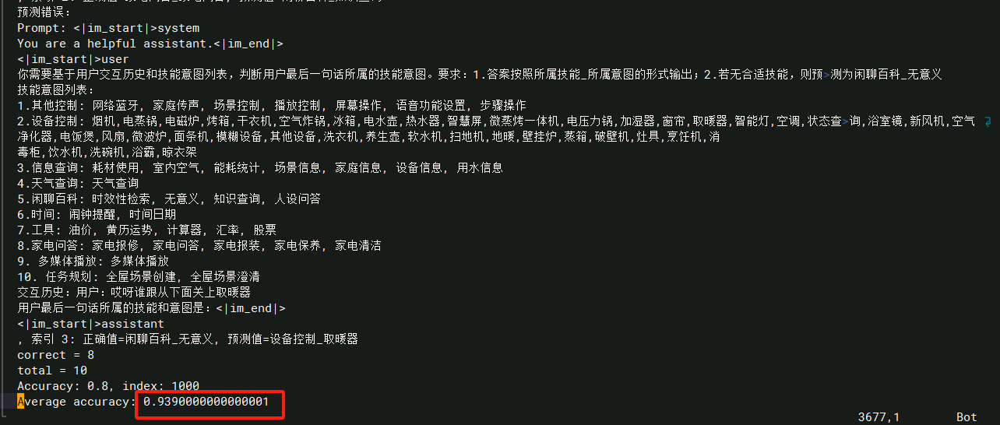

#### 7.3.2. Lora微调

##### 7.3.2.1. 训练&评分脚本

```sh
# ./scripts/qwen25_7b_instruct/auto_train_and_test_4_lora_eval.sh
set -e
export CUDA_DEVICE_MAX_CONNECTIONS=1
export ASCEND_RT_VISIBLE_DEVICES=8,9,10,11,12,13,14,15
source /usr/local/Ascend/ascend-toolkit/set_env.sh
# source /usr/local/Ascend/nnal/atb/set_env.sh

NPUS_PER_NODE=2
MASTER_ADDR=localhost
MASTER_PORT=1902
NNODES=1
NODE_RANK=0
WORLD_SIZE=$(($NPUS_PER_NODE*$NNODES))

# please fill these path configurations
CKPT_LOAD_DIR="/apps/shared_storage/hw_test/hw/weights/weight_mg/qwen2.5_7b_instruct_mcore_tp2_pp1"
CKPT_SAVE_DIR="/apps/shared_storage/hw_test/hw/weights/ckpt_record/auto_train_test/qwen2.5_mcore_lora_tp2_pp1_midea_eval"
DATA_PATH="/apps/shared_storage/hw_test/hw/datasets/midea_dataset/midea_datasets_sft/intent_train_10k/intent_train_10k"
TOKENIZER_PATH="/apps/shared_storage/hw_test/hw/weights/Qwen2.5-7B-Instruct"
tensorboard_dir="/apps/shared_storage/hw_test/hw/outputs/qwen2.5-7b/tensorboard_dir/full"
train_log_path="/apps/shared_storage/hw_test/hw/outputs/qwen2.5-7b/logs/auto/tune_mcore_qwen25_7b_lora_tp2_pp1_train.log"
# Evaluation params
CHECKPOINT=$CKPT_LOAD_DIR
CHECKPOINT_LORA=$CKPT_SAVE_DIR
EVAL_DATA_PATH="/apps/shared_storage/hw_test/hw/datasets/midea_dataset/midea_datasets_sft/intent_test_1k.jsonl"
eval_log_path="/apps/shared_storage/hw_test/hw/outputs/qwen2.5-7b/logs/auto/generate_mcore_qwen25_7b_lora_tp2_pp1_eval.log"

TP=2
PP=1
SEQ_LEN=2048
MBS=16
GBS=64
TRAIN_ITERS=785

DISTRIBUTED_ARGS="
    --nproc_per_node $NPUS_PER_NODE \
    --nnodes $NNODES \
    --node_rank $NODE_RANK \
    --master_addr $MASTER_ADDR \
    --master_port $MASTER_PORT
"

TUNE_ARGS="
    --finetune \
    --stage sft \
    --is-instruction-dataset \
    --tokenizer-not-use-fast \
    --prompt-type qwen \
    --variable-seq-lengths \
    --padded-samples \
    --lora-r 16 \
    --lora-alpha 32 \
    --lora-fusion \
    --lora-target-modules linear_qkv linear_proj linear_fc1 linear_fc2
"

GPT_ARGS="
    --use-mcore-models \
    --use-distributed-optimizer \
    --overlap-grad-reduce \
    --tensor-model-parallel-size ${TP} \
    --pipeline-model-parallel-size ${PP} \
    --num-layers 28 \
    --hidden-size 3584 \
    --ffn-hidden-size 18944 \
    --num-attention-heads 28 \
    --tokenizer-type PretrainedFromHF \
    --tokenizer-name-or-path ${TOKENIZER_PATH} \
    --seq-length ${SEQ_LEN} \
    --max-position-embeddings ${SEQ_LEN} \
    --micro-batch-size ${MBS} \
    --global-batch-size ${GBS} \
    --make-vocab-size-divisible-by 1 \
    --padded-vocab-size 152064 \
    --rotary-base 1000000 \
    --lr 1.0e-5 \
    --lr-warmup-fraction 0.1 \
    --train-iters ${TRAIN_ITERS} \
    --lr-decay-style cosine \
    --untie-embeddings-and-output-weights \
    --disable-bias-linear \
    --attention-dropout 0.0 \
    --init-method-std 0.02 \
    --hidden-dropout 0.0 \
    --position-embedding-type rope \
    --normalization RMSNorm \
    --swiglu \
    --use-flash-attn \
    --weight-decay 0.0 \
    --use-rotary-position-embeddings \
    --no-masked-softmax-fusion \
    --attention-softmax-in-fp32 \
    --clip-grad 1.0 \
    --adam-beta1 0.9 \
    --adam-beta2 0.999 \
    --add-qkv-bias \
    --initial-loss-scale 4096 \
    --no-gradient-accumulation-fusion \
    --bf16 \
    --group-query-attention \
    --num-query-groups 4 \
    --norm-epsilon 1e-06 \
    --use-fused-rmsnorm \
    --use-fused-swiglu \
    --use-fused-rotary-pos-emb \
    --tensorboard-dir $tensorboard_dir \
"

DATA_ARGS="
    --data-path $DATA_PATH \
    --split 100,0,0
"

CKPT_ARGS="
    --no-load-optim \
    --no-load-rng \
    --no-save-optim \
    --no-save-rng \
    --seed 1234 \
"

OUTPUT_ARGS="
    --log-interval 10 \
    --save-interval 1000 \
    --eval-interval 1000 \
    --eval-iters 0 \
    --log-throughput
"

torchrun $DISTRIBUTED_ARGS posttrain_gpt.py \
    $GPT_ARGS \
    $DATA_ARGS \
    $CKPT_ARGS \
    $OUTPUT_ARGS \
    $TUNE_ARGS \
    --distributed-backend nccl \
    --load ${CKPT_LOAD_DIR} \
    --save ${CKPT_SAVE_DIR} \
    | tee $train_log_path

echo "==========Start evaluation=========="
LORA_ARGS="
    --lora-load ${CHECKPOINT_LORA} \
    --lora-r 16 \
    --lora-alpha 32 \
    --lora-fusion \
    --lora-target-modules linear_qkv linear_proj linear_fc1 linear_fc2
"

torchrun $DISTRIBUTED_ARGS inference_4_sft.py \
       --use-mcore-models \
       --tensor-model-parallel-size ${TP} \
       --pipeline-model-parallel-size ${PP} \
       --load ${CHECKPOINT} \
       --num-layers 28 \
       --hidden-size 3584  \
       --num-attention-heads 28  \
       --ffn-hidden-size 18944 \
       --max-position-embeddings ${SEQ_LEN} \
       --seq-length ${SEQ_LEN} \
       --make-vocab-size-divisible-by 1 \
       --padded-vocab-size 152064 \
       --rotary-base 1000000 \
       --untie-embeddings-and-output-weights \
       --micro-batch-size 4 \
       --swiglu \
       --disable-bias-linear \
       --tokenizer-type PretrainedFromHF  \
       --tokenizer-name-or-path ${TOKENIZER_PATH} \
       --normalization RMSNorm \
       --position-embedding-type rope \
       --norm-epsilon 1e-6 \
       --hidden-dropout 0 \
       --attention-dropout 0 \
       --tokenizer-not-use-fast \
       --add-qkv-bias \
       --max-new-tokens 256 \
       --no-gradient-accumulation-fusion \
       --exit-on-missing-checkpoint \
       --attention-softmax-in-fp32 \
       --seed 42 \
       --group-query-attention \
       --num-query-groups 4 \
       --temperature 0.00001 \
       --eval-data-path $EVAL_DATA_PATH \
       --no-do-sample \
       ${LORA_ARGS} \
       | tee $eval_log_path
```

##### 7.3.2.2. 启动脚本

```sh
cd /apps/shared_storage/hw_test/hw/src/MindSpeed-LLM-2.1.0-cy611
bash ./scripts/qwen25_7b_instruct/auto_train_and_test_4_lora_eval.sh
```

##### 7.3.2.3. 测试结果

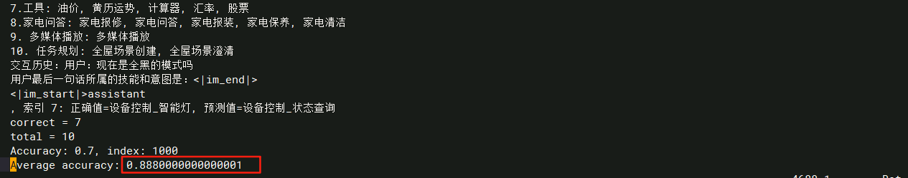

### 7.4. 权重转换HuggingFace 格式

> 权重转换实现了 Megatron-LM 权重到 HuggingFace 格式的转换，支持多种并行策略（如张量并行、流水并行等）。转换过程中，模型的权重会被适配为 HuggingFace 的标准格式，确保可以在 HuggingFace 环境下继续进行训练和推理。

#### 7.4.1. 全参微调

Megatron-LM权重转换到Huggingface格式[参考链接](https://gitee.com/ascend/MindSpeed-LLM/blob/2.1.0/docs/pytorch/solutions/checkpoint_convert.md#22-megatron-lm%E6%9D%83%E9%87%8D%E8%BD%AC%E6%8D%A2%E5%88%B0huggingface%E6%A0%BC%E5%BC%8F)

##### 7.4.1.1. 转换脚本

```sh
# /apps/shared_storage/hw_test/hw/src/MindSpeed-LLM-2.1.0-cy611/scripts/qwen25_7b_instruct/ckpt_convert_qwen25_mcore2hf_4_full_eval.sh
source /usr/local/Ascend/ascend-toolkit/set_env.sh

python convert_ckpt.py \
    --model-type GPT \
    --load-model-type mg \
    --save-model-type hf \
    --model-type-hf llama2 \
    --use-mcore-models \
    --add-qkv-bias \
    --load-dir /apps/shared_storage/hw_test/hw/weights/ckpt_record/auto_train_test/qwen2.5_mcore_full_tp4_pp2_midea_eval \
    --target-tensor-parallel-size 1 \
    --target-pipeline-parallel-size 1 \
    --save-dir /apps/shared_storage/hw_test/hw/weights/Qwen2.5-7B-Instruct  # <-- 需要填入原始HF模型路径，新权重会存于 /apps/hw/weights/Qwen2.5-7B-Instruct/mg2hf/
    
mg2hf_path="/apps/shared_storage/hw_test/hw/weights/ckpt_record/mg2hf/auto_train_and_test_4_full_eval_mg2hf"
[ -d $mg2hf_path ] && rm -r $mg2hf_path
mv /apps/shared_storage/hw_test/hw/weights/Qwen2.5-7B-Instruct/mg2hf $mg2hf_path
```

##### 7.4.1.2. 执行命令

```sh
cd /apps/shared_storage/hw_test/hw/src/MindSpeed-LLM-2.1.0-cy611
bash ./scripts/qwen25_7b_instruct/ckpt_convert_qwen25_mcore2hf_4_full_eval.sh
```

##### 7.4.1.3. 测试结果

当前评测准确率：93.9%。

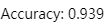

#### 7.4.2. Lora微调

> lora权重转换[参考链接](https://gitee.com/ascend/MindSpeed-LLM/blob/2.1.0/docs/pytorch/solutions/checkpoint_convert.md#23-lora%E6%9D%83%E9%87%8D%E8%BD%AC%E6%8D%A2)
>
> 注意：
>
>  - Lora在权重转换前，需要将Config.json中的数据类型改为float16，推理时采用fp16加载，否则会有精度误差。
>

##### 7.4.2.1. 转换脚本

```sh
# /apps/shared_storage/hw_test/hw/src/MindSpeed-LLM-2.1.0-cy611/scripts/qwen25_7b_instruct/ckpt_convert_qwen25_mcore2hf_4_lora_eval.sh
source /usr/local/Ascend/ascend-toolkit/set_env.sh

python convert_ckpt.py \
    --model-type GPT \
    --use-mcore-models \
    --load-model-type mg \
    --save-model-type hf \
    --load-dir /apps/shared_storage/hw_test/hw/weights/weight_mg/qwen2.5_7b_instruct_mcore_tp2_pp1 \
    --lora-load /apps/shared_storage/hw_test/hw/weights/ckpt_record/auto_train_test/qwen2.5_mcore_lora_tp2_pp1_midea_eval \
    --lora-r 16 \
    --lora-alpha 32 \
    --lora-target-modules linear_qkv linear_proj linear_fc1 linear_fc2 \
    --target-tensor-parallel-size 1 \
    --target-pipeline-parallel-size 1 \
    --add-qkv-bias \
    --save-dir /apps/shared_storage/hw_test/hw/weights/Qwen2.5-7B-Instruct  # <-- 需要填入原始HF模型路径，新权重会存于 /apps/hw/weights/Qwen2.5-7B-Instruct/mg2hf/
    
mg2hf_path="/apps/shared_storage/hw_test/hw/weights/ckpt_record/mg2hf/auto_train_and_test_4_lora_eval_mg2hf"
[ -d $mg2hf_path ] && rm -r $mg2hf_path
mv /apps/shared_storage/hw_test/hw/weights/Qwen2.5-7B-Instruct/mg2hf $mg2hf_path
```

##### 7.4.2.2. 执行命令

```sh
cd /apps/shared_storage/hw_test/hw/src/MindSpeed-LLM-2.1.0-cy611
bash scripts/qwen25_7b_instruct/ckpt_convert_qwen25_mcore2hf_4_lora_eval.sh
```

##### 7.4.2.3. 测试结果

当前评测准确率：88.8%。

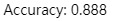

### 7.5. Loss曲线

#### 7.5.1. 全参微调

 Loss曲线图如下图所示，可以看到MindspeedLLM训练loss曲线正常下降收敛。

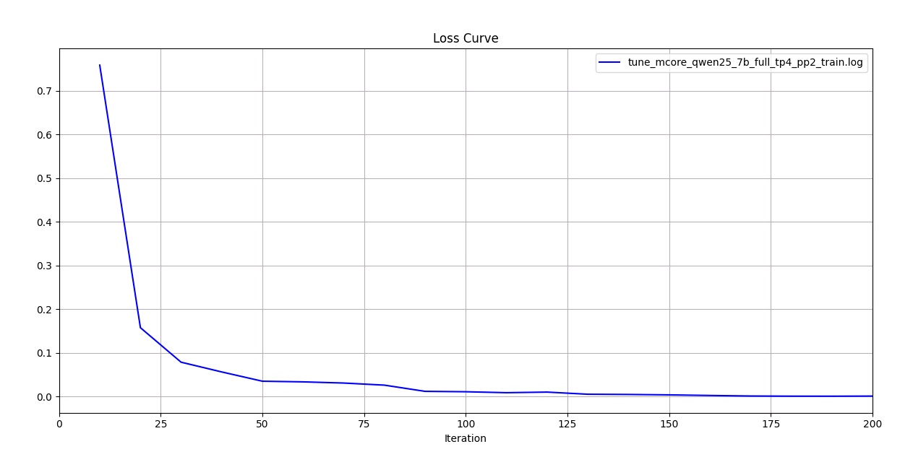

#### 7.5.2. Lora微调

 Loss曲线图如下图所示，可以看到MindspeedLLM训练loss曲线正常下降收敛。

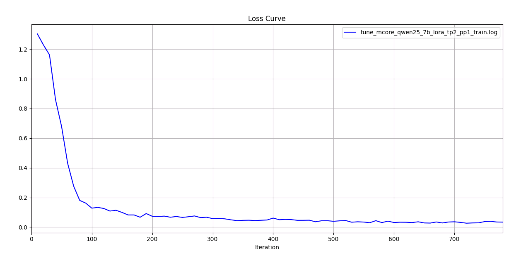

## 第二部分：Qwen3-14B训练验证

### 一、前期准备

#### 1.1. 训练脚本准备

已准备了Qwen3-14B模型的训练验证脚本，包括数据预处理、模型格式转换、全参微调和LoRA微调等功能，放在到`/data/share/platform_test/scripts/qwen3-14b`路径下。

```shell
/data/share/platform_test/scripts/qwen3-14b#
    ├── ckpt_convert_qwen3_14b_hf2mcore.sh   # 将HF权重转换为Mcore格式(TP=4, PP=2)
    ├── ckpt_convert_qwen3_lora_merge.sh  # Lora微调Lora权重合并脚本
    ├── ckpt_convert_qwen3_mcore2hf_full.sh  # 将全参微调的Mcore权重转换为HF格式
    ├── ckpt_convert_qwen3_mcore2hf_lora.sh  # 将全参微调的Mcore权重转换为HF格式
    ├── data_convert_qwen3_instruction_intent10k_qwen3.sh # qwen3 intent慢思考数据转换脚本
    ├── data_convert_qwen3_pretrain_enwiki.sh # 预训练enwiki数据转换脚本
    ├── eval_qwen3_14b_full_intent10k.sh  # 全参微调的评测脚本
    ├── eval_qwen3_14b_lora_intent10k.sh  # Lora微调的评测脚本
    ├── pretrain_qwen3_14b_enwiki_4K_ptd.sh # 预训练训练脚本
    ├── tune_qwen3_14b_4K_full_intent10k_ptd_2nodes.sh # 全参微调双机训练脚本
    ├── tune_qwen3_14b_4K_full_intent10k_ptd.sh   # 全参微调训练脚本
    └── tune_qwen3_14b_4K_lora_intent10k_ptd.sh   # Lora微调训练脚本
```

#### 1.2. 权重准备

从HuggingFace下载模型权重Qwen3-14B，已放置在`/data/share/platform_test/models/Qwen3-14B`目录下。

```
/data/share/platform_test/models/Qwen3-14B# 
    ├── config.json
    ├── configuration.json
    ├── generation_config.json
    ├── merges.txt
    ├── mg2hf
    ├── model-00001-of-00008.safetensors
    ├── model-00002-of-00008.safetensors
    ├── model-00003-of-00008.safetensors
    ├── model-00004-of-00008.safetensors
    ├── model-00005-of-00008.safetensors
    ├── model-00006-of-00008.safetensors
    ├── model-00007-of-00008.safetensors
    ├── model-00008-of-00008.safetensors
    ├── model.safetensors.index.json
    ├── README.md
    ├── tokenizer_config.json
    ├── tokenizer.json
    └── vocab.json
```

#### 1.3. 数据集准备

准备训练与测试数据集，已放在`/data/share/platform_test/datasets/`目录下

```sh
/data/share/platform_test/datasets#
    ├── intent_test_1k.jsonl    # 测试集
    └── intent_train_10k.jsonl  # 训练集
```

#### 1.4. 镜像准备

使用镜像

```
registry-cn-guian.midea.com/aios/aimp_a3_llm_release:v2.1.5-npu-arm
```

> 说明：由于做慢思考数据，需要使用MindSpeed-LLM的master分支代码，训练使用MindSpeed-LLM的2.1.0分支代码。因此在镜像 /src/train25.1.0目录中，有MindSpeed-LLM 的2.1.0 和 master两个分支代码，分别放置在MindSpeed-LLM-2.1.0 和 MindSpeed-LLM-master目录。
>
> /src/train25.1.0目录如下：
>
> ```
> /src/train25.1.0
> ├── Megatron-LM    # Megatron源码，供参考，源码编译时依赖
> ├── MindSpeed      # MindSpeed源码，供参考，源码编译时依赖
> ├── MindSpeed-LLM  # MindSpeed-LLM的2.1.0分支源码，供参考
> ├── MindSpeed-LLM-2.1.0 # MindSpeed-LLM的2.1.0分支源码，训练时依赖
> └── MindSpeed-LLM-master # MindSpeed-LLM的master分支源码，训练时依赖
> ```

### 二、HF权重转换为MG格式

昇腾MindSpeed-LLM要求模型权重采用Megatron-LM格式，在这里我们将原始HuggingFace权重格式转换为Megatron-Mcore格式。

使用转换脚本，获取对应切分的mg权重。这里权重切分为TP4PP2，权重转换转换脚本 `ckpt_convert_qwen3_14b_hf2mcore.sh` 关键代码如下：

```
OUTPUT_BASE_DIR=/data/private/qwen3
log_path="${OUTPUT_BASE_DIR}/14b/logs/ckpt_convert_qwen3_14b_hf2mcore.log"
mkdir -p ${OUTPUT_BASE_DIR}/14b/mg_weights/qwen3_14b_mcore_tp4pp2/
mkdir -p ${OUTPUT_BASE_DIR}/14b/logs

# 设置需要的权重转换参数
python convert_ckpt.py \
    --use-mcore-models \
    --model-type GPT \
    --load-model-type hf \
    --save-model-type mg \
    --target-tensor-parallel-size 4 \
    --target-pipeline-parallel-size 2 \
    --spec mindspeed_llm.tasks.models.spec.qwen3_spec layer_spec \
    --load-dir /data/share/platform_test/models/Qwen3-14B/ \
    --save-dir ${OUTPUT_BASE_DIR}/14b/mg_weights/qwen3_14b_mcore_tp4pp2/ \
    --tokenizer-model /data/share/platform_test/models/Qwen3-14B/tokenizer.json \
    --params-dtype bf16 \
    --model-type-hf qwen3 \
        | tee $log_path
```

参数解析

| 参数                              | 说明                                                         | 必填 |
| --------------------------------- | ------------------------------------------------------------ | ---- |
| `--model-type GPT`                | 指定模型类型为GPT系列                                        | ✅    |
| `--use-mcore-models`              | 转换为Megatron-Mcore格式                                     | ✅    |
| `--target-tensor-parallel-size`   | 张量并行度设置                                               | ✅    |
| `--target-pipeline-parallel-size` | 流水线并行度设置                                             | ✅    |
| `--tokenizer-model`               | 指定分词器路径                                               | ✅    |
| `--load-model-type`               | 加载权重的类别（可以是hf、mg）                               | ✅    |
| `--save-model-type`               | 存储权重的类别（可以是hf、mg）                               | ✅    |
| `--load-dir`                      | 权重文件加载路径                                             | ✅    |
| `--save-dir`                      | 权重文件保存路径                                             | ✅    |
| `--model-type-hf`                 | huggingface模型类别，默认为llama2                            |      |
| `--params-dtype`                  | 指定权重转换后的权重精度模式，默认为fp16，如果源文件格式为bf16，则需要设置为bf16 | ✅    |

在平台托管训练下发任务，执行脚本

```
cd /data/share/platform_test/scripts/qwen3-14b && bash ckpt_convert_qwen3_14b_hf2mcore.sh
```

运行后部分日志截图如下

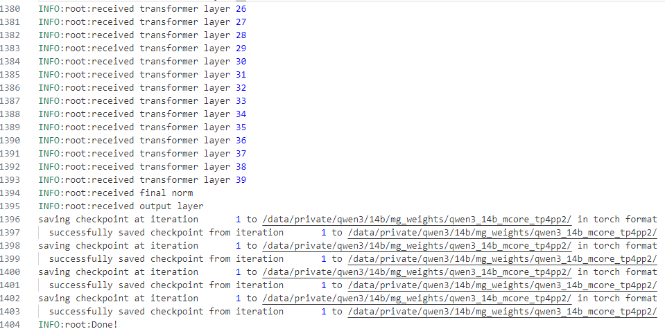

转换后生成目录文件如下：

```
/data/private/qwen3/14b/mg_weights/qwen3_14b_mcore_tp4pp2/
├── iter_0000001
│   ├── mp_rank_00_000
│   ├── mp_rank_00_001
│   ├── mp_rank_01_000
│   ├── mp_rank_01_001
│   ├── mp_rank_02_000
│   ├── mp_rank_02_001
│   ├── mp_rank_03_000
│   └── mp_rank_03_001
└── latest_checkpointed_iteration.txt
```

### 三、微调原始数据集转换为bin格式

这里使用的数据集为intent数据集，原始数据集目录为：

* 训练数据集：`/data/share/platform_test/datasets/intent_train_10k.jsonl`
* 评测数据集：`/data/share/platform_test/datasets/intent_test_1k.jsonl`

由于制作慢思考数据，需要使用MindSpeed-LLM的master分支代码，相关master分支代码已提前放置在镜像`/src/train25.1.0/MindSpeed-LLM-master` 目录。

其中微调数据集转换脚本 `data_convert_qwen3_instruction_intent10k_qwen3.sh` 大致如下

```
OUTPUT_BASE_DIR=/data/private/qwen3
mkdir -p ${OUTPUT_BASE_DIR}/finetune_dataset_intent10k_qwen3_think
log_path="${OUTPUT_BASE_DIR}/14b/logs/data_convert_qwen3_instruction_intent10k_qwen3.log"
mkdir -p ${OUTPUT_BASE_DIR}/14b/logs

python ./preprocess_data.py \
    --input  /data/share/platform_test/datasets/intent_train_10k.jsonl \
    --tokenizer-name-or-path /data/share/platform_test/models/Qwen3-14B/ \
    --output-prefix ${OUTPUT_BASE_DIR}/finetune_dataset_intent10k_qwen3_think/intent \
    --handler-name SharegptStyleInstructionHandler \
    --tokenizer-type PretrainedFromHF \
    --enable-thinking true \
    --workers 4 \
    --log-interval 1000 \
    --map-keys '{"messages":"messages", "tags":{"role_tag": "role","content_tag": "content","user_tag": "user","assistant_tag": "assistant","system_tag": "system"}}' \
    --prompt-type qwen3 \
        | tee $log_path
```

参数说明：

| 参数                       | 说明                                                         | 必填 |
| -------------------------- | ------------------------------------------------------------ | ---- |
| `--input`                  | 输入数据文件的路径，输入数据集目录或具体文件，如果是目录，则处理全部文件, 支持 .parquet \ .csv \ .json \ .jsonl \ .txt \ .arrow 格式， 同一个文件夹下的数据格式需要保持一致 | ✅    |
| `--tokenizer-name-or-path` | 用于分词器的预训练模型的路径。                               | ✅    |
| `--output-prefix`          | 输出文件的前缀。预处理后的数据会被保存为多个文件（例如，后缀为.bin和.idx），这个参数指定这些文件的前缀路径。 | ✅    |
| `--workers`                | 指定数据预处理时使用的进程数（多进程）。更多的进程数可以加快处理速度。 | ✅    |
| `-tokenizer-type`          | 指定tokenizer的类型。                                        | ✅    |
| `--log-interval`           | 控制日志打印的频率，例如每处理1000条数据打印一次进度日志。   | ✅    |
| `--handler-name`           | 指定数据处理器（handler）的类名。这里使用`SharegptStyleInstructionHandler`，这是专门为类似ShareGPT格式 | ✅    |
| `--prompt-type`            | 指定模型模板，能够让base模型微调后能具备更好的对话能力。`prompt-type`的可选项可以在[templates](https://gitee.com/ascend/MindSpeed-LLM/blob/2.1.0/mindspeed_llm/tasks/preprocess/templates.py)文件内查看。 | ✅    |
| `--map-keys`               | 参数用于配置字段映射来使用数据集。其中key值`"messages"、"tags"`代表数据集列映射后的属性，在代码中是固定的，不应改变。value值中`"conversations"`对应数据集的列名、`"from"`对应角色标志、`"human"、"gpt"、"system"、"observation"、"function_call"`对应角色种类、`"value"`对应具体内容标志。<br>OpenAI风格为`'{"messages":"messages", "tags":{"role_tag": "role","content_tag": "content","user_tag": "user","assistant_tag": "assistant","system_tag": "system"}}'`<br>ShareGPT风格为 `'{"messages":"conversations", "tags":{"role_tag": "from","content_tag": "value","user_tag": "human","assistant_tag": "gpt","system_tag": "system", "observation_tag":"observation", "function_tag":"function_call"}}'` | ✅    |

在平台托管训练下发任务，执行脚本

```shell
cd /data/share/platform_test/scripts/qwen3-14b && bash data_convert_qwen3_instruction_intent10k_qwen3.sh
```

运行后部分日志截图如下

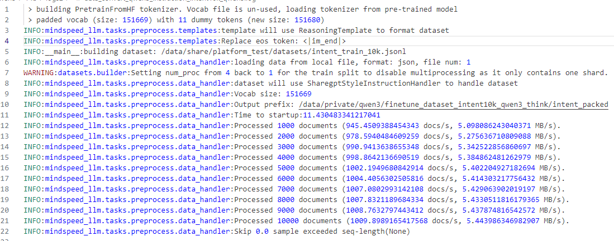

转换后生成的文件列表如下：

```
.
├── intent_packed_attention_mask_document.bin
├── intent_packed_attention_mask_document.idx
├── intent_packed_input_ids_document.bin
├── intent_packed_input_ids_document.idx
├── intent_packed_labels_document.bin
├── intent_packed_labels_document.idx
├── intent_train_indexmap_49920ns_42s_shuffle_decoder_packed_idx.npy
└── intent_train_indexmap_51200ns_42s_shuffle_decoder_packed_idx.npy
```

### 四、全参微调

#### 4.1 全参微调示例脚本

启动全参微调训练，训练启动脚本关键代码如下

```shell
export CUDA_DEVICE_MAX_CONNECTIONS=1
#基础配置
NPUS_PER_NODE=16  #使用单节点的NPU
MASTER_ADDR=localhost #以本节点ip地址为master_ip
MASTER_PORT=6015 #本节点端口号为6015
NNODES=1  #单机，即一台节点，多机即多节点
NODE_RANK=0  #单机RANK为0，多机为(0,NNODES-1)，不同节点不可重复
WORLD_SIZE=$(($NPUS_PER_NODE*$NNODES)) #最终使用的NPU数

OUTPUT_BASE_DIR=/data/private/qwen3
mkdir -p ${OUTPUT_BASE_DIR}/14b/logs

# 根据实际情况配置权重保存、权重加载、词表、数据集路径
CKPT_LOAD_DIR="${OUTPUT_BASE_DIR}/14b/mg_weights/qwen3_14b_mcore_tp4pp2/"  #权重加载路径，填入权重转换时保存的权重路径
CKPT_SAVE_DIR="${OUTPUT_BASE_DIR}/14b/save_weights_full/qwen3_14b_mcore_tp4pp2_intent10k_qwen3_think/"  #训练完成后的权重保存路径
DATA_PATH="${OUTPUT_BASE_DIR}/finetune_dataset_intent10k_qwen3_think/intent"  #数据集路径，填入数据预处理时保存的数据路径，注意需要添加后缀
TOKENIZER_PATH="/data/share/platform_test/models/Qwen3-14B/" #词表路径，填入下载的开源权重词表路径
log_path="${OUTPUT_BASE_DIR}/14b/logs/tune_qwen3_14b_4K_full_intent10k_ptd.log"

TP=4
PP=2
MBS=16
GBS=128
SEQ_LENGTH=800
TRAIN_ITERS=390 #训练步数

DISTRIBUTED_ARGS="
    --nproc_per_node $NPUS_PER_NODE \
    --nnodes $NNODES \
    --node_rank $NODE_RANK \
    --master_addr $MASTER_ADDR \
    --master_port $MASTER_PORT
"

GPT_ARGS="
    --use-mcore-models \
    --tensor-model-parallel-size ${TP} \
    --pipeline-model-parallel-size ${PP} \
    --spec mindspeed_llm.tasks.models.spec.qwen3_spec layer_spec \
    --kv-channels 128 \
    --qk-layernorm \
    --num-layers 40 \
    --hidden-size 5120 \
    --use-rotary-position-embeddings \
    --untie-embeddings-and-output-weights \
    --num-attention-heads 40 \
    --ffn-hidden-size 17408 \
    --max-position-embeddings 40960 \
    --seq-length ${SEQ_LENGTH} \
    --train-iters ${TRAIN_ITERS} \
    --micro-batch-size ${MBS} \
    --global-batch-size ${GBS} \
    --make-vocab-size-divisible-by 1 \
    --use-flash-attn \
    --padded-vocab-size 151936 \
    --rotary-base 1000000 \
    --disable-bias-linear \
    --swiglu \
    --tokenizer-type PretrainedFromHF \
    --tokenizer-name-or-path ${TOKENIZER_PATH} \
    --normalization RMSNorm \
    --position-embedding-type rope \
    --norm-epsilon 1e-6 \
    --hidden-dropout 0 \
    --attention-dropout 0 \
    --no-gradient-accumulation-fusion \
    --attention-softmax-in-fp32 \
    --exit-on-missing-checkpoint \
    --no-masked-softmax-fusion \
    --group-query-attention \
    --num-query-groups 8 \
    --seed 42 \
    --bf16 \
    --lr-warmup-fraction 0.1 \
    --clip-grad 1.0 \
    --adam-beta1 0.9 \
    --adam-beta2 0.999 \
    --no-load-optim \
    --no-load-rng \
    --lr 1.0e-5 \
    --sequence-parallel
"

DATA_ARGS="
    --data-path $DATA_PATH \
    --split 100,0,0
"

OUTPUT_ARGS="
    --log-interval 1 \
    --save-interval ${TRAIN_ITERS} \
    --eval-interval ${TRAIN_ITERS} \
    --eval-iters 0 \
    --log-throughput
"

TUNE_ARGS="
    --finetune \
    --stage sft \
    --is-instruction-dataset \
    --prompt-type qwen \
    --variable-seq-lengths
"

torchrun $DISTRIBUTED_ARGS posttrain_gpt.py \
    $GPT_ARGS \
    $DATA_ARGS \
    $OUTPUT_ARGS \
    $TUNE_ARGS \
    --tensorboard-dir ${OUTPUT_BASE_DIR}/14b/tb/full/intent10k \
    --distributed-backend nccl \
    --load ${CKPT_LOAD_DIR} \
    --save ${CKPT_SAVE_DIR} \
    | tee $log_path
```

#### 4.2 训练参数对照表

全参微调关键训练参数MindspeedLLM与LLaMAFactory对照表如下：

| MindspeedLLM           | LLaMAFactory                   | 备注                                                  |
| ---------------------- | ------------------------------ | ----------------------------------------------------- |
| SEQ_LEN=2048           | cutoff_len=2048                | Token长度限制                                         |
| log-interval=10        | logging_steps=10               | 打印日志频率                                          |
| MBS=32                 | per_device_train_batch_size=32 | 需要根据显存进行配置                                  |
| -                      | gradient_accumulation_steps=1  | MindspeedLLM梯度累计会根据MBS,GBS,DP自动计算。当前为8 |
| GBS=256                | -                              | MindspeedLLM 与 LLaMAFactory全局batch_size            |
| TRAIN_ITERS=200        | num_train_epochs=5             | MindspeedLLM 与 LLaMAFactory训练样本数对齐            |
| lr=1.0e-5              | learning_rate=1.0e-5           | 学习率                                                |
| lr-decay-style=cosine  | lr_scheduler_type=cosine       | 余弦退火学习率衰减                                    |
| lr-warmup-fraction=0.1 | warmup_ratio=0.1               | 学习率预热                                            |
| bf16                   | bf16=true                      | bf 训练                                               |

#### 4.3 单机任务下发

在平台托管训练下发任务，执行脚本

```shell
cd /data/share/platform_test/scripts/qwen3-14b && bash tune_qwen3_14b_4K_full_intent10k_ptd.sh
```

结果如下


#### 4.4 多机任务下发

多机场景下，需要修改以下配置

```
# 基础配置
NPUS_PER_NODE=16  #使用单节点的8卡NPU
MASTER_ADDR=$(cat /etc/volcano/worker.host | head -n 1 | awk '{print $1}') #以本节点ip地址为master_ip
MASTER_PORT=6016 #本节点端口号为6015
NNODES=${VC_WORKER_NUM}  #单机，即一台节点，多机即多节点
NODE_RANK=${VC_TASK_INDEX}  #单机RANK为0，多机为(0,NNODES-1)，不同节点不可重复
WORLD_SIZE=$(($NPUS_PER_NODE*$NNODES)) #最终使用的NPU数
```

在平台托管训练下发任务，执行脚本

```shell
cd /data/share/platform_test/scripts/qwen3-14b && bash tune_qwen3_14b_4K_full_intent10k_ptd_2nodes.sh
```

结果如下


### 五、Lora微调

#### 5.1 Lora微调示例脚本

Lora微调训练，训练启动脚本关键代码如下

```shell
export CUDA_DEVICE_MAX_CONNECTIONS=1
# 基础配置
NPUS_PER_NODE=8  #使用单节点的8卡NPU
MASTER_ADDR=localhost #以本节点ip地址为master_ip
MASTER_PORT=6015 #本节点端口号为6015
NNODES=1  #单机，即一台节点，多机即多节点
NODE_RANK=0  #单机RANK为0，多机为(0,NNODES-1)，不同节点不可重复
WORLD_SIZE=$(($NPUS_PER_NODE*$NNODES)) #最终使用的NPU数

OUTPUT_BASE_DIR=/data/private/qwen3
mkdir -p ${OUTPUT_BASE_DIR}/14b/logs

# 根据实际情况配置权重保存、权重加载、词表、数据集路径
CKPT_LOAD_DIR="${OUTPUT_BASE_DIR}/14b/mg_weights/qwen3_14b_mcore_tp4pp2/"  #权重加载路径，填入权重转换时保存的权重路径
CKPT_SAVE_DIR="${OUTPUT_BASE_DIR}/14b/save_weights_lora/qwen3_14b_mcore_tp4pp2_intent10k_qwen3_think/"  #训练完成后的权重保存路径
DATA_PATH="${OUTPUT_BASE_DIR}/finetune_dataset_intent10k_qwen3_think/intent"  #数据集路径，填入数据预处理时保存的数据路径，注意需要添加后缀
TOKENIZER_PATH="/data/share/platform_test/models/Qwen3-14B/" #词表路径，填入下载的开源权重词表路径
log_path="${OUTPUT_BASE_DIR}/14b/logs/tune_qwen3_14b_4K_lora_intent10k_ptd.log"
TP=4
PP=2
SEQ_LENGTH=2048
TRAIN_ITERS=800

DISTRIBUTED_ARGS="
    --nproc_per_node $NPUS_PER_NODE \
    --nnodes $NNODES \
    --node_rank $NODE_RANK \
    --master_addr $MASTER_ADDR \
    --master_port $MASTER_PORT
"

OPTIMIZE_ARGS="
    --use-flash-attn \
    --use-fused-rotary-pos-emb \
    --use-rotary-position-embeddings \
    --use-fused-swiglu \
    --use-fused-rmsnorm \
    --no-masked-softmax-fusion \
    --use-distributed-optimizer
"

TRAIN_ARGS="
    --micro-batch-size 4 \
    --global-batch-size 64 \
    --lr 1.0e-5 \
    --lr-decay-style cosine \
    --lr-warmup-fraction 0.1 \
    --attention-dropout 0.0 \
    --init-method-std 0.01 \
    --hidden-dropout 0.0 \
    --clip-grad 1.0 \
    --adam-beta1 0.9 \
    --adam-beta2 0.999 \
    --initial-loss-scale 4096 \
    --seed 42 \
    --bf16 \
    --train-iters ${TRAIN_ITERS} \
    --seq-length ${SEQ_LENGTH} \
    --no-shared-storage
"

MODEL_PARALLEL_ARGS="
    --tensor-model-parallel-size ${TP} \
    --pipeline-model-parallel-size ${PP}
"

GPT_ARGS="
    --use-mcore-models \
    --spec mindspeed_llm.tasks.models.spec.qwen3_spec layer_spec \
    --kv-channels 128 \
    --qk-layernorm \
    --tokenizer-name-or-path ${TOKENIZER_PATH} \
    --max-position-embeddings ${SEQ_LENGTH} \
    --num-layers 40 \
    --hidden-size 5120 \
    --ffn-hidden-size 17408 \
    --num-attention-heads 40 \
    --tokenizer-type PretrainedFromHF \
    --make-vocab-size-divisible-by 1 \
    --padded-vocab-size 151936 \
    --rotary-base 1000000 \
    --untie-embeddings-and-output-weights \
    --disable-bias-linear \
    --position-embedding-type rope \
    --normalization RMSNorm \
    --swiglu \
    --attention-softmax-in-fp32 \
    --no-gradient-accumulation-fusion \
    --group-query-attention \
    --num-query-groups 8
"

DATA_ARGS="
    --data-path $DATA_PATH \
    --split 100,0,0
"

OUTPUT_ARGS="
    --load ${CKPT_LOAD_DIR} \
    --save ${CKPT_SAVE_DIR} \
    --log-interval 1 \
    --save-interval ${TRAIN_ITERS} \
    --eval-interval ${TRAIN_ITERS} \
    --eval-iters 0 \
    --no-load-optim \
    --no-load-rng
"

TUNE_ARGS="
    --finetune \
    --stage sft \
    --is-instruction-dataset \
    --tokenizer-not-use-fast \
    --prompt-type qwen \
    --variable-seq-lengths \
    --lora-r 16 \
    --lora-alpha 32 \
    --lora-fusion \
    --lora-target-modules linear_qkv linear_proj linear_fc1 linear_fc2
"

torchrun $DISTRIBUTED_ARGS posttrain_gpt.py \
    $GPT_ARGS \
    $DATA_ARGS \
    $OUTPUT_ARGS \
    $OPTIMIZE_ARGS \
    $TRAIN_ARGS \
    $TUNE_ARGS \
    $MODEL_PARALLEL_ARGS \
    --tensorboard-dir ${OUTPUT_BASE_DIR}/14b/tb/lora/intent10k \
    --distributed-backend nccl \
    | tee $log_path
```

#### 5.2 训练参数对照表

Lora微调关键训练参数MindspeedLLM与LLaMAFactory对照表如下：

| MindspeedLLM                                                 | LLaMAFactory                   | 备注                                                         |
| ------------------------------------------------------------ | ------------------------------ | ------------------------------------------------------------ |
| lora-r=16                                                    | lora_rank: 16                  | Lora 秩                                                      |
| lora-target-modules linear_qkv linear_proj linear_fc1 linear_fc2 | lora_target: all               | lora模块                                                     |
| SEQ_LEN=2048                                                 | cutoff_len=2048                | Token长度限制                                                |
| log-interval=10                                              | logging_steps=10               | 打印日志频率                                                 |
| MBS=16                                                       | per_device_train_batch_size=32 | 需要根据显存进行配置。经过测试，目前TP4PP2最大配置16         |
| -                                                            | gradient_accumulation_steps=1  | MindspeedLLM梯度累计会根据MBS, GBS, DP自动计算。当前梯度累计=4 |
| GBS=64                                                       | -                              | MindspeedLLM 与 LLaMAFactory训练样本数对齐                   |
| TRAIN_ITERS=785                                              | num_train_epochs=5             | 需要根据GBS训练epochs数计算。                                |
| lr                                                           | learning_rate=1.0e-5           | 学习率                                                       |
| lr-decay-style=cosine                                        | lr_scheduler_type=cosine       | 余弦退火学习率衰减                                           |
| lr-warmup-fraction=0.1                                       | warmup_ratio=0.1               | 学习率预热                                                   |
| bf16                                                         | bf16=true                      | bf 训练                                                      |

#### 5.3 任务下发

在平台托管训练下发任务，执行脚本

```shell
cd /data/share/platform_test/scripts/qwen3-14b && bash tune_qwen3_14b_4K_lora_intent10k_ptd.sh
```

结果如下


#### 5.4 结果评测

评测脚本`eval_qwen3_14b_lora_intent10k.sh`大致如下：

```

```

在平台托管训练下发任务，执行脚本

```shell
cd /data/share/platform_test/scripts/qwen3-14b && bash tune_qwen3_14b_4K_lora_intent10k_ptd.sh
```

结果如下


### 六、预训练

#### 6.1 数据集转换

预训练数据集转换脚本关键代码如下

```
OUTPUT_BASE_DIR=/data/private/qwen3
mkdir -p ${OUTPUT_BASE_DIR}/pretrain_datasets_enwiki
log_path="${OUTPUT_BASE_DIR}/14b/logs/data_convert_qwen3_pretrain_enwiki.log"

python ./preprocess_data.py \
    --input /data/share/platform_test/datasets/enwiki/train-00000-of-00042-d964455e17e96d5a.parquet \
    --tokenizer-name-or-path /data/share/platform_test/models/Qwen3-14B/ \
    --tokenizer-type PretrainedFromHF \
    --handler-name GeneralPretrainHandler \
    --output-prefix ${OUTPUT_BASE_DIR}/pretrain_datasets_enwiki/enwiki \
    --json-keys text \
    --workers 4 \
    --log-interval 1000 \
        | tee $log_path
```


#### 6.2 预训练示例脚本

预训练启动脚本关键代码如下

```shell
# 基础配置
NPUS_PER_NODE=16  #A3单节点16卡NPU
MASTER_ADDR=localhost #以本节点ip地址为master_ip
MASTER_PORT=6115 #本节点端口号为6015
NNODES=1  #单机，即一台节点，多机即多节点
NODE_RANK=0  #单机RANK为0，多机为(0,NNODES-1)，不同节点不可重复
WORLD_SIZE=$(($NPUS_PER_NODE*$NNODES)) #最终使用的NPU数

OUTPUT_BASE_DIR=/data/private/qwen3

# 根据实际情况配置权重保存、权重加载、词表、数据集路径
CKPT_LOAD_DIR="${OUTPUT_BASE_DIR}/14b/mg_weights/qwen3_14b_mcore_tp4pp2/"  # 权重加载路径，填入权重转换时保存的权重路径
CKPT_SAVE_DIR="${OUTPUT_BASE_DIR}/14b/save_weights_pretrain/qwen3_14b_mcore_tp4pp2/"                # 训练完成后的权重保存路径
DATA_PATH="${OUTPUT_BASE_DIR}/pretrain_datasets_enwiki/enwiki_text_document"      # 数据集路径，填入数据预处理时保存的数据路径，注意需要添加后缀
TOKENIZER_PATH="/data/share/platform_test/models/Qwen3-14B/" # 词表路径，填入下载的开源权重词表路径
log_path="${OUTPUT_BASE_DIR}/14b/logs/pretrain_qwen3_14b_enwiki_4K_ptd.log"

TP=4  
PP=2 
CP=1  #序列并行
MBS=4 #设置micro-batch-size为4
GBS=64 #设置global-batch-size为128
SEQ_LENGTH=4096  #设置seq_length为4096 
TRAIN_ITERS=1000000 
CP_TYPE='ulysses_cp_algo' #序列并行算法

DISTRIBUTED_ARGS="
    --nproc_per_node $NPUS_PER_NODE \
    --nnodes $NNODES \
    --node_rank $NODE_RANK \
    --master_addr $MASTER_ADDR \
    --master_port $MASTER_PORT
"

OPTIMIZE_ARGS="
    --use-flash-attn \
    --use-fused-rotary-pos-emb \
    --use-rotary-position-embeddings \
    --use-fused-swiglu \
    --use-fused-rmsnorm \
    --no-masked-softmax-fusion \
    --use-distributed-optimizer
"

TRAIN_ARGS="
    --micro-batch-size ${MBS} \
    --global-batch-size ${GBS} \
    --lr 1.25e-6 \
    --min-lr 1.25e-7 \
    --weight-decay 1e-1 \
    --lr-warmup-fraction 0.01 \
    --attention-dropout 0.0 \
    --hidden-dropout 0.0 \
    --clip-grad 1.0 \
    --adam-beta1 0.9 \
    --adam-beta2 0.95 \
    --seed 42 \
    --bf16 \
    --train-iters ${TRAIN_ITERS} \
    --seq-length ${SEQ_LENGTH} \
"

MODEL_PARALLEL_ARGS="
    --tensor-model-parallel-size ${TP} \
    --pipeline-model-parallel-size ${PP} \
    --context-parallel-size ${CP} \
    --context-parallel-algo ${CP_TYPE} \
"

GPT_ARGS="
    --use-mcore-models \
    --spec mindspeed_llm.tasks.models.spec.qwen3_spec layer_spec \
    --kv-channels 128 \
    --qk-layernorm \
    --num-layers 40 \
    --hidden-size 5120 \
    --untie-embeddings-and-output-weights \
    --num-attention-heads 40 \
    --ffn-hidden-size 17408 \
    --max-position-embeddings 40960 \
    --make-vocab-size-divisible-by 1 \
    --padded-vocab-size 151936 \
    --rotary-base 1000000 \
    --disable-bias-linear \
    --swiglu \
    --tokenizer-type PretrainedFromHF \
    --tokenizer-name-or-path ${TOKENIZER_PATH} \
    --normalization RMSNorm \
    --position-embedding-type rope \
    --norm-epsilon 1e-6 \
    --no-gradient-accumulation-fusion \
    --attention-softmax-in-fp32 \
    --exit-on-missing-checkpoint \
    --group-query-attention \
    --num-query-groups 8 \
    --no-load-optim \
    --no-load-rng \
    --tensorboard-dir /data/share/platform_test/src/llm-qwen3/MindSpeed-LLM/tb \
    --sequence-parallel
"

DATA_ARGS="
    --data-path $DATA_PATH \
    --split 100,0,0
"

OUTPUT_ARGS="
    --log-interval 1 \
    --save-interval 20000 \
    --eval-interval ${TRAIN_ITERS} \
    --eval-iters 0 \
    --log-throughput
"

torchrun $DISTRIBUTED_ARGS pretrain_gpt.py \
    $GPT_ARGS \
    $DATA_ARGS \
    $OUTPUT_ARGS \
    $OPTIMIZE_ARGS \
    $TRAIN_ARGS \
    $MODEL_PARALLEL_ARGS \
    --distributed-backend nccl \
    --tensorboard-dir ${OUTPUT_BASE_DIR}/14b/tb/pretrain/enwiki \
    --load ${CKPT_LOAD_DIR} \
    --save ${CKPT_SAVE_DIR} \
    | tee $log_path
```

#### 6.3 任务下发

在平台托管训练下发任务，执行脚本

```shell
cd /data/share/platform_test/scripts/qwen3-14b && bash pretrain_qwen3_14b_enwiki_4K_ptd.sh
```

结果如下


## 第三部分： 其他参考

### 3.1 相关社区及文档链接

| 参考                                       | 链接                                                         |
| ------------------------------------------ | ------------------------------------------------------------ |
| 昇腾社区                                   | https://gitee.com/ascend                                     |
| Mindspeed LLM 官网（大模型）               | https://gitee.com/ascend/MindSpeed-LLM                       |
| 昇腾大模型加速库                           | https://gitee.com/ascend/MindSpeed                           |
| MindSpeed-MM 官网（多模态大模型）          | https://gitee.com/ascend/MindSpeed-MM                        |
| MindSpeed RL 官网（强化学习加速框架）      | https://gitee.com/ascend/MindSpeed-RL                        |
| 基于MindSpeed LLM训练和微调Qwen2.5（教程） | https://www.hiascend.com/developer/blog/details/02115183735165287002 |
| MindSpeed LLM开发实践（原理讲解）          | https://www.hiascend.com/developer/courses/detail/1910963014913622017 |
| Ascend华为官网                             | https://www.hiascend.com/                                    |

### 3.2 模型训练常见环境变量说明

模型训练常见环境变量说明如下

| 环境变量名称                | 环境变量描述                                                 |
| --------------------------- | ------------------------------------------------------------ |
| ASCEND_LAUNCH_BLOCKING      | 将Host日志输出到串口,0-关闭/1-开启。                         |
| ASCEND_SLOG_PRINT_TO_STDOUT | 设置默认日志级别,0-debug/1-info/2-warning/3-error。          |
| HCCL_WHITELIST_DISABLE      | HCCL白名单开关,1-关闭/0-开启。                               |
| HCCL_CONNECT_TIMEOUT        | 设置HCCL超时时间，默认值为120。                              |
| HCCL_NPU_SOCKET_PORT_RANGE  | 配置HCCL在NPU侧使用的通信端口，支持配置为具体的端口、端口范围或者字符串“auto”。[详细参考](https://www.hiascend.com/document/detail/zh/canncommercial/81RC1/apiref/envvar/envref_07_0144.html) |
| CUDA_DEVICE_MAX_CONNECTIONS | 定义了任务流能够利用或映射到的硬件队列的数量。               |
| TASK_QUEUE_ENABLE           | 用于控制开启task_queue算子下发队列优化的等级，0：关闭，1：开启Level 1优化，2：开启Level 2优化。 |
| COMBINED_ENABLE             | 设置combined标志。设置为0表示关闭此功能；设置为1表示开启，用于优化非连续两个算子组合类场景。 |
| PYTORCH_NPU_ALLOC_CONF      | 内存碎片优化开关，默认是expandable_segments:False，使能时expandable_segments:True。 |
| ASCEND_RT_VISIBLE_DEVICES   | 指定哪些Device对当前进程可见，支持一次指定一个或多个Device ID。通过该环境变量，可实现不修改应用程序即可调整所用Device的功能。 |
| HCCL_SOCKET_IFNAME          | 指定hccl socket通讯走的网卡配置。                            |
| GLOO_SOCKET_IFNAME          | 指定gloo socket通讯走的网卡配置。                            |
| HCCL_LOGIC_SUPERPOD_ID      | 指定当前设备的逻辑超节点ID，如果走ROCE，不同多机超节点ID不同，0-N。 |

### 3.3 MindSpeed-LLM训练参数说明

MindSpeed-LLM训练参数常见参数说明如下

| 参数                              | 说明                                                         | 必填 |
| --------------------------------- | ------------------------------------------------------------ | ---- |
| `--model-type GPT`                | 指定模型类型为GPT系列                                        | ✅    |
| `--use-mcore-models`              | 转换为Megatron-Mcore格式                                     | ✅    |
| `--target-tensor-parallel-size`   | 张量并行度设置                                               | ✅    |
| `--target-pipeline-parallel-size` | 流水线并行度设置                                             | ✅    |
| `--tokenizer-model`               | 指定分词器路径                                               | ✅    |
| `--load-model-type`               | 加载权重的类别（可以是hf、mg）                               | ✅    |
| `--save-model-type`               | 存储权重的类别（可以是hf、mg）                               | ✅    |
| `--load-dir`                      | 权重文件加载路径                                             | ✅    |
| `--save-dir`                      | 权重文件保存路径                                             | ✅    |
| `--model-type-hf`                 | huggingface模型类别，默认为llama2                            |      |
| `--params-dtype`                  | 指定权重转换后的权重精度模式，默认为fp16，如果源文件格式为bf16，则需要设置为bf16 | ✅    |
| `--tensorboard-dir`               | 开启tensorboard数据收集并指定tensorboard的事件存储目录，如` ./tb `。查看训练loss曲线使用方法为 `tensorboard --logdir=./tb --port=3000` |      |

### 
