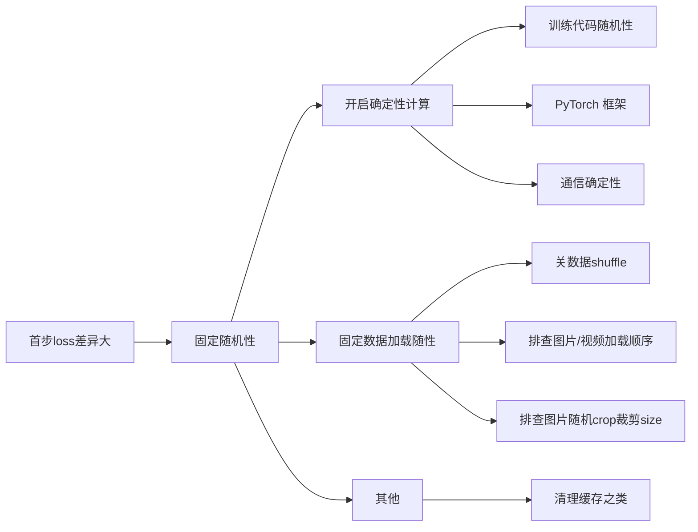
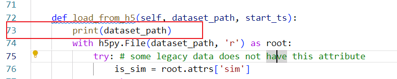
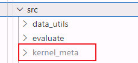

## 固定随机性和确定性计算

本文结构



固定随机性，即在开启确定性计算且所有随机因素被固定后，在相同的硬件和软件环境下，使用相同的输入数据执行相同的训练代码，每次运行得到的输出结果应该是**完全一致**的。

###  1、为什么要确定性计算

- **什么是确定性计算**：简单来说，在开启确定性计算且所有随机因素被固定后，在相同的硬件和软件环境下，使用相同的输入数据执行相同的训练代码，每次运行得到的输出结果应该是**完全一致**的。这对于调试模型、精度比对和科学实验的可复现性至关重要。
- **为什么要确定性计算**：NPU在AI处理器领域属于后来者，并且NPU与主流AI处理器在硬件、指令计算过程和浮点舍入截断模式方面存在差异。这些细微差异都能引起最终输出结果的不同，从而产生跟标杆比对程度不一的误差。在比较差异时，首先需要排除计算随机性的带来的差异，再来看是否是以上这些原因引起的误差或存在计算错误。
- **性能权衡**：需要注意的是，开启确定性计算可能会限制底层算子的某些优化（如使用非确定性的算法内核或改变并行计算顺序），这通常会导致**训练性能有所下降**。因此，一般在调试或需要严格复现结果时才开启，生产训练中可关闭以获得最佳性能。

### 2、开启确定性计算

#### 2.1 NPU开启确定性计算

在用工具进行分析定位前，需明确问题能复现，重复训练尽可能固定现象。在代码层面通常包括：

- 在代码层面，固定代码中随机性。

  - 固定随机种子：`torch_npu.npu.manual_seed(seed)` 和 `torch_npu.npu.manual_seed(seed)`
  - 关闭Dropout层

- 在Pytorch框架层面，打开Pytorch确定性计算。

  ```
  torch.use_deterministic_algorithms(True)
  ```

- 在通信层面，打开CANN的确定性通信开关。

  ```
  export HCCL_DETERMINISTIC=TRUE
  ```

- 若仍不能复现可使用精度采集工具采集md5数据进行排查。


**对于昇腾NPU**，可以利用 MindStudio 中的 `msprobe`工具来一键完成多项固定操作。例如前三项可统一通过seed_all工具进行自动固定，可以自动设置随机种子、开启确定性计算并移除Dropout层。

```
from msprobe.pytorch import seed_all
seed_all(seed=1234, mode=True, rm_dropout=True)
```

此外，对于一些特殊算子，由于硬件差异同样的随机种子在不同硬件上生成的随机数不同或可能暂不支持确定性计算。需通过先在CPU上计算生成后转回NPU或者小算子替换等方式手动补充。

对于千卡甚至万卡上出现的精度问题，通常需要将集群训练规模缩小进行复现定位。常见的做法是保持tensor parallel，pipeline parallel等参数不变，将data parallel参数缩小或直接减少模型层数，裁剪时需伴随实验确保能复现，最终选择规模尽可能小且可复现的训练参数。

#### 2.2 GPU开启确定性计算

安装msprobe

```
pip install mindstudio-probe
```

对于GPU，修改训练代码中主函数之前加入以下固定随机性的代码：

```python
from msprobe.pytorch import seed_all
seed_all(seed=1234,rm_dropout=True)

def fix_randomness(seed=1234, is_gpu=True, deterministic=True, rm_dropout=True):
    print("Fix randomness")
    import random
    import numpy as np
    from packaging import version
    random.seed(seed)
    os.environ['PYTHONHASHSEED'] = str(seed)
    np.random.seed(seed)
    torch.manual_seed(seed)
    cuda_version = torch.version.cuda
    if cuda_version is not None and version.parse(cuda_version) >= version.parse("10.2"):
        os.environ['CUBLAS_WORKSPACE_CONFIG'] = ':4096:8'
    os.environ['HCCL_DETERMINISTIC'] = str(True)
    if deterministic:
        print("torch.use_deterministic_algorithms(True)")
        torch.use_deterministic_algorithms(True,warn_only=True)
    
    if is_gpu:
        print("torch cuda manual seedall")
        torch.cuda.manual_seed_all(seed)
        torch.cuda.manual_seed(seed)
        if deterministic:
            torch.backends.cudnn.deterministic = True
            torch.backends.cudnn.enable = False
            torch.backends.cudnn.benchmark = False
    else:
        print("torch_npu manual seedall")
        torch_npu.npu.manual_seed_all(seed)
        torch_npu.npu.manual_seed(seed)
fix_randomness()
```

### 3、固定数据随机性

#### 3.1关闭数据shuffle

同时修改GPU和NPU的文件dataloader函数

```
    def get_train_dataloader(self) -> DataLoader:
      	...
        if not isinstance(train_dataset, torch.utils.data.IterableDataset):
            dataloader_params["drop_last"] = self.args.dataloader_drop_last
            dataloader_params["worker_init_fn"] = seed_worker
            dataloader_params["shuffle"] = True
```

将shuffle为True都修改为

```
dataloader_params["shuffle"] = False
```

#### 3.2 图片/视频遍历顺序一致

由于不同的硬件或操作系统，python的os.walk()函数遍历文件的顺序可能不同。可以通过sort函数对遍历后的文件进行强制排序，以确保遍历文件顺序一致。

问题现象：通过开确定性计算和关数据shuffle后，使用msprobe采集dump数据，发现首步的dump结果还较大差异。

定位过程大致如下：
通过pdb打断点，进一步定位：

```python
import pdb 
pdb.set_trace()
```

```python
def get_train_dataloader(self) -> DataLoader:
    
    if not isinstance(train_dataset, torch.utils.data.IterableDataset):
        ...
        dataloader_params["shuffle"] = False
    sampler = self._get_train_sampler()
    
    #增加pdb调试
    import pdb 
    pdb.set_trace()
    
    return self.accelerator.prepare(DataLoader(train_dataset, **dataloader_params))
```

由于具身模型采用的输入是HDF5文件，每个HDF5文件包含了多个步骤的图像和输入状态。查看数据的属性内容：
```
tmp=self.accelerator.prepare(DataLoader(train_dataset, **dataloader_params))
data_iter = iter(tmp)
first_batch = next(data_iter)
p first_batch.keys()

dict_keys(['observation.images.cam_high', 'observation.images.cam_left_wrist', 'observation.images.cam_right_wrist', 'observation.state', 'action', 'action_is_pad', 'is_s1', 'is_vl_data', 'task', 'reasoning'])
```


查看输入中其中一张图片的shape
```
p inputs['observation.images.cam_high'].shapes
```

shape的结果一样

```
[43,480,640]
```

说明shape一致，进一步检查图片最后一维tensor是否一致

`p inputs['observation.images.cam_high][:,:,0,:]`

GPU输出如下

```
tensor([[[0.0000, 0.7490, 0.7490,  ..., 0.0000, 0.0000, 0.0000],
         [0.0000, 0.8000, 0.8000,  ..., 0.0000, 0.0000, 0.0000],
         [0.0000, 0.8000, 0.8000,  ..., 0.0000, 0.0000, 0.0000]],

        [[0.0000, 0.0000, 0.0000,  ..., 0.0000, 0.0000, 0.0000],
         [0.0000, 0.0000, 0.0000,  ..., 0.0000, 0.0000, 0.0000],
         [0.0000, 0.0000, 0.0000,  ..., 0.0000, 0.0000, 0.0000]],

        [[0.0902, 0.0902, 0.0902,  ..., 0.0902, 0.0902, 0.0902],
         [0.0902, 0.0902, 0.0902,  ..., 0.0902, 0.0902, 0.0902],
         [0.0902, 0.0902, 0.0902,  ..., 0.0902, 0.0902, 0.0902]],

        [[0.0706, 0.0706, 0.0706,  ..., 0.0706, 0.0706, 0.0706],
         [0.0706, 0.0706, 0.0706,  ..., 0.0706, 0.0706, 0.0706],
         [0.0706, 0.0706, 0.0706,  ..., 0.0706, 0.0706, 0.0706]]],
       device='cuda:0')
```

NPU输出如下

```
(Pdb) p inputs['observation.images.cam_high'][:,:,0,:]
[rank0]:[W1122 16:44:29.376664262 compiler_depend.ts:164] Warning: Warning: Device do not support double dtype now, dtype cast repalce with float. (function operator())
tensor([[[0.0000, 0.2902, 0.2902,  ..., 0.0000, 0.0000, 0.0000],
         [0.0000, 0.4000, 0.4000,  ..., 0.0000, 0.0000, 0.0000],
         [0.0000, 0.4314, 0.4314,  ..., 0.0000, 0.0000, 0.0000]],

        [[0.0000, 0.0000, 0.0000,  ..., 0.0000, 0.0000, 0.0000],
         [0.0000, 0.0000, 0.0000,  ..., 0.0000, 0.0000, 0.0000],
         [0.0000, 0.0000, 0.0000,  ..., 0.0000, 0.0000, 0.0000]],

        [[0.1059, 0.1059, 0.1059,  ..., 0.1059, 0.1059, 0.1059],
         [0.1059, 0.1059, 0.1059,  ..., 0.1059, 0.1059, 0.1059],
         [0.1059, 0.1059, 0.1059,  ..., 0.1059, 0.1059, 0.1059]],

        [[0.0824, 0.0824, 0.0824,  ..., 0.0824, 0.0824, 0.0824],
         [0.0824, 0.0824, 0.0824,  ..., 0.0824, 0.0824, 0.0824],
         [0.0824, 0.0824, 0.0824,  ..., 0.0824, 0.0824, 0.0824]]],
       device='npu:0')
```
说明tensor数据不一致。

以为是Pillow包问题， 升级NPU的Pillow包

```
python3 -m pip install --upgrade Pillow -C jpeg=disable --force-reinstall
```

**问题依然存在，NPU的输出没有变化。** 怀疑数据shuffle没有固定住。

进一步打印首次加载的hdf5文件路径



发现GPU和NPU首次加载的HDF5文件不一致：

* GPU加载的首个Hdf5: random_folding_shirts_basket_zby_20250813_compressed/collection_1755074127.hdf5
* NPU加载的首个Hdf5: random_folding_shirts_basket_zby_20250813_compressed/collection_1755072388.hdf5

仔细走读代码，发现dataloader是通过pkl文件记录hdf5加载顺序的。

```
def find_all_hdf5(dataset_dir):
    hdf5_files = []
    for root, dirs, files in os.walk(dataset_dir):
        for filename in fnmatch.filter(files, '*.hdf5'):
            if 'features' in filename:
                continue
			...
            hdf5_files.append(os.path.join(root, filename))
    print(f'Found {len(hdf5_files)} hdf5 files')
    return hdf5_files

def save_stats(args):
    task_config = TASK_CONFIGS[args.task_name]
	...
    stats_path = os.path.join(args.ckpt_dir, f'dataset_stats.pkl')
    with open(stats_path, 'wb') as f:
        pickle.dump(stats, f)
```

将GPU和NPU的pkl文件通过python代码读入。

```
import pickle
path = "/data/share/xxx/exp7_train_mirro_1126_1die_smalldata_seedall_shuffle_cpu_3.sh/dataset_stats.pkl"


with open(path, "rb") as f:
    data = pickle.load(f)

print(data["dataset_path_list"])
```

GPU的结果

```
'random_folding_shirts_basket_zby_20250813_compressed/collection_1755074127.hdf5',
'random_folding_shirts_basket_zby_20250813_compressed/collection_1755070730.hdf5',
'random_folding_shirts_basket_zby_20250813_compressed/collection_1755072195.hdf5',
...
```

NPU的结果

```
'random_folding_shirts_basket_zby_20250813_compressed/collection_1755072388.hdf5',
'random_folding_shirts_basket_zby_20250813_compressed/collection_1755072097.hdf5',
'random_folding_shirts_basket_zby_20250813_compressed/collection_1755055498.hdf5',
```

**最终确认是  os.walk在x86和arm实现不同。**

**修改方案**: 

* 方案1 ：将os.walk()的API遍历得到的pkl文件在GPU上保存后，使用NPU替换目录中的前缀后，重新加载。
* 方案2：对os.walk()的API遍历后的文件顺序强制排序：`hdf5_files.sort()`

#### 3.3 屏蔽随机crop操作

代码中可能存在对图片的随机crop(裁剪)操作，在固定随机性进行精度对齐时，要一齐排查和固定。

比如 如下代码在对图片处理前有 rand_crop_resize 的判断

```python
def eval_bc(policy, deploy_env, policy_config, raw_lang=None):
	...
    set_seed(0)
    rand_crop_resize = True
	...
    for rollout_id in range(1000):
			...
            if t % query_frequency == 0:
            	...
                if rand_crop_resize:
                    print('rand crop resize is used!')
                    original_size = curr_image.shape[-2:]
                    ratio = 0.95
                    curr_image = curr_image[...,
                                 int(original_size[0] * (1 - ratio) / 2): int(original_size[0] * (1 + ratio) / 2),
                                 int(original_size[1] * (1 - ratio) / 2): int(original_size[1] * (1 + ratio) / 2)]
                    ....
                    traj_rgb_np = traj_rgb_np.cpu().numpy()
			....
```

在进行处理前，需将 rand_crop_resize设为 False。

### 4、其他操作

#### 4.1 清理缓存

部分缓存可能导致计算复用了上一次未固定随机性的计算结果，可以清理如kernel_cache, kernel_meta等文件。



在对系统进行某些修改后（如替换了修复确定性问题的算子库），务必删除算子编译缓存（例如 `~/atc_data/kernel_cache/`目录下的内容），以确保修改生效 。

####  4.2 其他高级排查

即使进行了上述设置，有时可能仍无法实现完全确定性，这通常源于以下原因：

1. **算子支持度**：并非所有算子都支持确定性计算。昇腾社区提供了支持的[API清单](https://www.hiascend.com/document/detail/zh/Pytorch/710/apiref/PyTorchNativeapi/ptaoplist_000213.html)（如 `torch.nn.functional.batch_norm`, `torch.matmul`等）。如果模型中使用了暂不支持确定性的算子（如案例中的 `MSDA`和 `grid_sample`），需要联系算子支撑人员或寻求替代方案（如用小算子组合替代或将该算子转到CPU上执行）。

### 5、总结

| 配置维度           | 核心方法         | NPU关键命令/配置                                             | GPU关键命令/配置                              | 备注                                      |
| ------------------ | ---------------- | ------------------------------------------------------------ | --------------------------------------------- | ----------------------------------------- |
| **数据shuffle**    | 固定数据加载顺序 | 设置 DataLoader 的 `shuffle=False`                           |                                               |                                           |
| **训练代码随机性** | 固定随机种子     | `torch.manual_seed(1234)`                                    |                                               |                                           |
|                    | 关闭 Dropout 层  | 在模型评估模式下 (`model.eval()`) 或训练时将droupout暂时移除 |                                               |                                           |
| **PyTorch 框架**   | 开启确定性计算   | `torch.use_deterministic_algorithms(True)`                   |                                               |                                           |
|                    | 验证是否开启     | `torch.are_deterministic_algorithms_enabled()`               |                                               |                                           |
| **昇腾通信**       | 开启确定性通信   | 设置环境变量 `export HCCL_DETERMINISTIC=TRUE`                | 设置环境变量 `export NCCL_DETERMINISTIC=TRUE` | AllReduce等多卡求和顺序不一致导致随机性。 |
| **其他**           | 清理缓存         | 清理如cache,kernel_meta等文件                                |                                               |                                           |
|                    | 其他高级排查     | 确认支持确定性计算的算子清单、                               |                                               |                                           |

### 参考

1. [torch API: torch.use_deterministic_algorithms](https://docs.pytorch.org/docs/2.6/generated/torch.use_deterministic_algorithms.html)
2. [确定性计算API支持清单](https://www.hiascend.com/document/detail/zh/Pytorch/710/apiref/PyTorchNativeapi/ptaoplist_000213.html)
3. [MindStudio-大模型训练精度问题定位案例-问题定位方法-问题复现](https://www.hiascend.com/document/detail/zh/mindstudio/80RC1/practicalcases/LargeModelTrainingAccuracy/toolsample3_005.html)
4. [logits采集比对](https://www.hiascend.com/document/detail/zh/mindstudio/80RC1/practicalcases/Analysiscaseofreasoningaccuracy/toolsample2_007.html)
4. [PyTorch Dataset的shuffle与不shuffle：为何会产生显著差异？如何选择shuffle参数？](https://blog.51cto.com/u_16827017/12564698)

