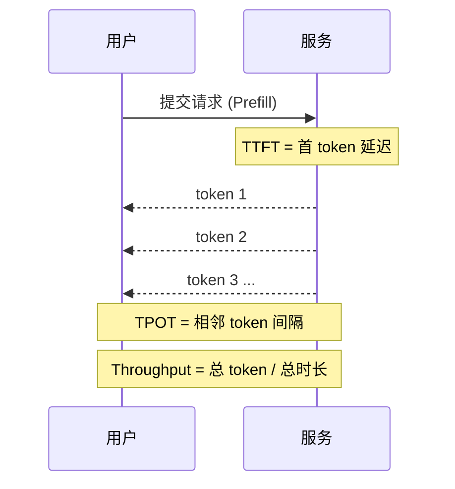

# 推理性能指标：TTFT / TPOT / Throughput

> "快不快"不能只说一句。本文给出 LLM 服务最重要的几个时延/吞吐指标定义、测量方法，以及它们和批大小、模型规模、硬件的关系，方便做 SLO 与容量规划。

关联：[服务化部署 Continuous Batching](服务化部署%20Continuous%20Batching.md) · [解码策略与投机解码](解码策略与投机解码.md) · [推理框架对比 vLLM SGLang TensorRT-LLM MindIE](推理框架对比%20vLLM%20SGLang%20TensorRT-LLM%20MindIE.md)

---

## 图示速览

**关键延迟指标时序**：TTFT 为首 token 延迟（Prefill 阶段），TPOT 为相邻生成 token 间隔（Decode 阶段），Throughput 为总 token / 总时长。




## 1. 核心指标

| 指标 | 含义 | 对应阶段 | 关注方 |
| --- | --- | --- | --- |
| **TTFT**（Time To First Token） | 从发请求到**首个 token** 的延迟 | Prefill | 用户体感"响应快不快" |
| **TPOT**（Time Per Output Token） | 相邻输出 token 的**平均间隔** | Decode | 用户体感"打字流不流畅" |
| **ITL**（Inter-Token Latency） | 逐 token 间隔（含波动） | Decode | 流畅度稳定性 |
| **Throughput** | 单位时间生成的**总 token 数**（tokens/s）或完成**请求数**（req/s） | 全程 | 系统容量/成本 |

> 一句话：TTFT 看"起步"，TPOT/ITL 看"持续输出顺不顺"，Throughput 看"总共能干多少活"。

---

## 2. 它们受什么影响

```
TTFT  ← prompt 长度、prefill 算力、并发排队、是否命中前缀缓存
TPOT  ← 模型层数/维度数、批大小(batch)、KV 访存带宽、量化精度、投机解码
Throughput ← 并发度、连续批处理效率、GPU 利用率、带宽/算力平衡
```

- **批大小↑** → TTFT 可能↑（排队/prefill 竞争），但 Throughput↑（更满利用算力）。
- **模型↑** → TTFT 与 TPOT 都↑（更多计算/带宽），需量化或并行抵消。
- **量化/投机解码** → 主要压 TPOT（见 [量化](量化推理%20GPTQ%20AWQ%20SmoothQuant%20FP8.md)、[投机解码](解码策略与投机解码.md)）。
- **连续批处理** → 显著提升 Throughput，平抑排队（见 [服务化部署](服务化部署%20Continuous%20Batching.md)）。

---

## 3. 测量方法

1. **压测工具**：用固定 prompt 分布（长度、复杂度）并发发请求，记录每条的 TTFT、每 token 时间戳。
2. **指标聚合**：
   - TTFT：取 p50 / p90 / p99（长尾比均值重要）。
   - TPOT：对每条求平均，再聚合成全局 p50/p99。
   - Throughput：总生成 token ÷ 总耗时（含排队）。
3. **固定变量**：同一模型、同一精度、同一框架版本、同一硬件；只动一个变量（如 batch）。
4. **典型负载**：短问答（看 TPOT）、长文生成（看吞吐）、RAG（长 prompt 看 TTFT）。

> 注意区分**端到端延迟**（含网络/排队）与**模型推理延迟**（纯引擎内）。调优应看后者，SLO 看前者。

---

## 4. 质量指标（不要忘了）

性能之外，模型"答得对不对"用：困惑度（Perplexity，越低越好）、以及下游任务指标（见 [模型评测](../03模型评测/RAEDME.md)：MMLU / GSM8K / HumanEval 等）。**量化/加速必须以质量不崩为底线**——每次改精度或框架都应有质量回归。

---

## 5. SLO 规划示例

- 对话产品：TTFT < 0.5s（p90），TPOT < 50ms（p90）。
- 代码补全：TTFT < 0.3s，TPOT < 30ms。
- 批处理抽取：不计较 TTFT，最大化 Throughput。
- 用这些目标反推并发上限、需要的卡数、是否上量化/投机解码。

---

## 6. TODO / 延伸

- [ ] 实测：7B/70B 在 vLLM vs MindIE 上的 TTFT/TPOT 曲线（不同 batch）。
- [ ] 深入：p99 TPOT 尖刺的常见来源（prefill 抢占、KV 碎片、host 同步）。
- [ ] 对比：开启投机解码后 TPOT 下降，但 Throughput 是否同步提升（理论上近似不变）。
- [ ] 工具：编写一段最小压测脚本，输出 TTFT(p90)/TPOT(p99)/Throughput 三件套。
