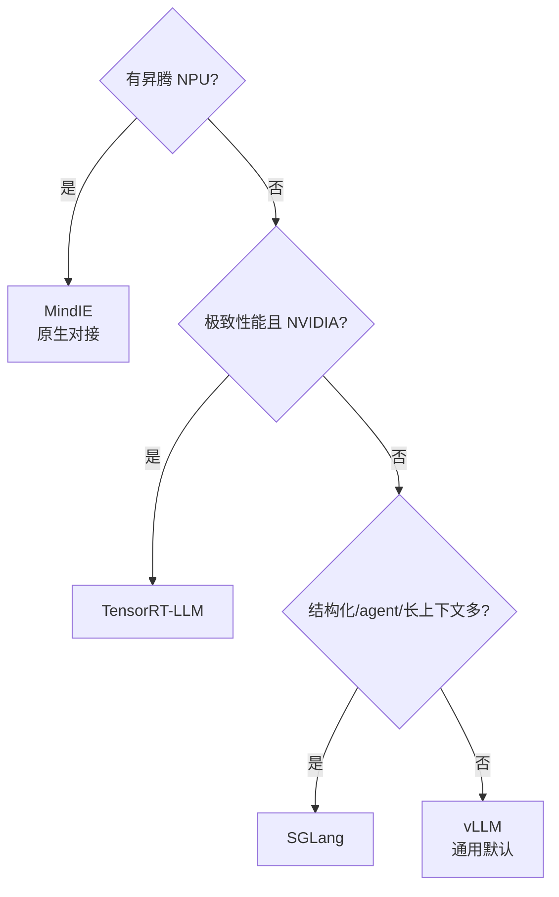

# 推理框架对比：vLLM / SGLang / TensorRT-LLM / MindIE

> 选对推理框架，吞吐可以差数倍。本文从架构定位、MoE 支持、长上下文、硬件绑定等维度对比四个主流框架，并给出选型建议。昇腾侧的 MindIE 作为国产硬件原生方案单列。

关联：[量化推理 GPTQ AWQ SmoothQuant FP8](量化推理%20GPTQ%20AWQ%20SmoothQuant%20FP8.md) · [服务化部署 Continuous Batching](服务化部署%20Continuous%20Batching.md) · [KV Cache 与 PagedAttention](../../00基础知识/KV%20Cache与PagedAttention.md)

---

## 图示速览

**框架选型决策树**：有昇腾优先 MindIE；否则按极致性能 / 结构化与长上下文 / 通用上手逐层分流。




## 1. 四个框架定位

| 框架 | 硬件 | 语言 | 定位 |
| --- | --- | --- | --- |
| **vLLM** | NVIDIA GPU（+ ROCm/昇腾社区适配） | Python | 高吞吐通用推理，PagedAttention 发源地 |
| **SGLang** | NVIDIA GPU | Python | 结构化生成 + RadixAttention 前缀复用，MoE/长上下文强 |
| **TensorRT-LLM** | NVIDIA GPU 仅 | C++/Python | 内核级极致优化，H100/H200 上峰值性能 |
| **MindIE**（昇腾） | 昇腾 NPU 仅 | C++/Python | 华为官推，MindSpore/MindSpeed 模型原生对接 |

---

## 2. 关键能力对比

| 能力 | vLLM | SGLang | TRT-LLM | MindIE |
| --- | --- | --- | --- | --- |
| PagedAttention / 块化 KV | ✅ 首创 | ✅ | ✅ | ✅ |
| Continuous Batching | ✅ | ✅ | ✅ | ✅ |
| 前缀缓存（prefix cache） | ✅（部分） | ✅ RadixAttention | 有限 | ✅ |
| MoE 优化 | ✅ | ✅ 强 | ✅ | ✅ |
| 结构化输出（JSON 等） | 需插件 | ✅ 原生 | 有限 | 部分 |
| 长上下文 | ✅ | ✅ 强 | ✅ | ✅ |
| FP8 / 权重量化 | ✅ | ✅ | ✅ 强 | ✅ |
| 硬件绑定 | 通用 GPU | 通用 GPU | 仅 NVIDIA | 仅昇腾 |

---

## 3. 各自强项

- **vLLM**：生态最大、模型覆盖最广、上手快；是"默认选项"。适合绝大多数在线/离线推理。
- **SGLang**：**RadixAttention** 把相同 prompt 前缀的 KV 在请求间复用，对 few-shot、多轮对话、agent 重复前缀极友好；在 MoE 与长上下文上吞吐常领先；原生支持复杂结构化生成（多轮调用、分支）。
- **TensorRT-LLM**：离硬件最近，H100/H200 上单卡/单集群可达最高吞吐与最低延迟，但定制化成本高、仅 NVIDIA。
- **MindIE**：昇腾 910B 上的一等公民，对接 MindFormers/MindSpeed 训练权重，ATB 算子 + 图引擎优化；在国产算力场景是不可替代的推理入口（仓库已有 [MindIE 安装/接口/调优](01推理框架/MindIE/) 文档）。

---

## 4. 选型建议

```
有昇腾 NPU？ ──是──> MindIE（原生对接，详见仓库 MindIE 文档）
     │否
     ▼
追求极致性能(且 NVIDIA)？ ──是──> TensorRT-LLM
     │否
     ▼
大量结构化输出 / agent / 长上下文 / 前缀复用多？ ──是──> SGLang
     │否
     ▼
通用、快速上手、生态广？ ──> vLLM
```

> 实践中常见组合：研究/验证用 vLLM，生产高并发 agent 用 SGLang，NVIDIA 极致优化用 TRT-LLM，国产算力用 MindIE。

---

## 5. 与量化的关系

- 框架的吞吐上限很大程度取决于能否跑低精度：vLLM/SGLang/TRT-LLM/MindIE 均支持 W8A8 / INT4 / FP8（见 [量化推理](量化推理%20GPTQ%20AWQ%20SmoothQuant%20FP8.md)）。
- 选框架前先确认目标模型 + 目标精度的算子覆盖，避免"框架支持但某层回退 FP16 拖慢整体"。

---

## 6. TODO / 延伸

- [ ] 实测：同一 7B/70B 在 vLLM vs SGLang 的吞吐（不同 batch / 序列），记录 TTFT/TPOT（见 [指标](推理性能指标%20TTFT%20TPOT%20Throughput.md)）。
- [ ] 深入：SGLang RadixAttention 的前缀树结构与淘汰策略。
- [ ] 对比：TRT-LLM 在 H100 vs MindIE 在 910B 的同模型吞吐（公开信息有限，需实测）。
- [ ] 跟踪：llama.cpp / Ollama 在边缘(CPU/GPU)场景的定位（[ollama](../../../04应用开发/08相关工具/03部署工具/ollama.md)）。
