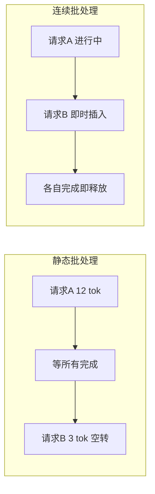

# 服务化部署：Continuous Batching

> 把 LLM 做成高并发在线服务，吞吐与延迟的博弈是核心。本文讲清"静态批处理"的浪费，以及 **Continuous Batching（连续批处理）** 如何用分块 KV 把 GPU 喂满，并延伸到 prefill/decode 分离等生产级架构。

关联：[KV Cache 与 PagedAttention](../../00基础知识/KV%20Cache与PagedAttention.md) · [推理框架对比 vLLM SGLang TensorRT-LLM MindIE](推理框架对比%20vLLM%20SGLang%20TensorRT-LLM%20MindIE.md) · [推理性能指标 TTFT TPOT Throughput](推理性能指标%20TTFT%20TPOT%20Throughput.md)

---

## 图示速览

**静态批处理 vs 连续批处理**：静态批需等整批最慢请求完成才释放，短请求空转；连续批中请求随时插入、各自完成即释放，GPU 利用率更高。

## 1. 静态批处理的问题

传统做法：凑满一个固定 batch（如 32 条请求）一起推理，等**最慢的那条**生成完才整体返回、再接下一批。

- 请求长短不一，短请求早早完成却**占着位置空等** → GPU 利用率低。
- 新请求必须**排队到下一个整批** → 排队延迟高（TTFT 变差）。
- 显存按最大序列预留 → 碎片与浪费（见 [KV Cache](../../00基础知识/KV%20Cache与PagedAttention.md)）。

---

## 2. Continuous Batching（连续/在途批处理）

核心：**不再以"整批"为单位，而以"每个 token 步"为单位动态调度**。一条请求每生成一个 token，就重新评估全局：哪些请求已结束（释放其 KV 块）、哪些新请求可加入、哪些继续解码。

- 借助 **PagedAttention** 的分块 KV，请求结束时立即回收其 KV 块，新请求随时插入空位。
- 短请求结束即退出，不拖慢同批其他人；长请求持续占用但别人照常加入。
- 效果：GPU 利用率从静态批的 ~30% 提升到 ~90%+，同等硬件下吞吐数倍提升。

> 实现代表：vLLM、SGLang、MindIE、Triton 的 scheduler 均基于此思想。

---

## 3. Prefill 与 Decode 两阶段

一次请求分两个阶段，特性截然不同：

| 阶段 | 输入 | 计算特性 | 瓶颈 |
| --- | --- | --- | --- |
| **Prefill** | 全部 prompt（多 token） | 高度并行，算力密集 | 算力（可一次算出所有 prompt 的 KV） |
| **Decode** | 单个新 token | 串行，每步读全模型 | 访存带宽 |

- Prefill 快但吃算力；Decode 慢且吃带宽。混在同一批会互相干扰（decode 被 prefill 的大矩阵乘拖慢 TPOT）。
- **分离部署（Disaggregation）**：用两组实例分别处理 prefill 和 decode，各自独立扩缩容与优化。代价是 KV 需在两组间传输（跨节点/显存拷贝）。

---

## 4. 调度策略与工程要点

- **优先级 / SLO 感知调度**：按业务优先级或延迟目标分配算力，保障重要请求 TTFT。
- **KV 显存水位管理**：设上限，接近满时拒绝/排队新请求，避免 OOM。
- **Chunked Prefill**：把超长 prompt 的 prefill 切成小块，与 decode 交错，避免一次 prefill 卡住整批（降低 TPOT 尖刺）。
- **前缀缓存**：相同 system prompt 的 KV 复用（SGLang RadixAttention），省去重复 prefill。

> 昇腾侧：MindIE 的调度器已支持连续批处理与分页 KV，生产部署时通过并发数、block_size、prefix cache 等参数调优（见 [MindIE 性能调优](01推理框架/MindIE/性能调优.md)）。

---

## 5. TODO / 延伸

- [ ] 推导：相同 QPS 下，连续批处理相比静态批处理的 GPU 利用率上限差异。
- [ ] 深入：Chunked Prefill 如何在不显著增加 TPOT 的前提下吸收长 prompt。
- [ ] 实验：MindIE 开启 prefix cache 后，多轮对话的 TTFT 变化（测法见 [指标](推理性能指标%20TTFT%20TPOT%20Throughput.md)）。
- [ ] 对比：prefill/decode 分离部署的 KV 传输开销 vs 吞吐收益拐点。
