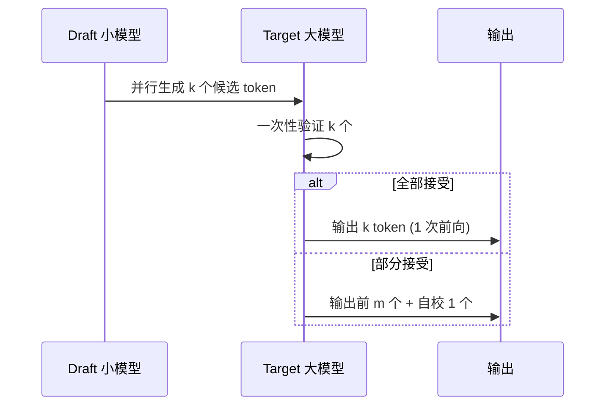

# 解码策略与投机解码

> 文本怎么"一个字一个字"生成出来？本文讲清贪心/集束/采样等基础解码，以及能显著加速推理的**投机解码（Speculative Decoding）**及其变体。

关联：[推理性能指标 TTFT TPOT Throughput](推理性能指标%20TTFT%20TPOT%20Throughput.md) · [KV Cache 与 PagedAttention](../../00基础知识/KV%20Cache与PagedAttention.md)

---

## 图示速览

**投机解码时序**：Draft 小模型一次并行生成 k 个候选，Target 大模型一次前向全部验证；全部接受时等效 1 次前向产出 k token，显著加速。

## 1. 基础解码

自回归生成每一步从词汇表分布中选一个 token：

| 策略 | 做法 | 特点 |
| --- | --- | --- |
| **Greedy（贪心）** | 每步选概率最大 token | 确定、快，但易重复/缺乏多样性 |
| **Beam Search（集束）** | 维护 k 条候选序列，按累计概率扩展 | 适合翻译/摘要等"标准答案"任务，但开销大、易平庸 |
| **Sampling（采样）** | 按分布随机抽 | 多样、自然，对话/创作常用 |
| **Top-k / Top-p（核采样）** | 只在 top-k 或累计概率 p 的子集里采 | 控质量与多样性平衡（Top-p 更常用） |
| **Temperature** | 缩放 logits 再 softmax（T↑更随机） | 调"创造力" |

> 现代对话模型几乎都用 **Top-p + Temperature 采样**；代码/数学推理常降 T 或贪心以保准确性。

---

## 2. 为什么 decode 慢

- 每生成一个 token 都要跑一次完整前向（大模型 GEMM），且**严格串行**（第 t 个 token 依赖 t-1）。
- decode 阶段是**访存密集**（HBM 带宽瓶颈），而非算力瓶颈——单步计算量小但频繁读大模型权重。
- 核心矛盾：**串行 + 每步都读全部权重** → 延迟高、GPU 算力空转。

---

## 3. 投机解码（Speculative Decoding）

思想：**用一个小模型（draft）先"猜测"未来 k 个 token，再用大模型（target）一次性并行验证**——猜得准就一次前进 k 步，大幅减少大模型的串行前向次数。

流程：

1. Draft 模型自回归生成候选序列 `x₁..x_k`。
2. Target 模型对这 k 个位置**并行**做一次前向，得到每个位置的真实分布。
3. 按"无偏接受"准则逐个接受：接受概率 = `min(1, p_target / p_draft)`；首个被拒位置后，用 target 分布重采样补一个 token。
4. 平均每次迭代前进 >1 个 token → 端到端延迟下降（吞吐近似不变，但 TTFT/TPOT 改善）。

前提：draft 模型要**便宜且与被投机模型分布接近**，否则接受率低、反而亏。

---

## 4. 变体

| 方法 | 草稿来源 | 说明 |
| --- | --- | --- |
| 标准投机解码 | 独立小模型 | 简单、通用 |
| **EAGLE / EAGLE-2** | 用 target 的隐含状态自回归预测 | 草稿来自目标模型自身，接受率更高 |
| **Medusa** | 在 LLM 头部挂若干"预测头" | 无需独立草稿模型，并行出多个候选 |
| **Lookahead / 自草稿** | 用 n-gram / 自身预测 | 轻量、免训练 |

> 仓库中 DeepSeek-V3 的 **MTP（多 token 预测）** 模块（见 [DeepSeek V3](../01模型结构/01LLM模型/deepseek/deepseek_v3.md)）正是为投机/多步解码设计的天然草稿器。

---

## 5. 与框架/硬件的关系

- vLLM / SGLang / MindIE 均已支持投机解码（需配置 draft 模型或 MTP 头）。
- 昇腾侧：MindIE 对 MTP / 投机解码有专门路径，配合 910B 的算子可显著降 TPOT。

---

## 6. TODO / 延伸

- [ ] 推导：投机解码的"无偏接受"为什么不改变目标分布。
- [ ] 实验：7B(draft)+13B(target) 在不同接受率下的 TPOT 提升（见 [指标](推理性能指标%20TTFT%20TPOT%20Throughput.md)）。
- [ ] 深入：EAGLE 如何用 target 特征树提升草稿质量。
- [ ] 昇腾：MindIE 上开启 MTP 投机解码的配置与实测加速比。
