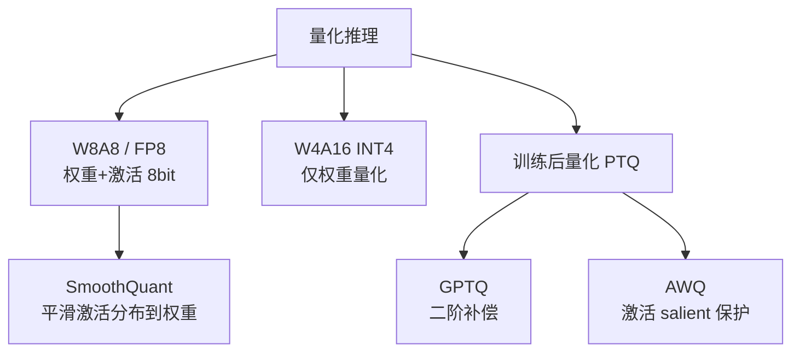

# 量化推理：GPTQ / AWQ / SmoothQuant / FP8

> 推理的成本主要在"显存占用"和"访存带宽"。量化通过降低权重/激活的数值精度，同时压小模型体积、提升吞吐。本文梳理权重量化（GPTQ/AWQ）、激活量化（SmoothQuant）、FP8 与 KV 量化的原理与选型。

关联：[混合精度训练 FP16 BF16 FP8](../../00基础知识/混合精度训练%20FP16%20BF16%20FP8.md) · [KV Cache 与 PagedAttention](../../00基础知识/KV%20Cache与PagedAttention.md) · [推理框架对比 vLLM SGLang TensorRT-LLM MindIE](推理框架对比%20vLLM%20SGLang%20TensorRT-LLM%20MindIE.md)

---

## 图示速览

**量化方法谱系**：按粒度分 W8A8/FP8（权重+激活）与 W4A16（仅权重）；PTQ 中 GPTQ 用二阶补偿、AWQ 保护显著激活；SmoothQuant 把激活分布平滑到权重。

## 1. 为什么要量化

| 目标 | 说明 |
| --- | --- |
| 降显存 | 权重从 FP16(2B)→INT4(0.5B)，体积 4× 缩小，能塞进更小/更多卡 |
| 提吞吐 | 低精度张量核心更快，且访存（HBM 带宽）压力下降（见 [MFU](../../00基础知识/大模型%20MFU%20计算公式.md)） |
| 降延迟 | decode 阶段是"访存密集"，小权重直接减少每 token 的 HBM 读取 |

量化可作用在三处：**权重（W）、激活（A）、KV Cache**。

---

## 2. 权重量化（Weight-only）：INT8 / INT4

只量化权重、激活仍保留较高精度（如 W4A16、W8A16）。推理时把权重反量化为 BF16 再算，或用专用低精度 GEMM。

### 2.1 GPTQ（基于二阶信息的逐列量化）

- 训练后量化（PTQ）：按列顺序量化，每量化一列就用**海森矩阵**估计量化误差，并**把误差补偿到后续未量化的列**——最小化整体重建误差。
- 优点：4-bit 下仍较好保持精度；支持任意模型。
- 缺点：需要校准集 + 计算海森，耗时较长。

### 2.2 AWQ（激活感知权重量化）

- 核心观察：少数（约 1%）**"显著权重"（salient weights）** 对精度影响极大，应该保护。
- 做法：观察校准数据的**激活幅度**，按激活大小对权重做**逐通道缩放（scale）**，把重要权重"放大"以保护，再做统一低比特量化。
- 优点：无需反向/海森，速度快；同等比特下常优于 GPTQ；工程友好。
- 代表实现：AutoAWQ、llama.cpp 的 AWQ 支持。

> 经验：W4 场景优先试 **AWQ**；若追求极致压缩且能耐受校准成本，GPTQ 也可。

---

## 3. 激活量化：SmoothQuant（W8A8）

难点：激活里常存在**大离群值（outlier）**，直接 INT8 量化激活会严重失真。

- SmoothQuant 引入平滑因子 `s`，把激活的离群值"迁移"到权重上：

$$X' = X \cdot \text{diag}(s)^{-1},\qquad W' = W \cdot \text{diag}(s)$$

- 使权重和激活都落在 INT8 可表示范围，实现 **W8A8 全程低精度推理**，近无损且大幅提速。
- 适用于 compute-bound 的大模型前向。

---

## 4. FP8 量化

- FP8（E4M3 精度优先 / E5M2 范围优先）在 H100、昇腾 910B 上有原生张量核心。
- 推理常用 **W8A8-FP8**：权重和激活都 FP8，计算累加在 FP32，几乎无损且接近 INT8 的 2× 带宽收益。
- 与训练侧 FP8（见 [混合精度训练](../../00基础知识/混合精度训练%20FP16%20BF16%20FP8.md)）共用硬件与 scaling 逻辑。

---

## 5. KV Cache 量化

- KV 随序列增长，长上下文下是大头（见 [KV Cache](../../00基础知识/KV%20Cache与PagedAttention.md)）。
- 可把 K/V 存为 **INT8 / FP8**（甚至 INT4 对部分层），牺牲少量精度换显存与带宽。
- 配合 PagedAttention 的分块管理，长上下文吞吐显著提升。

---

## 6. 选型速查

| 方案 | 比特 | 作用对象 | 质量 | 速度 | 适用 |
| --- | --- | --- | --- | --- | --- |
| AWQ | W4A16 | 权重 | 高 | 高 | 边缘/单卡部署主流 |
| GPTQ | W4A16 | 权重 | 中-高 | 高 | 通用 PTQ |
| SmoothQuant | W8A8 | 权重+激活 | 近无损 | 很高 | 算力受限/大 batch |
| FP8 | W8A8-FP8 | 权重+激活 | 近无损 | 很高 | 有 FP8 硬件（H100/910B） |
| KV-INT8 | — | KV | 中-高 | 中 | 长上下文 |

> 昇腾侧：MindIE / CANN 支持 W8A8、INT4 权重量化与 FP8 算子，迁移时确认算子支持清单与 calibration 流程；建议先用 BF16 基线、再逐步降比特并对照困惑度/任务精度。

---

## 7. TODO / 延伸

- [ ] 实验：同一 7B 模型 AWQ(W4) vs GPTQ(W4) 在 MMLU/困惑度上的差异。
- [ ] 深入：SmoothQuant 的平滑因子 `s` 如何按通道求解最优（per-channel vs per-tensor）。
- [ ] 对比：FP8 推理在 910B 与 H100 上的算子覆盖差异。
- [ ] 跟踪：混合量化（部分层 FP8、敏感层 BF16）的自动搜索方法。
