# 昇腾硬件架构

## 架构总览

昇腾AI处理器本质上是一个片上系统。主要可以应用在与图像、视频、语音、文字处理相关的场景。其主要的架构组成部件包括特制的计算单元、大容量的存储单元和相应的控制单元。该处理器大致可以划分为：控制CPU（ControlCPU）、AI计算引擎（包括AI Core和AI CPU）、多层级的片上系统缓存（Cache）或缓冲区（Buffer）、数字视觉预处理模块（DigitalVisionPreProcessing，DVPP）等。

可以采用LPDDR4高速主存控制器接口，价格较低。目前主流片上系统处理器的主存一般由DDR（DoubleDataRate，双倍速率内存）或HBM（HighBandwidthMemory，高带宽存储器）构成，用来存放大量的数据。**HBM相对于DDR存储带宽较高**，是行业的发展方向。其他通用的外设接口模块包括USB、磁盘、网卡、GPIO、I2C和电源管理接口等。

昇腾AI处理器集成了多个CPU核心，**每个核心都有独立的L1和L2缓存，所有核心共享一个片上L3缓存**。集成的CPU核心按照功能可以划分为专用于控制处理器整体运行的控制CPU和专用于承担非矩阵类复杂计算的AI CPU。

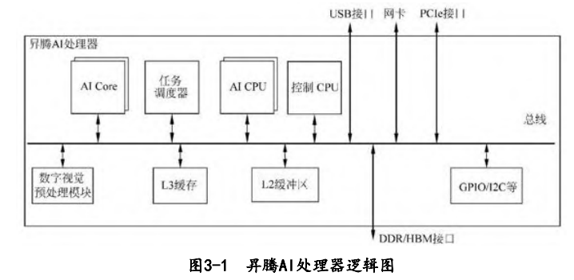

除了CPU之外，该处理器真正的算力担当是采用了达芬奇架构的AI Core。这些AI Core通过特别设计的架构和电路实现了高通量、大算力和低功耗，特别适合处理深度学习中神经网络必需的常用计算，如矩阵相乘等。目前该处理器能对**整型数（INT8、INT4）或对浮点数（FP16）**提供强大的乘加计算力。

针对深度神经网络参数量大、中间值多的特点，该处理器还特意为AI计算引擎配备了容量为**8MB的片上缓冲区（L2缓冲区）**。

缓存区大小对比：

| 芯片型号 | L1缓存大小 | L2缓存大小 | L3缓存大小 |
| -------- | ---------- | ---------- | ---------- |
| 310P     |            | 8MB        |            |
|          |            |            |            |
|          |            |            |            |

为了能够实现计算任务在AI Core上的高效分配和调度，该处理器还特意配备了一个专用CPU作为任务调度器（TaskScheduler，TS）。该CPU专门服务于AI Core和AI CPU，而不承担任何其他的事务和工作。

数字视觉预处理模块主要完成图像视频的编解码，支持4K分辨率的视频处理，对图像支持JPEG和PNG等格式的处理。数字视觉预处理模块主要实现视频解码（VideoDecoder，VDEC）、视频编码（VideoEncoder，VENC）、JPEG编解码（JPEGDecoder/Encoder，JPEGD/E）、PNG解码（PNGDecoder，PNGD）和视觉预处理（VisionPre-ProcessingCore，VPC）等功能。图像预处理可以完成对输入图像的上/下采样、裁剪、色调转换等多种功能。数字视觉预处理模块采用了专用定制电路的方式来实现高效率的图像处理功能，对应于每一种不同的功能都会设计一个相应的硬件电路模块来完成计算工作。

## AI Core的达芬奇架构

不同于传统的支持通用计算的CPU和GPU，也不同于专用于某种特定算法的专用芯片ASIC，达芬奇架构本质上是为了适应某个特定领域中的常见应用和算法，通常称为“特定域架构（DomainSpecificArchitecture，DSA）”芯片。

昇腾AI处理器的计算核心主要由AI Core构成，负责执行标量、向量和张量相关的计算密集型算子。

AI Core采用了达芬奇架构，包括了三种基础计算资源：矩阵计算单元（CubeUnit）、向量计算单元（VectorUnit）和标量计算单元（ScalarUnit）。

这三种计算单元分别对应了张量、向量和标量三种常见的计算模式，在实际的计算过程中各司其职，形成了三条独立的执行流水线，在系统软件的统一调度下互相配合达到优化的计算效率。AI Core中的矩阵计算单元目前可以支持INT8和FP16的计算；向量计算单元目前可以支持FP16和FP32以及多种整型数的计算。

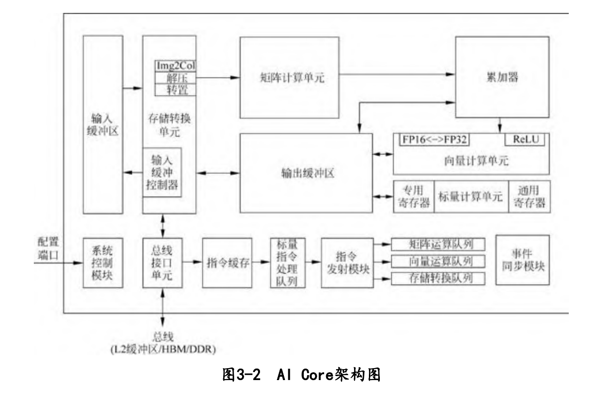

为了配合AI Core中数据的传输和搬运，围绕着三种计算资源还分布式地设置了一系列的片上缓冲区，比如用来放置整体图像特征数据、网络参数以及中间结果的输入缓冲区（InputBuffer，IB）和输出缓冲区（OutputBuffer，OB），以及提供一些临时变量的高速寄存器单元。这些存储资源和相关联的计算资源相连，或者和总线接口单元（BusInterfaceUnit，BIU）相连，从而可以获得外部总线上的数据。

在AI Core中，输入缓冲区之后设置了一个存储转换单元（MemoryTransferUnit，MTE）。这是达芬奇架构的特色之一，主要的目的是为了以极高的效率实现数据格式的转换。比如前面提到GPU要通过矩阵计算来实现卷积，首先要通**过Img2Col的方法把输入的网络和特征数据重新以一定的格式排列**起来。**这一步在GPU中是通过软件来实现的，效率比较低下**。达芬奇架构采用了一个专用的存储转换单元来完成这一过程，将这一步完全固化在硬件电路中，可以在很短的时间之内完成整个转置过程。由于类似转置的计算在深度神经网络中出现得极为频繁，这种定制化电路模块的设计可以提升AI Core的执行效率，从而能够实现不间断的卷积计算。

AI Core中的控制单元主要包括系统**控制模块、标量指令处理队列、指令发射模块、矩阵运算队列、向量运算队列、存储转换队列和事件同步模块**。系统控制模块负责指挥和协调AI Core的整体运行模式、配置参数和实现功耗控制等。**标量指令处理队列主要实现控制指令的译码**。当指令被译码并通过指令发射模块顺次发射出去后，**根据指令的不同类型，指令将会分别发送到矩阵运算队列、向量运算队列和存储转换队列**。三个队列中的指令依据先进先出的方式分别输出到矩阵计算单元、向量计算单元和存储转换单元进行相应的计算。不同的指令阵列和计算资源构成了独立的流水线，可以并行执行以提高指令执行效率。如果指令执行过程中出现依赖关系或者有强制的时间先后顺序要求，则可以通过事件同步模块来调整和维护指令的执行顺序。事件同步模块完全由软件控制，在软件编写的过程中可以通过插入同步符的方式来指定每一条流水线的执行时序从而达到调整指令执行顺序的目的。

### 计算单元

AI Core计算单元主要包含矩阵计算单元、向量计算单元、标量计算单元和累加器。矩阵计算单元和累加器主要完成与矩阵相关的运算，向量计算单元负责执行向量运算，标量计算单元主要负责各类型的标量数据运算和程序的流程控制。

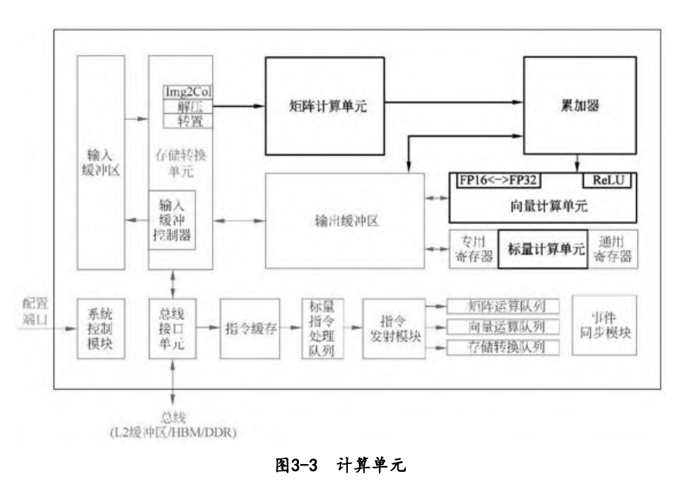

#### 矩阵计算单元

一个矩阵A和另一个矩阵B 之间的乘法运算C＝A×B，其中M表示矩阵A的行数，K表示矩阵A的列数以及矩阵B的行数，N表示矩阵B的列数。

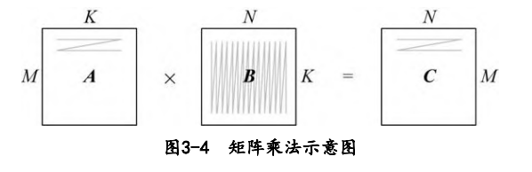

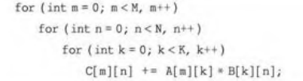

该程序需要用到3个循环进行一次完整的矩阵相乘计算，如果在一个单发射的CPU上执行至少需要M×K×N个时钟周期才能完成，当矩阵非常庞大时执行过程极为耗时。

在CPU计算过程中，矩阵A是按照行的方式进行扫描，矩阵B以列的方式进行扫描。考虑到典型的矩阵存储方式，无论矩阵A还是矩阵B都会按照行的方式进行存放，也就是所谓的Row-Major的方式。而**内存读取的方式是具有极强的数据局部性特征**的，也就是说，**当读取内存中某个数时会打开内存中相应的一整行并且把同一行中所有的数都读取出来**。这种内存的读取方式对矩阵A是非常高效的，但是对于矩阵B的读取却显得非常不友好，因为代码中矩阵B是需要一列一列读取的。为此需要**将矩阵B的存储方式转成按列存储**，也就是所谓的Column-Major，这样才能够符合内存读取的高效率模式。因此，在矩阵计算中往往通过改变某个矩阵的存储方式来提升矩阵计算的效率。

一般在矩阵较大时，由于芯片上计算和存储资源有限，往往需要对矩阵进行分块平铺处理（Tiling），如图3-6所示。受限于片上缓存的容量，当一次难以装下整个矩阵B时，可以将矩阵B划分成为B0、B1、B2和B3等多个子矩阵。而每一个子矩阵的大小都可以适合一次性存储到芯片上的缓存中并与矩阵A进行计算从而得到结果子矩阵。这样做的目的是**充分利用数据的局部性原理**，尽可能地把缓存中的子矩阵数据重复使用完毕并得到所有相关的子矩阵结果后，再读入新的子矩阵，开始新的周期。如此往复，可以依次将所有的子矩阵都一一搬运到缓存中，完成整个矩阵计算的全过程，最终得到结果矩阵C。矩阵分块的优点是充分利用了缓存的容量，并最大程度利用了数据计算过程中的局部性特征，可以高效地实现大规模的矩阵乘法计算，分块是一种常见的优化手段。


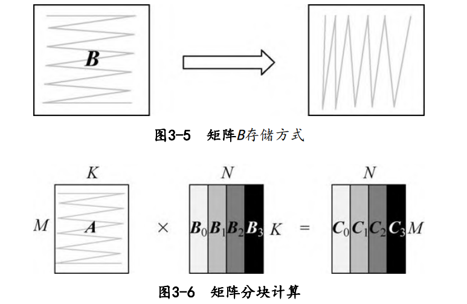

在深度神经网络中实现计算卷积过程，关键的步骤是将卷积运算转化为矩阵运算。在CPU中大规模的矩阵计算往往成为性能瓶颈，而矩阵计算在深度学习算法中又极为重要。为了解决这个矛盾，**GPU采用通用矩阵乘法（GEMM）的方法来实现矩阵乘法**。例如要实现一个16×16矩阵与另一个16×16矩阵的乘法，需要安排256个并行的线程，并且每一个线程都可以独立计算完成结果矩阵中的一个输出点。假设每一个线程在一个时钟周期内可以完成一次乘加运算，则GPU完成整个矩阵计算需要16个时钟周期，这个延时是传统GPU无法避免的瓶颈。而昇腾AI处理器针对这个问题做了深度的优化。因此AI Core对矩阵乘法运算的高效性为昇腾AI处理器作为深度神经网络的加速器提供了强大的性能保障。

达芬奇架构在AI Core中特意设计了矩阵计算单元作为昇腾AI处理器的核心计算模块，意图高效解决矩阵计算的瓶颈问题。矩阵计算单元提供强大的并行乘加计算能力，使得AI Core能够高速处理矩阵计算问题。通过精巧设计的定制电路和极致的后端优化手段，**矩阵计算单元可以用一条指令完成两个16×16矩阵的相乘运算（标记为16^3，也是Cube这一名称的来历）**，等同于在极短时间内进行了16^3＝4096个乘加运算，并且可以**实现FP16的运算精度**。如图3-7所示，矩阵计算单元在完成C＝A×B的矩阵运算时，会事先将矩阵A按行存放在输入缓冲区中，同时将矩阵B按列存放在输入缓冲区中，通过矩阵计算单元计算后得到的结果矩阵C按行存放在输出缓冲区中。在矩阵相乘运算中，矩阵C的第一元素由矩阵A的第一行的16个元素和矩阵B的第一列的16个元素由矩阵计算单元子电路进行16次乘法和15次加法运算得出。矩阵计算单元中共有256个矩阵计算子电路，可以由一条指令并行完成矩阵C的256个元素计算。


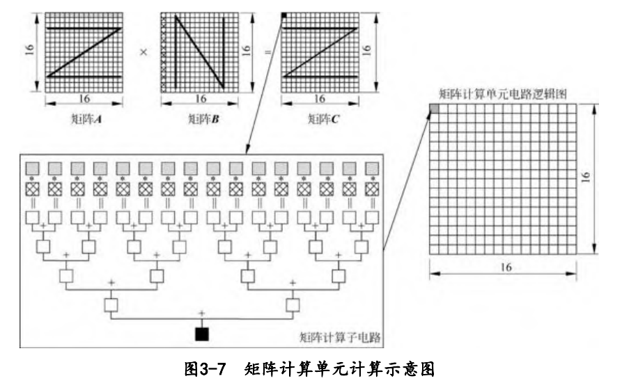

在有关矩阵的处理上，通常在进行完一次矩阵乘法后还需要和上一次的结果进行累加，以实现类似C＝A×B＋C的运算。矩阵计算单元的设计也考虑到了这种情况，为此**专门在矩阵计算单元后面增加了一组累加器单元，可以实现将上一次的中间结果与当前的结果相累加**，总共累加的次数可以由软件控制，并在累加完成之后将最终结果写入输出缓冲区。在卷积计算过程中，累加器可以完成加偏置的累加计算。

矩阵计算单元可以快速完成16×16的矩阵相乘。但当超过16×16大小的矩阵利用该单元进行计算时，则需要事先按照特定的数据格式进行矩阵的存储，并在计算的过程中以特定的分块方式进行数据的读取。如图3-8所示，矩阵A展示的切割和排序方式称作“**大Z小Z**”，直观地看就是矩阵A的各个分块之间按照行的顺序排序，称为“大Z”方式；而每个块的内部数据也是按照行的方式排列，称为“小Z”方式。与之形成对比的是矩阵B的各个分块之间按照行排序，而每个块的内部按照列排序，称为“**大Z小N**”的排序方式。按照矩阵计算的一般法则，昇腾AI处理器内部专用电路可以实现将如此排列的A、B矩阵相乘之后得到结果矩阵C，而矩阵C将会呈现出各个分块之间按照列排序，而每个块内部按照行排序的格式，称为“**大N小Z**”的排列方式。

在利用矩阵计算单元进行大规模的矩阵运算时，由于矩阵计算单元的容量有限，往往不能一次存放下整个矩阵，所以也需要对矩阵进行分块并采用分步计算的方式。如图3-9所示，**将矩阵A和矩阵B都等分成同样大小的块，每一块都可以是一个16×16的子矩阵，排不满的地方可以通过补零实现**。首先求C1结果子矩阵，需要分两步计算：第一步将A1和B1搬移到矩阵计算单元中，并算出A1×B1的中间结果；第二步将A2和B2搬移到矩阵计算单元中，**再次计算A2×B2，并把计算结果累加到上一次A1×B1的中间结果**，这样才完成结果子矩阵C1的计算，之后将C1写入输出缓冲区。由于输出缓冲区容量也有限，所以需要尽快将C1子矩阵写入内存中，便于留出空间接收下一个结果子矩阵C2。同理，以此类推可以完成整个大规模矩阵乘法的运算。上述计算方式是最基本的分块矩阵计算方式，没有复用数据。在昇腾AI处理器的实际计算过程中，会在一定程度上复用矩阵A和矩阵B的分块矩阵。

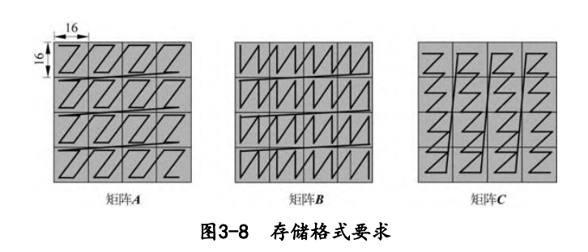

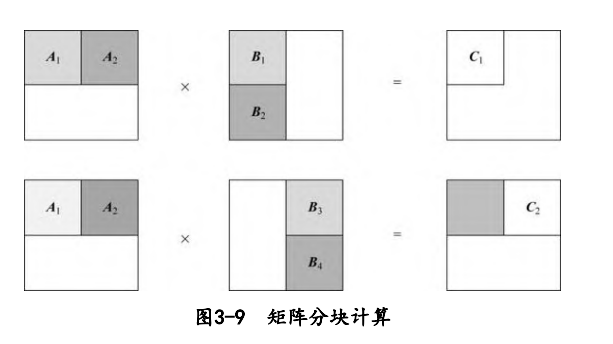

除了支持FP16类型的运算，矩阵计算单元也可以支持诸如INT8等更低精度类型的输入数据。对于INT8，**矩阵计算单元可以一次完成一个16×32矩阵与一个32×16的矩阵相乘运算**。程序员可以根据深度神经网络对于精度的要求来适当调整矩阵计算单元的运算精度，从而可以获得更加出色的性能。

矩阵计算单元除了支持FP16和INT8的运算之外，还同时支持UINT8和U2数据类型计算。在U2数据类型下，只支持对两比特U2类型权重的计算。由于现代轻量级神经网络权重为两比特的情况比较普遍，所以在计算中先将U2权重数据转换成FP16或者INT8后再进行计算。

#### 向量计算单元

AI Core中的向量计算单元主要负责完成和向量相关的运算，能够实现向量和标量，或双向量之间的计算，功能覆盖各种基本和多种定制的计算类型，主要包括FP32、FP16、INT32和INT8等数据类型的计算。

如图3-10所示，向量计算单元可以快速完成两个FP16类型的向量运算。如图3-2所示，向量计算单元的源操作数和目的操作数通常都保存在输出缓冲区中。对向量计算单元而言，输入的数据可以不连续，这取决于输入数据的寻址模式。向量计算单元支持的寻址模式包括了向量连续寻址和固定间隔寻址；在特殊情形下，对于地址不规律的向量，向量计算单元也提供了向量地址寄存器寻址来实现向量的不规则寻址。

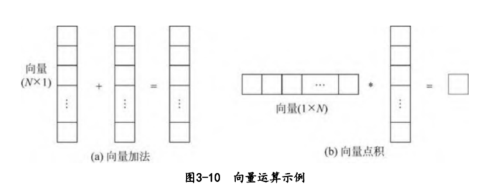

如图3-2所示，向量计算单元可以作为矩阵计算单元和输出缓冲区之间的数据通路和桥梁。矩阵运算完成后的结果在向输出缓冲区传递的过程中，向量计算单元可以顺便完成在深度神经网络尤其是卷积神经网络计算中常用的ReLU激活函数、池化等功能并实现数据格式的转换。经过向量计算单元处理后的数据可以被写回到输出缓冲区或者矩阵计算单元中，以等待下一次运算。所有这些操作都可以通过软件配合相应的向量单元指令来实现。

#### 标量计算单元

标量计算单元负责完成AI Core中与标量相关的运算。它相当于一个微型CPU，控制整个AI Core的运行。**标量计算单元可以对程序中的循环进行控制，可以实现分支判断**，其结果可以通过在事件同步模块中插入同步符的方式来控制AI Core中其他功能性单元的执行流程。它还为矩阵计算单元或向量计算单元提供数据地址和相关参数的计算，并且能够实现基本的算术运算。其他复杂度较高的标量运算则由专门的AI CPU通过算子完成。

在标量计算单元周围配备了多个通用寄存器（GeneralPurposeRegister，GPR）和专用寄存器（SpecialPurposeRegister，SPR）。这些通用寄存器可以用于变量或地址的寄存，为算术逻辑运算提供源操作数和存储中间计算结果。专用寄存器的设计是为了支持指令集中一些指令的特殊功能，一般不可以直接访问，只有部分可以通过指令读写。

AI Core中具有代表性的专用寄存器包括CoreID（用于标识不同的AI Core），VA（向量地址寄存器）以及STATUS（AI Core运行状态寄存器）等。软件可以通过监视这些专用寄存器来控制和改变AI Core的运行状态和模式。

### 存储系统

#### 存储单元

AI Core中的存储单元由存储控制单元、缓冲区和寄存器组成，如图3-11中的加粗部分所示。**存储控制单元通过总线接口可以直接访问AI Core之外的更低层级的缓存，并且也可以直通到DDR或HBM，从而可以直接访问内存**。存储控制单元中还设置了存储转换单元，其目的是将输入数据转换成AI Core中各类型计算单元所兼容的数据格式。缓冲区包括了用于暂存原始图像特征数据的输入缓冲区，以及处于中心的输出缓冲区来暂存各种形式的中间数据和输出数据。AI Core中的各类寄存器资源主要是标量计算单元在使用。

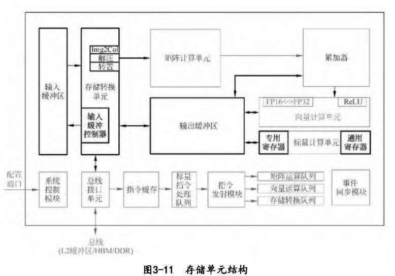

所有的缓冲区和寄存器的读写都可以通过底层软件显式地控制，有经验的程序员可以通过巧妙的编程方式来防止存储单元中出现读写 冲突而影响流水线的进程。对于类似卷积和矩阵这样规律性强的计算模式，高度优化的程序可以实现全程无阻塞的流水线执行。

总线接口单元作为AI Core的“大门”，是一个与系统总线交互的窗口，并以此通向外部世界。**AI Core通过总线接口从外部L2缓冲区、DDR或HBM中读取或者写回数据**。总线接口在这过程中可以将AI Core内部发出的读写请求转换为符合总线要求的外部读写请求，并完成协议的交互和转换等工作。

输入数据从总线接口读入后就会经由存储转换单元进行处理。存储转换单元作为AI Core内部数据通路的传输控制器，负责AI Core内部数据在不同缓冲区之间的读写管理，以及完成一系列的格式转换操作，如补零、Img2Col、转置、解压缩等。存储转换单元还可以控制AI Core内部的输入缓冲区，从而实现局部数据的缓存。

在深度神经网络计算中，由于输入图像特征数据通道众多且数据量庞大，往往会**采用输入缓冲区来暂时保留需要频繁重复使用的数据**，以达到节省功耗、提高性能的效果。当输入缓冲区被用来暂存使用率较高的数据时，就不需要每次通过总线接口到AI Core的外部读取，从而在减少总线上数据访问频次的同时也降低了总线上产生拥堵的风险。另外，当**存储转换单元进行数据的格式转换操作时，会产生巨大的带宽需求**，达芬奇架构要求**源数据必须被存放于输入缓冲区中，才能够进行格式转换**，而输入缓冲控制器负责控制数据流入输入缓冲区中。输入缓冲区的存在有利于将大量用于矩阵计算的数据一次性地搬移到AI Core内部，同时利用固化的硬件大幅提升了数据格式转换的速度，避免了矩阵计算单元的阻塞，消除了由于数据转换过程缓慢而带来的性能瓶颈。

在**神经网络中往往可以把每层计算的中间结果放在输出缓冲区中，从而在进入下一层计算时方便地获取数据**。由于通过总线读取数 据的带宽低、延迟大，通过充分利用输出缓冲区就可以大大提升计算效率。

与谷歌TPU设计中的统一缓冲区设计理念相类似，**AI Core采用了大容量的片上缓冲区设计**，通过增大的片上缓存数据量来减少数据从片外存储系统搬运到AI Core中的频次，从而可以降低数据搬运过程中所产生的功耗，有效控制了整体计算的能耗。

#### 数据通路

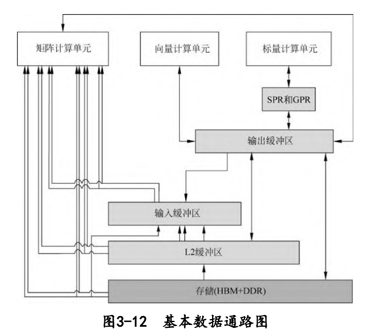

核外存储系统中的数据可以通过**LOAD指令被直接搬运到矩阵计算单元**中进行计算，输出的结果会被保存在输出缓冲区中。除了直接 将数据通过LOAD指令发送到矩阵计算单元中，核外存储系统中的数据也可以通**过LOAD指令先行传入输入缓冲区**，再通过其他指令传输 到矩阵计算单元中。这样做的好处是**利用大容量的输入缓冲区来暂存需要被矩阵计算单元反复使用的数据**。

**矩阵计算单元和输出缓冲区之间是可以相互传输数据**的。由于矩阵计算单元容量较小，部分矩阵运算结果可以写入输出缓冲区中，从而提供充裕的空间容纳后续的矩阵计算。当然也可以将输出缓冲区中的数据再次搬回矩阵计算单元作为后续计算的输入。输出缓冲区和向量计算单元、标量计算单元以及核外存储系统之间都有一条独立的双向数据通路。输出缓冲区中的数据可以通过专用寄存器或通用寄存器进出标量计算单元。

**AI Core中的所有数据如果需要向外部传输，都必须经过输出缓冲区**，才能够被写回到核外存储系统中。

**达芬奇架构数据通路的特点是多进单出**，数据流入AI Core可以通过多条数据通路，可以从外部直接流入矩阵计算单元、输入缓冲区和输出缓冲区中的任何一个，流入路径的方式比较灵活，在软件的控制下由不同数据流水线分别进行管理。而数据输出则必须通过输出缓冲区，最终才能输出到核外存储系统中。

#### 控制单元

在达芬奇架构下，控制单元为整个计算过程提供了指令控制，相当于AI Core的司令部，负责整个AI Core的运行，控制单元起到了至关重要的作用。控制单元的主要组成部分为系统控制模块、指令缓存、标量指令处理队列、指令发射模块、矩阵运算队列、向量运算队列、存储转换队列和事件同步模块。

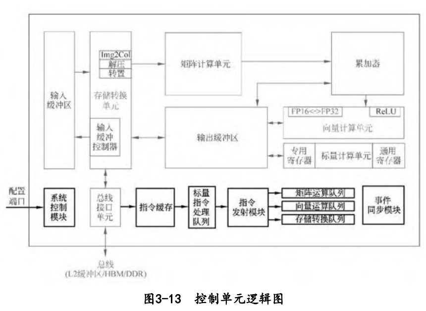

**在指令执行过程中，可以提前预取后续指令**，并一次读入多条指令进入缓存，提升指令执行效率。多条指令从系统内存通过总线接口进入到AI Core的指令缓存中并等待后续硬件快速自动解码或运算。指令被解码后便会被导入标量队列中，实现地址解码与运算控制。这些指令包括矩阵计算指令、向量计算指令以及存储转换指令等。在进入指令发射模块之前，所有指令都作为普通标量指令被逐条顺次处理。标量队列将这些指令的地址和参数解码配置好后，由指令发射模块根据指令的类型分别发送到对应的指令执行队列中，而标量指令会驻留在标量指令处理队列中进行后续执行。

**指令执行队列由矩阵运算队列、向量运算队列和存储转换队列组成**。矩阵计算指令进入矩阵运算队列，向量计算指令进入向量运算队列，存储转换指令进入存储转换队列，同一个指令执行队列中的指令是按照进入队列的顺序进行执行的，不同指令执行队列之间可以并行执行，通过多个指令执行队列的并行执行可以提升整体执行效率。不同的执行单元可以并行地按照指令来计算或处理数据，**同一个指令队列中指令执行的流程被称作为指令流水线**。

**对于指令流水线之间可能出现的数据依赖，达芬奇架构通过设置事件同步模块来统一协调各个流水线的进程**。事件同步模块时刻控制每条流水线的执行状态，并分析不同流水线的依赖关系，从而解决数据依赖和同步的问题。在达芬奇架构中，无论是**流水线内部的同步还是流水线之间的同步**，都是通过事件同步模块利用软件控制来实现的。


如图3-14所示，示意了4条流水线的执行流程。标量指令处理队列首先执行标量指令0、1和2三条标量指令，由于向量运算队列中的指令0和存储转换队列中的指令0与标量指令2存在数据依赖性，需要等到标量指令2完成（时刻3）才能发射并启动。由于指令是被顺序发射的，因此只能等到时刻4时才能发射并启动矩阵运算指令0和标量指令3，这时4条指令流水线可以并行执行。直到标量指令处理队列中的全局同步标量指令7生效后，由事件同步模块对矩阵流水线、向量流水线和存储转换流水线进行全局同步控制，需要等待矩阵运算指令0、向量运算指令1和存储转换指令1都执行完成后，事件同步模块才会允许标量流水线继续执行标量指令8。

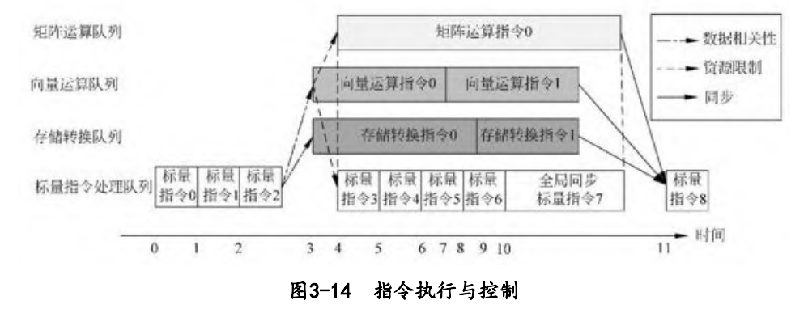

### 指令集设计

**指令集包含了数据类型、基本操作、寄存器、寻址模式、数据读写方式、中断、异常处理以及外部IO等**，每条指令都会描述处理器的一种特定功能。指令集是计算机程序能够调用的处理器全部功能的集合，是处理器功能的抽象模型，也是作为计算机软件与硬件的接口。

指令集可以分为精简指令集（ReducedInstructionSetComputer，RISC）和复杂指令集（ComplexInstructionSetComputer，CISC）。精简指令集的特点是单指令功能简单，执行速度快，编译效率高，不能直接操作内存，仅能通过指令来访问内存。常见的精简指令集有ARM、MIPS、OpenRISC以及RSIC-V等。复杂指令集的特点是单指令功能强大且复杂，指令执行周期长，可以直接操作内存，常见的复杂指令集如x86。

**昇腾AI处理器的指令集设计介乎于精简指令集和复杂指令集之间**，包括了标量指令、向量指令、矩阵指令和控制指令等。标量指令类似于精简指令集，而矩阵、向量和数据搬运指令类似于复杂指令集。昇腾AI处理器指令集结合精简指令集和复杂指令集两者的优势，在实现单指令功能简单和速度快的同时，对于内存的操作也比较灵活，搬运较大数据块时操作简单、效率较高。

#### 标量指令

标量指令主要由标量计算单元执行，主要的目的是**为向量指令和矩阵指令配置地址以及控制寄存器，并对程序执行流程进行控制**。标量指令还负责**输出缓冲区中数据的存储和加载**，以及进行一些**简单的数据运算**等。

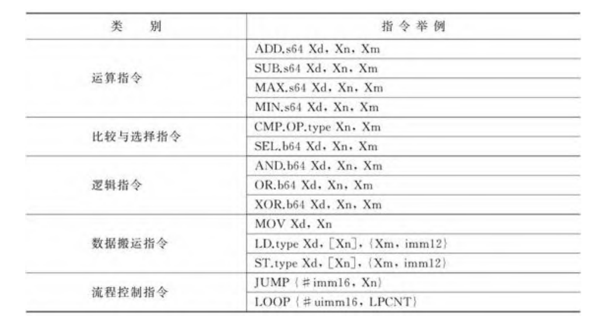

#### 向量指令

向量指令由向量计算单元执行，类似于传统的单指令多数据（SingleInstructionMultipleData，SIMD）指令，每个向量指令可以完成多个操作数的同一类型运算，可以直接操作输出缓冲区中的数据且不需要通过数据加载指令来操作向量寄存器中存储的数据。向量指令支持的数据类型为FP16、FP32和INT32。**向量指令支持多次迭代执行，也支持对带有间隔的向量直接进行运算**。

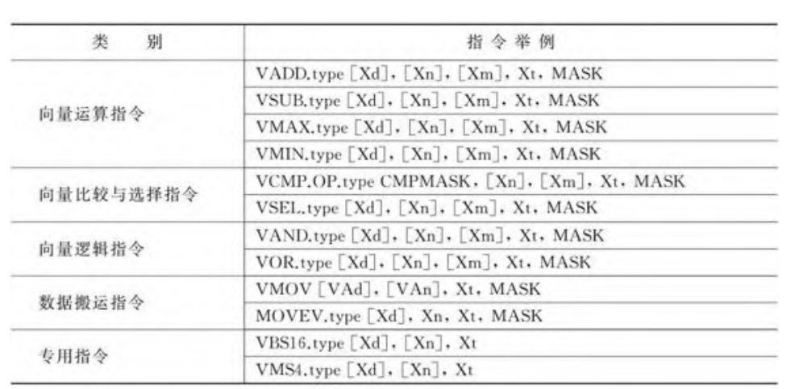

#### 矩阵指令

矩阵指令由矩阵计算单元执行，实现高效的矩阵相乘和累加操作（C＝A×B＋C）。在神经网络计算过程中，矩阵A通常代表输入特征矩阵，矩阵B通常代表权重矩阵，矩阵C为输出特征矩阵。矩阵指令支持INT8和FP16类型的输入数据，支持INT32、FP16和FP32类型的计算。目前最常用的矩阵指令为矩阵乘加指令MMAD，其格式如下：

```
MMAD.type[Xd],[Xn],[Xm],Xt
```

其中，[Xn]，[Xm]为指定输入矩阵A和矩阵B的起始地址，[Xd]为指定输出矩阵C的起始地址。Xt表示配置寄存器，由三个参数组成，分别为M，K和N，用以表示矩阵A、B和C的大小。在矩阵计算中，系统会不断通过MMAD指令来实现矩阵的乘加操作

### 卷积加速原理

#### 卷积加速

图3-15展示的是一个典型的卷积层计算过程，其中X为输入特征矩阵；W为权重矩阵；b为偏置值；Yo为中间输出；Y为输出特征矩阵，GEMM表示通用矩阵乘法。输入特征矩阵X和W先经过Img2Col展开处理后得到重构矩阵XI2C和WI2C。通过矩阵XI2C和矩阵WI2C进行矩阵相乘运算后得到中间输出矩阵Yo；接着累加偏置b，得到最终输出特征矩阵Y，这就完成了一个卷积神经网络中的卷积层处理。

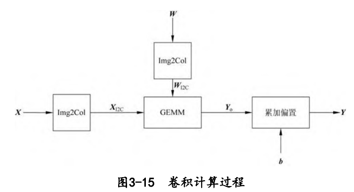

卷积整个数据流如图3-16所示，如果所有数据都在DDR或HBM中，存储转换单元接收到读取数据指令后，会将矩阵X和W由总线接口单元从核外存储器中由数据通路①读取到输入缓冲区中，并且经过数据通路③进入存储转换单元，由存储转换单元对X和W进行补零和Img2Col重组后得到XI2C和WI2C两个重构矩阵，从而完成卷积计算到矩阵计算的格式变换。在格式转换的过程中，存储转换队列可以发送下一个指令给存储转换单元，通知存储转换单元在矩阵转换结束后将XI2C和WI2C经过数据通路⑤送入矩阵计算单元中等待计算。根据数据的局部性特性，在卷积过程中如果权重WI2C需要重复计算多次，可以将权重经过数据通路⑰固定在输入缓冲区中，在每次需要用到该组权重时再经过数据通路⑱传递到矩阵计算单元中。在格式转换过程中，存储转换单元还会同时将偏置数据从核外存储经由数据通路④读入到输出缓冲区中，经过数据通路⑥由存储转换单元将偏置数据从原始的向量格式重组成矩阵后，经过数据通路⑦转存入输出缓冲区中，再经过数据通路⑨存入累加器中的寄存器中，以便后续利用累加器进行偏置值累加。

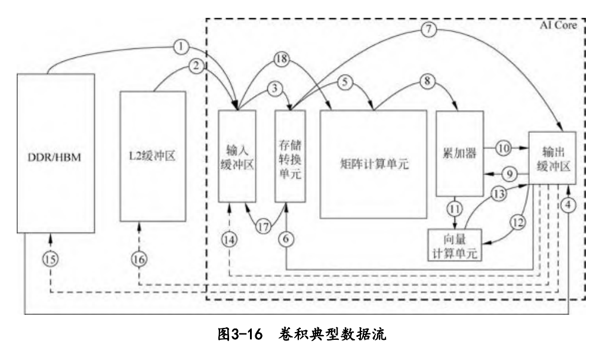

当左、右矩阵数据都准备好了以后，矩阵运算队列会将矩阵相乘指令通过数据通路⑤发送给矩阵计算单元。XI2C和WI2C矩阵会被分块组合成16×16的矩阵，由矩阵计算单元进行矩阵乘法运算。如果输入矩阵较大，则可能会重复以上步骤多次并累加得到Yo中间结果矩阵，存放于矩阵计算单元中。矩阵相乘完成后，如果还需要处理偏置值，累加器会接收到偏置累加指令，并从输出缓冲区中通过数据通路⑨读入偏置值，同时经过数据通路⑧读入矩阵计算单元中的中间结果Yo并累加，最终得到输出特征矩阵Y，经过数据通路⑩被转移到输出缓冲区中等待后续指令进行处理。AI Core通过矩阵相乘完成了网络的卷积计算，之后向量执行单元会接收到池化和激活指令，输出特征矩阵Y就会经过数据通路⑫进入向量计算单元进行池化和激活处理，得到的结果Y会经过数据通路⑬存入输出缓冲区中。向量计算单元能够处理激活函数等一些常见的特殊计算，并且可以高效实现降维的操作，特别适合做池化计算。在执行多层神经网络计算时，Y会被再次从输出缓冲区经过数据通路⑭转存到输入缓冲区中，作为输入重新开始下一层网络的计算。

达芬奇架构针对通用卷积的计算特征和数据流规律，**采用功能高度定制化的设计，将存储、计算和控制单元进行有效的结合**，在每个模块完成独立功能的同时实现了整体的优化设计。AI Core高效组合了矩阵计算单元与数据缓冲区，缩短了存储到计算的数据传输路径， 降低延时。

# 待考证问题

1. AI Core中的矩阵计算单元目前可以支持INT8和FP16的计算；向量计算单元目前可以支持FP16和FP32以及多种整型数的计算。**AI Core不支持FP32吗？**
2. 如图3-9所示，**将矩阵A和矩阵B都等分成同样大小的块，每一块都可以是一个16×16的子矩阵，排不满的 地方可以通过补零实现**，这种方式并不能连续读取，确定效率问题。


# 参考

1. 昇腾AI处理器架构与编程——深入理解CANN技术原理及应用 (梁晓峣) 