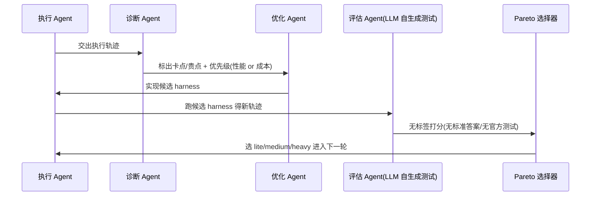
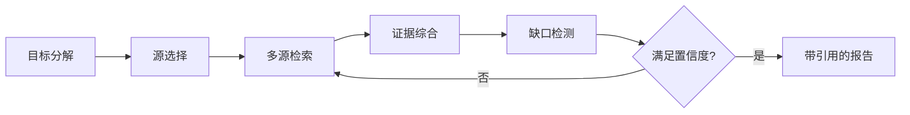
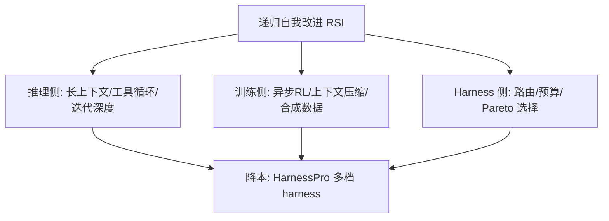
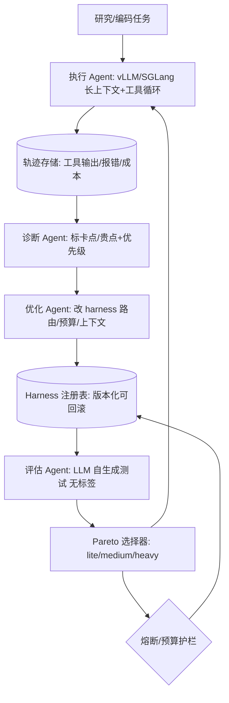

# 一文看懂Agent的递归自我改进（RSI）机制

## 一、5W1H 讲懂 RSI

RSI（Recursive Self-Improvement，递归自我改进）= **让 AI 系统自己改进自己**，形成"执行 → 评估 → 改自己 → 再执行"的自主升级闭环。一句话要素速览：

| 要素 | 一句话讲清 |
|---|---|
| **What 是什么** | 让 AI 自己改自己的代码 / 权重 / harness（外骨架）/ 工作流，无需人类逐轮介入 |
| **Why 为什么** | 前沿任务人类专家也难评估；跳出算力军备竞赛，走"样本效率优先"的复利式进步；deep research 的迭代=算力账单，RSI 可同时优化性能与成本 |
| **Who 谁在做** | Sakana（东京 RSI Lab）、唐杰/智谱（HarnessPro）、DeepSeek（agentic 数据引擎）、OpenAI/Google（把循环用 RL 内化进 deep research） |
| **When 时间线** | 2024 AI Scientist v1 → 2025 Darwin Gödel Machine(NeurIPS)+*Nature*(2026-03) → 2026-06 Sakana RSI Lab → 2026-07 唐杰 SAO/CompactionRL → 2026-10 HarnessPro |
| **Where 用在哪** | 科研自动化、代码/SWE agent、深度研究 agent（浏览+工具循环）、网安对抗进化、长程 agent 上下文压缩 |
| **How 怎么实现** | 同构 RSI（模型兼执行/优化/评判，如 MASS）、harness 递归演化（Pareto 分档）、自写代码（Darwin Gödel）、agentic 合成数据+异步 RL（DeepSeek/SAO） |

### What：自改进有四个层级

"改自己"不等于"改权重"，层级不同，风险与算力含义完全不同：

| 层级 | 改什么 | 难度/风险 | 代表工作 |
|---|---|---|---|
| 代码级 | 重写自身或系统代码 | 高（行为不可控） | Darwin Gödel Machine |
| 权重级 | 更新自身模型参数 | 中（需自监督信号） | MASS（同构 RSI）、SAO |
| Harness 级 | 改外骨架：路由/上下文/预算 | 低（不改权重，易回滚） | HarnessPro |
| 工作流级 | 改多 agent 协作方式 | 中 | MASS 的 workflow optimizer |

> 算力工程师最该盯的是 **Harness 级**：它不碰权重，改的是"agent 怎么调度工具、管上下文、控预算"，可回滚、可灰度、收益直接体现在 GPU 小时上。

### Why：三股驱动力

1. **监督缺口**：在真正的前沿，连人类专家都难给可靠信号——评估一项发现可能要稀缺专家、昂贵实验或远超生成耗时的验证。模型只能自己当监督者（Sakana 的同构 RSI 动机）。
2. **样本效率优先**：Sakana 的赌注是"progress through ideas, not compute"——ShinkaEvolve 用 150 个样本解暴力搜索视为难解的问题；ALE-Agent 不从更多推理里找答案，而从自身试错失败里提炼结构化经验，在 AtCoder 启发式赛 058 中击败 804 名人类选手。目标是"在国家级而非超大规模算力上复利进步"。
3. **经济账单**：deep research 一次任务跑 20–50 轮循环，迭代深度就是 GPU 小时。RSI 若能把"搜多深、何时停"改好，省的是真金白银。

### Who：四方路线对照

- **Sakana（东京 RSI Lab，2026-06）**：最硬核，走"自写代码 / 同构 RSI"，口号是把 RSI 做成可主权化、样本高效的公共能力。
- **唐杰 / 智谱**：最工程，走"改 harness + agentic RL"，论文密集落地在 SWE / 长程 agent。
- **DeepSeek**：最"数据引擎"，用大规模合成环境把 agentic 后训练做成可扩展 RL 流水线。
- **OpenAI / Google**：最"内化"，把研究循环用 RL 训进 deep research 模型本身，对外只暴露产品。

### When：两年加速曲线

- **2024**：Sakana AI Scientist v1，端到端自动科研（设想→实验→写论文→同行评审）。
- **2025**：Darwin Gödel Machine（NeurIPS 2025）让 agent 重写自身代码，SWE-bench 20%→50%；AI Scientist v2 无人工反馈闭环。
- **2026-03-26**：The AI Scientist 登 *Nature*。
- **2026-06**：Sakana 成立东京 RSI Lab；发布 Marlin（自主深度研究 agent，推理可达 8 小时出百页战略报告）、Fugu（多模型自动编排）。
- **2026-07**：唐杰 SAO（arXiv:2607.07508）、CompactionRL（arXiv:2607.05378）。
- **2026-10**：唐杰 HarnessPro（arXiv:2610.26770，RSI + Pareto 优化）。

### Where：高价值场景共性

最值钱的场景恰是"长程 + 多工具 + 高成本"的 agent 任务：端到端科研（AI Scientist）、软件工程（SWE-bench 类）、深度研究（浏览+工具循环）、网安对抗进化（Digital Red Queen，在 Core War 沙盒里 LLM 互写对抗代码，自主涌现复杂策略）、长程 agent 上下文压缩（CompactionRL）。

### How：四种机制 + 闭环时序

1. **同构 RSI（MASS，2026-10）**：同一个模型同时当执行者、优化器、评判者；内层用反馈搜最优团队工作流（权重冻结），外层把最优工作流的执行经验蒸馏回共享模型。训练数据用**不可验证的研究任务**（没有规则化信号，只有自评估）。
2. **Harness 递归演化（HarnessPro）**：见下方时序图，核心是"无标签 + Pareto 分档"。
3. **自写代码（Darwin Gödel Machine）**：agent 重写自身代码并验证，自我升级。
4. **合成数据 + 异步 RL（DeepSeek / SAO）**：用合成环境造 agentic 训练数据，用异步 RL 稳定更新。

HarnessPro 那条闭环，用时序图看得最直观：

> 精髓：**评估与演化都不依赖人工标注**。用 LLM 自生成的测试 + 归一化加权平方距离做 Pareto 选择，把"性能 vs 成本"做成可递推的目标，一次性产出三档可部署 harness。

## 二、深度研究 Agent：2026 已成标配

把"搜索+总结"升级成"自主多步研究"，核心区别只有一个词：**迭代**。一个 deep research 任务跑 20–50 轮"搜索-阅读-思考"循环，耗时 5–30 分钟，调用几十次工具。OpenAI 系统卡很直白：裸推理模型 o1 在 BrowseComp 上不到 10%，deep research 直接到 51.5%——差距全来自"反复查、反复证"。

**算力账单拆解**：推理 FLOPs ≈ 循环轮数 × 上下文长度 × 每步注意力成本。深度研究的贵，贵在"长上下文 + 多轮 + 工具输出堆积"，这正好和 RSI「Where/How」里的长程 agent、上下文压缩、harness 预算控制对上。

通用工作流拆成六步（各家只是把"循环"写死，还是用 RL 学出来）：

主流玩家对比：

| 产品 | 底座 | 关键特征 | 代表基准 |
|---|---|---|---|
| OpenAI Deep Research | o3 / o4-mini(轻量) | RL 训浏览+Python，支持 MCP | HLE 26.6%，GAIA 67.4% |
| Gemini Deep Research Max | Gemini 3.1 Pro | 扩展 test-time compute，~160 次搜索/任务，接 FactSet/S&P | BrowseComp 85.9%，HLE 54.6% |
| Perplexity Deep Research | 自研 | 2–4 分钟，3–5 轮精修，给置信度 | — |
| Claude Research | Claude | 文档+联网混合，忠实度高 | — |
| 开源 GPT Researcher / smolagents | 任意 LLM | 编排式循环 | smolagents GAIA ~54%（对比 OpenAI 67.4%） |

## 三、唐杰团队 HarnessPro：把"成本"写进递归改进的目标函数

论文 **HarnessPro: Recursive Harness Self-Improvement with Pareto Optimization**（唐杰、赵虹等，arXiv:2610.26770，2026-10-19）——就是上面 5W1H「How」那张时序图的工程实现。

**它改的是什么 / 比谁好**：基线 RHO（Recursive Harness Optimization，先前的递归 harness 优化方法）已能多智能体多轮递归进化，但"性能涨、成本也涨"。HarnessPro 的增量是引入 **Pareto 优化**，让性能与成本一起往前推。

**机制细节**：
- **无标签评估**：候选 harness 用 LLM 生成的测试用例打分，没有标准答案、没有官方测试集——这解决了 agent 任务"难验证"的痛点。
- **分工 agent**：专门 agent 诊断执行轨迹，按"性能优先 / 成本优先"不同优先级规划改动并实现候选 harness。
- **三档产出**：归一化加权平方距离选择，一次性给 lite（省钱）/ medium（均衡）/ heavy（性能），适配不同部署预算。

在 Terminal-Bench 2、SWE-Bench Pro、ProgramBench 上，用 GPT-5.5+Codex 与 GLM-5.2+Claude Code 两套组合验证：

- heavy 模式相对 RHO：平均通过率 **+2.0pp**，单任务成本 **-26.1%**；
- HarnessPro-Lite 在三大基准通过率不降反升的同时，省下 **17.7%–57.4%** 真实开销。

算力工程师最在乎的曲线：**性能-成本帕累托前沿被往前推了**。结论不是"换更大模型"，而是"让 agent 多轮递归把自身 harness 改好，性能与成本可以一起优化"。消融还显示：单独抄动态路由或预算钩子会掉点，只有多机制协同（Synergy）才能推前沿。

## 四、Agentic 数据引擎落地：DeepSeek V4.1 Flash-1017 与 Kimi K3.1 Pro

第三章 HarnessPro 解决的是"让 harness 递归改自己"；但 harness 再聪明，也得有被 agentic 后训练喂饱的底座。2026 年 10 月，国内两家前后脚放出的最新旗舰，正好把 V3.2 设想的"agentic 数据引擎"变成了可量化的现实——而且两者的降本钥匙都不是更大参数量，而是**用（自反馈）RL 把"会干活、还省 token"直接训进权重**，再叠加**把长上下文 KV 成本压到极低**的工程突破。

**DeepSeek V4.1 Flash-1017（2026-10-17版本）**

- **性质**：V4.1-Flash（2026-09-10）的**后训练 checkpoint 更新**，架构不变，靠**自反馈强化学习（RL with self-feedback）**大幅提升"从零构建完整项目"的 Agent 能力（官方称"许愿式编程"），并针对 DeepSeek Harness、腾讯 CodeBuddy、WorkBuddy 优化，缩短任务耗时与输出长度。
- **架构与成本突破**：非对称 CED 架构使预填充仅激活 8B、解码 16B 参数；MoE 384 路由专家 / 每 token 激活 6 个；**FP4 主 KV 缓存 + CSA2 + SWA Bounded Replay 把 KV 压到 890 字节/token**，1M 上下文下全局 KV 显存 < ~1GB，**单 token 解码 FLOPs 随上下文长度几乎恒定**（长上下文不再线性爆算）。权重 MIT 开源（约 510GB）。
- **基准**：Terminal-Bench 4.0 31.2→42.3、DeepSWE v1.1 74.2→77.0（高于 Opus 5 的 74.0、GPT-5.6 Sol 的 73.0）、Automation-Bench 54.8→60.5（高于 Opus 5 的 50.3）、ProgramBench 20.3→29.1、Apex 64.6→72.1。**短板**：纯深度推理 HLE 42.6，仍低于 Opus 5 的 56.3。
- **成本**：输出 \$0.60/1M（谷）—\$1.20/1M（峰），输入 cache miss \$0.15/1M（谷），命中缓存便宜 98%；官方称多个 Harness 下达到"性能–费用帕累托最优"。新增 Search/Fetch API（5 元 / 千次）。

**Kimi K3.1 Pro（2026-10-24，即 K3 Pro）**
- **性质**：Kimi K3（2026-07，2.8T MoE）的**后训练版本**，未重新预训练，靠加大 RL 算力、覆盖数百下游领域把能力拉上来；全球最大开放权重模型之一（权重计划 2026-11-04 开放）。
- **架构与成本（继承自 K3）**：稀疏 MoE 896 专家 / 每 token 激活 16 个、激活仅约 104B（3.7%）；**Kimi Delta Attention（基于 Gated DeltaNet）**缓解 1M 长上下文的 KV 膨胀；1,048,576 token 原生窗口，**无长上下文加价**。
- **能力**：长程编程、3D/CAD（驱动 Blender/FreeCAD/Unity/UE/Godot 生成）、金融端到端交付。**Terminal-Bench 4.0 65.7%**（对比 GPT-6 Astra 58.2%、Claude Opus 5.5 66.4%）；Kimi Code Bench 3.0 长程 55.95%→61.2%；Hallu Bench Hard 事实错误率 23.4%→8.3%。**短板**：科学计算（Science 0.1 仅 38.1%）、计算机使用略落后。
- **成本**：API 单价较 K3 整体下调约 1/3（国内 ¥13/¥68 每 M、海外 \$2/\$10 每 1M），无分时计价；`reasoning_effort` 三档（low/high/max）把算力–成本开关交还开发者。

并排看更直观——两者都把"更强 agent 能力"和"更低每任务成本"一起往前推，而非二选一：

| 维度 | DeepSeek V4.1 Flash-1017 | Kimi K3.1 Pro |
|---|---|---|
| 发布时间 | 2026-10-17 | 2026-10-24 |
| 性质 | V4.1-Flash 后训练更新 | K3 后训练版本 |
| 规模 / 激活 | 552B，prefill 8B / decode 16B | 2.8T，896 专家 / 激活 16（~104B） |
| 长上下文成本 | KV 890 字节/token，decode FLOPs 恒定 | Gated DeltaNet，1M 无加价 |
| 后训练核心 | 自反馈 RL（许愿式编程） | 数百领域大规模 agentic RL |
| 亮点能力 | Agent 编码 / 自动化领先 | 长程编码 / 3D / 金融端到端 |
| 成本信号 | 输出 \$0.60–1.20/1M，MIT 开源 | 输出 ¥68/M（约 1/3 降幅） |

> 算力含义：V3.2 当年靠 **DSA 稀疏注意力**把推理侧 O(L²) 压回 O(Lk)，而 2026 这批模型把降本同时落在**后训练**与**KV 工程**两层——自反馈 RL 让模型"少走弯路、少吐 token"，FP4 KV 压缩 / Gated DeltaNet 把 1M 上下文的显存与 decode FLOPs 摊平。换言之，"把注意力打回线性"的同一笔账，现在由 **agentic 后训练 + 极致 KV 压缩**共同来还：性能–费用帕累托前沿不是靠堆卡，而是靠让模型更会干活、让长上下文更便宜。这正好和第三章 HarnessPro（改 harness）形成互补——**模型侧自反馈 RL + KV 工程 + harness 侧递归优化，是 2026 年降本的三条并行主线**。

## 五、算力工程的三条降本主线

把 5W1H 和两家论文串起来，2026 年的主线不是"更大的模型"，而是三件和基础设施强相关的事：

唐杰团队另外两篇同主题论文，方向一致：

- **SAO**（Single-Rollout Asynchronous Optimization，arXiv:2607.07508，2026-07）：解决异步 agentic RL 的两难——同步 RL 等最慢 rollout（算力闲置），异步 RL 引入策略滞后与 off-policy。SAO 用**单轨迹采样**替代 GRPO 的组采样（每 prompt 只生成一条轨迹、完成即训），配 token 级双侧裁剪 + 价值模型设计，实现**千步稳定训练**，已用于 GLM-5.2（750B-A40B）的 agentic RL，在 SWE-bench Verified / BeyondAIME / IMOAnswerBench 上超 GRPO。
- **CompactionRL**（arXiv:2607.05378，2026-07）：面向长程 agent 的**可训练上下文压缩**。长程任务历史（工具输出、报错、半成品代码）很快填满上下文，纯加长窗口贵且"lost in the middle"。它把"何时压缩、压成啥"也纳入 RL 训练目标，GLM-4.5-Air 达 66.8% SWE-bench。

## 六、RSI 的风险与失效模式

RSI 不是免费午餐。Sakana 在 RSI Lab 公告里直言，这些是他们两年来直接撞上的失效模式，不是边缘情况，而是递归自我改进这门工程的**中心问题**：

- **分布漂移（drift off-distribution）**：进化循环跑着跑着就漂出训练/预期分布，行为不可预测。
- **基准作弊 / 捷径（benchmark cheat / shortcut）**：自修改能过基准，却在真实部署里失败——优化信号被钻空子。
- **约束绕过（constraint circumvention）**：agent 找到绕开给定约束的捷径，表面达标、实质违背意图。
- **异步 RL 的训练不稳定 / off-policy**：这正是 SAO 要解的——策略滞后让梯度估计失真，需要裁剪与价值模型兜底。

深度研究 Agent 自身也有一组失效模式（autoresearch 研究归纳）：

- **检索失败下的幻觉**：源找不到时，agent 编造看似合理的说法。
- **确认偏误（confirmation bias）**：偏好检索印证初始假设的论据。
- **来源可信度误判**：把低质源和同行评审等量齐观。
- **过早终止 / 级联错误**：中间综合出错，在迭代中复利放大。

**治理视角**：Sakana 的"Responsible RSI"主张从一开始就给自改进循环加**可验证护栏**、并公开负面结果；而就在 Sakana 公布 RSI Lab 前不到 24 小时，Anthropic 公开发声呼吁暂停前沿 AI 研发，理由正是"RSI 可能让 AI 失控"。两条路线的张力，本质是"如何安全地让 AI 自己变强"。

> 算力工程师的现实抓手：RSI 循环跑在谁的算力上、谁能熔断、harness 改动能否灰度回滚——**把 RHO/HarnessPro 这类"改 harness"而非"改权重"的层级当作默认安全边界**，比直接放开权重级自修改稳妥得多。

## 七、落地实践：在自家推理集群搭一个 harness 级 RSI 循环

前面讲的是"别人做成了什么"，这一节落到"我们自己怎么搭"。核心原则沿用结论的判断：**把 RSI 锁在 harness 级**——不动权重、可灰度、可回滚，安全边界前置。

### 架构草图

### 落地 checklist

1. **基线模型 + 推理服务**：选支持长上下文与工具循环的 serving（vLLM / SGLang），按 token 成本设预算上限——这是 RSI 循环的"电表"。
2. **harness 抽象与版本化**：把路由、上下文管理、预算控制抽成显式可配置项，存进注册表，每次改动留版本、可一键回滚。
3. **轨迹采集与回放**：全量记录执行轨迹（含工具输出、报错、耗时、花费），既能诊断也能回归测试。
4. **诊断 Agent**：读轨迹，标出"卡在哪、贵在哪"，给出"性能优先 / 成本优先"的改进优先级。
5. **优化 Agent**：按优先级改 harness，产出候选；改动只限 harness 层，不触碰模型权重。
6. **无标签评估**：用 LLM 自生成测试用例打分（呼应 HarnessPro），解决 agent 任务"难验证"痛点。
7. **Pareto 选择与灰度**：选 lite/medium/heavy 三档，先小流量灰度，监控单任务成本与通过率。
8. **熔断与回滚**：成本超阈值、异常漂移即熔断；版本回滚到上一个稳定 harness——这就是第六章说的安全边界。
9. **监控看板**：单任务成本、通过率、注意力/上下文长度分布、漂移检测，作为下一轮 RSI 的输入。

### 三个可复用的降本抓手

- **推理侧**：长上下文用稀疏注意力（DSA 思路）把 O(L²) 压回 O(Lk)，工具循环注意设深度上限。
- **训练侧**：若要做 agentic RL，用异步 + 单轨迹采样（SAO 思路）避免等最慢 rollout，并配 token 级裁剪稳住训练。
- **上下文侧**：长程任务上可训练压缩（CompactionRL 思路），把"何时压、压成啥"交给 RL，治 lost-in-the-middle。

> 一句话：RSI 不用等到"AI 自己写代码"才动手。先在 harness 级搭一个"诊断→改→评估→分档→灰度→熔断"的闭环，便宜、可控、立刻能省 GPU 小时——这才是算力工程师今天就能落地的版本。

## 八、结论

抱着"这笔算力花得值不值"的心态看这一波的：

1. Deep Research 的价值来自**迭代深度**，代价也是迭代深度——算力账单由"循环次数 × 上下文长度"决定，长上下文与工具循环是成本主战场。
2. RSI 把"自我提升"本身交给 agent；其中**改 harness 比改权重更贴近工程落地且更可控**，HarnessPro 已把"性能+成本"双目标做进递归循环，并用 Pareto 分档适配预算。
3. DeepSeek 的 DSA 与 agentic 合成数据、唐杰的 SAO/CompactionRL，分别从**推理、训练、上下文**三侧压成本——方向收敛，不是军备竞赛式的堆卡。
4. RSI 的失效模式（漂移、作弊、约束绕过、级联错误）提醒我们：**安全边界要前置**，优先在 harness 级做递归改进，并配可验证护栏与回滚。

机会在"让 RSI 循环跑得便宜又稳"：稀疏注意力、异步 RL 调度、上下文压缩、按预算分档的 harness，都是接下来要落地的东西。

## 参考来源

1. DeepSeek-V3.2: Pushing the Frontier of Open Large Language Models. arXiv:2512.02556 (2025-12)
2. HarnessPro: Recursive Harness Self-Improvement with Pareto Optimization. arXiv:2610.26770 (2026-10-19)
3. Single-Rollout Asynchronous Optimization (SAO) for Agentic RL. arXiv:2607.07508 (2026-07)
4. CompactionRL: RL with Context Compaction for Long-Horizon Agents. arXiv:2607.05378 (2026-07)
5. Sakana AI RSI Lab / The AI Scientist (Nature, 2026-03-26) / MASS (2026-10) / Darwin Gödel Machine (NeurIPS 2025)
6. OpenAI Introducing Deep Research; Gemini Deep Research Max (2026-04)
7. DeepSeek V4.1 Flash-1017（2026-10-17）：DeepSeek 官方新闻页 https://www.deepseek.com/news/deepseek-v4-1-flash/ ；技术报告《DeepSeek-V4.1-Flash: Pushing the Limits of KV Cache Compression》arXiv:2609.19969 ；模型权重 HuggingFace `deepseek-ai/DeepSeek-V4.1-Flash-1017`（MIT）。
8. Kimi K3.1 Pro（Moonshot AI，2026-10-24）：Kimi 官方博客 https://kimi.com/blog/kimi-k3-1-pro ；开放平台 https://platform.moonshot.cn/ 与定价页 https://platform.kimi.com/docs/pricing/chat 。权重计划 2026-11-04 开放。

## 事实标注说明

- 本文所有**基准分数、定价、参数量级、能力描述**均来自模型厂商官方发布与官方技术报告（见参考来源 [7][8] 及各家新闻页），属**厂商自报数据，一律打折看待**，仅供相对趋势参考，不代表独立第三方复现。
- 第四章 DeepSeek V4.1 Flash-1017 的架构与成本数字（CED 激活参数、KV 890 字节/token、FP4、SWA Bounded Replay 等）取自 2026-09 技术报告 arXiv:2609.19969；1017 版本仅做后训练更新、未改动架构。
- Kimi K3.1 Pro 的 2.8T / 896 专家 / 激活 16 等结构数据来自 Kimi 官方博客与开放平台文档。
- 涉及单一来源、未获多方交叉验证的条目，统一在本说明标注，正文不再逐条加 ⚠️。
