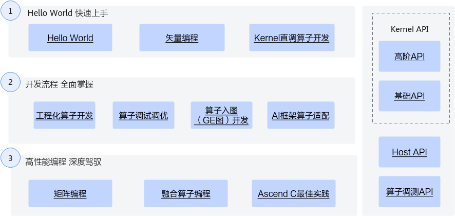

# Ascend C算子开发

算子开发成长地图

[安装CANN，参考安装环境](https://www.hiascend.com/document/detail/zh/CANNCommunityEdition/82RC1alpha001/opdevg/Ascendcopdevg/atlas_ascendc_10_0002.html)

## 快速入门

### HelloWorld

### 基于Kernel直调工程的算子开发

### 基于自定义算子工程的算子开发

## 参考

1. [Ascend C算子开发简介](https://www.hiascend.com/document/detail/zh/CANNCommunityEdition/82RC1alpha001/opdevg/Ascendcopdevg/atlas_ascendc_10_0001.html)