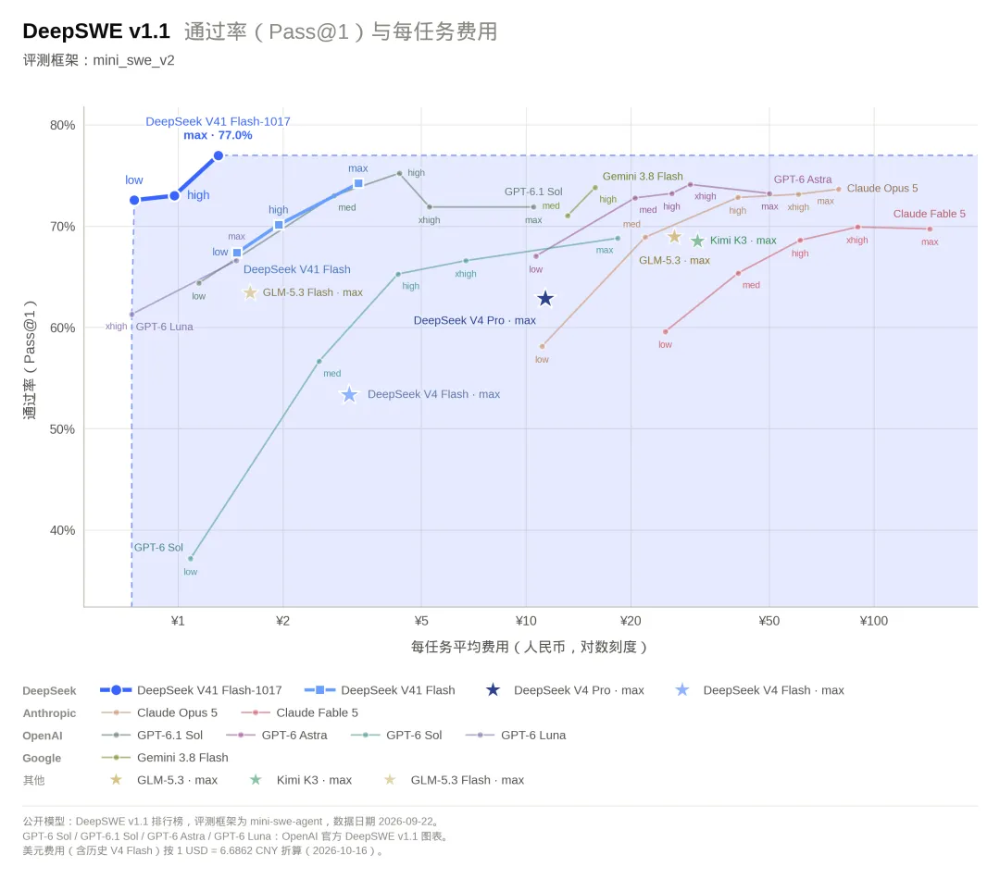

# DeepSeek V4.1-Flash-1017 技术调研报告

## 0. 摘要（TL;DR）

- **定位**：V4.1-Flash-1017 是 DeepSeek V4.1-Flash（2026-09-10 发布）的一个**后训练 checkpoint 更新**，不是新的架构代际，也不是新的 API 标识符（`deepseek-flash` 自动切换）。
- **一句话**：在**架构不变**的前提下，用**自反馈强化学习（RL）**显著提升"从零搭建完整项目"的 Agent 能力，同时**缩短输出长度、加快任务完成**，把"性能—成本"帕累托前沿又往前推了一步。
- **最值得算力团队关注的创新**：**非对称 CED 架构（8B/16B 激活）+ 极致 KV 缓存压缩（890 字节/Token，FP4 + CSA2 + SWA Bounded Replay）**，使 552B 级模型在 1M 上下文下的部署显存/存储成本大幅下降——这是长上下文 Agent 量产落地的关键工程突破。
- **能力画像**：Agent 编码/自动化类基准领先或持平 Opus 5、明显领先 GPT-5.6 Sol；**纯深度推理（HLE）仍是短板**（42.6 vs Opus 5 的 56.3）。
- **开放**：模型权重 MIT 开源（HF/ModelScope，约 510GB），并**首次对外开放自研 Search / Fetch 搜索 API**（5 元 / 千次）。

---

## 1. 模型定位与发布背景

| 维度 | 说明 |
|---|---|
| 开发者 | DeepSeek |
| 发布时间 | 1017 版本：2026-10-17；基线 V4.1-Flash：2026-09-10 |
| 模型族 | DeepSeek-V4 系列（含 V4.1-Flash 与 V4-Pro 1.6T） |
| 架构代际 | 沿用 9 月 V4.1-Flash 架构，**1017 仅做后训练 checkpoint 更新** |
| API 标识符 | `deepseek-flash`（自动路由到最新 checkpoint，无需改代码） |
| 开源协议 | **MIT**（V4.1-Flash 及其 1017 权重均开源） |
| 权重地址 | HuggingFace：`deepseek-ai/DeepSeek-V4.1-Flash-1017`；ModelScope 同名 |
| 上下文 | 原生 **1M tokens**，最大输出 **384K tokens** |
| 模态 | 原生多模态：**图像 + 文本输入**，文本输出（非图像生成） |

**发布逻辑**：9 月发布的 V4.1-Flash 已宣布在性能/成本/速度/总用时上全面超越 V4-Pro，并下线 V4-Pro（路由到 Flash）。1017 是在此基础上的"能力补强"，官方强调**优化目标直指 Agent 编程与联网应用**，并点名适配 DeepSeek Harness、腾讯 CodeBuddy、WorkBuddy 等平台框架。

---

## 2. 核心架构与创新点

> 以下架构细节来自 9 月 V4.1-Flash 技术报告《Pushing the Limits of KV Cache Compression》（arXiv:2609.19969），1017 版本**未改动架构**，仅通过后训练强化能力。

### 2.1 Causal Encoder-Decoder（CED）非对称架构 
- 40 层 Transformer = **20 层因果编码器 + 20 层解码器**。
- 关键设计：解码器的**全局 KV 缓存由最终编码器隐藏状态投影得到**，而非由各解码器层自身状态推导。
- **收益**：预填充（prefill）每 token 仅激活 **8B** 参数，解码（decode）每 token 激活 **16B** 参数。
- **算力意义**：对"输入重、输出轻"的 Agent 场景（代码库、长文档、多轮工具调用记录塞满上下文），成本几乎全部落在最贵的 prefill 段，8B 激活把这段成本压到极低。这是"小激活、大总参"范式的代表。

### 2.2 Compressed Sparse Attention 2（CSA2）
- 每个注意力层静态分配三种模式之一：**Full / Reindex / Reuse**，跨层共享主 KV 与 indexer K，并复用 Top-K 稀疏注意力索引。
- 解码器中引入 **Hierarchical Sparse Indexer**，把更深层索引限制在第一层 Full 模式构建的候选池内，使**索引成本与上下文长度解耦**。
- 相比 V4-Flash 的 CSA+HCA 混合，V4.1-Flash 使用**纯 CSA2**，进一步精简。

### 2.3 FP4 主 KV 缓存 
- 全局 KV 使用 **FP4（E2M1 格式，每 16 通道一个 E4M3 缩放因子）** 缓存，训练期引入但性能损失极小。
- 全局 KV 缓存降至 **890 字节 / token**，约为 V4-Flash 的 **1/4**。
- **算力意义**：1M token 全量上下文的全局 KV 显存占用 < ~1GB，长上下文 Agent 的 HBM 压力大幅缓解。⚠️ FP4 缓存涉及低精度硬件支持，是当前 NPU/加速卡需要跟进的精度方向。

### 2.4 SWA Bounded Replay（持久 KV 再降 1/8）
- 每层均使用 Sliding-Window Attention（SWA），但**不再把 SWA KV 持久化到 SSD/主机内存**。
- 需要时仅重放最近 `n_win` 个 token 来近似重建缺失的 SWA KV 状态，性能损失可忽略。
- 持久化 KV 缓存降至 V4-Flash 的约 **1/8**。
- **综合效果**：运行时 KV ≈ 1/4 HBM、持久化 KV ≈ 1/8 SSD；且**单 token 解码 FLOPs 随上下文长度几乎恒定**（长上下文不再线性爆算）。

### 2.5 MoE / Engram / DSpark / MTP
| 组件 | 设计要点 | 作用 |
|---|---|---|
| 稀疏 MoE | 每层 1 共享专家 + **384 路由专家**，每 token 激活 **6 个**路由专家（sqrtsoftplus 打分、noaux_tc 路由、路由缩放 1.5） | 大总参、小激活的基础 |
| Engram 条件记忆 | **196B 参数**，通过基于 token 的查找稀疏访问 | 强化 n-gram 类记忆能力 |
| DSpark 投机解码 | 半自回归草稿生成 + 置信度调度验证 | 提升解码吞吐 |
| MTP（多 Token 预测） | **3 层** MTP | 配合投机解码加速生成 |
| Single-Pass mHC | 改进残差流混合 + Mega-mHC 内核，激活显存搬运减半 | 训练/推理效率 |

### 2.6 多模态架构
- 视觉编码器 **DeepSeek-ViT**（从头训练，2D-RoPE + 3×3 pixel-unshuffle 下采样）+ **两层 MLP 投影器**，从预训练起即与文本联合处理。
- 支持 JPEG/PNG/GIF/WebP；单图最多约 1024 视觉 token（自动缩放到约 1300×1300）；每请求最多 600 张图。
- 定位：**视觉理解（看懂图）**，非图像/视频/音频**生成**。

### 2.7 训练与可控推理
- 预训练：从零在 **45T tokens** 多模态语料上训练；稀疏注意力在 64K 序列训练，34T 处扩展到 1M 上下文。
- 后训练：标准 **SFT → RL → On-Policy Distillation（OPD）**，算法无改动，**实质改进在数据管线**（大规模自动合成 Agent 任务与环境，渐进式放大数据/任务/rollout）。
- **可控推理力度**：`reasoning_effort` 整数 1–100（API 档位 low/high/max 对应 50/75/100），用推理成本换精度。

---

## 3. 1017 版本后训练更新：自反馈 RL 与"许愿式编程"

- **核心改动**：引入**基于自反馈的强化学习（RL with self-feedback）**，重点提升"从零开始构建完整项目"的能力——官方称为**"许愿式"编程**：在**极少提示词与素材参考**下，通过**极短交互轮次**直接产出可运行项目。
- **官方演示案例**：故宫 3D 建模、网页版赛车游戏、基于 Godot 引擎复刻《传送门 2》、Valley of Ages（3D 场景动态展现史前到现代）。
- **针对性判断**：增益分布（Terminal-Bench +11.1、ProgramBench +8.8、Apex +7.5、Automation +5.7，而原本已强的 DeepSWE 仅 +2.8）更符合"针对 Agent 脚手架/项目执行做定向后训练"，而非一次更大的预训练。
- **可信度提醒**：官方未披露具体训练细节与数据说明，且 1017 未配套新报告（沿用 9 月技术报告）。演示惊艳 ≠ 任意仓库/生产环境可靠自主。

---

## 4. 性能对比

### 4.1 与上一版 V4.1-Flash 的纵向对比（全部 11 项提升）

相比上一版本的 DeepSeek V4.1 Flash，新模型在各方面的基准测试中取得了长足的提升。

| Benchmark | V4.1-Flash | **1017** | 变化 | 相对提升 |
|---|---|---|---|---|
| HLE（无工具） | 36.8 | **42.6** | +5.8 | +15.8% |
| Terminal-Bench 4.0 | 31.2 | **42.3** | +11.1 | +35.6% |
| DeepSWE v1.1 | 74.2 | **77.0** | +2.8 | +3.8% |
| ProgramBench | 20.3 | **29.1** | +8.8 | +43.3% |
| NL2Repo-Bench | 65.4 | **68.2** | +2.8 | +4.3% |
| Automation-Bench v1.0.6 | 54.8 | **60.5** | +5.7 | +10.4% |
| Agents' Last Exam | 31.8 | **35.4** | +3.6 | +11.3% |
| Apex Bench v1.1 | 64.6 | **72.1** | +7.5 | +11.6% |
| Chartography（w/工具） | 78.9 | **83.0** | +4.1 | +5.2% |
| BabyVision（w/工具） | 89.6 | **92.5** | +2.9 | +3.2% |
| ZeroBench-main（w/工具） | 49.0 | **51.0** | +2.0 | +4.1% |

> 注：HLE 文本子集 1017 为 44.0（前文 36.8 为含多模态全集）。

### 4.2 与主流闭源/开源模型的横向对比

| Benchmark | **1017** | V4.1-Flash | Kimi K3* | GLM-5.3* | GPT-5.6 Sol | Opus 5 |
|---|---|---|---|---|---|---|
| HLE（无工具） | 42.6 | 36.8 | 43.5 | 42.0 | 44.5 | **56.3** |
| Terminal-Bench 4.0 | 42.3 | 31.2 | 12.6 | 37.9 | 39.9 | **51.8** |
| DeepSWE v1.1 | **77.0** | 74.2 | 67.5 | 66.9 | 73.0 | 74.0 |
| ProgramBench | 29.1 | 20.3 | 17.5 | 19.0 | 23.0 | **37.0** |
| NL2Repo-Bench | 68.2 | 65.4 | 58.0 | 58.0 | 56.8 | **75.3** |
| Automation-Bench | **60.5** | 54.8 | 46.7 | 48.8 | 45.8 | 50.3 |
| Agents' Last Exam | **35.4** | 31.8 | 27.6 | 28.5 | 26.7 | 28.6 |
| Apex Bench v1.1 | **72.1** | 64.6 | 47.8 | 56.6 | 54.3 | 65.8 |
| Chartography（w/工具） | 83.0 | 78.9 | 68.1 | — | 79.9 | **84.0** |
| BabyVision（w/工具） | 92.5 | 89.6 | 85.7 | — | 88.9 | **94.1** |
| ZeroBench-main（w/工具） | 51.0 | 49.0 | 41.0 | — | **53.0** | 52.0 |

\* Kimi K3、GLM-5.3 为开源阵营对手（参数量分别约 2.8T / 753B，激活 104B 级别），用于对比"小激活"路线在效率上的代差。

**读表结论**：
- **1017 在 4 项领先 Opus 5**：DeepSWE（+3.0）、Automation-Bench（+10.2）、Agents' Last Exam（+6.8）、Apex Bench（+6.3）。
- **Opus 5 仍领先**：HLE（-13.7）、Terminal-Bench（-9.5）、NL2Repo（-7.1）、ProgramBench（-7.9）——即"深度推理 + 复杂代码库级任务"仍是 Flash 产品线的边界。
- **GPT-5.6 Sol 仅 HLE 一项领先**（44.5 vs 42.6），其余 7 项均落后。
- 开源对比：DeepSeek 的 8B/16B 激活是**不同数量级**的效率优势，且是唯一公布 API 定价的。

### 4.3 缩短模型的任务时间和输出长度

在提升性能的同时，此版本还缩短了模型的任务运行时间与输出长度，让用户能够以更低成本、更快速度完成任务（如下图所示），在多个 Harness 下达到了新的性能-费用帕累托最优。特别地，本次着重针对 DeepSeek Harness、腾讯 CodeBuddy、WorkBuddy 等平台框架进行了优化。许升级到 DeepSeek Harness 0.2.1-rc.1 及以上版本，以获得适配新版模型的最优体验。

---

## 5. 成本、定价与部署要点

### 5.1 API 定价（与 9 月持平，未涨价）
价格单位：美元 / 百万 tokens（峰值时段为工作日 01:00–04:00、06:00–10:00 UTC，其余含周末为低谷）。

| 用量类型 | 低谷价 | 峰值价 |
|---|---|---|
| 输入（cache miss） | $0.15 | $0.30 |
| 输入（cache hit） | $0.003 | $0.006 |
| 输出 | $0.60 | $1.20 |

- 低谷价为峰值 **50%**；命中缓存输入较未命中便宜 **98%**——对"反复复用长指令/共享参考材料"的 Agent 极具价值。
- Vercel AI Gateway 渠道报价：$0.14/M 输入、$0.28/M 输出（零加价），较前沿推理模型约省 85%。
- 推理实测（Vercel 边缘网）：北美首 token 中位 **46ms**、西欧 **52ms**，持续吞吐 > **145 tokens/s**。

### 5.2 部署成本的核心杠杆
- **真正的成本指标是"每次完成任务的成本"**，而非每 token 单价：包含重复上下文、输出、工具循环、失败重试。
- 1017 在**单价不变**下通过**更短输出 + 更快完成**降本。示例（假设）：10 万输入 + 4 万输出 → 缩短到 2.5 万输出，模型成本约降 **23%**（前提是仍能正确完成任务，过度压缩导致返工反而更贵）。
- **开源权重约 510GB（HF 48 个分片，MIT）**：不是轻量单卡模型，自托管需可观加速卡显存与并行/注意力状态/并发管理；对多数组织，托管 API 更经济，除非体量/隐私/定制需求足够。

### 5.3 Search / Fetch API 开放（新增成本项）
- 首次以独立 API 形式对外开放自研搜索引擎能力：**Search（结构化检索）+ Fetch（抓网页转 Markdown）**，均 **5 元 / 千次（≈$0.75/千次）**。
- 搜索语法支持 `site / lang / after / before`；Fetch 返回正文 Markdown。
- 对 RAG/Agent 开发者：可免去单独对接第三方搜索服务，但需把"检索请求 + token + 工具执行 + 重试"统一计入工作流总成本。

---

## 6. 技术趋势洞察（算力视角）

1. **"小激活、大总参"成为高效推理主流路线**：CED 把 prefill/decode 拆开计费，8B/16B 激活让 552B 模型的服务成本逼近小模型。对算力侧意味着**评测模型成本要看"激活参数 + KV 压缩"，而非总参数量**。
2. **KV 缓存压缩是长上下文 Agent 落地的胜负手**：890 字节/token（FP4×CSA2）使 1M 上下文显存可控；SWA Bounded Replay 把持久化 KV 再降 1/8。**显存/SSD/HBM 带宽正取代算力成为部署瓶颈**，这是算力团队做推理优化时的重点方向。
3. **低精度（FP4）成为新前沿**：KV 缓存用 FP4 且性能损失极小，暗示**低比特推理（FP4/INT4）将成为下一代加速卡的关键能力**。昇腾等 NPU 在 FP4 支持上的布局值得提前跟踪。
4. **Decode FLOPs 随上下文长度恒定**：长上下文不再线性爆算，利好"整库代码/长文档"类场景的规模化部署。
5. **投机解码 + MTP 成标配**：DSpark + 3 层 MTP 把吞吐推到 >145 t/s，说明**半自回归草稿 + 置信度验证**已是高吞吐服务的基础组件。
6. **后训练数据管线 > 算法创新**：V4.1 后训练"算法无改动、改数据合成"，1017 又靠自反馈 RL 做定向强化——**能力上限越来越由"合成 Agent 任务/环境"的数据工程决定**。
7. **开源开放 + 生态绑定**：MIT 权重 + 点名适配 CodeBuddy/WorkBuddy/Harness，体现"用生态换采用率"的策略；搜索 API 开放则是把"模型 + 工具"打包成 Agent 基础设施。

---

## 7. 适用场景与局限

**最适合**：
- 代码仓库级编码助手、对截图敏感的开发者 Agent、可持续运行的自动化工作流；
- 需原生视觉理解（文档/图表/截图/OCR/Agent 观察）的任务；
- 反复复用长上下文、长提示状态的应用；
- 多步骤 Agent 活动（编码、终端执行、业务自动化）。

**局限与风险**：
- **纯深度推理仍是短板**（HLE 42.6 vs Opus 56.3），不适合重度知识/数学推理主战场；
- 1M 上下文≠每 token 完美检索，长 prompt 应用**必须自测召回率、指令保持、工具可靠性**；
- 非图像/音频/视频**生成**模型，原生多模态 ≠ 媒体生成；
- 自检式"许愿式编程"演示惊艳，但**可靠自主完成任意生产环境项目未经验证**，高影响操作需校验+人工审批；
- `deepseek-flash` 为持续更新别名，**关键流程上线前应做回归测试**（新旧 checkpoint 行为可能漂移）；
- 所有基准为厂商自报，建议以内部实测为准。

---

## 8. 对昇腾算力交付的启示

1. **推理优化重心迁移**：客户做长上下文 Agent 时，瓶颈从算力转向 **KV 缓存显存/带宽**。我们的推理引擎应在 **KV 量化（FP4/INT4）、跨层 KV 复用、SWA 重放**等方向提供原生支持与性能基准。
2. **FP4 精度布局**：跟踪 FP4 KV/权重在训练与推理中的可行性，评估昇腾对低比特精度的硬件/软件支持路线，避免在下一代模型浪潮中掉队。
3. **MoE 小激活调度**：8B/16B 激活 + 384 专家路由是典型"稀疏大模"，对**专家并行、路由负载均衡、显存碎片**提出新要求，可沉淀为交付模板。
4. **Agent 工具链适配**：Search/Fetch API + 可控 reasoning_effort，提示我们在"模型 + 工具 + 缓存"一体化交付中，应把**工具调用成本、缓存命中率**纳入交付指标。
5. **标杆案例储备**：DeepSWE 77.0、Automation-Bench 60.5 这类可量化 Agent 基准，可作为我们向客户证明"算力 + 模型 + 工程"组合效能的对外对标素材。

---

## 9. 参考资料

- DeepSeek V4.1 Flash 新版本：许愿式编程一键成真. https://mp.weixin.qq.com/s/X-5kbBkedQ5Oct9byUunag
- DeepSeek 官方新闻页：https://www.deepseek.com/news/deepseek-v4-1-flash/
- 技术报告《DeepSeek-V4.1-Flash: Pushing the Limits of KV Cache Compression》：arXiv:2609.19969（https://arxiv.org/html/2609.19969）
- 模型权重：HuggingFace `deepseek-ai/DeepSeek-V4.1-Flash-1017`
- 第三方评测：AIHub、Data Studios、MarkTechPost、Open LLM Radar、Traictory、Modelflare、Gate.AI
